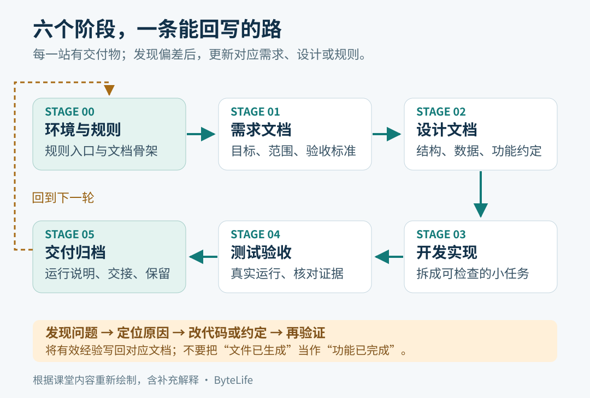
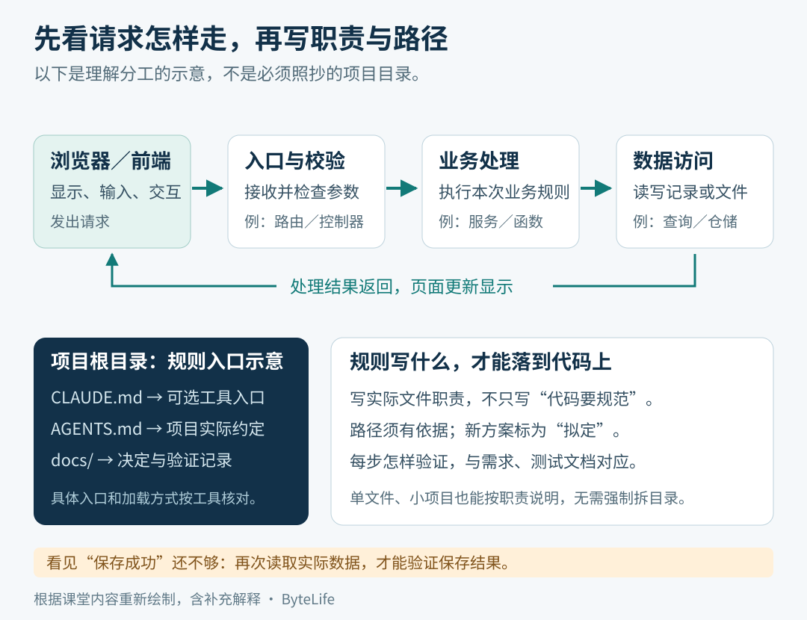
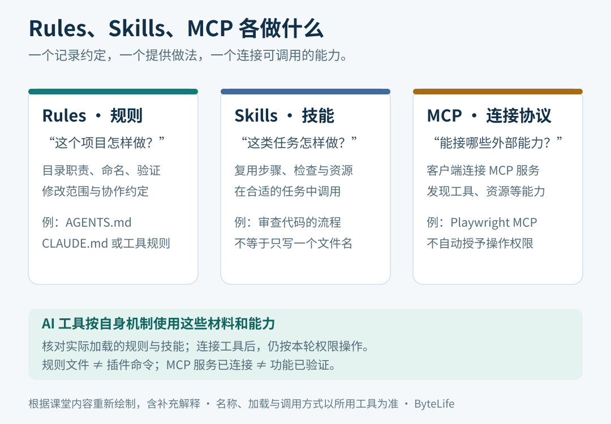

这篇整理 10 月 26 日《AI 开发规则建立》录课。视频约 **1 小时 24 分 16 秒**，主题是：让 AI 写业务代码之前，先把项目事实、开发约定和验收办法说明白。

它接着上一篇 [技术栈全景图](../content/full-stack-overview.md) 往下走。上一篇认识前端、后端、数据库分别做什么；这一篇解决“知道这些名词之后，怎样让 AI 按一个项目的实际情况工作”。

本文根据全程录音转写、全程定时画面和关键位置的高清画面整理。**课堂原有内容、整理者补充示例、官方资料校正，会分别说明。** 录屏中出现了课件和提示词文件，但本次没有拿到它们的独立原文件，不能把视频里没展示的页面也算作已经读过。

配套文件已经准备好：

- [规则模板与使用说明](https://github.com/Milo-Guo/bytelife/tree/main/examples/ai-development-rules)：可逐个复制文件，不需要先安装插件。
- [初始化提示词](https://github.com/Milo-Guo/bytelife/blob/main/examples/ai-development-rules/00-env-setup.prompt.md)：填写项目情况，再交给开发工具。
- [规则验收清单](https://github.com/Milo-Guo/bytelife/blob/main/examples/ai-development-rules/规则验收清单.md)：检查文件是否真的有用。

这些配套文件是**按课堂思路重新编写的练习材料**，不是老师原文件，也没有替读者完成真实项目的环境配置。

## 阅读导航

| 章节 | 要解决的问题 |
| --- | --- |
| [01 为什么要先定规则](#rules-01) | 只说“帮我做一个系统”为什么容易失控？ |
| [02 六阶段和经验回写](#rules-02) | 规则、需求、设计、开发、测试、交付如何衔接？ |
| [03 三类文件各管什么](#rules-03) | CLAUDE.md、AGENTS.md、提示词和 docs 有什么区别？ |
| [04 Karpathy 四原则](#rules-04) | 怎样把“别乱改”写成可以检查的要求？ |
| [05 项目问卷与技术选型](#rules-05) | 开发前要填写哪些事实？ |
| [06 目录和调用规则](#rules-06) | routers、service、CRUD、models、schemas 怎样配合？ |
| [07 从空目录做一次初始化](#rules-07) | 零基础具体打开什么、复制什么、怎么检查？ |
| [08 复查课堂实际结果](#rules-08) | 文件生成了，是否就代表项目已经完成？ |
| [09 Windows 命令与下载排错](#rules-09) | cd、盘符、Raw，以及 .md 文件为什么变成 HTML？ |
| [10 Skills、MCP、CodeGraph](#rules-10) | 它们分别解决什么，哪些并非必装？ |
| [11 跨端开发与发布问题](#rules-11) | H5、小程序、App 和 UI 框架为什么不能混用？ |
| [12 怎样验收和继续下一阶段](#rules-12) | 怎么确认规则被读取、问题被修复、文档被更新？ |
| [13 全程回看索引与材料范围](#rules-13) | 哪段讲什么，哪些结果仍未验证？ |

<a id="rules-01"></a>

## 01 为什么要先定规则

### 1.1 课堂先问了一个很常见的问题

打开 AI 工具，新建会话，然后输入：

> 我要一套进销存管理系统，帮我开发。

AI 很快就能创建目录、写页面、接数据库。问题是，这句话留下了大量空白：给谁用、用什么语言、已有代码能否修改、哪些功能先做、怎样才算完成？

如果这些问题没有说清，AI 可能自己补一套。第一天它选一种框架，第二天换一种；代码分工不一致；界面显示成功，后台却没有保存；代码改过几轮，文档还停在最初版本。

课堂强调的“先定规则”，是先把这些经常导致返工的约定写下来。例如：

| 模糊要求 | 可以检查的写法 |
| --- | --- |
| 不要乱改 | 先列相关文件，只修改这次功能涉及的代码；公开接口需要改时说明影响 |
| 项目要规范 | 沿用已存在的目录、命名和依赖；新增模块放在哪里要有依据 |
| 不要编造 | 未看到的文件标记“未确认”；计划创建的目录标记“拟定” |
| 功能要成功 | 说明输入、操作、预期结果，并实际执行能运行的验证 |
| 文档要同步 | 接口、启动方式或配置变化时，同步修改对应文档并报告位置 |

这些要求是协作约定。它们能减少遗漏，**不能保证模型百分之百遵守**；仍然需要看文件差异、运行结果和实际页面。

### 1.2 规则、需求、设计不是一件事

- **规则**：工作时遵守哪些边界。例如保留用户修改、按现有目录分工、不能把假数据冒充真实结果。
- **需求**：这个产品要做什么。例如用户提交问卷，管理员查看记录。
- **设计**：具体准备怎样实现。例如提交接口、数据表、页面和权限如何安排。

规则可以先确立，再逐步补需求和设计。也不必等所有细节都想好才开始：已知事实先写清，未知项列出来，避免偷偷把猜测写成项目事实。

**计划模式也有用。** 课堂批评的是没有项目边界就直接展开大量设计；不能据此理解成“打开计划模式就是错误”。

<a id="rules-02"></a>

## 02 六阶段和经验回写

录屏约 **06:00** 展示“六个阶段，一条回路”。下面的图按画面重新绘制。



*根据课堂内容重新绘制；每个阶段的产物用来支持下一阶段，踩过的坑再回写相关文档。*

| 阶段 | 课堂图上的重点 | 用信息收集系统理解 |
| --- | --- | --- |
| 00 环境与规则 | 三份规则文件就位 | 明确目录、技术栈、文件分工和协作约定 |
| 01 需求文档 | 十句话＋验收标准 | 谁填写、填写什么、谁能查看，怎样判断提交成功 |
| 02 设计文档 | 架构／数据／功能 | 哪些页面、接口、数据表负责这些事情 |
| 03 开发实现 | 任务卡＋七步循环 | 把“提交一份问卷”拆成小任务，逐项实现和验证 |
| 04 测试验收 | 用例＋真跑＋审计 | 正常提交、缺少必填项、重复操作、无权限访问分别怎样处理 |
| 05 交付归档 | 冻结＋部署＋交接 | 确认交付版本，说明运行环境、部署和恢复方式 |

这节课主要完成 **00 阶段**。图里提到“七步循环”，不等于本节已经逐项讲完或跑通全部开发流程。

“一条回路”尤其重要。假设开发时发现 AI 经常把后台管理页面和用户小程序混在一起，不应只在聊天里纠正一次。应该把“后台管理端做什么、用户端做什么”写回项目约定，再在下一次会话引用它。

文档也要分工：长期有效的开发习惯写进规则；某次报错的处理记录写进排错文档；接口变更更新设计或接口说明。把全部聊天记录塞进一个巨大规则文件，反而难以找到真正重要的约束。

<a id="rules-03"></a>

## 03 三类文件各管什么

### 3.1 先认识根目录、Markdown 和“空骨架”

**项目根目录**是这一个项目的最外层文件夹。例如 `get-message` 里面再放后端、后台页面、小程序和文档，而不是今天在下载文件夹改一份、明天在桌面改另一份。

**Markdown** 是纯文本写作格式，常见后缀为 `.md`。`#` 表示标题，`-` 可以表示列表。它没有“写成这个后缀就会自动执行”的效果。

**文档骨架**是先准备目录、文件和索引。里面还没有业务内容，就不能说需求、测试或部署已经完成。

### 3.2 课堂中的文件分工

约 **28:00–45:00** 展示的 `00-env-setup（定规矩）.prompt` 要求生成三类产物：

| 文件或目录 | 在这套课堂方法中的用途 | 应该放什么 |
| --- | --- | --- |
| `CLAUDE.md` | 简短的通用编码习惯或规则入口 | 先读项目、说明假设、保持简单、进行验证 |
| `AGENTS.md` | 这个项目的专属约定 | 技术栈、目录职责、命名、测试、提交与冲突处理 |
| `docs/README.md` 和阶段文档 | 文档索引及后续产物 | 需求、概要设计、详细设计、测试、部署、验收记录 |

另外，初始化 `.prompt` 文件是**给 AI 的一次任务说明**，告诉它这轮做什么、填哪些信息、产出什么。它不是所有开发工具都会自动识别的特殊文件类型。

课堂口述的“三份规则”，不能机械理解成三个固定文件名。提示词、长期规则和 `docs/` 是不同用途；六阶段也不意味着只能有六个 Markdown 文件。

### 3.3 文件放进去以后，工具是否会读？

**要看工具的加载规则。** 课堂把这些文件泛称为各类 Agent 通用规则，实际使用时需要进一步区分：

| 工具 | 常见入口 | 实际需要核对的地方 |
| --- | --- | --- |
| Codex | `AGENTS.md`、`AGENTS.override.md` | 全局指令与项目路径上的规则会组合；同目录 override 优先，越接近工作目录的项目指令可以覆盖前面的同类约定 |
| Claude Code | `CLAUDE.md`、`.claude/rules/`，支持版本中也有 `AGENTS.md` | 加载方式受版本和设置影响；多个规则文件可能一起进入上下文，冲突要主动消除 |
| Cursor | `.cursor/rules/*.mdc`，也支持 `AGENTS.md` 入口 | `.mdc` 的适用范围和自动附加方式由元数据决定；普通 `.md` 放进 rules 目录不等于生效 |
| 其他 Agent | 以该工具说明为准 | 可能需要设置入口、导入文件，或在会话里明确要求读取 |

Codex 并不是启动时遍历整个仓库的所有子目录规则；Claude Code 也不能简单套用“项目文件一定压过全局文件”的一句话结论。以上已按 **2026-10-27** 的官方说明核对。[Codex 指令文件](https://learn.chatgpt.com/docs/agent-configuration/agents-md)、[Claude Code 规则加载](https://code.claude.com/docs/en/memory)、[Cursor Rules](https://cursor.com/docs/rules)

这份配套模板用 `AGENTS.md` 集中放主要约定，`CLAUDE.md` 作为短入口。对于支持导入语法的 Claude Code，入口包含 `@AGENTS.md`；其他工具应按自己的规则读取，不能假定都理解这个语法。

**最低限度的验证方法：** 在真实项目会话里，让 AI 报告已经读取的规则路径，并复述本次任务适用的几条约定；再看它后续行为和实际文件。只回答“我知道了”不能证明加载正确。

<a id="rules-04"></a>

## 04 Karpathy 四原则怎样落地

录屏约 **15:00、21:00 和 01:17:00** 浏览了 [andrej-karpathy-skills 社区仓库](https://github.com/multica-ai/andrej-karpathy-skills)。它整理了受 Karpathy 观察启发的开发原则，**不是 Karpathy 本人发布的官方工具或官方技能包**。

不必背英文。把四条原则放回自己的项目：

| 原则 | 实际做法 | 常见反例 |
| --- | --- | --- |
| Think Before Coding，先思考 | 先读相关文件，把关键假设和待确认项说清楚 | 没看代码就声称某个类已经存在 |
| Simplicity First，简单优先 | 用能满足当前目标的最小方案，沿用现有依赖 | 一个录入页面先搭多套框架和复杂抽象 |
| Surgical Changes，精确修改 | 修登录问题就围绕登录改，保留无关代码和用户修改 | 顺便格式化全仓库、改名、替换数据库 |
| Goal-Driven Execution，以结果推进 | 先说明成功标准，执行相关验证，再按结果修正 | 代码写完就说完成，测试报错也不处理 |

这是对仓库原则的中文应用解释。原文可看 [CLAUDE.md](https://github.com/multica-ai/andrej-karpathy-skills/blob/main/CLAUDE.md)。

例如“修改问卷标题后应该立即显示新标题”，可以变成三个检查：保存接口是否成功、重新查询得到什么、刷新页面是否仍显示新值。这样，AI 的目标就比“优化一下问卷系统”明确得多。

规则也不是越多越好。课堂早期谈到大型项目规则积累了很多内容；后面初始化提示词却要求通用文件不超过 40 行。两者并不矛盾：**短入口保留稳定约定，项目细节放在适合的位置。** 40 行是该课堂模板的设计选择，不是工具的通用硬限制。

<a id="rules-05"></a>

## 05 项目问卷与技术选型

### 5.1 先把“我在做什么”写清楚

老师把初始化输入做成选择题，减少初学者不知道怎么描述的问题。核心信息包括：

| 问题 | 为什么要问 |
| --- | --- |
| 项目名和实际路径 | 确保 AI 操作的是同一份文件 |
| 新项目还是已有项目 | 新项目可以提出目录方案；老项目先读现状，不能随便重建 |
| 后端语言与框架 | 决定运行方式、目录和代码规范 |
| 数据库 | 决定数据连接、迁移和部署约束 |
| 前端形态 | 网页、小程序、手机 App 的运行和测试工具不同 |
| 开发者人数 | 决定如何协作、审查和处理合并冲突 |
| 额外约定 | 补上选项无法表达的业务边界 |

**开发者人数不等于用户量**，也不直接等于每天必须提交多少个 PR。PR 是提议合并修改的协作方式；团队人数影响协作安排，而不是一个固定的数量公式。

### 5.2 本课实际填写的例子

约 **53:00–56:00**，课堂演示的是一个信息收集项目，可整理成：

```text
项目：信息收集管理系统
状态：新项目
后端：Python / FastAPI
数据库：MySQL
浏览器端：Vue，用作后台管理
用户端：微信小程序，用作信息填写与提交
手机 App：本期不做
开发者：1 人
版本：尚未明确的版本先列为待确认
```

最有价值的补充是“**浏览器端给管理员用，小程序给普通用户用**”。只写“有网页和小程序”仍然不够，AI 可能把两边都做成同一个界面。

### 5.3 选型不能只看 AI 喜欢什么

约 **30:00** 的《技术选型指南》先看四个量：峰值并发、未来数据量、能维护代码的人数、计划维护几年。它还按规模提供档位，强调先确定语言，再考虑框架、服务治理和版本。

可以沿用这种思考顺序，但不能把课堂里的档位当作通用行业标准。总用户人数也不等于同时在线人数，技术是否合适还取决于实际功能和已有团队能力。

对于已有项目，先看 `package.json`、依赖清单、构建文件、数据库配置和当前版本。**沿用能工作的方案，通常比为了“先进”换一套技术更实际。** 对新项目，再把候选方案和需要的能力对应起来。

课堂选项出现了 MySQL、PostgreSQL、SQL Server、SQLite，以及多种后端框架。它们是候选，不是本节必须全部安装的软件；“SQLite 只适合单机小工具”等措辞也是课堂简化，不能当作其全部能力的定义。

没有确定的版本写“待确认”，不要让 AI 擅自填一个看似很精确的版本号。正式运行和交付前，再把经过验证的版本固定到配置、依赖文件和运行说明中。

<a id="rules-06"></a>

## 06 目录和调用规则：让代码各有职责

### 6.1 为什么规则文件里还要写代码分层

只写“代码清晰”太笼统。约 **36:00–45:00**，老师开始解释前端请求进入后端以后，由哪个位置接收、哪里处理业务、哪里读写数据库。

例如用户提交问卷，可以这样理解：

```text
用户在页面填写并点击提交
    ↓
前端向后端 API 发请求
    ↓
路由 / Controller：接请求、检查参数格式、调用业务功能
    ↓
Service：判断是否允许提交、组织业务步骤
    ↓
数据访问：读取或写入记录
    ↓
数据库
```

随后结果再返回前端。这是一个便于入门的分工示例，不是所有程序都必须创建五层目录。



*按课堂主线重新绘制；目录名称和请求示例包含整理者补充，真实项目以已有代码为准。*

### 6.2 同一种职责，不同框架的名字可能不同

| 职责 | Python / FastAPI 常见示例 | Java / Spring 项目常见示例 |
| --- | --- | --- |
| 对外接收请求 | `routers/` 中的路径处理函数 | Controller |
| 业务判断和流程 | `services/` | Service |
| 数据读写 | `crud/`、repository 或项目已有的数据访问模块 | Repository、Mapper、DAO 等 |
| 数据表的映射 | `models/` 中的 ORM 模型 | Entity 等 |
| 输入输出数据格式 | `schemas/` 中的数据模型 | DTO、请求类、响应类等 |

**ORM** 可以理解成用程序中的对象描述和操作数据库记录。**Schema** 在这里描述接口接收、返回什么数据。**DTO** 是在不同层之间传递数据的对象。

它们不是所有框架都统一规定的文件夹。FastAPI 不会因为没有 `services` 目录就不能运行；团队为了分工可以采用这样的结构。老项目已有 `api`，也不能只因为示例写 `routers` 就全部改名。

还要校正一个容易听混的地方：**一张表不必只对应一种接口数据模型。** 例如用户表包含密码散列，公开响应不能把它返回；新增、修改、展示用户也可能分别需要不同字段。FastAPI 官方教程同样使用多个模型来区分输入、表记录和输出。[FastAPI 多数据模型示例](https://fastapi.tiangolo.com/tutorial/sql-databases/#update-the-app-with-multiple-models)

### 6.3 事务：一起成功或一起撤销的是哪些操作

课堂用了转账的例子解释：多个相关写入不能只成功一半。可以先用同一个数据库中的两条记录理解：

```text
A 余额减 500
B 余额加 500
两步都成功 → 提交
其中一步失败 → 回滚本次事务里的数据库修改
```

这里有两个需要补充的边界：

1. **单表操作同样可能需要事务。** 事务不是“至少操作三张表才有”的功能，边界应按业务一致性要求确定。[SQLAlchemy Session 与事务](https://docs.sqlalchemy.org/en/20/orm/session_basics.html#auto-begin)
2. **数据库回滚不会自动撤销外部银行 API。** 调用第三方系统、跨数据库或跨服务的操作，要另外设计状态、重试、幂等或补偿办法；本课的简化例子不等于完整的支付实现。

所以，规则里可以写“需要一致性的多步写入应明确事务边界”，不应粗暴写“所有 service 函数都加事务”并认为问题解决。

### 6.4 命名和小项目也要对号入座

Python 示例常用类名 `PascalCase`，函数和变量 `snake_case`；其他语言应沿用自己的习惯。“Controller 数量等于业务模块数量”“超过 300 行必须拆分”都可以作为某个项目的参考约定，不能当作软件天然必须满足的等式或阈值。

很小的脚本可以按功能分文件；已有清晰分层的项目按现有结构工作。目标是让人和 AI 找得到职责，避免为了规则本身增加维护负担。

<a id="rules-07"></a>

## 07 从空目录做一次规则初始化

下面是**整理者补充的练习路线**。它用普通文件和对话实现，不依赖课堂中的项目管理插件。

### 第一步：准备一个独立练习目录

打开 **文件资源管理器**，进入自己的“文档”，新建 `ai-rule-practice` 文件夹。若已有同名项目，换一个新名称，先保留原来的内容。

打开 **VS Code → File → Open Folder**，意思是“文件 → 打开文件夹”，选中刚才的练习目录。左边 Explorer 显示的最外层文件夹应当就是它。

也可以在 PowerShell 中进入已创建的文件夹。下面假设“文档”仍在 Windows 默认位置；若它被重定向到 OneDrive 或其他磁盘，请先从文件资源管理器地址栏复制实际路径，替换第一行的路径：

```powershell
Set-Location -LiteralPath "$env:USERPROFILE\Documents\ai-rule-practice"
Get-Location
Get-ChildItem -Force
```

第一条切换目录；第二条应显示这个练习文件夹；第三条列出其内容。提示找不到路径，先回文件资源管理器确认名称，不要在错误目录继续操作。

### 第二步：先选一种方式，不要两套内容互相覆盖

**方式 A：让 AI 根据项目生成。** VS Code 本身只是编辑器，还需要使用已经安装、登录且能操作本地项目文件的 AI 编程工具。在那个工具里打开同一个练习目录，确认其任务工作目录正确，再打开 [初始化提示词](https://github.com/Milo-Guo/bytelife/blob/main/examples/ai-development-rules/00-env-setup.prompt.md)，填写项目名、路径、状态、技术栈、各端职责、本轮模式和允许创建的文件，将完整内容发送到该项目的聊天输入框。

如果使用的只是不能访问本地文件的普通聊天页面，就让它输出候选文件内容，再由自己在 VS Code 中新建、粘贴并保存；不能把聊天回答当作文件已经落到电脑上。

**方式 B：先手动放模板。** 打开 [starter 目录](https://github.com/Milo-Guo/bytelife/tree/main/examples/ai-development-rules/starter)，按原有层级复制 `CLAUDE.md`、`AGENTS.md` 和 `docs`。把待填写位置改成自己的情况，再要求 AI 读取并核对。GitHub 文件页的 **Raw** 按钮显示纯文本，可以从那里复制。

想先理解文件结构，可以先用方式 B；已有真实项目，更应先扫描现状，再决定怎样合并规则。**不要把模板整个覆盖到已有规则上。**

课堂把阶段任务封装成了自己的入口，普通文件名并不会自动注册 `/00-env-setup` 命令。如果工具没有这个命令，直接复制完整提示词即可。

### 第三步：这一轮只做规则和文档骨架

可以补一句范围明确的要求：

```text
这是新建的练习目录。先确认实际内容，再根据我填的信息建立规则。
把已存在的事实、拟采用的约定、尚未确认的事项分开写。
本轮只生成规则文件和 docs 文档骨架，不写业务代码，不安装依赖。
已有同名文件先阅读并合并，不覆盖现有约定。
完成后列出文件路径、各自用途、行数和未完成事项。
```

这轮成功的标志是：目标文件真实存在，内容和自己的项目一致，业务功能仍没有开始实现。

### 第四步：逐个打开文件看

至少检查这些问题：

- `CLAUDE.md` 是可读规则文本，还是误保存的网页？入口是否过长，是否与项目规则重复矛盾？
- `AGENTS.md` 写的语言、框架、数据库、前端职责，是不是自己填的？
- 里面的目录是已经存在，还是未来准备创建？有没有明确区分？
- 测试命令有没有项目依据？找不到的命令是否标为待确认？
- `docs/README.md` 链接是否能打开？文档是否还是空骨架？
- 这一轮有没有夹带业务代码、安装依赖、修改配置或擅自提交？

配套 starter 中的阶段文档带有“待填写”提示，方便练习，**与课堂中实际生成的 0 KB 空文件不同**。带有标题和待办项，也不代表对应工作已完成。

### 第五步：新会话确认读取后，再进入需求阶段

课堂建议每个阶段新开会话，减少前一个任务的杂乱信息。这可以采用，但新会话必须重新给出项目位置、阶段和必要文档，不能指望它记得全部聊天。

例如下一轮输入：

```text
继续这个信息收集项目。先读取适用于当前目录的规则和 docs/README.md，
报告读取路径及项目现状。当前只整理需求，不开发业务代码。
先根据已有材料写明用户、功能范围、暂不做的内容和可检查的验收标准。
未知项列出待确认，不把假设写成确定需求。
```

这里的“先不开发”是本阶段练习范围。后续得到开发任务时，再按明确目标推进，不能让阶段提示词变成永久禁止开发。

<a id="rules-08"></a>

## 08 复查课堂实际结果：生成报告也要验证

### 8.1 课堂报告列出了什么

约 **01:07–01:08**，Agent 执行初始化后，报告中显示：

| 产物 | 报告行数 | 报告用途 |
| --- | ---: | --- |
| `CLAUDE.md` | 34 行 | 通用编码习惯 |
| `AGENTS.md` | 91 行 | 项目规则、分层、命名等 |
| `docs/README.md` | 12 行 | 六阶段文档索引 |
| 六份阶段文档 | 0 行 | 只建立骨架 |

报告还称没有安装依赖、修改配置、初始化 Git 或改 `.gitignore`。这些是**画面中的报告内容**，不是本文另行访问老师电脑得到的文件审计结果。

### 8.2 更值得注意的是它承认了什么

报告随后说明：目录是空的，连 Git 都没有初始化。因此 `backend/app`、`admin/src`、`miniprogram` 等只是针对新项目拟定的目录约定，不是扫描现有代码得到的事实。版本号没有确定，六个文档的具体名称也由 AI 自定。

这正好说明初始化时为什么要区分三种状态：

| 状态 | 应该怎样写 |
| --- | --- |
| 已存在 | 已看到某个文件或配置，并给出依据 |
| 拟定 | 尚未创建，准备采用这个目录或方案 |
| 未确认 | 没有材料，不能判断 |

“我会创建这样的结构”和“你的项目本来就是这样的结构”是不同的陈述。规则应帮助 AI 保持这个区别。

### 8.3 六份文档，和六个阶段不是一一对应

约 **01:23**，资源管理器能看到：

```text
docs/
├─ README.md
├─ 01-需求文档.md
├─ 02-概要设计文档.md
├─ 03-详细设计文档.md
├─ 04-测试计划.md
├─ 05-部署手册.md
└─ 06-验收记录.md
```

其中六份阶段文档显示为 0 KB。设计阶段被拆成概要设计与详细设计，因此“阶段编号”和“文件编号”不必一致。

老师在结尾也提到，部分文件可能由自己的项目管理插件建立。**不能保证学员只复制某一句指令，就一定自动得到完全相同的文件。** 本文提供明确的文件模板，是为了让这一步可以检查和复现。

<a id="rules-09"></a>

## 09 Windows 命令与下载排错

### 9.1 CMD 和 PowerShell 先分清

约 **01:18–01:20**，课堂解释了盘符、`cd` 和 Tab 补全。

在 **CMD** 中，下面是一个路径示例，运行前换成自己实际存在的目录：

```bat
cd /d "D:\claude-demo\get-message"
dir
```

`cd` 切换文件夹，`/d` 允许一起切换盘符，`dir` 列出文件。也可以先输入 `D:` 切到 D 盘，再 `cd` 到目标目录。

在 **PowerShell** 中可以写：

```powershell
Set-Location -LiteralPath 'D:\claude-demo\get-message'
Get-Location
Get-ChildItem -Force
```

这个 D 盘目录来自课堂示例，不代表读者电脑必定存在。路径带空格时保留引号；Tab 可以补全目录名，但回车前仍要看补全结果。

### 9.2 名字叫 CLAUDE.md，内容却可能是网页

约 **01:22**，录屏中打开的 `CLAUDE.md` 开头出现 `<!DOCTYPE html>`，后面有 GitHub 页面资源的 `<link>`、`<script>` 等内容。这是**保存了 GitHub 文件浏览网页**，没有正确拿到 Markdown 原文。

修改后缀不能把网页转换成规则。可以这样处理：

1. 用浏览器打开仓库中的具体文件。
2. 点击 **Raw**，确认页面只显示正文。
3. 复制正文，或使用原始文件下载按钮。
4. 先保存成一个临时名称并打开检查。
5. 确认是规则原文，再与已有文件比较、合并。

若用 PowerShell 下载，使用明确的命令和 Raw 地址，避免假设当前 `wget` 就是某个特定下载程序。下面的写法会保存到新名称，运行前先确认该临时文件尚不存在：

```powershell
$rawUrl = 'https://raw.githubusercontent.com/multica-ai/andrej-karpathy-skills/refs/heads/main/CLAUDE.md'
if (Test-Path -LiteralPath '.\CLAUDE.download.md') {
    throw '临时文件已存在，请先检查它或换一个名称。'
}
Invoke-WebRequest -Uri $rawUrl -OutFile '.\CLAUDE.download.md'
Get-Content -LiteralPath '.\CLAUDE.download.md' -TotalCount 12
```

成功时应看到规则正文，而不是完整 HTML 网页，也不是登录或错误页面。这里取的是社区仓库当前主分支；原文以后可能更新，项目应保留自己采用的内容和来源。配套 starter 是另一份独立编写的简短模板，**两份文件按项目需要选择或合并，不要反复相互覆盖**。

### 9.3 课堂后面改用下载按钮，不代表所有细节都验证了

老师发现下载内容不对后，转而使用文件下载入口。画面能证明这个排错过程，但没有完整展示最终规则文件逐项检查。复盘时应保留“拿到原文后还要检查”的步骤。

<a id="rules-10"></a>

## 10 Skills、MCP、CodeGraph：不要混成一种东西

### 10.1 可以先按三个问题理解



*根据课堂内容重新绘制，含补充解释。这是帮助入门的分工，不是协议之间严格互斥的分类。*

| 名称 | 先用一句话理解 | 例子 |
| --- | --- | --- |
| Rules，规则 | 这个项目工作时遵守什么 | 按现有目录开发；未运行的测试不能说通过 |
| Skills，技能 | 处理一类任务时怎样做 | 接到文档任务后，按步骤读取、整理、检查 |
| MCP | AI 应用怎样连接外部工具和数据 | 读取外部资料、操作受支持的工具、进行浏览器自动化 |

**提示词**是这次任务的具体要求；**上下文**是模型当前获得的信息，例如规则、会话、读到的代码和工具结果；**工作流**则安排这些步骤如何衔接。这几项解释是整理者为便于理解补充的术语说明。

Skill 不只是一个能点击的按钮。以 Claude Code 为例，技能可能按相关性自动调用，也可能通过 `/名称` 手动调用；正文通常在使用时加载。自定义 commands 已与 skills 机制整合，旧命令目录仍有兼容方式。[Claude Code Skills 官方说明](https://code.claude.com/docs/en/skills)

MCP 是连接 AI 应用与工具、数据等能力的开放标准，本身也可以提供提示模板等内容。因此“规则管约束、技能管流程、MCP 接工具”是入门理解，不是严格定义。[MCP 官方介绍](https://modelcontextprotocol.io/docs/getting-started/intro)

### 10.2 CodeGraph 想解决的是代码关系查找

约 **17:00–27:00**，老师介绍代码图谱：索引文件、类、函数和调用关系，让 Agent 在较大的项目里更快找到相关位置。

可以把它理解成“代码之间的关系地图”。它提供查找线索；规则文件说明工作约定；设计文档解释为什么这样做。三者可以配合，不能相互完全替代。

还要注意：

- 新建空目录里没有多少代码关系可以索引，先完成当前阶段即可。
- 代码新增或重构以后，索引也需要更新；具体命令和支持范围看实际工具。
- 静态索引不一定捕获所有动态调用、外部服务或运行时行为，最终还要看源码与运行结果。
- 文档不同步不能只归因于没装图谱工具；任务要求、更新流程和实际检查同样重要。

本课口述叫它 CodeGraph，并提到 npm 安装和图谱数据库，但录课材料不足以可靠复原完整软件包坐标及版本，本文不拼接一个猜测的安装命令。初学者可以先用文件搜索与现有工具完成规则练习，等确认具体项目来源后再按其文档安装。

### 10.3 Hermes、项目管理插件和 3D 工作区

约 **47:00–53:00**，老师在课堂使用的 Agent 工作台里演示了新建项目、项目管理、提示词优化和工作区。画面能确认 `HERMES AGENT`，老师也明确说部分插件仍是半成品。

这些演示说明工作流可以封装成工具，但**不是完成本课三类文件的前提**。3D 小人和工作状态展示也不代表代码正确。用自己已经能访问项目的开发工具，照样可以完成这份练习。

老师还提醒多个 Agent 相互调用会增加成本和管理难度。具体用几个应按任务安排；“不超过三个”是其课堂经验，不是技术上限。提示词优化若缺少项目背景，也可能只是改写句子，并没有改善项目适配。

### 10.4 Playwright MCP 和微信开发者工具

约 **01:07–01:16、01:20–01:22**，课堂解释外部工具连接与自动化测试，并讨论 Playwright MCP。

这里要把三个层次分清：

1. Playwright 是浏览器自动化工具。
2. Playwright MCP 把相应能力接给支持 MCP 的客户端。
3. 在真实项目中还要启动服务、打开正确页面、执行具体用例，并读取结果。

“能控制浏览器”不等于“所有业务已经验收”。填表后还应检查响应、刷新后的数据和权限等结果。Playwright MCP 的具体接入方式以 [微软维护的项目说明](https://github.com/microsoft/playwright-mcp) 为准。

微信小程序需要适合小程序的开发和测试工具，不能直接把它当普通 H5 页面。老师展示了 **微信开发者工具 → 设置 → 安全设置 → 服务端口** 等连接相关设置；是否需要令牌、怎样配对，要按所用版本和连接工具实际提示处理。

这段录屏中，开发者工具明确出现 **“在项目根目录未找到 app.json”**，模拟器启动失败，后面也没有看到修复成功的画面。先确认导入目录和小程序配置是否完整，再谈自动化连接。打开服务端口本身不会补齐缺失的项目文件。

口头讨论中还举了让工具调用另一个模型识图、连接建模或剪辑软件的例子。这说明不同能力可能通过工具协作，不能据此推导成“任何软件天然支持 MCP”或“调用了识图工具，原模型就变成原生多模态”。录屏未演示跑通的连接，不列为已经完成的操作。

<a id="rules-11"></a>

## 11 跨端开发与发布：课堂延伸怎样理解

约 **56:00–01:06**，课堂从前端选型延伸到小程序、H5、App、UI 框架、真机测试和上架。这部分与“项目问卷为什么要写清楚前端形态”有关，但不应作为一份已经验证的跨端部署教程。

### 11.1 先区分运行在哪里

| 形态 | 用户主要在哪里使用 | 初始化时应说清楚 |
| --- | --- | --- |
| 网页／H5 | 浏览器或应用内浏览器 | 公开页面还是后台，是否需要登录和微信身份 |
| 微信小程序 | 微信小程序运行环境 | 页面、配置、微信能力和开发者工具 |
| 手机 App | Android、iOS 等系统 | 目标系统、原生能力、设备测试与发布方式 |

**Vue、React 这类界面技术，UI 组件库，以及跨端框架不是同一层概念。** UI 组件库提供按钮、表单、表格等；它不能单独把一个 Web 项目变成可在所有平台运行的 App。

### 11.2 对课堂里几个名字做边界校正

- **uni-app** 面向多个端提供编译和运行支持，但不同端的 API、组件和能力有差异；已有浏览器 DOM 代码或 Web 组件不能假设全部直接兼容。[uni-app 跨端说明](https://uniapp.dcloud.net.cn/tutorial/index.html)
- **React Native** 使用面向 Android、iOS 等平台的原生视图组件，不是把任意 H5 页面原样封装成原生应用。[React Native 官方组件说明](https://reactnative.dev/docs/intro-react-native-components)
- **Flutter** 有自己的框架、运行方式和支持平台；支持移动端或 Web，不等于官方直接支持任意小程序目标。[Flutter 支持平台](https://docs.flutter.dev/reference/supported-platforms)
- **Element UI 等 UI 库** 的适用范围取决于其框架、版本和目标环境。项目需要某个端时，先核对兼容性，再选择组件。

课堂提到的苹果上架难度、历史代办价格、认证费用、用户占比，属于经验交流或待核实信息。它们会因地区、账号、主体与时间变化，本篇不把那些数字当成当前报价或确定结论。

**真机测试值得保留为明确需求。** 模拟器能帮助开发，但摄像头、网络、登录、支付和系统权限等行为仍要在目标设备验证。

### 11.3 测试分发、正式发布和微信网页授权

TestFlight 用于 Apple 应用的 beta 测试，有构建有效期、测试者范围和相应审核安排，不能直接当成无限期面向所有正式用户的发布方式。[Apple TestFlight 官方说明](https://developer.apple.com/help/app-store-connect/test-a-beta-version/testflight-overview/)

H5 是网页形态，**普通网页展示不等于必须接微信网页授权**。业务若需要微信用户身份或信息，再核对相应场景的权限和授权流程。这个区分是根据微信官方将网页授权用于获取用户身份及资料的说明作出的判断。[微信网页授权](https://developers.weixin.qq.com/doc/service/guide/h5/auth.html)

在需求和交付文档里，应提前写清：目标平台、发布主体、账号条件、需要的权限、谁负责审核材料，以及什么结果才算验收。不能仅凭页面在自己电脑上打开，就承诺所有平台都能正式发布。

<a id="rules-12"></a>

## 12 怎样验收规则，并继续下一阶段

### 12.1 一次初始化，至少验证四件事

| 检查 | 怎样做 | 成功时看到什么 |
| --- | --- | --- |
| 文件正确 | 在编辑器打开每个产物，检查首行、目录和内容 | 是项目约定，不是 HTML、空泛套话或别的项目内容 |
| 事实正确 | 对照实际目录和配置 | 已有、拟定、未确认分开写；版本和命令有依据 |
| 范围正确 | 查看文件差异与 Agent 操作记录 | 这一轮只产生授权的规则和文档改动 |
| 读取正确 | 在当前工具中核对加载路径，并发起一个小任务 | 行为与关键规则一致，能给出实际验证结果 |

Git 项目可在项目根目录查看：

```powershell
git status --short
git diff
git diff --stat
```

这些命令只检查已存在的 Git 仓库，不能在空目录报“不是仓库”后就谎称检查通过；也不要为了消除报错而擅自初始化 Git。还没有 Git 的练习目录，先通过文件列表与编辑器检查，版本管理另作下一步任务。

未跟踪的新文件通常不会出现在普通 `git diff` 正文中，要结合 `git status` 逐个打开核对。

### 12.2 做一个小任务，验证规则是否有实际作用

刚放好规则以后，不必马上让 AI 做整套系统。先给一项小任务：

```text
先读取项目规则和已有文档，告诉我当前项目属于新项目还是已有项目。
列出已经存在的目录、拟定目录和未确认事项，给出依据。
这次只补全需求文档中的“用户与范围”，不创建业务代码。
完成后列出实际修改文件和检查结果。
```

如果目录明明为空，AI 却说“现有后端已经采用 FastAPI 并成功连接数据库”，就需要纠正事实来源；如果它把后台管理端写成普通用户填写端，就需要补清职责。

不要只把问题留在聊天里。把有效的约定写回规则，把具体需求写回需求文档，再验证一次。

### 12.3 到开发阶段，验收要落到具体操作

例如以后实现信息提交功能，可以把验收写成：

1. 填写合法内容并提交，接口返回成功。
2. 管理端重新查询，能看到新记录。
3. 刷新页面或重新启动服务后，数据仍然存在。
4. 缺少必填项时，系统给出明确错误，不保存不完整记录。
5. 普通用户不能直接调用管理员的查询或删除功能。

这些是补充的验收例子，不是本节录像已经跑通的功能。

也不要把“禁 mock”理解成禁止所有测试替身。真正要防止的是**把模拟数据、硬编码成功提示或未执行的测试冒充实际业务结果**。单元测试可以合理使用 mock；端到端验收必须说明真实覆盖了什么、哪些依赖被替代。

### 12.4 文档怎么持续更新

每次改动结束，用四个问题收尾：

- 需求或功能范围变了吗？更新需求文档。
- 接口、数据结构、调用关系变了吗？更新对应设计说明。
- 启动命令、配置、部署方式变了吗？更新运行或部署文档。
- 这次发现的坑是否会再发生？把可复用的约定写回合适的位置。

每次不必重写全部文档。指出相关段落，做局部更新，并报告依据。这样才能避免“代码已经 3.0，文档还是 1.0”。

<a id="rules-13"></a>

## 13 全程回看索引与材料范围

时间按原视频起点计算，供定位回看，段落边界为约数。

| 原视频时间 | 内容与回看重点 |
| --- | --- |
| 00:00–06:00 | 开课背景，学员怎样使用 AI，为什么先定规则 |
| 06:00–09:00 | 六阶段图、规则文件、项目根目录 |
| 09:00–15:00 | 开发工具与安装交流，准备项目目录和规则来源；网络服务和私人聊天不作为本篇学习步骤 |
| 15:00–18:00 | 社区规则仓库、CLAUDE.md 与项目规则，文档不同步问题 |
| 18:00–27:00 | CodeGraph、调用关系、索引更新、规则作用域问答 |
| 27:00–30:00 | 初始化 prompt、角色、新旧项目、项目问卷 |
| 30:00–33:00 | 技术选型指南，数据库、前端形态和开发者人数 |
| 33:00–36:00 | 团队协作与冲突、三类产物、空文档骨架 |
| 36:00–39:00 | 路由、Controller、前端调用服务端 API |
| 39:00–45:00 | Service、事务、数据访问、模型、schema、命名、约束与输出 |
| 45:00–47:00 | 回顾项目表单，准备实际新建项目 |
| 47:00–53:00 | Agent 工作台、项目管理插件、提示词优化和工作区演示 |
| 53:00–56:00 | 信息收集系统选型，后台管理端与用户小程序的职责 |
| 56:00–01:06:00 | 小程序、H5、App、跨端框架、上架、测试和 UI 组件库讨论 |
| 01:06:00–01:09:00 | 提交初始化提示词，读取报告，讨论 Skills 与 MCP |
| 01:09:00–01:16:00 | Playwright、微信开发者工具、外部工具连接；可见缺 app.json 的失败画面 |
| 01:16:00–01:18:00 | 检查规则、重新查看社区规则来源 |
| 01:18:00–01:20:00 | CMD 切盘符、cd、Tab 补全与文件下载 |
| 01:20:00–01:23:00 | Playwright MCP 说明；发现 CLAUDE.md 保存成 HTML，再改用文件下载入口 |
| 01:23:00–01:24:16 | 检查 docs 空文件，说明插件可能的影响，分发提示词后结束 |

### 这篇笔记覆盖了什么

完整音频已处理；全程按每分钟抽取画面并补看结尾，共 86 张定时画面，另对关键位置作高清核对。机器转写用于定位内容，术语、文件名和关键结果结合画面及官方资料校正；这不等于逐帧检查每次鼠标操作。

实际拿到的材料只有本次压缩包中的录屏。画面中的课件名为《02AI辅助开发流程规范.pptx》，可见总页数 25，但本文只按录像展示的部分整理；初始化 prompt 和《技术选型指南》也未拿到独立原文件。

为便于学习，本文补充了术语解释、示意图、操作路线、规则模板和验收例子。本文没有复刻老师的私有插件，没有声称安装了 CodeGraph 或 MCP，没有声称在老师的项目中跑通数据库、小程序及整套业务。

发布的材料是课程整理和独立编写的练习文件；原录屏、会议页、私人聊天及个人项目上下文不随文章上传。
