这节课接着[上一课的 TDD、PM 派单与三层验收](../content/tdd-agent-delivery.md)，继续做八年级会考刷题系统。项目已经有需求、接口、数据库和功能设计。课堂从审设计到启动验收，逐步发现筛选条件不够细、页面和接口没接通、测试互相清数据、两个会话同时修改同一个文件等问题，任务卡显示完成也未必真能交付。

这一课适合放在“准备开始开发”和“第一批功能验收”之间反复看。前半段教你审设计，后半段用现场排错说明：**一个功能交付，需要对应的页面、接口、数据和验收证据一起成立。**

录屏来自 `261108.zip` 中的 `meeting_01.mp4`，封面日期为 **2026 年 11 月 8 日**，全长约 **2 小时 29 分 27 秒**。本文时间码从视频开头计算。下面先复盘课堂，再用“设备借用管理系统”说明怎样把这套方法换到自己的工程里。

- [下载配套资料包](https://raw.githubusercontent.com/Milo-Guo/bytelife/main/downloads/ai-integration-acceptance.zip)：项目检查表、分层规则、设计审查、派单、验收、缺陷卡、并发暂停与恢复、数据导入变更和操作手册。
- [在线查看配套文件](https://github.com/Milo-Guo/bytelife/tree/main/examples/ai-integration-acceptance)。这些是重新编写的学习模板，不是老师的原始项目、私有 PM 工具或 skill 安装包。
- 要直接跟做，读[第 23 节的准备步骤](#ia-23)和[第 24 节的发送顺序](#ia-24)；找原片位置，使用[第 26 节时间轴](#ia-26)。

<a id="ia-01"></a>

## 01 先说清这节课做到哪一步

本课的第一阶段范围是后端骨架、系统基础信息管理和登录安全，以及相关客户端骨架。题库、答题、错题本等完整业务仍是后续工作。后面新增的 F59 真题导入又单独引入了一批设计和开发任务。

因此，课堂里的几个“通过”要分开理解：

| 画面中的结果 | 实际说明什么 |
| --- | --- |
| 19 处控件标注、39 项 PASS | 两份功能设计文档的检查结果 |
| 文档门禁从 39 项变为 45 项 | 增加了跨端覆盖等文档约束 |
| 328 passed / 0 failed | 当时那一版、那次串行运行的后端测试结果 |
| 36 passed / 4 failed / 2 skipped | 第一阶段管理端表单验收仍未全过 |
| 任务卡 Done 或页面能登录 | 仍需检查实际产物、业务链路和独立验收 |

它们都不能单独证明整个系统已完成。课末仍能看到运行和受阻的卡，老师也让大家课后继续跑。本课的价值在于这些问题怎样被找到、记录和处理。

文中的 AC 是验收条件（Acceptance Criteria），E2E 是端到端测试；worker 指实际执行某张任务卡的进程或执行者。一个看板任务可能对应多个子任务，检查状态时要分清层级。

<a id="ia-02"></a>

## 02 先沿着一次请求看懂分层

开场老师用订单、产品和库存画数据流：用户在 UI 输入条件，接口接收请求，业务层决定怎样处理，数据访问层读写数据库，最后把结果返回给页面。Web 管理端和小程序可以调用同一套后端服务。

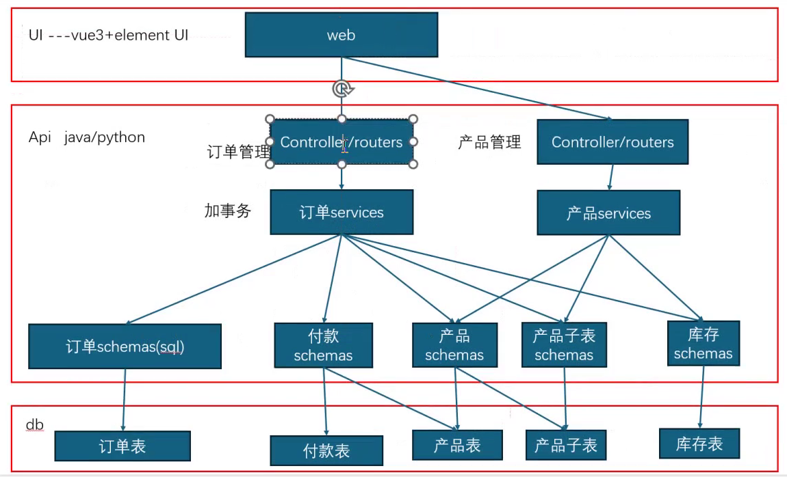

*02:04。课堂用 UI、接口、服务和数据库解释一次请求经过的层次。图中的 schemas/sql 是教学简写，正式代码应按下表区分职责。*

| 层或结构 | 负责的事 | 不宜混进来的事 |
| --- | --- | --- |
| UI 页面 | 输入、展示、交互、错误提示 | 直接连接生产数据库、代替服务端授权 |
| Router / Controller | HTTP 入口、参数解析、调用业务用例、组织响应 | 堆积整段业务流程和复杂数据库操作 |
| Service | 业务判断、多步骤编排、事务协调 | 操作页面按钮、依赖浏览器 DOM |
| CRUD / Repository | 按接口执行数据库读写 | 擅自决定完整业务流程和提交时机 |
| ORM Model | 表与对象的映射 | 接收所有外部输入、不加区分地输出所有列 |
| Schema / DTO | 请求与响应的数据结构、类型和约束 | 被当作执行 SQL 的数据访问层 |

03:31 后打开的 `AGENTS.md` 把 Routers、Services、CRUD、Models、Schemas 的职责和禁止项列了出来。审核时要同时看这两列，不能把“禁止做什么”读成“应该做什么”。

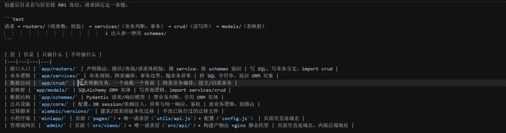

*10:59。分层约定要落到具体职责与依赖方向，只有目录名还不够。*

目录不必和课堂逐字相同。已有 Spring Boot 项目可能使用 Controller、Service、Repository；小脚本也不一定要新建五套目录。先认清当前工程的层次，再补缺失的约束。

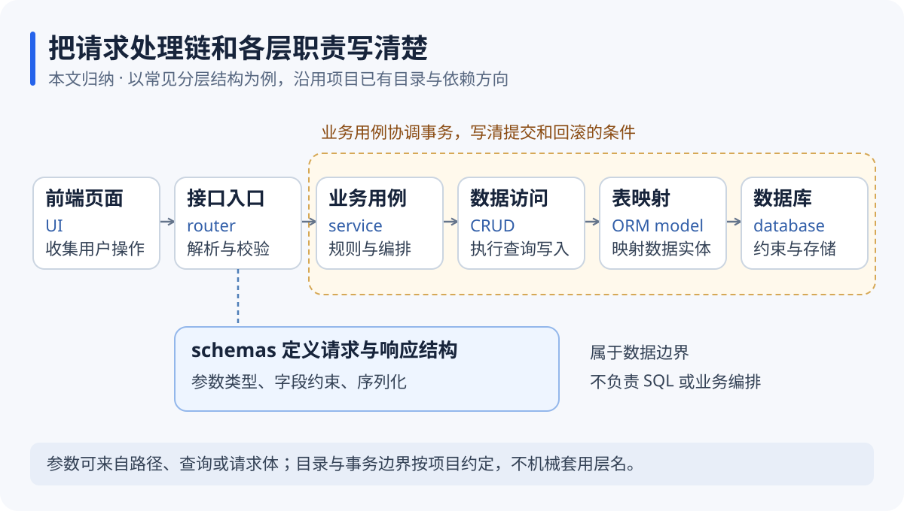

*整理图：Schemas/DTO 描述边界数据，业务用例协调事务。图中的命名是一种常见安排，沿用自己项目已有约定即可。*

<a id="ia-03"></a>

## 03 事务、对象参数和双重校验各解决什么问题

约 12:00，老师把事务和对象参数补进功能设计提示词。可以把这两条拆成更准确的工程要求。

**事务先看业务是否需要一起成功。** 例如借出设备时，同时创建借用单并把设备从“可借”改成“借出”。如果只做成功其中一步，数据就不一致。这类操作需要明确共同提交和失败回滚的边界；仅仅关联查询两张表，不等于必须额外包一套业务事务。

SQLAlchemy 的事务上下文可以在正常结束时提交、发生异常时回滚；具体写法还要配合项目现有 Session 生命周期，避免在已经开启事务的上下文中机械嵌套。参见[官方事务说明](https://docs.sqlalchemy.org/en/20/orm/session_transaction.html)。外部消息、对象存储和第三方接口也不会因为被放进同一个 Python 函数，就自动获得数据库事务的原子性。

**对象参数便于统一描述，不能代替字段校验。** 本课倾向于让 Router 入参使用对象，但这是团队约定。FastAPI 本身支持标量路径参数、查询参数和请求体模型；一组相关查询条件也可以用 Pydantic 模型统一声明。参见[请求体与路径、查询参数](https://fastapi.tiangolo.com/tutorial/body/)及[查询参数模型](https://fastapi.tiangolo.com/tutorial/query-param-models/)。必填、可空、默认值和范围都要单独写清楚。

**前后端校验各有作用。** 前端帮助用户及时修正输入，后端决定请求能不能执行。即使下拉框只显示两个合法科目，接口仍要校验科目值、角色权限和数据归属，不能因为“页面选不了别的”就省略服务端检查。

配套 `02分层与事务规则补充.md` 提供可合并的条目。先核对现有规则，再追加适合自己的部分。

<a id="ia-04"></a>

## 04 用教材维护练习审一份功能设计

14:46 开始看 F04 教材维护。文档已经写了 `/textbooks` 页面、管理权限、默认分页、科目筛选、新增、修改、启用和停用。看上去很完整，老师仍逐项追问：只有科目够不够，年级和教材版本要不要筛，列表究竟显示哪些字段。

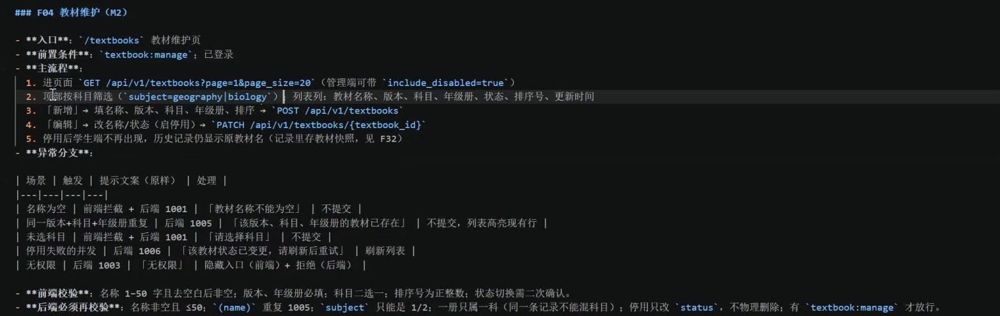

*17:46。这里是在审核功能规格，还没有实际点页面操作。*

可以按一个使用过程检查：先找到教材，再打开详情，修改信息，保存后回列表，最后检查学生端是否受到影响。

| 检查位置 | 应当能回答的问题 |
| --- | --- |
| 入口与权限 | 谁能进入，直接访问地址是否仍校验权限 |
| 查询区 | 按什么找，使用什么控件，默认条件是什么 |
| 列表 | 返回哪些列，空结果怎样显示，分页和排序怎样处理 |
| 新增与修改 | 必填项、合法值、重复规则、编辑回填分别是什么 |
| 启用与停用 | 学生端是否隐藏，已产生的历史数据怎样保留 |
| 异常 | 重名、缺科目、并发修改、无权限、保存失败怎样反馈 |

不熟悉结构化文档也能提出修改，只要说得具体。例如：“教材列表增加年级筛选，默认全部；新增时年级必选；列表增加版本与年级两列。”然后让 Agent 回写规格，并核对接口和数据结构是否支持。

18:46 后还快速检查教材导入、章节和知识点关联、处理状态轮询与失败列表。导入功能不能只设计一个上传按钮，还要能告诉用户哪些行失败、为什么失败、怎样重试。

<a id="ia-05"></a>

## 05 题目维护还要审核历史快照和异常输入

21:00 左右的 F08 题目维护，把设计细节继续推进了一层。新增题目要选教材、联动章节，再填写题型、题干、选项、答案和解析。主观题还需要参考答案和评分要点。

审核不能停在“新增、编辑、删除”几个动作上。至少还要检查：单选题有几个正确答案，选项数量是否满足业务规则，主观题是否错误地被要求填写客观题选项，缺少教材或章节能否提交，查重结果怎样处理。

课堂还有一个容易漏掉的条件：**修改题干或答案，不应改变已经判分的历史试卷。** 画面中的方案使用 `attempt_questions` 快照。它保存的是当时作答依据，当前题库后来怎样修改，历史记录仍能说明当时看到了什么、按什么评分。

这也适用于其他系统：订单要保留成交时价格，借用单可能要保留当时设备名称和审批规则。是否需要快照，要从业务追溯要求推导，不能每次都实时读取已经变化的主数据。

27 分钟后还浏览了抓题、批量启停用、查重、组卷和时间分配。它们和题目维护有关，但应分别有输入、处理结果和验收条件，不能用“题库功能完成”一句话代替。

<a id="ia-06"></a>

## 06 筛选条件要写到控件和搜索方式

28:26 起，课堂把反复发现的问题写回 `02c-feature` 提示词：业务分类和状态适合选择控件；文本搜索要说明匹配方式；每个筛选项要写明文本框、单选按钮、下拉框或日期选择器。

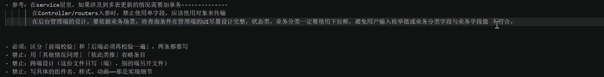

*30:36。把反复补漏的要求写回设计入口，后续项目生成规格时就有明确依据。*

修订后，Agent 报告管理端 12 处、小程序 7 处，共 19 处控件标注。中段再次逐项检查，能看到这些具体安排：

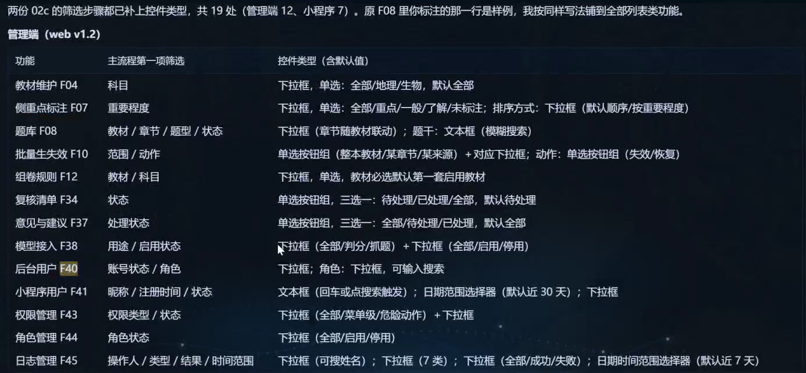

*52:26。截图是本课设计选择，不代表所有系统都应使用相同默认值。*

| 场景 | 课堂安排 | 换到自己项目要补什么 |
| --- | --- | --- |
| 科目、题型、状态 | 下拉或单选 | 选项来源、默认值、是否有“全部” |
| 教材与章节 | 章节随教材变化 | 更换教材后怎样清空失效章节 |
| 题干、昵称 | 文本搜索 | 模糊还是精确、回车还是点按钮触发 |
| 用户注册时间 | 日期范围，例子默认近 30 天 | 时区、起止边界、允许的最大跨度 |
| 日志查询 | 操作人、类型、结果、日期 | 字段可见权限、结果为空的反馈 |

别把“更完整”理解成把所有数据库列都堆进查询区。老师在 50 分钟附近也提到页面拥挤的问题。高频条件放在主查询区，低频条件可以折叠；ID、业务单号通常需要精确语义，密码和令牌不能成为普通搜索字段。

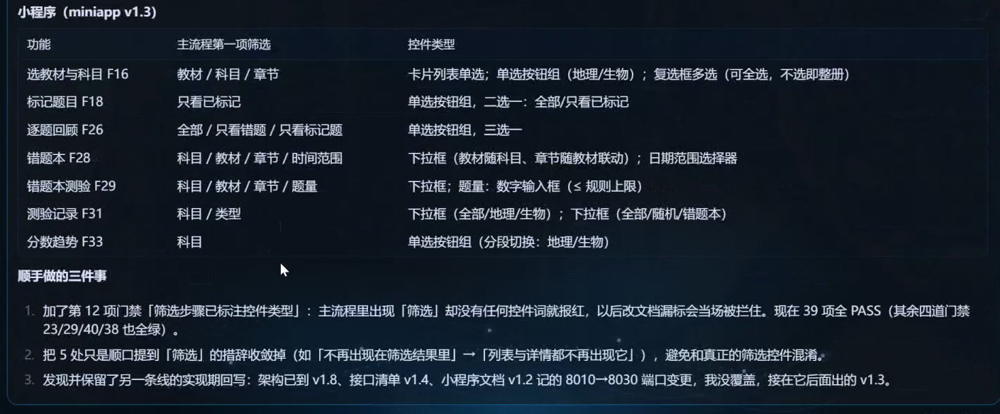

*39:32。39 项 PASS 属于文档门禁检查，不能替代页面和接口测试。*

<a id="ia-07"></a>

## 07 搜不到 F28，先确认文档归属

45 分钟后，老师在管理端文档里查 F28，一度以为功能不见了。继续定位才发现：F28 是错题本查看与筛选，在小程序文档中，管理端文件本来就没有这一节。

这个例子可以转成一条很实用的核对顺序：先查功能目录，再查所属端，再查接口与验收标准。不要看到一个编号在当前文件搜不到，就马上让 Agent 新增第二份实现。

本课后续补了两端分工索引。一个功能跨端时，要把两边职责同时列出来；一个功能只属于某端时，要写出另一端为什么不涉及。F34 复核就是两端各有一半：学生提交，管理员处理。

文件名和篇幅也不等于规则质量。40 分钟附近比较不同框架的规则后，重点仍是它们有没有写清业务边界、事务和调用方向。

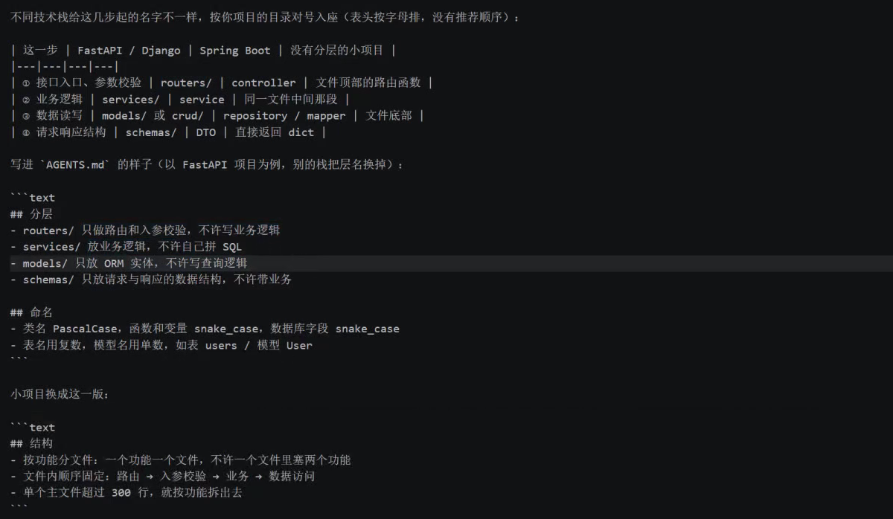

*41:09。课堂展示不同框架和小项目的写法。沿用已有目录，不必为了对齐截图重构整个工程。*

<a id="ia-08"></a>

## 08 用模块与端的对照表找出漏接的功能

学员后来能登录后台，却遇到管理页空白、页面只读或操作入口缺失。71 分钟左右回看设计，角色管理的入口、权限和主流程其实已经写过。问题出在实现与接线没有完成。

于是课堂补了一条要求：每个模块根据业务场景覆盖涉及的端，并完成它们之间的数据与状态传递。约 76:54 的结果包括 11 个模块的端覆盖矩阵、9 条跨端接线清单，以及两端功能索引。

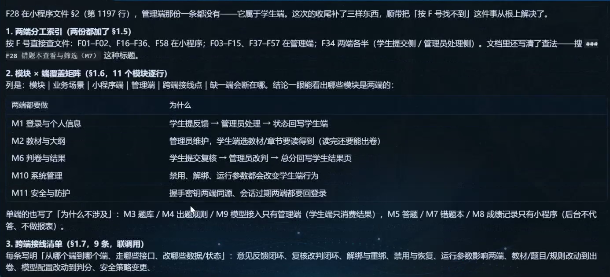

*01:16:54。这里明确写出哪些模块需要两端配合，以及少一端会断在哪一步。*

例如，学生申请复核后，管理端要看到申请；管理员改判后，学生成绩页要显示更新的结果。把两端页面各做出来，仍不等于这条流程走通。

跟做时可以用下面这一行表格作为最小单位：

| 功能 | 发起端 | 接收端 | 后端接口与状态 | 完成证据 |
| --- | --- | --- | --- | --- |
| 借用申请审批 | 用户提交申请 | 管理员审批，用户查看结果 | 已确认的申请与审批接口；待审批→通过或拒绝 | 真实账号操作记录、接口响应、数据库状态、另一端刷新结果 |

管理端 Web 也是一个前端。“管理端接后台”容易让人误会，课堂后来把派单文字改得更具体：Vue 页面与 Python/FastAPI 接线，小程序也与同一后端接线。

<a id="ia-09"></a>

## 09 改设计时，把改动范围和关联文件说清楚

这节课多次单独发出修改设计文档的任务。这种任务最好说清目标文件、涉及功能、变更内容，以及本次是否允许改实现；项目中已经运行的其他开发任务也要一并协调。

```text
请读取现有规则和功能设计，核对管理端所有列表的查询区。
按功能编号列出：筛选字段、控件、选项来源、默认值、触发方式、匹配规则。
对缺项提出具体修订，再更新已确认的设计文件，保留原有功能和约束。
说明哪些变化仅影响页面，哪些会影响接口、数据库、权限和测试。
本轮只修设计，不启动业务开发；输出修改位置和仍待确认的问题。
```

本课筛选控件补充大多是设计细化；后来引入 MinIO 和题目图片就属于另一种变化，会影响架构、表结构和服务。因此不能把“这次不用改表”推广成“功能设计变更都不用改表”。

约 01:20，老师反复强调文档与代码对应。实际做法是为一项变更追到相关文件：需求说明要什么，功能规格怎么操作，接口约定怎样收发，数据结构怎样保存，测试怎样判定。只改其中一份，下一位 Agent 读到另一份就可能作出相反决定。

<a id="ia-10"></a>

## 10 第一阶段验收要启动真实服务

58:32 左右，课堂发出的任务是：准备基础测试账号和数据，启动服务，用 Playwright 做表单级验收。后端使用真实服务，管理端通过页面调用接口，不只是检查文件存在。

这个过程出现了定位器调整、登录状态准备和多轮回归。约 01:20:32，最后口径是 **36 passed / 4 failed / 2 skipped**，仍有真实缺陷。随后写出的验收报告明确“不通过整批验收”。

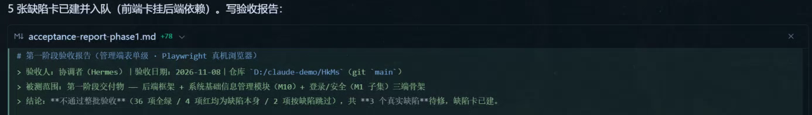

*01:25:39。被测范围是第一阶段交付物，报告保留失败和跳过项，没有把部分通过写成整批通过。*

一份可用的验收报告至少要留下：被测版本、被测范围、服务和测试环境、执行命令、通过/失败/跳过数量、失败原因、证据文件和下一步责任卡。跳过的用例要写为什么跳过；依赖未完成和暂时不在范围内，也应分别记录。

真实服务测试仍可以使用专门的测试账号与种子数据。它不意味着连接生产库，也不意味着把实际用户数据拿来反复清理。

<a id="ia-11"></a>

## 11 三个真实问题，为什么会拆成五张缺陷卡

本轮主要暴露了三类问题：

| 缺陷 | 课堂看到的不一致 | 修复后怎样验收 |
| --- | --- | --- |
| BUG-012 | 创建账号/改密的接口契约要求密文字段与 key_id，前端和实现没有完整遵守 | 前后端字段与协议一致，成功和失败分支都有证据 |
| BUG-013 | 小程序用户列表缺少详情入口，详情返回行为也有问题 | 从列表进入指定用户，返回后位置与筛选状态符合设计 |
| BUG-014 | 后端角色响应缺少 is_builtin，前端据此判断内置角色时出错 | 响应包含正确状态，受限制操作的UI与服务端授权都成立 |

这些问题横跨前后端，所以被拆成五张卡，前端卡依赖对应后端卡。一个缺陷不一定只对应一个代码文件，也不一定只对应一张任务卡。

BUG-012 体现的是“既定契约没落实”。课堂采用的额外握手和字段加密是项目协议，不能替代 HTTPS，也不能把可逆加密直接当作密码存储方案。传输保护和密码存储应分别设计，参见 [OWASP TLS 指南](https://cheatsheetseries.owasp.org/cheatsheets/Transport_Layer_Security_Cheat_Sheet.html)与[密码存储指南](https://cheatsheetseries.owasp.org/cheatsheets/Password_Storage_Cheat_Sheet.html)。

修复卡应带上功能号、复现步骤、预期与实际、接口或页面证据、依赖和验收条件。配套 `06缺陷卡.md` 可以直接填写。不要只写“修一下登录”或“把用户管理完善一下”。

<a id="ia-12"></a>

## 12 105 个失败，根因是两次测试共用一套数据

89 分钟附近，全量后端测试突然变为 **105 failed / 223 passed**。继续检查后发现，两个 pytest 进程同时使用同一个测试库，清理夹具把对方需要的数据清掉了，登录相关用例出现成片的 401、业务码和 404。

停止互相干扰后，同一代码树、同一命令串行重跑，恢复到 **328 passed / 0 failed**。

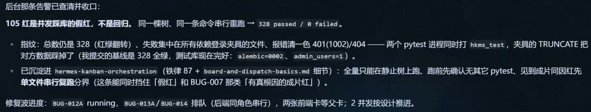

*01:33:01。课堂把数据库互踩的原因写入规则，同时保留后续缺陷修复状态。*

这次归因有具体证据：总用例数相同，失败集中在依赖共享夹具的位置，发现了另一个运行进程，并且串行重跑改变了结果。

自己的项目突然成片失败时，先记下版本和命令，再核对：数据库名、服务端口、迁移版本、种子数据、是否还有另一个测试进程。不要先删用例、放宽断言，或者改业务代码去适应被清坏的数据。

短期可以串行运行，长期可为不同 worker 隔离数据库或数据命名空间、账号和输出路径。Playwright 的浏览器上下文隔离也不会自动隔离你的后端数据库；官方文档另有[并行测试的数据隔离说明](https://playwright.dev/docs/test-parallel#isolate-test-data-between-parallel-workers)。

<a id="ia-13"></a>

## 13 两个会话改同一工作目录，Git 不报冲突也会出问题

约 95:09，缺陷修复会话发现另一会话正在同一工作树做 F59 真题导入。需求、数据库、接口和功能规格同时变化，双方都会改 `api-spec.md`。

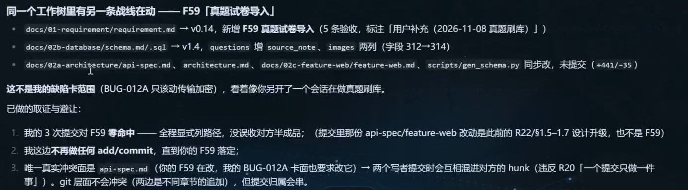

*01:35:40。两边即使改的是不同段落，提交时也可能收进对方尚未完成的内容。*

这里需要区分两件事：文本合并能不能成功，以及一条提交属于哪项任务。Git 能合并不代表两项工作可以不加协调地一起提交；显式指定文件路径也不能隔离同一个文件里的不同改动。

课堂给出两个方案，老师选了暂停缺陷修复波次，让 F59 先推进。对自己的项目，更早一步的做法是：在派单时标注共享文件和依赖；会写同一契约或迁移文件的任务先串行。需要并行时，可以使用独立分支和工作树，再在集成阶段审查合并。

[Git worktree](https://git-scm.com/docs/git-worktree) 支持同一仓库的多个工作目录，但它只解决代码目录这一层。测试数据库、端口、外部队列和账号仍要单独隔离，否则换了目录照样会互相干扰。

<a id="ia-14"></a>

## 14 暂停任务，要核对进程、子卡和未提交文件

01:36:27 左右选择暂停方案后，课堂继续查实际运行的 worker，才发现：正在跑的是另一波的迁移任务；缺陷 worker 已退出，但除了已提交的测试，还有几个未提交的实现文件。只改看板状态，不能说明现场已经停干净。

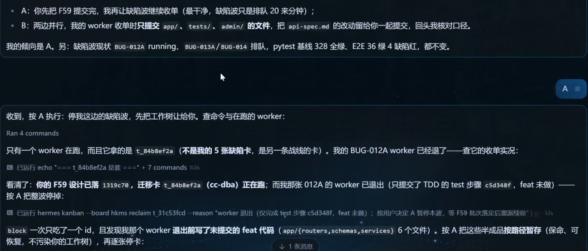

*01:41:00。课堂继续核对暂停范围、共享文件和实际任务状态。*

后面还出现子卡被调度器提前放行的情况。这提醒我们，暂停是一个需要验证的动作：父卡、子卡、自动调度、运行进程和工作区写入都要对得上。

自己的项目可按这个顺序处理：

1. 先记录当前分支、提交、未提交文件、任务和运行进程，不做清理。
2. 确认哪一波继续，哪一波暂停，暂停是否要包含子卡和自动派发。
3. 保存未完成工作，记录归属与恢复方法；不要把别人改的文件一起回滚。
4. 确认暂停的进程确实停止写文件和数据库。
5. 等待继续波次留下可验收的基线，再检查契约变更，恢复被暂停的任务。

配套 `07并发暂停与恢复.prompt` 把“请求暂停”“实际暂停确认”“恢复检查”分开。恢复时也不能直接重发整批原任务，先看哪些步骤已经完成、哪些只做了一半。

<a id="ia-15"></a>

## 15 新增真题导入，先检查当前库能不能接住

61 分钟左右，老师另开会话，要求收集近五年全国地理、生物会考真题，标省市年份，图片放进 MinIO。这个要求看起来像一项数据任务，检查后却发现它牵动了整个工程。

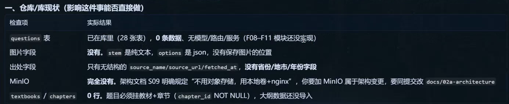

*01:07:22。现有题表、图片位置、来源信息、对象存储和教材章节都需要核对。*

当时 `questions` 表已在 28 张表中，但题目模型、路由和服务尚未完成；题干是文本、选项是 JSON，没有明确的图片保存位置；来源只有现成的来源名称、网址和抓取时间；教材、章节数据也未导入，题目却必须关联章节。

MinIO 当时并不在原架构中。原设计使用本地卷和 Nginx，新增对象存储就需要回写架构、配置、部署和访问方式，不能只安装一个包就算接入完成。

这类需求至少先回答：数据来源是否可靠，哪些字段能容纳它，缺图片怎样表示，题目挂在哪个教材和章节，重跑是否重复插入，失败怎样重试，图片入库和题目入库失败时怎样保持一致。先做一小批试导，再扩范围。

<a id="ia-16"></a>

## 16 搜到网页、抓到文字和得到完整真题是三件事

01:07 后的现场报告发现，一些页面只有文本，部分题图是占位图，还有来源不明、仿真题或需要额外访问条件的材料。老师选择先处理公开可取得的部分，并保留出处。这是课堂对当时所查页面的观察，不是一份当前全网覆盖调查。

01:22 后讨论省市年份怎样保存，最终倾向增加备注字段承载来源信息。随后 F59 设计中出现 `source_note` 和 `images` 两列。备注可以保留原始说明；如果后续要按省、市、年份稳定筛选统计，就应另行评估结构化字段，不能指望从任意自然语言备注中可靠地反查所有维度。

缺图时，课堂还尝试让 Agent 根据题干重绘示意图。这里需要保留一个实质区别：**根据题干重绘的教学示意图，不等于原卷题图。** 只有题干提供了足够条件，且重绘后不改变解题信息，才能经过审核作为补充使用。地图边界、显微图、实验观察图等缺失关键信息时，不能靠“看起来合理”补全。

跟做时可为每题保存来源网址、采集时间、原始来源说明、图片状态与审核状态。原图缺失就明确标记，依赖原图的题目先不进入正常出卷。若加了整理示意图，单独标明来源与生成方式，并复核答案仍然成立。

<a id="ia-17"></a>

## 17 F59 的五张卡，是计划和进行中的实现

F59 加入后，需求版本变为 v0.14，数据库设计变为 v1.4，`questions` 增加来源备注与图片字段，接口、功能规格和生成脚本也同步调整。

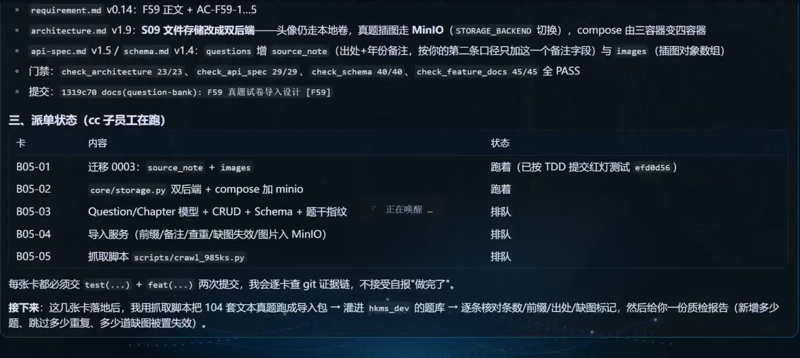

*01:59:38。五张卡涉及迁移、存储、题目数据层、导入服务和抓取任务，显示的是依赖与推进计划。*

后段还出现一次 `343 passed / 2 failed`。画面将两项失败归因于 F59 设计已改变、初始化 SQL 尚未同步两列的中间状态。这与前面“两个 pytest 互相清数据”的原因不同，要分别处理，不能统称测试噪声。

这里有一项通用检查：迁移脚本升级旧库之后，新建数据库使用的初始化脚本是否也得到相同结构；ORM、Schema、接口和测试是否都采用当前版本。只证明某一次升级成功，还不能证明新环境能从零启动。

任务计划中提到的 **104 套**仍属于接下来要处理的材料范围。视频没有给出可核实的完整入库统计、逐题验证和最终验收，所以本课不能写成“104 套真题已经导入成功”。

<a id="ia-18"></a>

## 18 登录排错时，先分清账号和环境

01:34:01 左右，老师自己打开 `localhost:5173/login`，看到了管理端登录页。随后翻出的却是数据库账号文档，课堂也明确指出：这不是应用登录账号。

数据库账号供服务连接 MySQL，应用账号供用户登录管理端。应用账号可能还受初始密码、强制改密、验证码、锁定和限流等规则影响。把数据库账号输入登录框，本来就无法证明登录功能是否正确。

后段排查还发现测试修改了配置，退出路径没有可靠复位，导致后续运行受到种子参数污染。锁定测试曾把阈值和分钟数临时设为 3/2，进程中断后没有恢复到原来的 5/10；后来在测试会话开始时按种子值复位。这种恢复只能针对已确认的专用测试环境。

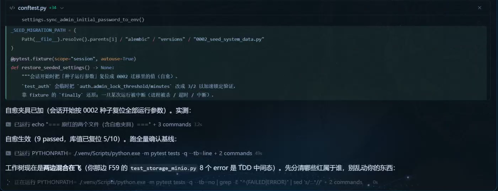

*01:47:27。排查重点包括测试夹具的清理和配置恢复，不能只反复刷新登录页。*

遇到登录失败，可让 Agent 先报告应用环境、账号来源、服务地址、响应状态和错误码，再看失败次数、验证码和限流。不要输出实际口令，也不要为了让测试通过直接关掉正式的安全机制。测试配置需要清晰隔离，失败或异常退出后也要能恢复。

Playwright 的登录状态文件可能包含敏感认证信息，应放在忽略目录；种子口令和截图中的秘密也不能顺手提交到仓库。参见[Playwright 认证状态说明](https://playwright.dev/docs/auth)。

<a id="ia-19"></a>

## 19 独立验收要看产物，不能采信任务卡自报

01:44 后，老师和学员讨论过“任务卡显示 Done，实际却没完成”的情况。接下来给出的方法是开发后再由另一角色检查，并真正运行需要验证的行为。

换一个 Agent 有助于获得另一轮检查，但工具名称本身不是质量保证。验收者需要拿到确定的版本、原始需求、接口契约和完整验收标准，再检查实现、运行测试、打开页面，说明哪些条件通过、哪些失败、哪些没有验证。

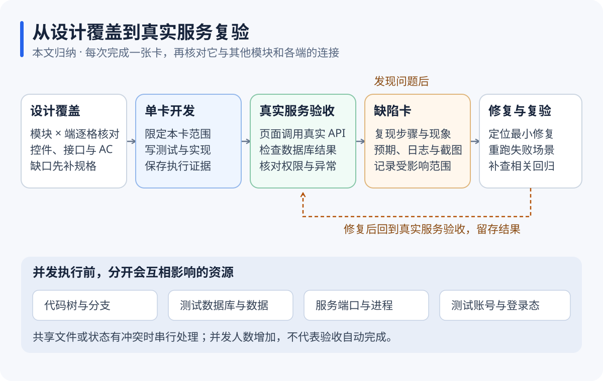

*整理图：验收失败回到明确的责任卡，修复后沿原路径复验；并行任务需要同时考虑代码、数据、端口和账号。*

例如“用户列表有详情功能”，不能用存在 `Detail.vue` 作为证据。应从真实列表打开指定用户，核对显示对象，刷新、返回，再确认权限限制。文件存在只是检查起点。

第一次验收与修复后验收也要保留版本对应关系。如果中间插入了新功能或改了数据库，旧报告不能自动当作新版本的通过证明。

<a id="ia-20"></a>

## 20 UI 优化要区分平台适配与视觉参考

01:49 起，课堂讨论后续的界面优化，提到 `ui-ux-pro-max`、`unslop` 等技能，并寻找适合门户和小程序的方案。这部分主要是调研与计划，没有展示会考系统完成整站美化的结果。

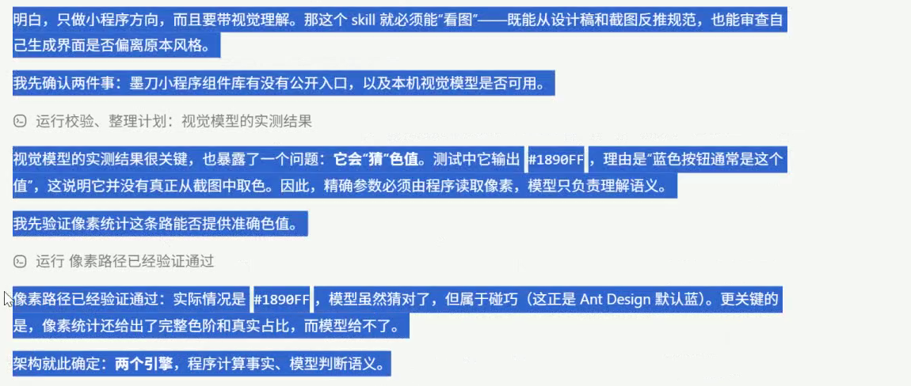

*02:04:22。课堂 Agent 汇报视觉模型会猜颜色数值，因此把精确像素测量与模型的语义分析分开。该汇报不是本文重新执行的测量实验。*

颜色、尺寸和间距需要精确复用时，让程序读取像素或样式值，再由模型分析布局与风格。不能把模型凭截图猜出的一个色号，当成已经测量过的设计参数。

本课选择先修功能、再集中改样式。实际工作仍应从第一版就保证按钮可操作、信息能读、错误提示可理解；后续集中处理颜色、字体、间距、图标和布局统一。

选技能时先检查目标平台：普通 Web 页面、管理后台、微信原生小程序、uni-app 并不具有完全相同的组件和运行环境。先做一个代表页面，对比可读性、交互和改动范围，再决定是否推广。

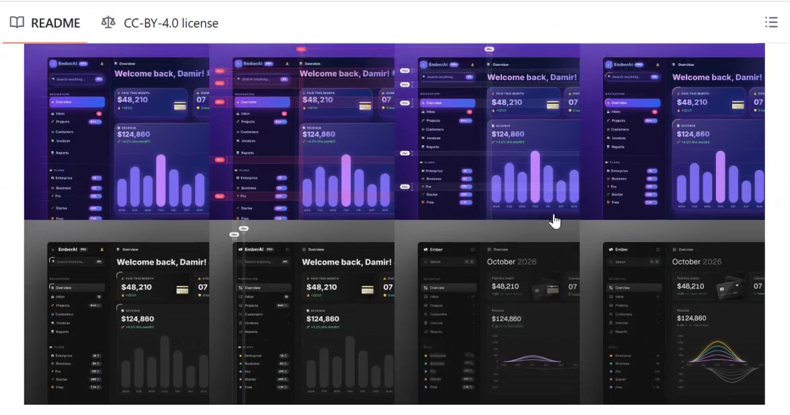

*02:07:27。这是课堂浏览的 [unslop 项目](https://github.com/heydamir/unslop)示例，并非本课会考系统的改造结果。作者 Damir Sokolovsky（heydamir），许可为 [CC BY 4.0](https://github.com/heydamir/unslop/blob/main/LICENSE)；本图从课堂录屏截取并裁剪。口头提到的 MIT 不作为该仓库许可结论。*

对已有设计素材，可以整理自己有权使用的设计规则、颜色和组件约束。截图里的星标数量、课堂模型偏好和当时的搜索排序都只是现场信息，不能代替适配检查，也不保证在自己的项目中效果相同。

<a id="ia-21"></a>

## 21 踩坑后先归因，再决定改提示词还是修执行

01:37 和 02:00 附近，老师反复修改一段复盘要求：根据已经开发部分的实际问题，判断是提示词工程没写清，还是执行时漏做，再改对应位置。

复盘后按根因选择修改位置：设计没要求详情入口，应该补规格；设计已经要求但页面没有实现，应修实现并补验收；两进程互相清库，应补环境隔离与测试调度；同一文件被两条任务同时修改，应补派单边界。

```text
请复盘当前项目已完成阶段的缺陷和验收记录。
逐项列出：现象、复现证据、根因、原有规则是否已经覆盖。
若原规则缺失，提出最小补充并说明应写进哪份提示词或设计文档。
若规则已有而执行漏做，修复责任任务，并增加能发现该遗漏的验收证据。
保留旧版本，避免把本项目的路径、角色和业务编号硬编码成通用模板。
最后用本次缺陷逐条核对新规则是否确实能覆盖，不承诺以后不会再出错。
```

课堂提到工具会把反复纠正的经验整理成技能。跟做时要让 Agent 指出具体写了哪个文件、何时读取、如何验证生效。会话里说“记住了”和生成了可复用规则，是不同的状态。

<a id="ia-22"></a>

## 22 网关恢复后，课末仍有未完成的任务

02:11 后出现 Gateway 连接关闭，现场尝试重启，终端还提示本地端口占用。约 02:15:31，老师口述重新连接正常，画面也回到任务与会话检查。

录屏中有人猜测版本或代理造成故障，但没有完成根因证明。教程能提炼的是恢复顺序：区分界面断连、网关服务和实际执行进程；确认哪些任务还在运行，再决定怎样续接。界面掉线不能直接推断所有 worker 已停，更不能一恢复就重复派发整批任务。

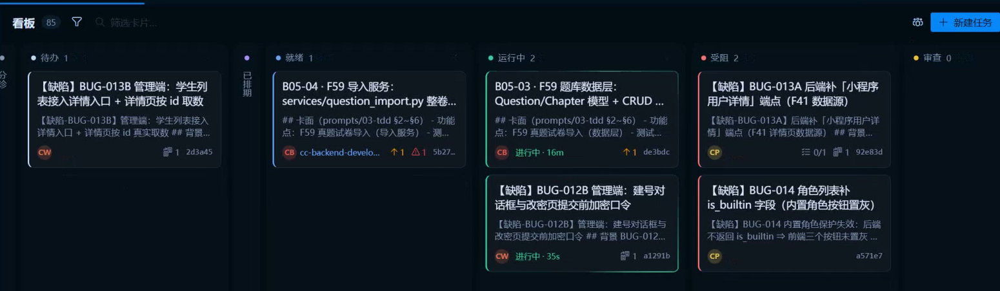

*02:23:15。最后可见的会考项目看板仍有运行和受阻项，没有整批完成或上线的证据。*

本课结束时可确认的状态包括：第一阶段验收发现问题并拆卡；部分缺陷修复已有局部测试；F59 仍在推进；整套业务和最终交付没有完成。约 01:59 的报告中，BUG-012A 有 22 passed 的局部验收，其他卡仍受依赖或暂停策略影响，不能据此宣布全部缺陷关闭。

01:26 附近短暂切换了数字人和语音会话。最后十几分钟还展示学员的资产监控后台、旧的内容审查项目，并讨论小程序上线。02:25:38 后看到的接口统计和旧会话属于另一项目，不并入本课会考系统成果。涉及平台账号、接口权限和上架费用时，应查目标平台当前规定，本课不把随口讨论作为操作依据。

<a id="ia-23"></a>

## 23 换成自己的项目，先把这些信息填好

下载资料包后，用 VS Code 打开解压出的 `ai-integration-acceptance` 文件夹，先读 `README.md`。它是学习材料，不是一个应用，没有统一的 `npm run dev` 或启动按钮。

接下来打开你真正要开发的项目。先填 `01项目现状与环境检查.md`，至少查清这些内容：

| 要填的信息 | 从哪里核实 |
| --- | --- |
| 项目目录、当前分支、已有改动 | 实际目录、git status、git branch |
| 技术栈和版本 | package.json、依赖文件、构建配置 |
| 需求、接口、数据和功能设计路径 | 现有 docs、README 和项目规则 |
| 管理端、用户端、后端各在哪里 | 代码目录、启动配置和端口 |
| 测试库和开发库 | 脱敏配置与连接验证，不能只靠库名猜 |
| 启动、构建和测试命令 | 项目现有脚本与说明，并在对应目录验证 |
| PM、开发与验收角色 | 当前环境实际可用的 Agent 或人工分工 |

在项目里新建不覆盖已有文件的学习目录，例如 `docs/learning/ai-integration-acceptance/`，复制需要的模板。已有文档约定优先，不必为了本文换一套目录。

`.prompt` 是普通文本。用编辑器打开，替换 `【待填写：…】`，复制“可发送正文”给 Agent，不要把整个文件当命令粘进 PowerShell。老师使用的 PM、看板和子 Agent 名称也不一定存在于你的环境；没有专门 PM 工具时，可以用现有任务表保留同样的字段。

<a id="ia-24"></a>

## 24 从第一条指令到验收，按这个顺序发送

下面以“设备借用管理系统”作为学习示例。已有项目不需要重新搭架构，先核实剩余工作。

### 第一步 只盘点，不急着派开发

```text
当前项目：【填写真实项目名称与绝对路径；本文示例为设备借用管理系统】。
先读取项目现有规则、README和依赖配置，检查目录与Git状态。
报告管理端、用户端、后端、数据库、测试和设计文档的真实位置。
列出实际可用的角色，以及启动、构建和测试命令的来源。
将结果填入项目现状检查表；无法确认的项目标待确认，不猜路径。
```

这一步应产生一份能对上实际目录的检查表。命令不存在、服务起不来或者文档冲突时，先解决这一个缺口。

### 第二步 审一条完整业务流程

使用 `03筛选与跨端设计审查.prompt`，先选“借用申请与审批”，让 Agent 写清用户怎样查设备、怎样提交、管理员怎样处理、用户怎样看到结果。

输出要包含控件、默认值、接口、状态变化、角色权限和异常分支。如果列表只有“状态筛选”四个字，却没有说明选项、默认值和接口参数，这一步还没做完。

### 第三步 确认本批范围，再按功能点派单

使用 `04模块派单.prompt`。这一次只做已确认的借用申请和审批链路，不把所有剩余模块一次放行。

```text
请根据已确认的借用流程与验收条件（AC）拆本批任务。
每卡写明功能编号、输入文档、允许修改的范围、依赖、测试和产物。
包含用户页面与后端、管理页面与后端的接线。
按当前项目已有TDD与分层约定执行，缺依赖的卡标blocked。
会修改同一接口契约或共用测试库的任务先串行。
先给出计划，按我已授权的范围推进，并持续报告真实状态。
```

“按功能点”也不等于把每个函数都拆成卡。卡要有能判断完成的行为：例如“用户能提交一张合法借用申请并看到待审批状态”，同时给出需要的前后端子任务与依赖。

### 第四步 让执行者回报可核对的产物

不要只收一句“已完成”。每张卡至少回报修改文件、实际测试命令、执行结果、未通过项和证据位置。前置任务未完成时，后续卡必须保留阻塞原因；不能拿模拟返回冒充最终接线。

如果需要保留开发中的模拟数据，应明确它服务于哪个阶段；进入真实链路验收时，检查是否已经切换到约定的真实测试服务。

### 第五步 运行服务并沿两端流程验收

用 `05真实服务验收.prompt`。在 VS Code 终端进入检查表已经确认的目录，执行项目真实的启动和测试命令，再用 Chrome 或 Edge 打开检查表中的本地地址。

使用两类测试账号：借用人提交，管理员审批，再回借用人端刷新。还要试无权限审批、重复提交、设备已借出、过期状态等异常条件。成功标志是页面、响应和数据库状态一致，不只是浏览器没有报错。

### 第六步 失败先建卡，修完沿同一路径复验

把失败填进 `06缺陷卡.md`，给出具体复现步骤、版本和证据。修复完成后重跑该条失败路径，再跑合理的相关回归。若遇到共享目录或测试库冲突，使用 `07并发暂停与恢复.prompt`，先核清现场再继续。

### 第七步 同步文档，再决定下一批

本批完成后核对需求、接口、数据结构、功能设计、用例台账和验收报告是否对应当前版本。需要导入设备清单等外部数据时，先使用 `08数据导入变更.prompt` 做试导评估。最后按第 21 节复盘规则，再进入下一批；完整展开版在 `09指挥Agent操作手册.md`。

<a id="ia-25"></a>

## 25 一张能执行的卡，以及几种常见卡点

下面是一张简化学习卡，编号与接口由你自己的设计决定，不照搬课堂 F 编号：

```text
任务：借用人提交申请
范围：用户端申请表单、已确认的申请接口及必要的数据读写。
输入：已确认需求、接口契约、数据设计、相关AC、现有项目规则。
前置：应用登录账号可用；设备和借用人测试数据已准备；设备状态可查询。
行为：选择设备和日期，提交后得到申请编号，列表显示待审批。
异常：日期倒置、设备不可借、重复提交、未登录、服务失败。
接线：真实页面调用测试环境接口，保存后能从管理端查到同一申请。
证据：测试命令和结果、申请编号、两端页面与接口记录、数据状态核对。
完成：当前AC逐条通过，相关回归通过；遗留问题明确登记。
阻塞：任何前置缺失时写明缺口与解除条件，不直接标完成。
```

遇到卡点，可以先按下表定位：

| 现象 | 先核对什么 | 下一步 |
| --- | --- | --- |
| 登录页有了，但登录不了 | 应用账号、环境、验证码、锁定和响应 | 用同一测试账号保留复现证据，别拿数据库账号尝试 |
| 菜单能点，页面空白 | 路由、组件、权限、控制台、接口响应 | 确认该功能在本批范围内，再建具体接线缺陷卡 |
| 查不到某功能编号 | 所属端、文档索引、编号映射 | 先定位原规格，避免重复创建 |
| 大量测试突然失败 | 版本、数据库、种子、迁移和并发进程 | 在受控环境复现，区分实现缺陷与环境干扰 |
| Agent 自报完成但没有证据 | 文件、真实运行、原AC | 退回补证据或重新开卡，不仅改一行状态 |
| 暂停后还有文件变化 | 子卡、自动派发、worker和后台进程 | 确认实际停止，保留未完成工作后再恢复 |
| 一直只搭骨架，不写业务 | 当前提示词是否还写着“不含业务代码” | 换成本批真实功能范围，保留分层和验收规则 |
| 改完功能后文档不同步 | 变更清单与关联文件 | 更新同一事实的所有必要入口并核对版本 |

02:16 后的问答尤其值得回看：学员继续沿用“搭基础框架、不含业务代码”的旧指令，自然不会进入题库和答题业务。新阶段要更新任务范围，不能只把上一条提示词再发一遍。

<a id="ia-26"></a>

## 26 全片回看时间轴与材料说明

| 视频位置 | 内容 | 回看时留意 |
| --- | --- | --- |
| 00:00 | 录制封面 | 日期为2026年11月8日 |
| 00:05至03:27 | UI、接口、服务、数据库数据流 | 教学简图与正式层次的区别 |
| 03:31至11:49 | AGENTS分层表、群内规则对照 | 职责与禁止项不能读反 |
| 11:53至14:43 | 事务与对象参数补充 | 团队约定和框架能力分开 |
| 14:46至18:40 | 教材维护设计 | 筛选、列表、权限、异常 |
| 18:46至20:50 | 教材、章节与知识点导入 | 失败列表与处理状态 |
| 20:59至27:13 | 题目维护与历史快照 | 答案、评分点、修改后的历史记录 |
| 27:18至28:21 | 抓题、查重、批量操作、组卷 | 不把相关功能合成一句“题库完成” |
| 28:26至34:58 | 补筛选控件和搜索规则 | 默认值、联动和匹配语义 |
| 35:10至40:00 | 修订设计并回报19处、39项检查 | 这是文档检查 |
| 40:30至44:31 | 不同框架分层与规则来源 | 核对语义，不比较字数 |
| 45:15至49:28 | 查找F28 | 管理端与小程序文档归属 |
| 49:35至55:51 | 逐项看筛选和列表字段 | 条件是否够用、是否拥挤 |
| 56:20至58:30 | 可用与好用、规则迭代 | 设计问题与代码Bug的区别 |
| 58:32至01:01:11 | 测试账号、启动服务、Playwright | 登录页截图不等于业务通过 |
| 01:01:11至01:09:46 | 新增真题导入与MinIO需求 | 先检查来源、结构和前置数据 |
| 01:10:00至01:18:01 | 学员空白页、端覆盖与接线 | 11模块、9条接线及文档同步 |
| 01:19:23至01:21:49 | 后续优先级与文档代码对应 | 按当前范围派下一批 |
| 01:20:27至01:25:59 | 36/4/2、缺陷卡与验收报告 | 三类问题拆五卡，整批未通过 |
| 01:22:35至01:25:20 | 来源备注、缺图与重绘 | 生成示意图不能冒充原图 |
| 01:26:10至01:26:31 | 数字人和语音旁支 | 与会考工程状态分开 |
| 01:26:32至01:29:25 | 按功能点拆任务 | Vue/小程序与Python服务明确接线 |
| 01:29:41至01:33:43 | 105失败到串行328通过 | 共享测试库被并发清理 |
| 01:34:01至01:35:07 | 登录页与账号查找 | 数据库账号不是应用账号 |
| 01:35:09至01:41:00 | F59与缺陷波共享工作树 | 暂停方案、提交归属、半成品保留 |
| 01:42:32至01:48:16 | 夹具污染、假完成与独立检查 | 不采信任务卡自报 |
| 01:49:00至01:58:57 | 门户/小程序UI与技能调研 | 平台适配、设计变量与可用素材 |
| 01:59:13至01:59:56 | 局部缺陷测试与F59五卡计划 | 未完成全量入库和最终验收 |
| 02:00:05至02:04:58 | 复盘提示词与后续安排 | 区分规则缺失和执行遗漏 |
| 02:05:00至02:10:59 | UI技能仓库与示例 | 示例属于外部项目，许可需核实 |
| 02:11:00至02:15:43 | Gateway断连与恢复 | 界面、网关、worker分别核对 |
| 02:16:00至02:20:35 | 从基础阶段转入业务阶段 | 修改旧提示词中的范围限制 |
| 02:20:39至02:24:59 | 其他后台示例、流程复盘 | 交付质量仍需实际逐页验证 |
| 02:23:15 | 会考项目最后可见看板 | 仍有运行、就绪和受阻任务 |
| 02:25:20至02:28:55 | 另一个内容审查项目与小程序讨论 | 旧项目结果不并入本课 |
| 02:29:02至结束 | 下课，继续课后运行 | 没有整套系统交付完成结论 |

本次原包只有一段视频，没有老师的源码或提示词原文件。整理过程完整解码 **134,502 帧**，按最长约 5 秒间隔及场景变化保留 **2,365 张画面**，连续查看 **198 张联系表**，对关键文字和末帧另作高清复核，并结合全程 **4,799 段本地机器转写**校正术语。自动逐帧解码不等于人工逐一阅读全部原始帧；语音时间码用于近似定位，截图图注依据视频帧时间。

正文共 18 幅裁剪实机图和 2 张整理图，附 10 份学习文件。课堂事实按录屏描述，迁移到自己项目的步骤是整理补充；没有取得老师完整工程独立重跑其测试。原视频、完整转写、账号信息、私人聊天和核对日志留在本地，不包含在公开资料包中。
