这节课最值得留下的，是两个“已经完成”被现场操作推翻的时刻。

第一个发生在小程序里：看板上的卡已经完成，测试数量也不少，但学生点“开始测验”后进不了答题页。第二个发生在富文本改造后：后端、上传接口、后台编辑器和小程序都改了，老师追问文档是否同步，Agent 才承认文档还没动。

下面按这两条线，把旧项目接管、UI 调整、真实业务验收、文档门禁和结尾的数字人演示串起来。每一段都区分课堂中实际看到的结果、Agent 的报告，以及整理时补充的工程做法。

**录课日期：2026 年 11 月 10 日；时长：2 小时 38 分 36 秒；整理发布：2026 年 11 月 13 日。** 压缩包名没有日期，日期以片头和录屏时间为准。

本文有 **28 节讲解、20 幅课堂截帧、3 张整理图、10 份学习材料**。图片可点击放大。想直接跟做，可以先看 [第 24 节操作路线](#tu-24)，再下载 [配套学习包](https://raw.githubusercontent.com/Milo-Guo/bytelife/main/downloads/ai-takeover-ui-contract.zip)。学习包是依据课堂重新编写的练习材料，不是视频里提到的教师原始提示词包。

<a id="tu-01"></a>
## 01 这节课做了什么，最后做到哪一步

开场看到项目看板有 167 张完成卡。之后的登录、小程序和文档检查，却继续暴露缺陷。这说明“完成”必须附带验收范围：完成代码、通过静态测试、启动服务、跑通某条业务流程，是不同的状态。

| 主线 | 课堂动作 | 录课结束前可确认的边界 |
| --- | --- | --- |
| 旧项目接管 | 讲解 00b 接管、00c 定规则、范围与迁移 | 主要是方法和提示词讲解，没有在本片内完整演示一次陌生项目接管 |
| 管理端 UI | 查登录失败、改登录布局和后台首页 | 新版登录与后台首页实际出现；不能据此宣布全部后台页面验收通过 |
| 小程序 | 导入工程、构造本地测试条件、自动走业务 | 找到答题页缺失和请求解包错误；真实微信登录与后续图片渲染验收不能省略 |
| 富文本与文档 | 改题干、选项和图片链路，补文档门禁 | Agent 报告测试与门禁通过，同时列出小程序实机复测和 F59 遗留 |
| 数字人 | 创建 Avatar、尝试连接、文本和语音驱动 | 部分画面能播放，仍出现 JSON 解析错误、TTS 获取失败和口型模糊 |

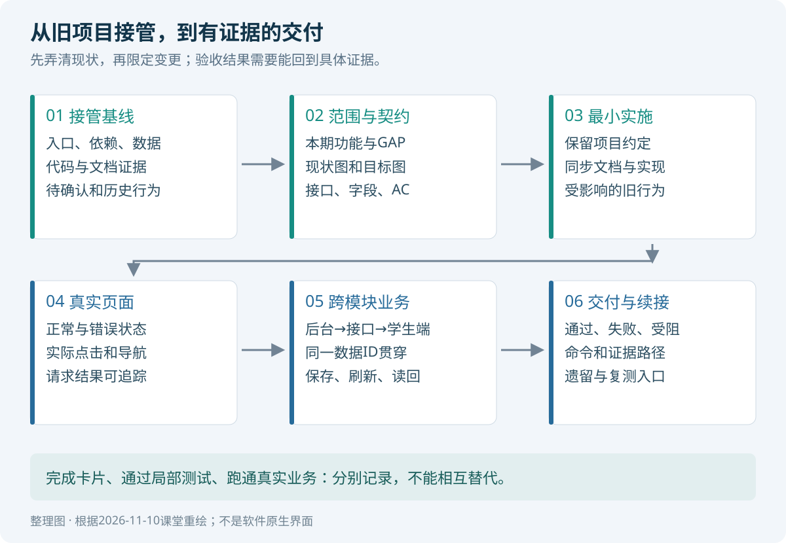

这篇文章的画面核对覆盖全片：视频完整解码 142,827 帧；按每 5 秒取样并加密场景变化，保留 2,617 张核对画面，按顺序审阅全部 219 页联系表，并结合完整语音转写和关键帧高清复核。完整解码不等于逐一人工读过全部 14 万帧；小字、错误信息和最终状态以单独放大的画面为准。

<a id="tu-02"></a>
## 02 二次开发先回答：旧系统到底有什么

**回看：00:08 至 00:11。** 课堂把新建和二开分开：新项目需要先把目标想清楚；二开还要先读懂现有代码、数据和使用习惯。

老师举了一个旧工程体积很大、模型没摸清楚就开始重写的例子。这里的风险不是“项目大就不能用 AI”，而是模型没有证据时，容易把它熟悉的结构当成项目本来的结构。

接管第一轮应该产出这些事实：

- 启动入口在哪，哪些服务必须一起运行，端口和环境分别是什么。
- 业务从哪个页面发起，调用哪个接口，最终读写哪些表。
- 哪些功能有代码且实际可用，哪些只有文档或页面占位。
- 哪些历史行为虽然不理想，但当前用户正在依赖。
- 哪些位置没有权限、资料不足或无法运行，需要写“待确认”。

“历史已有”也需要证据。只有需求文字，没有实现位置，不能标成已实现；只有一段实现，没有运行证据，也不能直接标成业务已验收。

可以先这样指挥 Agent：

```text
先做接管扫描。检查 Git 状态，读取已有 AGENTS.md、README 和运行说明。
本轮只读代码、配置、文档及已授权的数据结构，不修改业务逻辑和数据库。
对每个判断给出文件位置或实际执行结果。
输出：项目基线、模块清单、启动依赖、历史功能、缺口和待确认问题。
找不到依据就写“待确认”，不要补成你认为应该有的架构。
```

<a id="tu-03"></a>
## 03 00b 接管摸底：索引、扫描、缺口、裁剪

**回看：00:21:08 至 00:24:36。** 课件先讲建立代码索引，再从模块与符号、目录结构、既有文档、数据库和任务看板五个方向扫描。

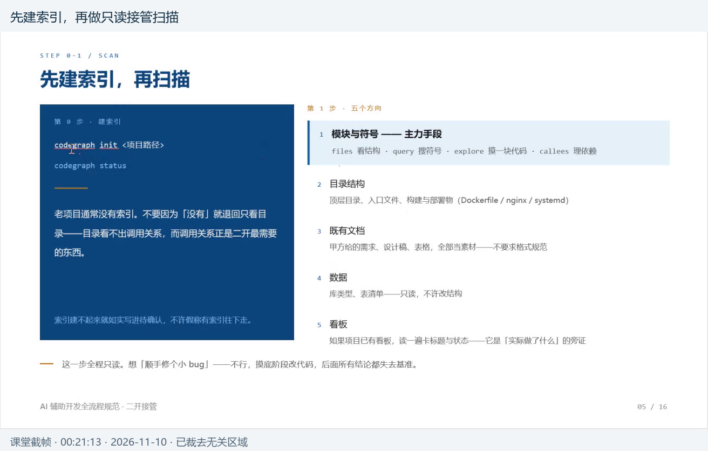

课件出现 `codegraph init <项目路径>`、`codegraph status` 等命令。它们是课堂所用工具的约定。本附件没有该工具的源码、安装包或版本信息，不能据同名命令推断一个安装方式。没有这个工具时，可以用编辑器引用查找、语言服务器、`rg` 和实际调用链阅读完成同样的证据整理。

索引还要维护。第一次建立索引后，代码继续变化，旧索引可能失效；课堂提到在后续工作中读取和同步索引。实际落地时应先查工具支持的同步命令，再接入工作流。

接管输出不是一篇“项目看起来不错”的介绍。课堂提示词明确要求基线、缺口表和历史功能追认。

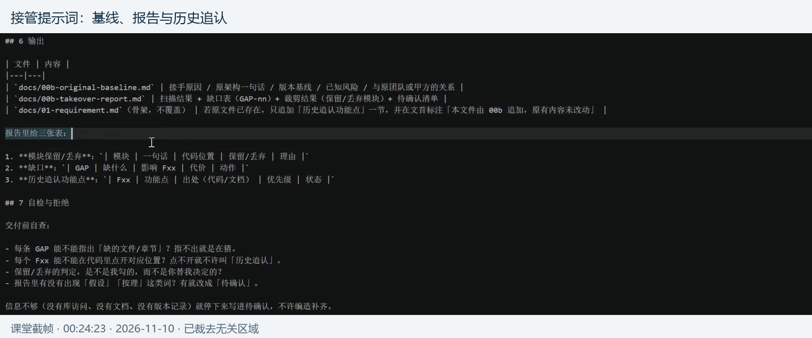

图中可读到的文件是 `docs/00b-original-baseline.md`、`docs/00b-takeover-report.md` 和 `docs/01-requirement.md`。这些是课堂工程命名，自己的仓库应优先沿用已有文档目录。

一个有用的缺口可以写成：

| 字段 | 示例，非课堂原始台账 |
| --- | --- |
| 编号 | GAP-01 |
| 缺少什么 | 学生答题页没有可交互的题干与选项 |
| 证据 | 页面文件、按钮点击结果、报错截图 |
| 影响 | F17/F18，学生无法完成测验 |
| 处置 | 本期立即修复；补真实页面验收 |
| 完成标准 | 新建测验后能答题、切题、保存、交卷，刷新可读回 |

缺口分成“本期补齐”“需要业务确认”“本期不做”。AI 可以提出候选，范围由项目负责人决定。不能因为模型发现了十个优化机会，就自动多做十个功能。

<a id="tu-04"></a>
## 04 00c 定规则：从旧项目提炼约定

**回看：00:24:39 至 00:27:06。** 接管之后，课堂切到 `00c-conventions（定规则）.prompt`，检查目录、命名、分层、接口、错误处理、日志、配置和测试约定。

这一轮的重点是把“团队实际上怎么写”说明白。比如旧工程把错误码集中管理，新功能就应接入原机制；旧工程的请求封装已经统一解包，页面就不能再按另一套返回结构处理。

整理时可分三类：

| 类别 | 应怎么处理 |
| --- | --- |
| 已有且一致的约定 | 写进规则，并给一个真实代码例子 |
| 已有但混乱的做法 | 标技术债，例如 TD-01；本次只改涉及范围 |
| 本次确实需要的新约定 | 说明旧方式的具体问题、影响面和迁移方法 |

课堂口述提到重新生成规则文件。实践时不要直接删除已有 `AGENTS.md` 或把另一份文件覆盖上去。先读、备份、做差异比较，再合并仍有效的项目要求；规则中的测试命令也要在当前仓库核实。

```text
根据接管报告提炼本项目约定，逐项附代码证据。
保留已有有效规则；冲突列出来解释，不静默覆盖。
技术债单独编号，不把“定规则”扩成全仓库重构。
尤其确认：API 是否解包、错误怎样抛出、测试库如何隔离、文档放在哪里。
```

<a id="tu-05"></a>
## 05 需求与架构要同时保留“现状”和“目标”

**回看：00:27:11 至 00:28:44。** 课堂列出从接管、定规则、需求、架构、数据库、功能设计，到 DDL、测试 Review、冻结交付的一组提示词。价值在于前后输入有依据，不能机械地把九个文件全部跑一遍就宣布流程完成。

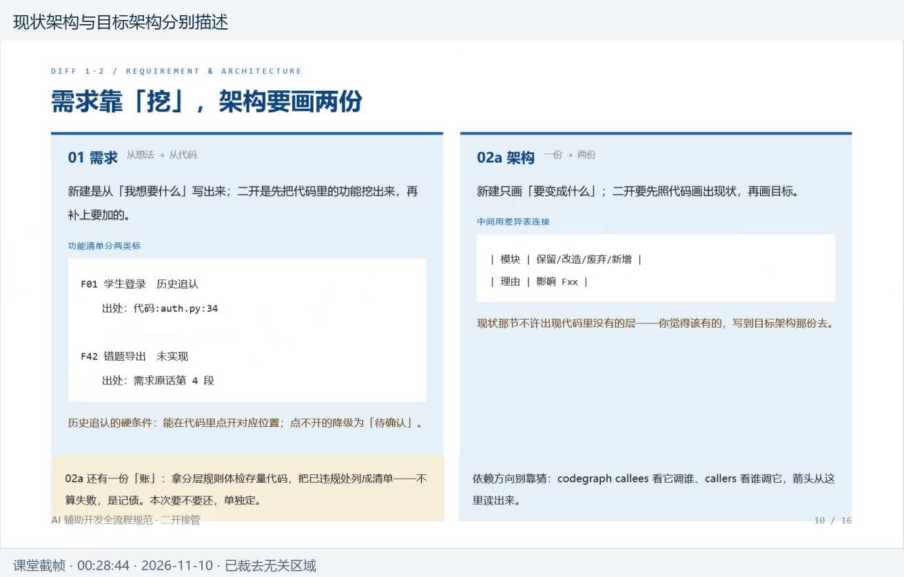

例如，当前系统是“页面直接调用服务函数”，目标希望引入一层统一 API。现状图就画当前调用关系；目标图再画计划中的接口层。把目标层提前画进现状图，后续扫描、迁移和测试都会找错位置。

两张图之间还要有差异表：哪个模块保留、哪个改造、哪个废弃、哪个新增；每项影响哪些功能编号。旧实现存在的问题可以记录为技术债，但本期是否偿还要单独确定。

课堂说“范围是你勾的”，对应的实际动作是：先让 Agent 列清候选，再明确选中哪些；对未选中的事项保留记录，不安排开发。范围有变更时，先更新需求和验收条件，再继续设计。

<a id="tu-06"></a>
## 06 数据库迁移：保护已有数据，再增加约束

**回看：00:28:46 至 00:28:55。** 课件用已有表加字段说明增量迁移：先允许为空，分批回填，验证之后再收紧约束。

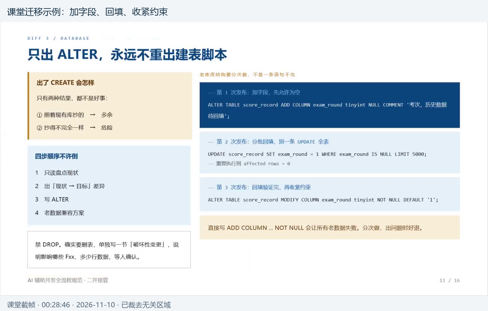

需要给课件标题补上适用范围：“只出 ALTER”针对修改已有表，不代表新业务永远不能 `CREATE TABLE`。新表当然可能需要创建，问题是不能用重新建库、重新建表代替已有系统的迁移。

同样，“加 NOT NULL 一定导致所有老数据失败”过于绝对。具体行为取决于数据库、列类型、默认值和执行方式。更稳妥的决策顺序是：先查看现有数据和目标约束，再评估锁表、耗时、默认值、旧版本兼容与回退方式。

```text
请先生成迁移计划，不直接修改生产库。
列出现有结构、目标结构、受影响行数的查询方法和兼容性要求。
对新增必填字段，评估先可空、分批回填、校验、再收紧约束的方案。
在独立测试库执行，记录耗时、旧代码读写结果和恢复演练结果。
无法验证回退就写“未验证”，不要把一句 ROLLBACK 当成恢复方案。
```

MySQL 中不少 DDL 会隐式提交，不能把普通事务回滚当成通用的结构恢复办法。应按实际版本设计并演练恢复路径。[MySQL：会导致隐式提交的语句](https://dev.mysql.com/doc/refman/8.4/en/implicit-commit.html)

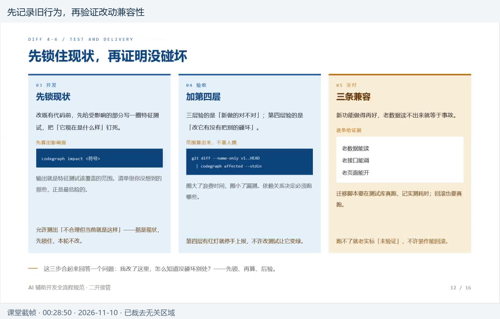

课件还要求验证老数据能读、老接口能调、老页面能开。旧行为测试是基线；遇到明确缺陷要有意识地调整预期，不能为了让结果变绿随手改测试。

<a id="tu-07"></a>
## 07 登录失败先看请求，别先猜密码或缓存

**回看：00:02 至 00:05；00:30:23 至 00:31:08。** 开场管理端登录没有明显反馈。课堂检查验证码图片、Network 请求，后来看到明确的业务响应。

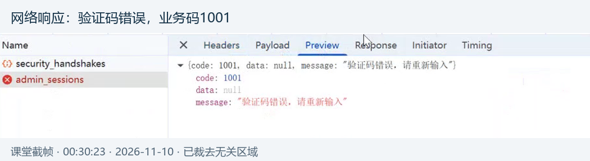

画面显示业务码 `1001`，消息为验证码错误。随后把输入的小写字母改成大写，进入强制改密流程，再回登录页，最终打开后台。这是本次录屏中的操作结果，不足以推导所有验证码系统都区分大小写。

排查顺序应沿着请求走：

1. 打开浏览器开发者工具 `Network`，筛选 `Fetch/XHR`。
2. 清楚地区分验证码获取请求和登录请求。
3. 点登录，确认有没有发出请求；没有请求先查前端事件、校验和 Console。
4. 请求发出后，分别记录 HTTP 状态、业务码、响应消息。
5. 检查页面有没有展示失败、有没有解除加载状态、是否需要刷新验证码。
6. 登录成功后再检查跳转、权限菜单、改密和会话状态。

课堂早先出现“可能旧包”等判断，它是排查假设。只有清缓存、重启或切包之后有可复现的前后对照，才能把它写成根因。

另一个后续细节：后台密码改过，自动化种子脚本还用旧凭据，测试就会失败。因此测试账号配置与业务流程必须同步维护，日志和论坛截图则不要记录明文凭据。

<a id="tu-08"></a>
## 08 UI 改造要同时验布局、交互和错误反馈

**回看：00:33 至 00:49。** 老师提出登录页左侧放产品介绍、右侧放表单、预留广告区域、调整背景和导航，并让 Agent 回到功能设计会话同步文档。

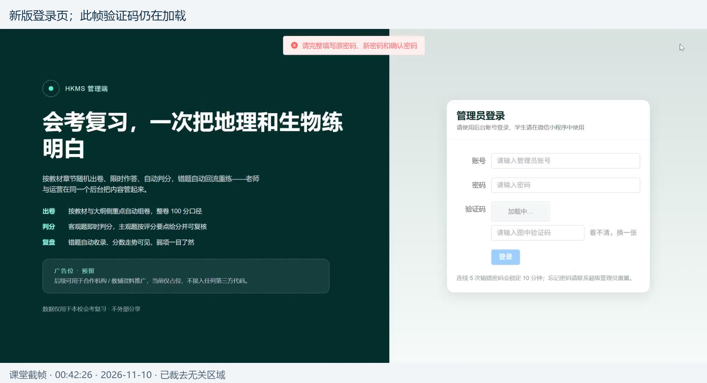

图里布局已经变化，但验证码仍显示加载中，顶部还有提示。这张图只能证明该时刻的页面外观，不能同时证明验证码、登录和改密全部通过。随后录屏确实出现新版后台首页。

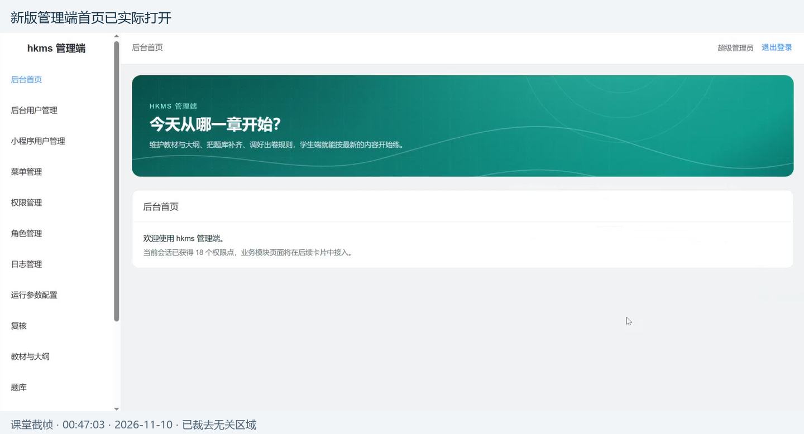

后台继续逐项查看时，还暴露一些产品问题：科目更适合选项控件，题量默认值说明不清，部分页面仍保持原来的表单样式。约 00:49 的模型“测试连通”显示“连接失败：模型不存在”，因此不能把这段写成真实模型判分链路已经成功。

HTML 负责结构、CSS 负责样式、JavaScript 负责行为，是理解页面的起点。但 UI 改造经常同时涉及模板、状态和交互，不能把所有 UI skill 都理解为只改 CSS。

在 `Elements` 的 `Styles` 面板里，属性被划线可能只是被其他规则覆盖，不一定是语法错误。需要结合警告标记、层叠顺序和 `Computed` 的最终值判断。[Chrome DevTools：无效、覆盖和不生效的 CSS](https://developer.chrome.com/docs/devtools/css/issues)

课堂中还短暂出现 Vue 标签未闭合的构建错误。此时应先修模板编译，再验视觉，避免把旧页面残留当成修改后的效果。

可以把“帮我美化一下”换成：

```text
请列出本轮涉及的页面、状态和交互，再同步功能设计。
保留已有业务字段、接口和权限语义。
分别验收：正常、加载、空数据、输入错误、接口失败、无权限状态。
提供桌面和窄屏截图，并实际点击登录、退出、菜单和主要表单按钮。
图片或截图只证明画面；业务成功还要附请求与状态变化证据。
```

<a id="tu-09"></a>
## 09 小程序排错：目录、开发工具登录、业务登录是三件事

**回看：00:36:35；00:45:05；00:51:56 至 00:55:59。** 最初微信开发者工具打开的是另一个目录，提示缺少 `app.json`。后来明确导入本项目的 `miniapp`，目录树才出现正确文件。

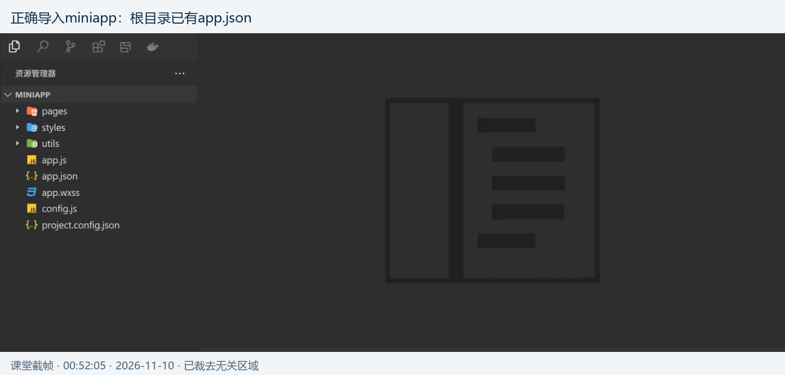

跟做时先核对 `project.config.json` 配置的工程根和实际 `app.json` 所在位置。遇到缺文件先确认打开的工程，不要在错误目录里临时造一个文件。

接下来还有两种登录：

| 状态 | 解决的事情 | 不能据此证明什么 |
| --- | --- | --- |
| 微信开发者工具扫码登录 | 让开发工具使用相应开发者身份 | 不代表学生已登录业务后端 |
| 业务登录 | 前端登录凭据由后端处理，形成业务会话 | 不代表后续答题、保存和交卷可用 |
| 本地测试会话 | 为隔离后的业务测试准备已登录条件 | 不代表真实微信登录链路通过 |

录屏中正确工程启动后出现 401、400。Agent 判断后端缺少 AppSecret，导致 `code2Session` 相关路径失败；随后用测试学生的本地会话继续检查业务页面。这应记为“登录后的开发测试”，真实微信登录仍要单独验收。AppSecret 应放在服务端受控配置中，不能交给小程序或贴进公开日志。

开发工具里临时关闭域名、TLS 和证书校验，是课堂的本地联调条件。它不能成为正式环境的验收依据。发布前需按微信当前规则配置域名和 HTTPS，并在真实设备检查图片及接口行为。

<a id="tu-10"></a>
## 10 小程序真正暴露的两个缺陷

**回看：01:01:21 至 01:08:23；01:20:16 至 01:20:32。** 自动化开始走学生流程后，课堂 Agent 找到两类问题：答题页面没有完整作答 UI，以及页面读取 API 结果的方式与公共封装不一致。

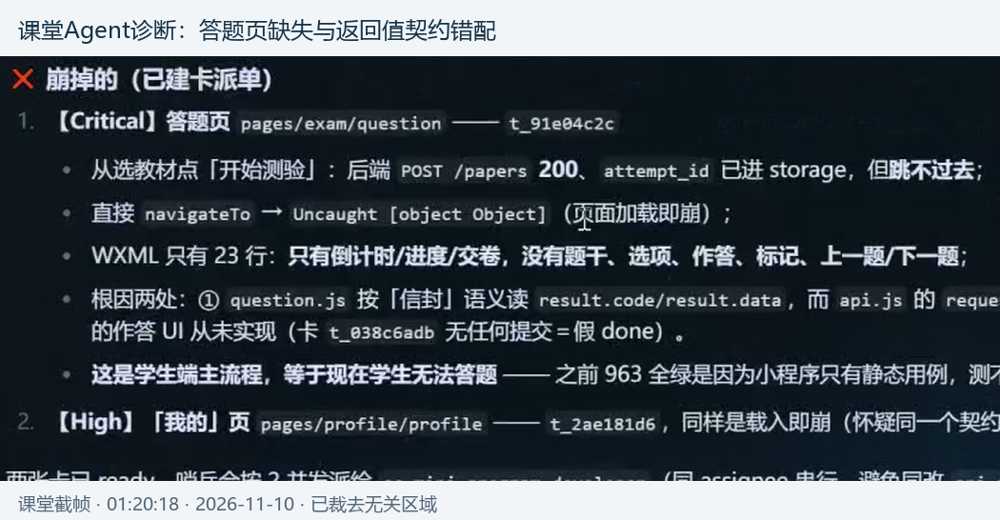

报告中提到 `question.wxml` 只有约 23 行，缺少完整题干、选项、作答和切题交互。它不是把颜色改好就能解决的问题。另一个问题在 `loadAttempt()`：页面按 `{code, data}` 读取结果，而公共请求层已经把外层信封解掉。

下面是整理用的简化示例，不是附件中提取的可运行源码：

```javascript
// 假设项目已有请求层：成功时直接返回业务数据，失败时抛出异常。
const attempt = await api.getAttempt(attemptId);

// 页面应按已确认的契约读取，不再检查 attempt.code 或 attempt.data。
renderQuestions(attempt.questions);
```

如果请求层返回的是 `body.data`，页面却再读一次 `result.data`，拿到的就可能是 `undefined`。反过来，如果请求层本来保留信封，页面也不能擅自假定已解包。修复前必须打开请求封装和调用者一起看。

画面中的报告还指出：`POST /papers` 已返回 200，测验 ID 已保存，但页面跳转仍报 `Uncaught [object Object]`。这说明“后端请求成功”没有覆盖“学生能进入答题页”这个验收条件。

两个相关缺陷被交给同一小程序开发者串行处理，目的是避免同时改 `api.js`。这里应按共享文件安排任务，而不是一见两个 bug 就强行并发。

<a id="tu-11"></a>
## 11 测试数量为什么没有挡住这个问题

**回看：01:20 左右；01:26 左右。** 课堂 Agent 自报先前有 963 个测试，但小程序主要是静态用例，没有覆盖真实 UI，因此没有挡住答题主链路失败。

这组数字是课堂报告，不是本文重新执行课堂仓库得到的结果。值得学的是检查测试到底断言了什么：

| 粒度 | 示例 | 能发现的问题 |
| --- | --- | --- |
| 字段或函数 | 空题干、超长文本、状态转换 | 局部规则错误 |
| 页面 | 进入页面、表单校验、按钮状态、错误提示 | 渲染与交互错误 |
| 完整业务 | 选教材→组卷→答题→交卷→结果→记录 | 多模块契约和数据衔接错误 |

一个检查“文件中有 `submit` 字符串”的静态测试，不能替代实际点击提交并断言结果。空页面截图、无数据列表、请求成功但未跳转，也不能统一算通过。

老师要求“使用 Playwright，我要看网页动态变化”，于是出现可见浏览器自动操作。可见模式便于旁观，但是否真实，取决于服务、数据、断言和证据，不取决于窗口是否显示。Playwright 默认支持无头运行，`--headed` 可以显示窗口，`--ui` 用于交互调试。[Playwright：运行测试](https://playwright.dev/docs/running-tests)

真正有价值的断言应落在页面结果和业务状态上，例如预期 URL、保存成功提示、记录内容，而不是仅等待几秒截图。异步页面断言通常需要等待条件成立。[Playwright：断言](https://playwright.dev/docs/test-assertions)

<a id="tu-12"></a>
## 12 四层 Review：每一层都要有明确失败条件

**回看：01:32:18 至 01:35:37。** 老师打开 F01 的验收卡，展示四层 Review。图中的端口、环境和表名属于被讲解的那份任务卡，不应不加检查地复制到另一项目。

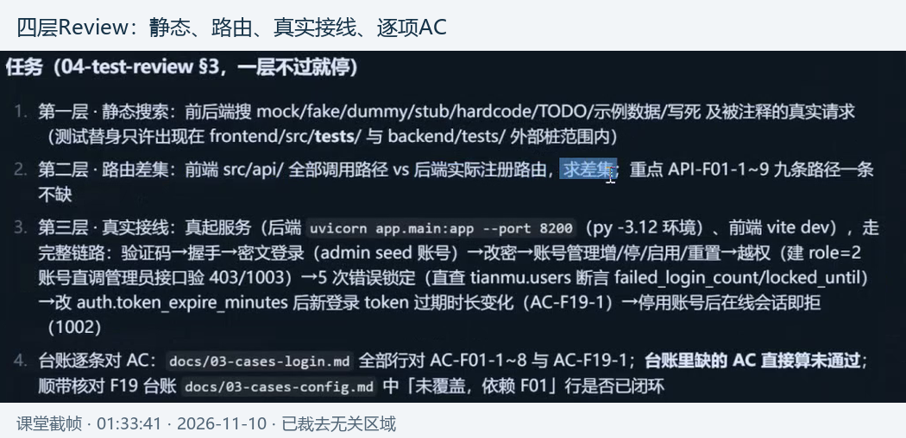

**第一层，静态检查。** 查运行代码里的 mock、fake、dummy、stub、硬编码、TODO、示例数据和被注释的真实请求。命中关键词只是线索，要判断它是不是运行路径上的替身；测试夹具中的 mock 有正常用途，不能全删。

**第二层，路由对照。** 比较前端实际调用、后端实际注册路由和接口文档。对照方法、路径、参数与响应，不是只数接口总数。动态拼接路径、路由前缀和路径参数必须正确归一化。

**第三层，真实接线。** 启动真实前后端，走验证码、登录、改密、账号操作、权限拒绝、锁定和过期等链路；在已授权测试库里核对结果。屏幕上按钮变灰还不够，后台也必须拒绝越权请求。

**第四层，逐条核对 AC。** AC 是 Acceptance Criteria，即验收条件。把每条条件连接到用例和证据：已覆盖、失败、未执行、受阻分别列出。没有证据的条件不能因“其他测试全绿”顺带勾选。

课堂接管课件还提到保护旧行为的回归要求。不要混淆两处“第四层”的说法：一处是二开额外关注兼容性，另一处是这张 Review 卡的第四项台账核对。实际项目可以把它们共同放进验收清单。

<a id="tu-13"></a>
## 13 单模块通过后，再验跨模块业务

**回看：01:25 至 01:36。** 浏览器实际执行了后台登录、用户新增和编辑、状态切换、权限菜单、参数修改及恢复等操作。之后还需要确认教材、题库、组卷、答题、结果和记录之间是否接通。

可以用一条带可追踪数据的链路验收：

```text
在隔离测试环境准备一个测试教材和章节。
后台新增一题并保存，记录题目ID。
配置并启用组卷规则，记录规则ID。
小程序选择该教材，发起测验，记录测验ID。
完成作答、切题、保存、交卷，重新打开结果与记录。
每一步核对：页面状态、实际请求、后端返回、数据库最终状态。
同时覆盖无题、规则未启用、接口失败与无权限分支。
```

课堂曾遇到“规则建了但未启用”，也看到未选教材时题库为空。二者都可能是前置条件，不应马上改成“忽略规则”或“默认显示所有题”。先检查产品设计要求，再准备测试数据。

种子数据是为了重现业务条件。修改了哪些数据、使用哪个测试账号、运行结束如何恢复，都应记录。共享测试库还要防止两个测试进程互相重置数据，第 18 节会看到这个问题再次出现。

<a id="tu-14"></a>
## 14 内存接近用满时，先定位进程和测试并发

**回看：01:38:43 至 01:44。** 自动化期间出现连接关闭，任务管理器显示内存达到 97% 至 98%，其中一个 Python 进程占用约 10.8 GB。停止相关任务后，占用明显下降。

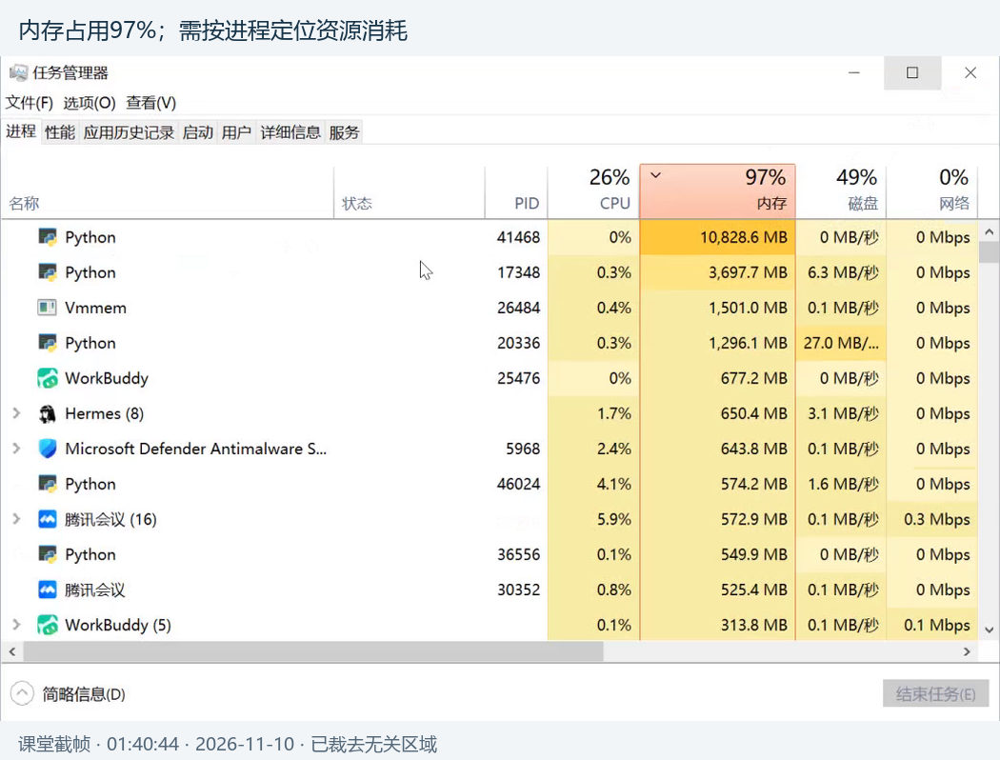

这些画面能证明资源紧张和停止任务后的变化，不能单凭进程名认定 Playwright 内存泄漏，也不能得出“所有 AI 开发都必须 64 GB 内存”。当时同时运行了浏览器、服务、Agent 和其他程序。

更可操作的排查是：记录高占用 PID，查看它的命令行、父进程和启动时间，确认属于哪次任务；降低测试 worker 或浏览器并发；失败分支也关闭页面、context 和 browser；测试结束检查子进程是否退出。

需要终止时，只结束已确认属于本轮任务的进程。不要按名字结束全部 Python，它可能包含数据库脚本、转写或其他正在工作的服务。资源不足导致测试中断，应记为“未完成/受阻”，不能保留之前的绿色汇总冒充全套完成。

<a id="tu-15"></a>
## 15 题干改富文本，会牵动整条数据链路

**回看：01:36:35 至 01:37:10；01:42:44 之后。** 老师在新增题页面发现题干和选项都是普通文本，要求改成富文本，方便插入并渲染图片。

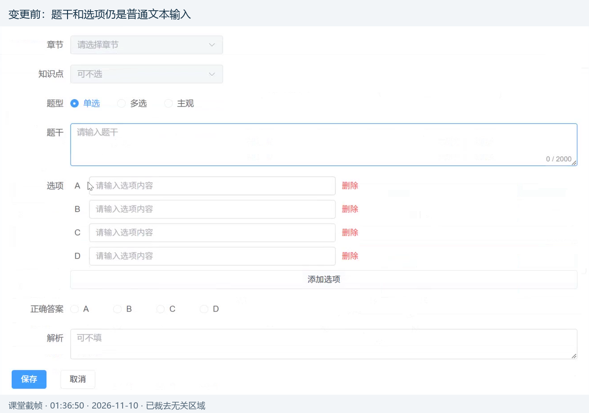

这句话至少涉及以下决定：

| 位置 | 要说明的契约 |
| --- | --- |
| 后台编辑器 | 支持哪些格式、按钮、粘贴和图片插入行为 |
| 接口 | HTML还是结构化节点；长度按原始内容还是可见文字计算 |
| 服务端 | 允许的标签、属性、URL协议；如何清洗输入 |
| 图片存储 | 上传权限、大小和类型、访问地址、有效期与失败提示 |
| 数据库 | 现有列是否足够；旧纯文本如何兼容 |
| 小程序 | 能渲染哪些节点；图片URL和设备行为是否符合要求 |

课堂随后改了富文本清洗、题目 schema、图片上传、后台编辑器和小程序相关实现。可见改动已经越过单纯样式范围。

需要保留 HTML 排版时，只把全部字符转义会把格式也变成文本；直接原样渲染又会带来脚本注入风险，因此要采用适合渲染上下文的 HTML 清洗方案。OWASP 也提醒，清洗后再次被其他库改写，可能破坏原先的安全效果。[OWASP：HTML Sanitization](https://cheatsheetseries.owasp.org/cheatsheets/Cross_Site_Scripting_Prevention_Cheat_Sheet.html)

这不是要求随手写个正则删除 `<script>` 就结束。实际验收应包括正常格式保留、危险标签或属性被处理、非法 URL 被拒、旧文本显示正确、保存后再编辑不丢内容、图片失效时有反馈。服务端规则与前端体验要分别检查。

<a id="tu-16"></a>
## 16 “文档同步了吗”暴露了真正的流程缺口

**回看：01:56:16 至 01:58:11。** 老师问：代码和文档是否统一？Agent 回答代码已经改完，但文档还没有动。继续追问不提醒会不会同步时，Agent 承认原先把文档安排在测试之后，是事后补账。

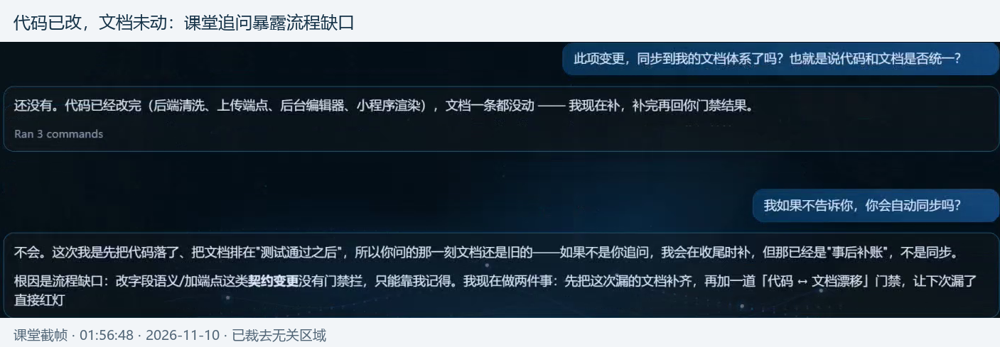

这里不能靠再加一句“请记得同步文档”结束。新上传端点、字段语义、返回结构、页面输入方式都已经变更；后来的开发者如果继续按旧文档工作，就会把错误扩散到更多地方。

一张可执行的变更卡应该写清：

```text
变更：题干与选项支持富文本图片。
影响：需求、接口、数据字段语义、后台功能、小程序功能、上传与渲染测试。
先完成：文档中的输入输出、限制、错误行为和兼容方案。
再完成：对应代码、门禁、真实页面与跨端测试。
完成证据：文档路径及版本、代码差异、测试命令、结果、截图与遗留项。
```

版本号提高本身不能证明内容一致。必须能从变更卡追到具体字段或端点，再从文档追到实现与测试。

<a id="tu-17"></a>
## 17 文档门禁怎么设计，才能拦住下一次遗漏

**回看：01:58:11 至 02:02；02:08:58 至 02:09:25。** 课堂 Agent 提出四项改进：把文档先行写入项目规则，添加契约漂移检查脚本，修改开发卡模板，并调整收尾顺序。

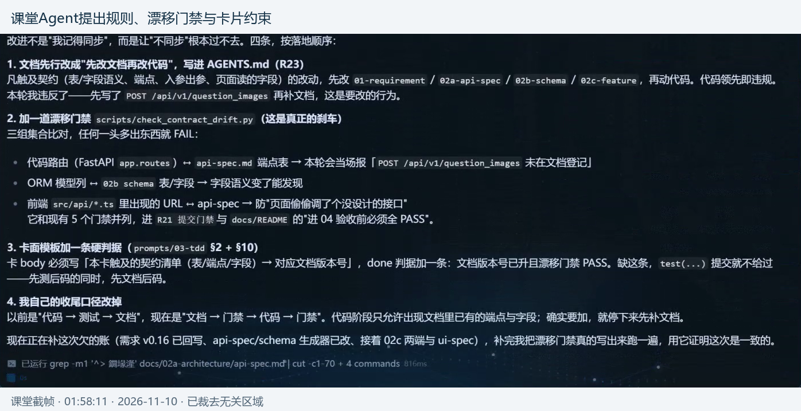

所谓契约漂移，就是代码和文档对同一件事描述不一致。课堂提出比较三组信息：后端注册路由与 API 文档、ORM 模型与数据库文档、前端请求 URL 与 API 文档。

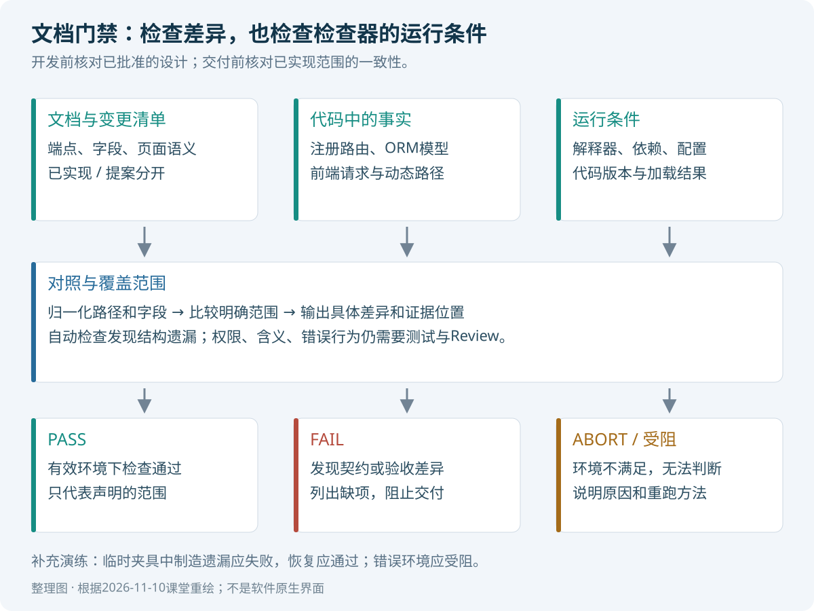

整理时还要补一个容易忽略的实现细节：**文档先改完、代码还没写时，严格的双向一致检查本来就可能发现“文档有、代码无”。** 因而“文档→门禁→代码→门禁”不能简单理解为每一步都运行同一检查并要求全绿。

比较合理的阶段划分是：

1. 开发前检查变更清单、文档完整性和已批准的待实现项。
2. 实现中只允许本卡登记的暂时差异，不给全局放行。
3. 交付前核对已实现范围，要求代码、文档和验收证据一致。
4. 提案或未来功能单独记录，不能计入已实现数量。

脚本也有边界。枚举路由和字段可以发现遗漏，却不能自动证明权限语义、字段含义、富文本清洗和错误码都正确。动态 URL 拼接、条件注册路由、数据库生成列、运行环境差异，都需要有明确处理规则。

**建议增加门禁自身的红绿测试，这是整理补充，录课没有完整演示这一组负例。** 在临时副本或测试夹具里删去一个接口文档条目，检查必须失败；恢复后通过；再用错误解释器运行，应该明确报环境受阻，而不是输出绿色。不能为了这个演练破坏主工作区。

<a id="tu-18"></a>
## 18 课堂最终报告：通过项和未完成项一起读

**回看：02:18:57 至 02:20:01。** 后段出现富文本编辑器的截图，以及测试、文档和门禁汇总。

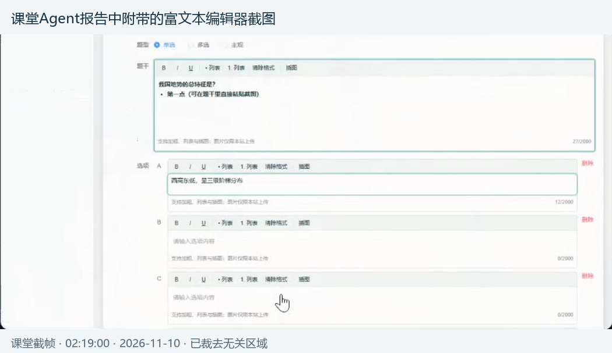

下面保留证据等级，避免把报告数字写成本文亲自复跑：

| 项目 | 课堂中可见的信息 | 应如何表述 |
| --- | --- | --- |
| 全量测试 | Agent 报告 `1002 passed` | 课堂 Agent 自报，本文没有课堂源码可复跑 |
| 四个文件串行复测 | Agent 报告 `42 passed` | 用于解释共享测试库冲突后的复测 |
| API 文档 | 报告 v1.6、91 个端点 | 文档统计，不代表91条业务链路均已端到端验证 |
| 数据结构 | 报告 v1.6、27 表、315 字段 | 包含 `llm_configs.enabled_flag` 生成列 |
| API/schema 检查 | 报告 29/29、40/40 PASS | 对应各脚本的检查范围 |
| 契约漂移门禁 | 指定虚拟环境中 7/7 PASS | 环境和范围是结果的一部分 |
| 小程序图片富文本 | 明确只静态检查，未在开发工具/真机实跑 | 待实机验证 |
| F59 真题导入 | 文档已登记，代码尚未实现 | 提案状态，不能计入完成 |

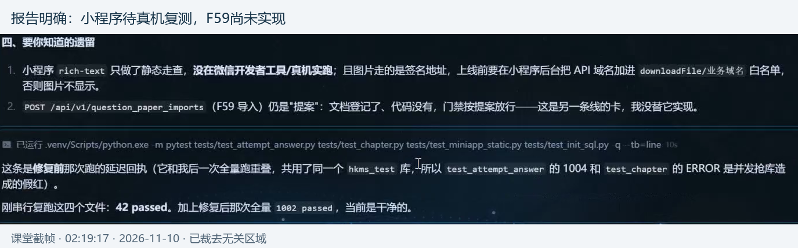

报告解释，一次延迟回执中的测试错误与全量测试同时重置共享测试库有关。它随后串行复跑四个文件。这个例子说明测试环境也需要隔离：至少明确谁拥有库、谁能初始化；并发时使用独立数据库或隔离的 fixture，不能互相删数据。

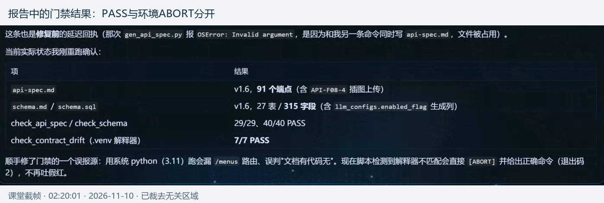

最后一帧还说，系统 Python 3.11 会漏加载 `/menus` 路由，造成错误差集；调整后，解释器不匹配会 `ABORT` 并返回退出码 2。这个细节很有价值：**环境未就绪既不是产品功能失败，也不是检查通过，应该单独呈现。**

小程序图片地址涉及哪些域名配置，要按实际组件和请求方式核对，不能只照抄报告中的一组白名单名称。真正的完成条件是目标设备能请求图片、正确渲染、保存后重进仍正常。

<a id="tu-19"></a>
## 19 多机调度：把网络、远程执行和任务看板分开

**回看：01:47:29 至 01:53:45。** 老师展示自制项目插件、机器在线状态和远程执行日志，讨论用 Tailscale 连通机器，再通过 SSH 调远端 Agent CLI，把结果回传到本机看板。

可以拆成四层理解：本机负责下发任务；网络负责连通；SSH 负责在授权机器执行；远端 Agent 在明确目录里读写项目。看板显示任务状态属于上层调度，不是网络工具自动提供的能力。

Tailscale 上运行普通 SSH，与启用产品功能“Tailscale SSH”不是同一件事。后者还接管相应连接的认证授权；如果继续使用普通 SSH，密钥、系统用户和权限仍按原 SSH 配置管理。[Tailscale SSH 官方说明](https://tailscale.com/docs/features/tailscale-ssh)

实际跟做先用最小只读任务验证：远端工作目录、当前分支、工具版本、命令退出码和日志能否正确回传。再派允许写入的任务，并限制共享文件冲突、并发数和超时。局域网已连通时可能直接使用已有 SSH，不必为了模仿课堂额外装网络层。

视频里的插件属于演示中的项目，没有随本次 ZIP 提供。本文也没有把它包装成可下载的成品。

<a id="tu-20"></a>
## 20 工具输出脱敏：先确认改的是输出还是文件

**回看：02:04 至 02:08。** 课堂讨论网关脱敏时，普通代码标识和 `placeholder` 相关内容被替换成密码占位符，Agent 因而怀疑源码被污染，并尝试修复。

这里有两个不同位置：磁盘上的原文件，以及传给模型的工具输出。原文件可能正确，只有展示层被替换；如果不先核实，模型可能按被替换的内容反向改坏源码。

整理用例：

```html
<!-- 普通输入提示文案，不是凭据。 -->
<input placeholder="请输入题目标题">
```

不要因为一个字段名包含敏感词就把整段语法替换掉，也不要发现误报后立刻关闭全部保护。应做最小正反例：真正的凭据不能泄漏，普通文案和组件属性应保留结构；对照本地文件与经过工具链后的输出，确认替换发生在哪层。

本次公开配图只保留教学相关区域，未公开原始凭据、登录二维码、私人聊天和机器地址。

<a id="tu-21"></a>
## 21 限速、Token 用量和 skills：先测量再下结论

**回看：00:13 至 00:20；02:09 至 02:18。** 课堂多次切到模型路由、项目用量和技能配置。对中转、缓存、额度和封禁原因的一些说法只是讨论，没有完整对照实验。

排查限速时至少区分：上游供应商限制、网关队列或重试、Agent 工作流重复调用。记录请求时间、响应状态、重试次数和等待时长，才能知道时间花在哪一层。不要把换了路由后暂时快一点，当成某产品长期更快的结论。

Token 面板也应拆开读：输入、输出、缓存读取、缓存写入、失败重试和估算费用可能使用不同口径。课堂出现很大的累计数字，不能直接把总 Token 乘以单一单价当成最终账单。所谓网关“多耗多少比例”的说法，在本片中没有完成实测。

关于 skills 和 MCP，课堂建议减少长期不用的内容。整理后的执行顺序是：列清来源、用途、加载方式、最近使用和依赖；先禁用候选，再跑一轮原有工作流；确认没有影响后再决定是否移除。不同工具不一定把全部技能正文常驻上下文，不能仅凭安装数量判断实际消耗，也不应让 Agent 盲删“最近没用”的工具。

本次整理没有修改读者的任何技能或网关设置。视频中某个技能的星标数、是否新发布，也不足以代替对来源、权限和执行内容的检查。

<a id="tu-22"></a>
## 22 几个容易听混的概念，放在一起校正

**回看：约 01:00 至 01:20。** 这段口头延伸涉及 Agent、RAG、Memory、LangChain、LangGraph、LoRA、小模型和 ESP32。录音中的同音词很多，不能把自动转写当术语表。

| 概念 | 本文采用的区分 |
| --- | --- |
| RAG | 先检索相关外部知识，再把检索结果提供给生成过程；检索来源不必局限于向量数据库 |
| Memory | 保存与检索会话或任务状态的机制；是否需要、存什么、何时失效由任务决定 |
| LangGraph | 使用图和状态组织执行过程的编排运行时，可用于不同复杂度的流程 |
| LangChain | 提供模型、工具和 Agent 等抽象；其 Agent 能力建立在 LangGraph 之上 |
| LoRA | 参数高效微调方法，训练低秩增量参数；不是知识蒸馏的同义词 |
| 知识蒸馏 | 利用教师模型的信息训练学生模型；可以与其他训练技术组合 |
| “把视频蒸馏成 skill” | 此处是提炼步骤和知识的口语说法，不等于训练一个神经网络 |

LangGraph 不能简单叫作“LangChain 的多智能体升级版”。官方把它描述为处理状态和执行的低层基础设施，也可以独立于 LangChain 使用。[LangGraph 概览](https://docs.langchain.com/oss/python/langgraph/overview)

RAG 也不是一套强制的业务规则框架。已有 SQL、文档库或其他知识源可以直接成为检索来源；选不选向量库要看检索需求。[LangChain：Retrieval](https://docs.langchain.com/oss/python/deepagents/retrieval)

LoRA 的核心是冻结预训练权重并训练低秩矩阵；经典蒸馏讨论的是把教师知识转移给学生模型。二者可以组合，但不能混为一谈。[LoRA 论文](https://arxiv.org/abs/2106.09685)、[知识蒸馏论文](https://arxiv.org/abs/1503.02531)

课堂关于“几十 KB 模型在 ESP32 上做通用对话”“ESP32 自带 Linux”的口述需要另行验证。常见 ESP-IDF 环境使用 FreeRTOS；关键词识别、分类和把语音发给云端 LLM，也不等于板上运行完整通用对话模型。[ESP-IDF FreeRTOS 文档](https://docs.espressif.com/projects/esp-idf/en/stable/esp32/api-reference/system/freertos_idf.html)

同样，不能用“项目大就用 Wiki，小就用 RAG”一刀切。先看知识更新频率、权限、检索质量和引用要求。“AI Native”也不能被本课提到的几个组件拼成一张所有系统都必须照买的清单。

<a id="tu-23"></a>
## 23 数字人演示：任务完成、连接成功、口型自然分别验收

**回看：02:20 至 02:38:36。** 最后切到一个已有数字人项目，涉及 LiveTalking、MuseTalk、GPT-SoVITS，以及头像处理、语音服务和前端连接。

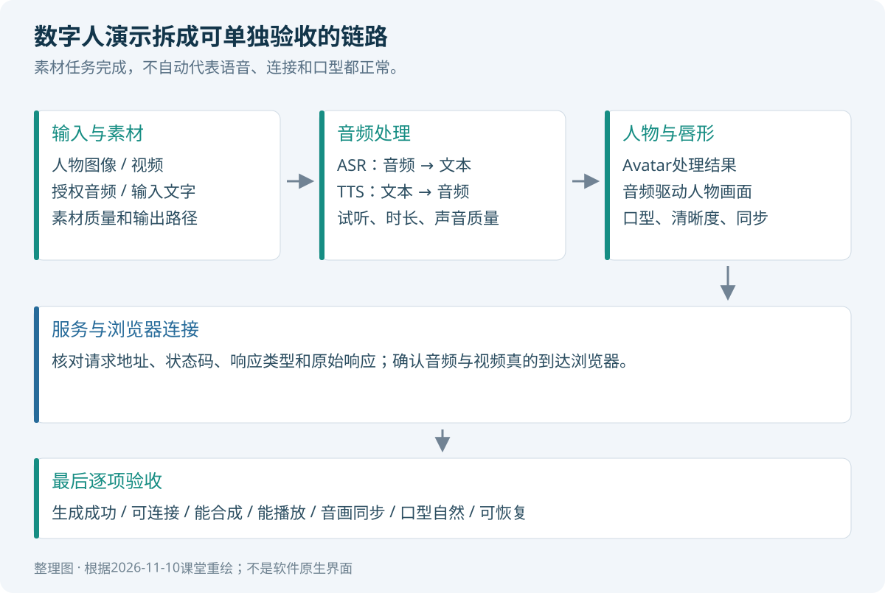

先分清三个转换：ASR 把音频转为文本；TTS 把文本合成为音频；唇形驱动让人物画面与音频对齐。声音训练、人物素材处理、聊天模型和实时传输又分别有自己的输入与验收标准。分离人声和背景音可以由软件实现，不是一定要额外硬件。

LiveTalking 项目提供实时数字人相关能力，GPT-SoVITS 关注语音合成和声音适配；具体版本能接哪种模型，需要按各自配置验证，不能仅凭前端下拉框判断服务已连好。[LiveTalking 项目](https://github.com/lipku/LiveTalking)、[GPT-SoVITS 项目](https://github.com/RVC-Boss/GPT-SoVITS)

这段演示的结果要分开记：

- 约 02:27，页面建立过连接并出现人物画面。
- 之后发送文字并不一直得到预期声音，TTS 管理页出现 `Failed to fetch`。
- 创建 Avatar 的任务先显示 RUNNING，后来显示 COMPLETED。
- 约 02:32:54，使用新 Avatar 连接时报 JSON 解析错误。
- 之后回到默认 Avatar 又出现画面，口述中提到听到声音；不能说整段一直无声。
- 临近结束，TTS 管理页仍显示失败，人物口型模糊也仍在讨论。

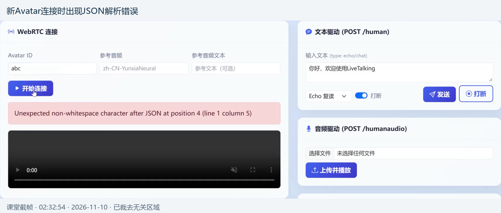

JSON 报错的重点是客户端没有拿到它预期的单个合法 JSON 响应。下一步要看 Network 中的状态码、响应类型、原始响应和服务日志。录屏没有展示足够信息来确认究竟是错误页、混入其他内容还是别的格式问题，本文不替它猜定根因。

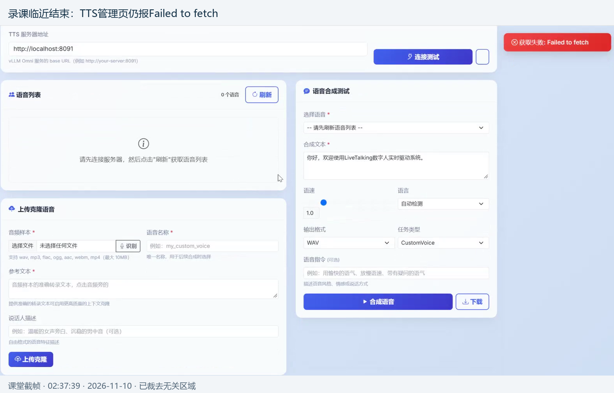

同样，`Failed to fetch` 不能单独确定为 CORS。应先核对服务是否启动、实际请求地址是否可达，再检查浏览器错误和服务端日志。尤其浏览器中的 `localhost` 指向浏览器所在机器，多机部署时要确认服务真实位置。

这段课适合提炼成分段验收：素材能处理、任务有输出、音频能合成、连接有视频、文本能驱动声音、音画能同步、口型可接受、断连能恢复。某一步完成，不能代替其余步骤。

结尾还讨论云主机、备案、优惠和家庭宽带。这些是当时的个人经验，不作为本篇的现行价格或部署规则；部署选择应以实际负载和当期服务条款为准。

<a id="tu-24"></a>
## 24 换成自己的项目，按这条路线指挥 Agent

如果只想把课里的方法用起来，可以下载学习包，用编辑器打开 `README.md`，按下面顺序逐份填写。不要一次把所有提示词塞进同一个长对话，让它跳过中间证据。

| 步骤 | 你给 Agent 的内容 | 你要检查的产出 |
| --- | --- | --- |
| 1 接管 | 项目路径、允许读取范围、当前问题 | 基线、结构、启动依赖、代码证据、待确认项 |
| 2 定规则 | 接管报告和现有规则文件 | 项目实际约定、规则差异、技术债 |
| 3 定范围 | 本期选中的 GAP 与功能 | 需求、现状和目标差异、验收条件 |
| 4 做变更卡 | 具体业务变化，如富文本图片 | 涉及文档、端点、字段、页面、兼容与测试 |
| 5 实施 | 已明确的设计和允许修改范围 | 最小代码差异、有效测试、更新后的文档 |
| 6 页面验收 | URL、测试角色、隔离数据、流程 | 正常与错误状态、真实点击和网络证据 |
| 7 跨端验收 | 后台→接口→小程序→数据库链路 | 同一组业务ID贯穿始终，保存和读回一致 |
| 8 交付 | 验收表和所有未完成项 | PASS/FAIL/未执行/受阻分别列出，给复测入口 |

第一轮可以直接填写并发出：

```text
项目根目录：<填真实路径>
当前目标：<例如题干和选项支持图片，同时兼容旧题目>
已知现象：<写可复现操作与结果>
本期允许修改：<模块或目录>
本期暂不处理：<列清范围外事项>
测试环境：<开发服务和独立测试库，不贴凭据>

先执行接管摸底，给我代码证据、影响面和最小变更方案。
沿用已有文档结构和规则，不自动扩范围。
缺少业务决定时集中列出；能独立核查的继续核查。
实施前先把本次契约和验收条件写清楚。
```

开始测试前，打开项目使用的终端、浏览器或微信开发者工具；按仓库 README 中已经核实的命令启动，不照抄录屏端口。成功标准是你的目标流程能实际完成，并留下结果记录。若失败，从下节表格找对应层，不要同时重装环境、换模型、改接口和重写页面。

<a id="tu-25"></a>
## 25 把本课故障变成一张排查表

| 看到的现象 | 先查什么 | 什么才算修好 |
| --- | --- | --- |
| 点登录没有反馈 | 是否发请求、响应业务码、异常处理和加载状态 | 成功正确跳转；失败有明确提示且可重试 |
| 小程序缺 app.json | 工程目录与小程序根配置 | 正确工程加载，入口与页面清单可读 |
| 开发工具登录了，业务仍401/400 | 微信登录与业务会话链路、后端配置 | 真实业务登录独立验收通过 |
| HTTP200却进不了答题页 | 请求层解包、页面字段读取、导航与渲染错误 | 有题目、可作答、可保存、能交卷 |
| 测试很多但功能不可用 | 用例是否走真页面和完整链路 | 关键AC有真实证据，不能只数用例 |
| 富文本编辑器出现了，图片不显示 | 上传、存储URL、有效期、清洗、目标端节点支持 | 保存、重进、跨端与真机均按预期显示 |
| 门禁报文档/代码不一致 | 实际差异、解释器、路由注册条件 | 有效环境下通过；无效环境清楚受阻 |
| 并行测试忽红忽绿 | 是否共用并重置同一个测试库 | 隔离后稳定复现，修复后稳定通过 |
| 内存97%导致任务断开 | PID、父进程、worker、浏览器和子进程回收 | 有界并发，测试完整跑完，资源正常回收 |
| 数字人任务完成却连不上 | 产物路径、Avatar配置、连接响应与日志 | 产物可加载，连接和播放分别通过 |
| TTS Failed to fetch | 服务地址、连通性、原始响应和浏览器错误 | 可获取声音并实际合成、播放 |

每次修复只针对已定位的原因。复测要重复原始失败步骤，再查受影响的相邻功能；不要只运行新加的一小条测试就关闭整张卡。

<a id="tu-26"></a>
## 26 全片回看时间轴

以下时间以视频起点计，约到秒；某些话题中途切出又切回。私人群聊、电话和账号页面仅记录其间发生了切换，不摘录内容。

| 时间 | 内容与回看重点 |
| --- | --- |
| 00:00 至 00:08 | 已完成看板、后台启动、登录无反馈、验证码与请求检查 |
| 00:08 至 00:13 | 二开与新建区别，先理解旧代码再建立规则 |
| 00:13 至 00:21 | 模型路由与限速讨论，未经实测的原因仍是推测 |
| 00:21 至 00:24:36 | 索引、五方向扫描、GAP缺口、00b接管输出 |
| 00:24:39 至 00:28:55 | 00c规则、提示词阶段、范围、两张架构图、增量迁移与回归 |
| 00:29 至 00:33 | 验证码失败、改密、实际登录、后台页面巡查 |
| 00:33 至 00:43 | UI要求、页面实现、CSS检查、模板编译错误与新版登录 |
| 00:43 至 00:51 | 开发工具登录与端口、后台继续巡查、模型连通失败 |
| 00:51:56 至 00:59:34 | 正确导入miniapp、业务登录受阻、本地测试条件、首页UI |
| 00:59:34 至 01:08 | 数字人旁支、小程序答题缺陷、请求解包、页面巡查 |
| 01:08 至 01:20 | RAG/Memory/LangGraph/LoRA/ESP32讨论与小程序缺陷派单 |
| 01:20 至 01:25 | 小程序失败总结，请求Playwright可见浏览器测试 |
| 01:25 至 01:32 | 管理端实际操作、权限与表单测试；其间群聊旁支不展开 |
| 01:32 至 01:36 | F01四层Review、AC逐项核对、跨模块验收 |
| 01:36 至 01:42 | 题库表单、富文本需求、文档版本报告、内存紧张 |
| 01:42 至 01:47 | 继续富文本实现、图片与对象存储讨论 |
| 01:47 至 01:54 | 自制插件、多机网络、SSH与远程Agent日志 |
| 01:54 至 02:02 | 富文本改造后追问文档，提出并实现同步门禁 |
| 02:02 至 02:09 | 将经验回写提示词、工具脱敏误报；私人电话略过 |
| 02:09 至 02:18 | 门禁继续实现、用量与网关讨论、skills精简 |
| 02:18:57 至 02:20:01 | 富文本、测试、遗留、共享库复测、环境ABORT汇总 |
| 02:20 至 02:27 | 数字人项目报告、音频知识提炼、素材与服务准备 |
| 02:27 至 02:33 | 连接、TTS失败、Avatar生成任务、新Avatar JSON报错 |
| 02:33 至 02:38:36 | 再次连接、声音测试、部署闲谈、TTS失败与口型模糊收尾 |

<a id="tu-27"></a>
## 27 配套学习包：10 份可以直接填写的材料

[下载 ZIP 学习包](https://raw.githubusercontent.com/Milo-Guo/bytelife/main/downloads/ai-takeover-ui-contract.zip) · [在 GitHub 查看全部文件](https://github.com/Milo-Guo/bytelife/tree/main/examples/ai-takeover-ui-contract)

| 文件 | 怎么用 |
| --- | --- |
| `README.md` | 阅读顺序、项目准备、结果边界 |
| `01-接管摸底.prompt` | 填项目路径和范围，先扫描并生成基线 |
| `02-项目规则.prompt` | 从真实代码提炼规则，保留用户已有约定 |
| `03-缺口台账.md` | 登记GAP、证据、影响、优先级和处置 |
| `04-真实UI验收.prompt` | 让Agent实际操作页面，采集请求和状态证据 |
| `05-验收矩阵.md` | 把功能、AC、页面、接口、数据与证据连起来 |
| `06-富文本变更卡.md` | 在实施前明确跨端契约、限制与兼容要求 |
| `07-文档门禁.prompt` | 实现范围明确的漂移检查和门禁自身负例 |
| `08-故障复盘.md` | 分开事实、假设、根因、修复和复测 |
| `09-交付与续接.md` | 记录提交、运行方法、通过项、待办与下一次入口 |

这些文件是整理后的学习版，按项目实际情况填写；其中的路径和编号示例不表示你的仓库已经存在同名文件。包内没有课堂源码、原视频、全文转写、私人聊天、登录信息，也没有视频里展示的第三方私有技能包。

<a id="tu-28"></a>
## 28 资料依据和阅读边界

课堂事实来自所提供 `meeting_01(2).zip` 中唯一的视频，已核对完整时长、连续画面、语音转写和关键结果。截图时间写在图片底部；代码短例、关系图、操作路线和学习模板是整理补充。

技术校正优先引用对应项目的官方文档或原始论文，相关链接已放在各节论述旁。微信官方文档本次自动抓取受限，因此没有把课堂的域名配置口述冒充逐条核实的官方结论。读者部署前可从 [微信 code2Session 文档](https://developers.weixin.qq.com/miniprogram/dev/OpenApiDoc/user-login/code2Session.html) 和 [小程序网络能力文档](https://developers.weixin.qq.com/miniprogram/dev/framework/ability/network.html) 复查当前要求。

本文没有拿到课堂完整业务仓库，因此没有重新执行视频里的 963、1002 或 42 项测试，也没有验证私人网关的计费与性能。文中“课堂 Agent 报告”保留这个限制；“实际看到”只指录屏展示的操作和画面。

最后带走一份实际可检查的交付要求就够了：改之前有现状和契约，改之后有真实业务结果，报告里保留没做完的部分。下一次接管或继续开发时，接手的人才能知道从哪里开始。
