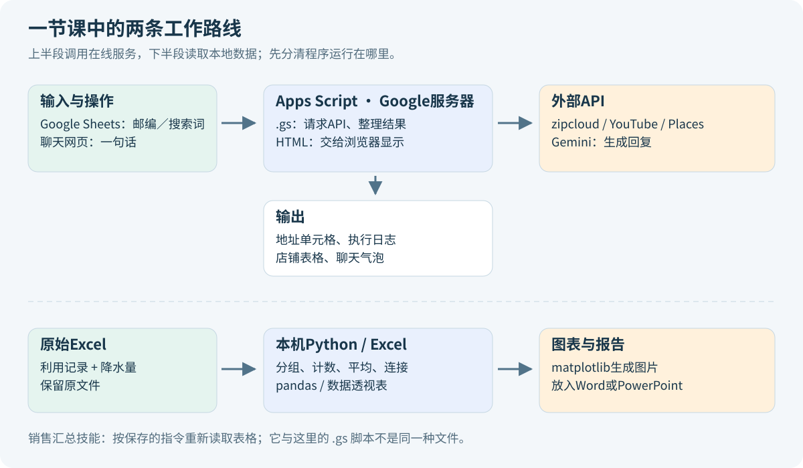
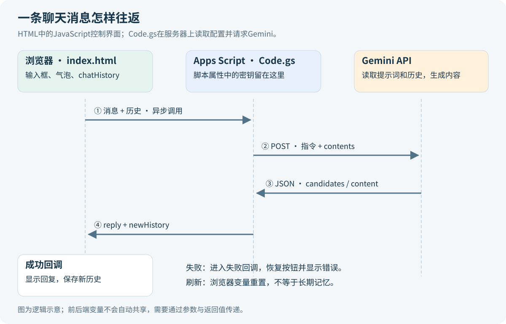
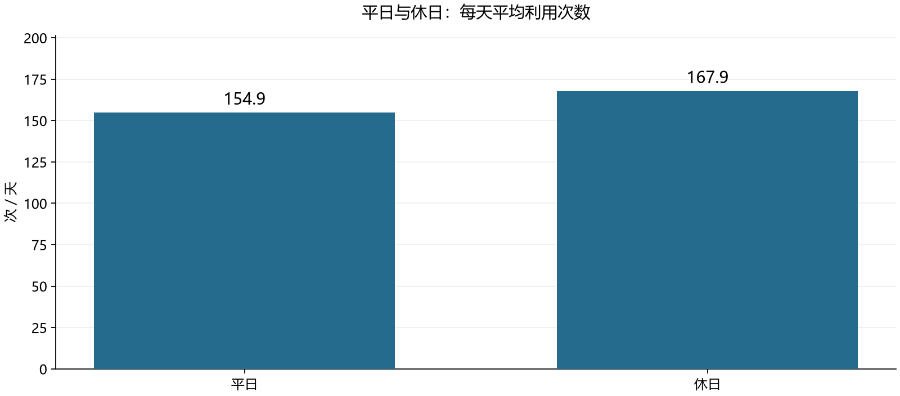
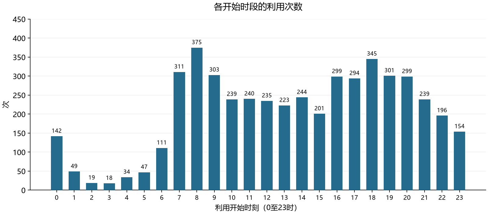
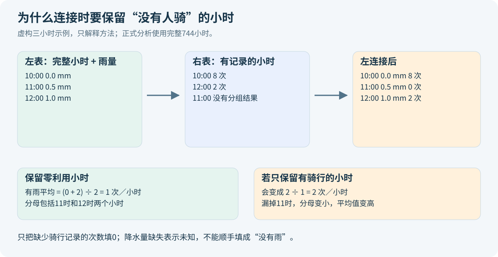
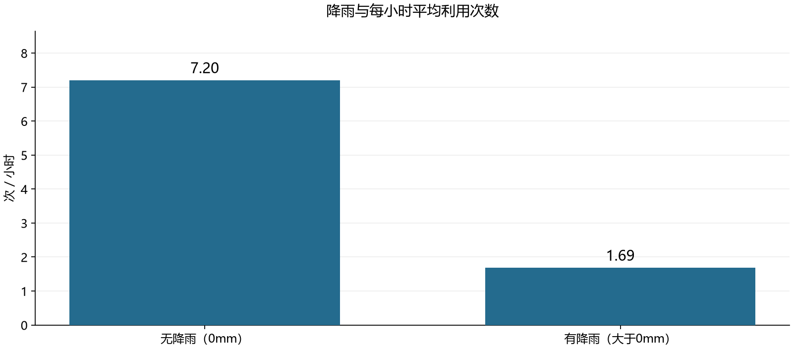
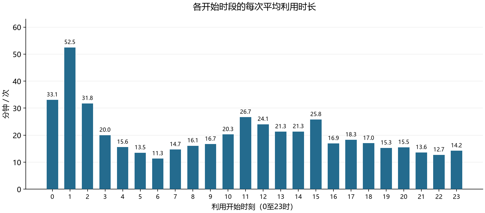

这节《情報学実習B》里，我把邮编查询、YouTube频道统计、相棒AI网页和店铺查询都运行出来了，最后还做了共享单车数据分析。但代码大多是复制老师的示例，再根据报错修改。看到结果，并不代表已经知道每一行在做什么。

下面先说明代码放在哪里运行，再沿着一次输入看它怎样变成结果。课堂来源是2026年11月13日的42页课件、老师配套示例、当天的操作记录，以及2026年3月的HELLO CYCLING表格。文中分别说明老师原来的写法、排错时的改动和这次整理的学习版。

- [下载中文注释代码包](https://raw.githubusercontent.com/Milo-Guo/bytelife/main/downloads/apps-script-api-data-lab.zip)。包含邮编、YouTube、聊天前后端、Places、销售汇总技能指令和Python分析脚本。
- [在线查看完整代码](https://github.com/Milo-Guo/bytelife/tree/main/examples/apps-script-api-data-lab)。代码包是便于学习的重写版，不会自动替换学校账号中的项目；原始骑行明细与实际密钥不在包内。
- 第03至10节解释最基础的JavaScript和接口；第11至19节解释聊天网页；第22至29节解释Python和Excel；第30节给出实际运行顺序。

<a id="lab-01"></a>

## 01 这节课到底在连接哪些东西

前半段课件讲数字化与DX：把照片、声音或业务记录变成计算机能处理的数据，再用这些数据改善工作。例如，一张骑行订单记录了时间、起终点和费用，按时间汇总后就能讨论什么时候调车。把纸搬进电脑只是开始，后面的分类、计算和决策才让记录有用。

课件也讲API经济：自己的应用不必独自实现地图、视频平台、地址数据库和AI模型，可以按对方提供的接口调用这些能力。后面的四个编程练习正是在练这个过程。



*整理图。图中的箭头表示程序调用或数据传递，不表示这些系统使用同一种编程语言。*

| 课堂内容 | 输入 | 程序做什么 | 输出 |
| --- | --- | --- | --- |
| 销售汇总技能 | 自然语言要求、指定表格 | 读取、选择字段、计算和解释 | 汇总表 |
| 邮编查询 | 7位邮编 | 调用zipcloud，读取JSON | 地址地区 |
| YouTube查询 | 频道ID列表 | 读取频道资料和统计 | 执行日志 |
| 相棒AI | 一句话、已有对话 | 网页调用后端，后端调用Gemini | 文本回复和新历史 |
| Places查询 | 搜索词 | 搜索地点，把嵌套数据整理成行列 | Google Sheets结果页 |
| 单车分析 | 本地Excel | 校验、分组、合并降水数据、绘图 | 图表和文字报告 |

课堂还介绍了游戏中的多Agent架构。那是商业案例的结构说明，课堂相棒网页只实现了一个简化聊天链路，并没有把图中的记忆库、多个专业Agent和审核系统全部做出来。课件第12页的另一项讨论练习标注了本次不实施，也不应凭空补成已完成的编程任务。

<a id="lab-02"></a>

## 02 先认清窗口：代码到底放在哪里

我当时在Word的“插入”菜单里找数据透视表，就是把工具认错了。文件看起来都像表格或文字，运行环境却不同。

| 工具 | 这节课的用途 | 入口或文件 |
| --- | --- | --- |
| Google Sheets | 在线表格、邮编公式、店铺结果 | 「拡張機能」→「Apps Script」 |
| Apps Script | 在Google服务器运行JavaScript | `コード.gs`，即脚本文件 |
| Apps Script HTML文件 | 定义聊天网页 | 文件区「＋」→「HTML」，命名为`index` |
| 浏览器中的相棒网页 | 输入消息、显示气泡 | 部署完成后的`/exec`网址 |
| Excel | 打开老师的`.xlsx`、做数据透视表 | 「插入」→「数据透视表」 |
| Python | 读取Excel并批量计算 | 本机运行`.py`文件 |
| Word或PowerPoint | 放图表并写分析，作为作业提交 | `.docx`或`.pptx` |

Apps Script可以是“独立项目”，也可以绑定在某张Google表格上。YouTube查询只输出日志，用独立项目即可。Places要把结果写回表格，使用绑定项目就容易知道写到哪一张表。

`.gs`中的`UrlFetchApp`、`SpreadsheetApp`、`Logger`是Google提供的服务对象。把相同文件交给本机Node.js执行，不会自动获得这些对象。`.html`可以在浏览器显示，但直接双击它打开，通常没有Apps Script提供的`google.script.run`，所以聊天仍然不会工作。

<a id="lab-03"></a>

## 03 看代码前，先认识变量、函数、数组和对象

下面不是新作业，而是把课堂代码缩到能看清的大小。

```javascript
const price = 150;
let total = 0;
total = total + price;

function add(a, b) {
  return a + b;
}

const answer = add(150, 160);
```

`const price = 150`给一个值起名字。`=`表示赋值，不是数学中要求左右恒等的等号。`let total`允许后面重新赋值；`const`不允许这个变量重新指向别的值，但如果它指向数组，数组内容仍可以追加。老师示例里的`var`也是变量声明，主要区别涉及作用域；本课先会读它即可，学习版优先使用`const`和`let`。

`function add(a, b)`定义一种操作。`a`和`b`是接收输入的参数。只写定义不会计算，执行到`add(150, 160)`才真正调用函数，随后`return`把310交还给调用处。`Logger.log`打印到执行日志，`return`返回给另一个程序或单元格，两者用途不同。

```javascript
const names = ['频道A', '频道B'];
const first = names[0];
const channel = {
  title: '频道A',
  statistics: { videoCount: '77' }
};
const videos = channel.statistics.videoCount;
```

`[]`用于数组，也用于按下标取值。数组下标从0开始，所以`names[0]`是第一项。`{}`在这里创建对象，对象按字段名保存信息。`channel.statistics.videoCount`要按顺序读：先找channel，再找它的statistics，再找里面的videoCount。它不是一个很长的变量名。

还有几个符号会反复出现：

| 写法 | 在本课中怎样读 |
| --- | --- |
| `value === 0` | 判断值是否严格等于0 |
| `!value` | 对真假取反；空字符串等值会被当作假 |
| `a && b` | 两边条件都成立，且可短路避免继续取不存在的字段 |
| `a || b` | a为假值时采用b；数字0也是假值 |
| `condition ? a : b` | 条件成立取a，否则取b |
| `i++` | i增加1 |
| `array.push(item)` | 在数组末尾加一项 |
| `array.join(' / ')` | 用指定分隔符把数组拼成一段文字 |
| `// 说明` | 单行注释，不会作为程序执行 |

判断“是不是没有值”时要小心`||`。`rating || 'N/A'`会把0也替换掉。学习版写`rating == null ? 'N/A' : rating`，这里有意使用`== null`，只把`null`和`undefined`视为缺失。

<a id="lab-04"></a>

## 04 API、HTTP和JSON分别负责什么

API是程序之间约定好的调用方式。本课使用的Web API通常通过HTTP通信。一个请求至少要知道发到哪里、执行什么操作、带哪些输入。

```text
GET https://zipcloud.ibsnet.co.jp/api/search?zipcode=1000000
```

这行中的域名是服务地址，`/api/search`是具体路径，问号后的`zipcode=1000000`是查询参数。GET常用来读取资源；POST把较复杂的输入放到请求体中。本课的Gemini和Places都使用POST。POST不意味着这次请求一定创建了数据库记录，具体含义由API规定。

| 请求部分 | 课堂例子 |
| --- | --- |
| URL | 调用地址与模型名称 |
| method | `get`或`post` |
| headers | API密钥、想返回哪些字段等请求元信息 |
| body / payload | 搜索词、对话消息等输入内容 |
| response | 服务返回的状态、响应头和正文 |

JSON是一种文本格式，不是一种“自动执行的代码”。下面是一份便于学习的虚构响应：

```json
{
  "status": 200,
  "results": [
    { "address1": "東京都", "address2": "千代田区", "address3": "" }
  ]
}
```

`response.getContentText()`得到一段文字；`JSON.parse(text)`把JSON文字解析成JavaScript对象，随后才能用`.results[0].address1`取字段。发送方向相反：`JSON.stringify(payload)`把对象转成JSON文本。

HTTP状态码和JSON里的`status`是两个位置。HTTP 200说明HTTP层返回成功，不保证业务一定找到地址；正文可能包含“没有结果”。404、403、429也不能一概解释为“代码错了”，还要看它分别发生在地址、权限还是配额这一层。

<a id="lab-05"></a>

## 05 销售汇总技能：把重复要求保存下来

课件第14至16页让我们创建一个技能，每次读取指定Google Sheets，再按自然语言要求汇总销售。它保存的是一套工作规则，不是把那张表一次性训练进模型，也不会因为写了“读取表格”就自动取得权限。

我们用到的表头是`日時`、`商品名`、`単価`。如果要求“按负责人统计”，但表里没有负责人列，正确行为就是说明缺少字段。不能把商品名当负责人，也不能编几个负责人凑出表格。

同样，只有单价没有数量时，直接把单价求和，需要声明“一行代表一次销售记录”的口径。若不能确认每行就是一件商品，还不能把记录数不加说明地称为销量。

一个可复用的指令应当写明：每次重新读取最新数据，先检查列名与日期范围，说明计算口径，输出分组与总计，最后核对合计。完整模板在[技能指令文件](https://github.com/Milo-Guo/bytelife/blob/main/examples/apps-script-api-data-lab/05_sales_skill_prompt.md)。

课堂中我曾遇到“浏览器能打开表格，但Gemini说无法读取”。同一个学校账号只是第一项条件，连接服务获得的权限、Workspace设置、共享范围也可能影响访问。排查时先要求读取文件名、表头和前3行，确认读到的是目标文件，再执行汇总。聊天里说“已读取”，还应与实际数据交叉核对。

<a id="lab-06"></a>

## 06 邮编函数：沿着A1里的值走一遍

老师的`ZIP_ADDRESS(zip)`很短，主线是：接收邮编，调用接口，解析JSON，取第一条地址并拼接。比如在Google Sheets的B1输入：

```text
=ZIP_ADDRESS(A1)
```

Sheets把A1的内容传给`zip`。如果A1是字符串`1000000`，程序把它放到请求地址末尾，再交给`UrlFetchApp.fetch`。响应的`results`是数组，老师用`results[0]`取第一项，把`address1`、`address2`和`address3`三个地区字段相加后返回。

```javascript
const text = response.getContentText();
const data = JSON.parse(text);
const first = data.results[0];
const address = first.address1 + first.address2 + first.address3;
return address;
```

这里的`+`在字符串之间表示拼接。它把都道府县、市区町村、町域连成一段文字，不会自动补具体楼号或住户地址。一个邮编还可能对应多个地区，接口可以返回多项。[zipcloud官方字段说明](https://zipcloud.ibsnet.co.jp/doc/api)列出了这些字段和错误状态。

Google Sheets把函数的返回值显示在B1。我们没有在函数里写“去修改B1”，因为公式计算的返回通道已经完成了这一步。自定义函数也不是普通菜单脚本，不能随意修改任意单元格。[Google自定义函数说明](https://developers.google.com/apps-script/guides/sheets/functions)解释了这种运行方式。

<a id="lab-07"></a>

## 07 邮编学习版为什么多了检查

老师的最短示例假设输入合法、接口可用、结果不为空。一旦`results`是`null`，继续取`[0]`就会报错。

学习版[01_postal.gs](https://github.com/Milo-Guo/bytelife/blob/main/examples/apps-script-api-data-lab/apps_script/01_postal.gs)按输入、通信、业务结果的顺序检查：

```javascript
const code = String(zip == null ? '' : zip).trim().replace(/-/g, '');
if (code === '') return '';
if (!/^\d{7}$/.test(code)) return '请输入7位邮政编码';
```

`String`把值转为文本；`trim`去掉首尾空白；`replace(/-/g, '')`去掉所有半角短横线。正则`^\d{7}$`要求从开头到结尾正好7个数字。这里只处理单个单元格，没有承诺一次接收整个区域。

邮编是标识符，最前面的0不能丢。A列应先设为纯文本。如果Excel或Sheets已经把`0123456`变成数字123456，程序无法知道丢掉的是什么，不应该悄悄猜一个0补回去。

学习版还使用HTTPS、检查HTTP响应和JSON业务状态，并把多个地址放到同一格。发生异常时先读清错误，不要连续复制几百行公式去测试，这会同时产生大量外部请求。

<a id="lab-08"></a>

## 08 YouTube：频道ID、服务和授权

YouTube频道是一整个发布者空间，视频是其中的一条内容。课堂使用的是频道ID，所以获取的是整个频道的统计。两个频道放在同一数组里，只需循环两次，不等于把两个视频合并了。

```javascript
const channelIds = [
  'UC35OgsYuLuq8cNTAm_5GvWA',
  'UCl9sQNYTYHS-h_yrwBOQBIw'
];
```

这些是公开频道标识，不是API密钥。频道名称或`@handle`也不能不加区分地塞进`id`参数。API有专门的筛选参数，应按参数定义使用。

Apps Script里的`YouTube.Channels.list`来自添加的高级服务。需要左侧「サービス」点加号，选择YouTube Data API v3。只有复制代码，没有添加服务，就可能得到`YouTube is not defined`。第一次运行还可能需要本人账号授权；使用标准Cloud项目时还应核对对应API是否启用。[高级服务说明](https://developers.google.com/apps-script/guides/services/advanced)说明了这两层配置。

老师分别调用`statistics`和`snippet`两次。前者取统计，后者取标题等描述。学习版把它们合并到同一次调用：

```javascript
const result = YouTube.Channels.list('snippet,statistics', {
  id: channelIds[i]
});
```

`part`支持逗号分隔的多个资源部分，所以这里一次就能拿到两组字段。[Channels.list参数说明](https://developers.google.com/youtube/v3/docs/channels/list)是核对依据。

<a id="lab-09"></a>

## 09 循环两次，程序到底怎么走

老师写的是`for (var i in channelId)`。在这个普通数组例子里，i通常依次是字符串形式的索引`"0"`和`"1"`。`for...in`一般用来枚举对象属性；初学时容易把i误认为频道ID本身，所以学习版改成更直观的计数循环：

```javascript
for (let i = 0; i < channelIds.length; i++) {
  const result = YouTube.Channels.list('snippet,statistics', {
    id: channelIds[i]
  });
  // 在这里检查结果并输出。
}
```

| 时点 | i | 条件和操作 |
| --- | --- | --- |
| 第1次 | 0 | 0小于2，使用`channelIds[0]`查询第一个频道 |
| 第1次结束 | 变成1 | 执行`i++` |
| 第2次 | 1 | 1小于2，使用`channelIds[1]`查询第二个频道 |
| 第2次结束 | 变成2 | 再执行`i++` |
| 下一次判断 | 2 | 2不小于2，退出循环 |

`result.items`可能是空数组，所以先检查再取`items[0]`。学习版遇到空结果时用`continue`跳过这个频道，继续查下一个；如果用`return`，则会结束整个函数。

<a id="lab-10"></a>

## 10 日志里的数字从哪来，能说明什么

完整代码在[02_youtube.gs](https://github.com/Milo-Guo/bytelife/blob/main/examples/apps-script-api-data-lab/apps_script/02_youtube.gs)。核心取值可以这样读：

| 表达式 | 含义 |
| --- | --- |
| `result.items[0]` | 返回列表中的第一个频道对象 |
| `channel.snippet.title` | 频道标题 |
| `channel.statistics.subscriberCount` | API提供的订阅数 |
| `channel.statistics.videoCount` | 公开视频数量 |
| `channel.statistics.viewCount` | API定义的频道观看数 |

`Logger.log('動画数：%s', stats.videoCount)`中的`%s`是占位位置，日志工具把后面的值填进去。返回的数值字段可能表现为数字字符串，显示时没有问题；要做加法时应先确认类型，避免`'77' + '341'`变成`'77341'`。

当天截图中，两个频道分别显示6800、21000个订阅，77、341个视频，2811721、114031867次观看。这些是当次执行的记录，不是现在仍不变的值。订阅数还有有效位数取整规则；公开视频数不能理解为账号上传过的全部私有、已删除内容。[频道资源官方定义](https://developers.google.com/youtube/v3/docs/channels)可用于核对字段语义。

课堂提交项写的是粘贴API输出结果，因此日志中的频道名和各项数字是关键内容。“実行開始”和“実行完了”是运行状态，可以一起保留。课程页面曾出现两个同名入口，仅凭标题不能判断是否要按频道拆交，应查看各入口的详细要求。

<a id="lab-11"></a>

## 11 相棒AI其实是三个地方在协作

相棒页面看起来像一个程序，实际有三处运行代码。浏览器负责界面；Apps Script服务器负责读取配置并发请求；Gemini服务生成回复。



*整理图。API密钥在Apps Script端读取，浏览器接收的是回复和会话结构。网页访问者仍可能消耗部署者的API配额。*

| 文件或服务 | 工作 | 不负责什么 |
| --- | --- | --- |
| `index.html` | 输入框、消息气泡、发送按钮、朗读和动画 | 不直接携带API密钥调用模型 |
| `Code.gs` | 提供页面，处理网页调用，组织请求和响应 | 不直接操作用户浏览器里的DOM |
| Gemini API | 根据提示词与上下文生成内容 | 不会自动替网页保存永久用户档案 |

HTML、CSS和JavaScript可以写在同一个HTML文件里，但职责仍然不同。HTML定义结构，CSS规定样式，JavaScript响应点击并更新内容。`Code.gs`也使用JavaScript，却运行在Google服务器，不能调用浏览器的`document.getElementById`。

<a id="lab-12"></a>

## 12 后端入口doGet：为什么一打开网址就有网页

```javascript
function doGet() {
  return HtmlService.createHtmlOutputFromFile('index')
    .setTitle('相棒AI 学习版')
    .addMetaTag('viewport', 'width=device-width, initial-scale=1');
}
```

访问部署后的网页地址时，Apps Script调用`doGet`，再把返回的HTML响应交给浏览器。`createHtmlOutputFromFile('index')`读取项目中的`index.html`，这里省略`.html`扩展名。名称拼错就找不到文件。

后面几个点号是连续调用方法。`setTitle`设置页面标题；viewport让移动端按设备宽度显示。它们不会向Gemini发送消息。真正聊天是另一条入口`chatWithGemini`，由页面里的JavaScript触发。

完整文件见[学习版Code.gs](https://github.com/Milo-Guo/bytelife/blob/main/examples/apps-script-api-data-lab/apps_script/03_chat/Code.gs)。本课沿用`generateContent`接口，便于和老师示例对照；接口文档可能也展示其他新入口，不能直接把不同接口的请求结构混用。

<a id="lab-13"></a>

## 13 密钥、模型和角色提示词不是同一件事

课堂原示例把密钥写在源码常量中。我们修改后的方向是把配置放到「プロジェクトの設定」中的「スクリプト プロパティ」，由后端读取：

```javascript
const properties = PropertiesService.getScriptProperties();
const apiKey = properties.getProperty('GEMINI_API_KEY');
const model = properties.getProperty('GEMINI_MODEL') || 'gemini-3.5-flash-lite';
```

| 项目 | 作用 |
| --- | --- |
| Google账号 | 决定当前以谁的身份操作 |
| Cloud项目 | 管理启用的API、配额和结算等配置 |
| API密钥 | 识别调用项目，并受密钥限制约束 |
| 模型名称 | 指定由哪个模型处理请求 |
| system instruction | 规定角色、语气和回答范围 |
| history | 本轮要提供的已有对话 |

脚本属性让密钥不必写进公开源码，但能编辑脚本的人仍可能访问这些配置；它不是任何人都无法读取的保险箱。[Properties Service说明](https://developers.google.com/apps-script/guides/properties)介绍了作用域。

老师代码使用`gemini-2.5-flash`，课堂排错时我们调整过模型。学习版默认`gemini-3.5-flash-lite`，其名称已与[官方模型页](https://ai.google.dev/gemini-api/docs/models/gemini-3.5-flash-lite)核对。以后若项目不可用，应查自己的模型列表和错误，不能因为Gemini网页能聊天，就推断API项目一定有额度。

角色提示词让模型把用户称作“相棒”，用幻想世界语气回应，并把现实地址等话题引回故事。这能影响回答，但提示词不能替代真正的权限控制，也不能保证任何输入下都绝不偏离设定。

<a id="lab-14"></a>

## 14 聊天记忆：每次把以前说过的话再带上

网页最开始有一行：

```javascript
let chatHistory = [];
```

它创建一个空数组。第一次发送“我叫アキ”时，浏览器把这句话和空历史传给后端。后端把消息放入`contents`，Gemini回复后，再把模型回答加入历史。第二次问“我叫什么”时，浏览器把前面两条记录一起交出去。

```javascript
const contents = JSON.parse(JSON.stringify(history));
contents.push({
  role: 'user',
  parts: [{ text: userMessage.trim() }]
});
```

这里的`role`表示谁说的，`user`是用户，`model`是模型。`parts`是内容部分的数组，本课主要使用text。JSON来回转换在这里建立一份可序列化历史的副本，避免请求失败时直接改坏传入数据。

一次成功返回后，历史的顺序大致是：

```text
第1条：user  我叫アキ
第2条：model 好的，アキ
第3条：user  我叫什么
第4条：model 你叫アキ
```

所以名字测试说明“当前对话上下文被传回去了”。它不能证明模型已经永久记住这个人。本例没有数据库，也没把历史放进浏览器持久存储，刷新页面后数组会重新为空。长会话还会增加输入量；学习版到达设定的长度上限会提示开启新会话，而不是悄悄删掉某几句话。

<a id="lab-15"></a>

## 15 后端怎样组装请求，为什么不能只取第一个text

```javascript
const payload = {
  systemInstruction: {
    parts: [{ text: '用日语扮演幻想世界中的冒险相棒。' }]
  },
  contents: contents
};

const response = UrlFetchApp.fetch(url, {
  method: 'post',
  contentType: 'application/json',
  headers: { 'x-goog-api-key': apiKey },
  payload: JSON.stringify(payload),
  muteHttpExceptions: true
});
```

`payload`对象中保存本次输入。`JSON.stringify`将它转成网络正文，`contentType`说明正文格式。密钥放在请求头里，避免拼进URL。`muteHttpExceptions: true`的意思是遇到HTTP错误也返回响应供程序检查，不是把错误自动修好。

老师示例取`candidates[0].content.parts[0].text`。这条路径解释起来很直接：第一个候选回答、它的内容、第一部分、文本。但服务可能没有候选结果，也可能有多个内容部分，不能先假设每层都存在。

学习版先检查HTTP状态，再解析JSON和检查结构，收集可显示的文本部分。用于后续会话的历史则保存完整`modelContent`，保留API可能返回的附加字段和签名。发生错误就停止本轮处理。[generateContent参考](https://aistudio.google.com/api-reference/generate-content)列出了请求与响应的内容结构。

完整代码里还有`try`、`catch`和`throw`。`try`包住可能失败的操作，例如网络请求；操作抛出异常时，转到`catch`处理。`throw new Error('说明')`会主动报告错误并中止当前正常流程。前端的失败回调随后显示说明，让发送按钮恢复。因为设置了`muteHttpExceptions: true`，HTTP 429等响应不会仅凭这个状态进入网络请求的catch，还要在拿到response后检查`getResponseCode()`。

```javascript
contents.push(modelContent);
return { reply: reply, newHistory: contents };
```

`reply`用于显示，`newHistory`用于下一次请求。两个字段从同一个返回对象中传给网页。学习版这一段通过本地模拟响应验证了正常、多段文本、无文本、HTTP错误及历史保留；它不等同于再次调用真实Google项目。

<a id="lab-16"></a>

## 16 前端的HTML与CSS：输入框、气泡和会动的角色

学习版[index.html](https://github.com/Milo-Guo/bytelife/blob/main/examples/apps-script-api-data-lab/apps_script/03_chat/index.html)使用简单的CSS角色，方便读清代码。课堂原图是一段很长的`data:image/...;base64,...`，那串字符主要是在HTML中装入图片，不是AI模型或聊天算法。

```html
<div id="chat-box"></div>
<input id="user-input" type="text">
<button id="send-btn">送信</button>
```

`id`是给页面元素起的唯一名字。`document.getElementById('user-input')`才能准确拿到输入框；名字对不上会返回`null`。DOM可以理解为浏览器把HTML解析后形成的一组可供程序操作的节点。

```javascript
const message = document.createElement('div');
message.className = 'message user';
message.textContent = text;
box.appendChild(message);
```

这四行依次创建一个div、设置样式分类、放入文字、把它加到聊天区域。`textContent`把输入当文字显示。如果使用`innerHTML`，输入就可能被当作HTML解释；聊天气泡通常没有这个必要。老师原例使用`innerText`，也不是直接执行用户输入。

CSS里的`.user`和`.ai`是类选择器，`#chat-box`是ID选择器。`margin-left: auto`把用户气泡推向右边；`overflow-y: auto`让内容过多时产生纵向滚动；`border-radius`让边角变圆。它们只影响外观，不会影响模型是否记得名字。

`box.scrollTop = box.scrollHeight`把聊天区域滚到底部。若回复已经出现但还停在旧消息位置，用户可能误以为模型没有回答，这也是界面代码需要处理的事。

<a id="lab-17"></a>

## 17 异步回调：为什么发送后不能马上读取答案

`google.script.run`向Apps Script服务器发起调用。它是异步的：浏览器发出请求后会继续处理其他事情，不会把整个页面冻结到答案回来。[Google客户端通信说明](https://developers.google.com/apps-script/guides/html/communication)明确了这一点。

```javascript
google.script.run
  .withSuccessHandler(function(result) {
    chatHistory = result.newHistory;
    addMessageToChat('ai', result.reply);
    setBusy(false);
  })
  .withFailureHandler(function(error) {
    setBusy(false);
    statusBox.textContent = '发送失败：' + error.message;
  })
  .chatWithGemini(message, chatHistory);
```

这段要从最后一行看具体调用了谁，再回头看结果怎样处理。`chatWithGemini`对应后端同名函数；前两项是在登记“成功后做什么”和“失败后做什么”。`function(result)`不是马上执行，而是等服务器成功返回后，由运行环境调用。

用户点一次发送，学习版按下面的顺序运行：

1. 从输入框取值并`trim`，空消息就返回。
2. 检查`busy`，已有请求时不再发第二个，避免历史交叉。
3. 把用户消息显示到聊天区，清空输入框。
4. 禁用按钮，显示“考え中…”并启动动画。
5. 发起服务器调用。
6. 成功时显示回复、更新历史、恢复按钮；失败时保留重试所需的输入并显示错误。

错误分支也必须恢复按钮，否则一次失败后按钮就一直不可点。老师原版也有成功与失败处理，学习版把共同的状态切换集中到`setBusy`中。`form`的提交事件通过`event.preventDefault()`阻止默认页面跳转，因此按回车也可以触发发送。

<a id="lab-18"></a>

## 18 朗读和动画：文字生成后还有两项独立工作

相棒说话时的声音，在这个例子里来自浏览器的Web Speech API。Gemini后端返回文本，网页再让语音服务朗读，并没有在这段代码里请求Gemini生成音频。

```javascript
const utterance = new SpeechSynthesisUtterance(text);
utterance.lang = 'ja-JP';
utterance.rate = 1.2;
utterance.pitch = 1.5;
window.speechSynthesis.speak(utterance);
```

`new`创建一个朗读请求对象。`lang`指定语言，`rate`控制语速，`pitch`控制音调。实际声音取决于浏览器、系统语音和运行限制，设置了日语也不保证所有设备都有同样的音色。[MDN的SpeechSynthesisUtterance说明](https://developer.mozilla.org/en-US/docs/Web/API/SpeechSynthesisUtterance)列出了相关属性和事件。

角色运动则由CSS实现。给元素加上`speaking`类，`animation`开始执行；`@keyframes`定义开始与结束的位置或缩放。老师的`scale(1.1, 0.9)`让它变宽、变扁，`translateY(-15px)`让它向上移动。

`utterance.onstart`在朗读开始时添加类，`onend`和`onerror`移除类。因此“页面能回复”“能读出声音”“图片会动”是三个可分别检查的功能。学习版把朗读做成勾选项，并尊重系统的减少动画偏好。

<a id="lab-19"></a>

## 19 保存与部署：为什么改了代码，网页还是旧的

保存只把编辑器里的代码保存下来，部署则让某个版本可以通过网址运行。Apps Script网页部署有执行身份、访问范围和版本三个需要分别确认的设置。

| 设置 | 要看清什么 |
| --- | --- |
| 「次のユーザーとして実行」 | 以部署者还是访问者的身份运行 |
| 「アクセスできるユーザー」 | 哪些人能够访问网页 |
| 部署版本 | 网址实际指向哪一版代码 |

课堂选择以自己身份执行并分享网页，访问者触发的后端请求就可能消耗部署者项目的配额。把密钥藏在服务器端有必要，但还不能代替访问控制、调用次数限制或预算管理。

具体操作是「デプロイ」→「新しいデプロイ」→选择「ウェブアプリ」，按课程范围配置后授权。提交时复制“ウェブアプリ”的URL，不要把“デプロイID”当成网址。以后更新现有链接，可在「デプロイを管理」里编辑部署并选择新版本。[Google Web Apps说明](https://developers.google.com/apps-script/guides/web)解释了部署与运行身份。

验证时分开试三个问题：简单问候检查通信；先介绍名字再询问检查上下文；问现实地址检查角色提示词。第三项只是一次行为观察，不能由一次拒答推导出所有输入都受到了严格过滤。

<a id="lab-20"></a>

## 20 Places请求：搜索词与返回字段是两套设置

Places例子把“渋谷 焼肉”发给Google地图地点搜索。请求体描述“找什么”，FieldMask描述“结果里要哪些字段”。

```javascript
const payload = {
  textQuery: '渋谷 焼肉',
  languageCode: 'ja',
  pageSize: 5
};
```

`textQuery`是搜索词，`languageCode`是语言偏好，`pageSize`限制一页最多返回多少个地点。老师使用`maxResultCount`；当前文档已把它列为被`pageSize`取代的字段，所以学习版使用后者。它不保证一定有5家，也不代表整个地区只有5家。学习版只取第一页，不自动循环分页。

```text
X-Goog-FieldMask:
places.displayName,places.rating,places.userRatingCount,
places.reviews,places.id,places.googleMapsUri
```

这里是为了排版换行，代码中的请求头是一行连续字符串。名称、评分、评论数量、评论内容、Place ID和地图链接分别是不同字段。FieldMask也影响计费档位，加入评论不能当成一个完全不影响成本的显示选项。[Text Search (New)官方说明](https://developers.google.com/maps/documentation/places/web-service/text-search)给出了字段、分页和计费对应关系。

评分是平均评分，评论总数是数量，返回的评论数组只是有限的评论内容。它不是全量评价下载，也不能据此判断所有顾客的意见。公开展示时还需保留相应归属信息，并按[Places内容使用要求](https://developers.google.com/maps/documentation/places/web-service/policies)处理保存与展示范围。

<a id="lab-21"></a>

## 21 嵌套循环、二维数组，以及一直转圈的原因

Places响应的`places`是店铺数组，每家店的`reviews`又是评论数组。因此老师用了两层循环：外层i选择店铺，内层j选择这一家店里的评论。

```javascript
for (let i = 0; i < places.length; i++) {
  const place = places[i];
  const reviews = place.reviews || [];
  const texts = [];
  for (let j = 0; j < reviews.length; j++) {
    const review = reviews[j];
    if (review.text && review.text.text) {
      texts.push(review.text.text);
    }
  }
  // texts是当前这一家店的评论，外层下一轮会建立新的数组。
}
```

`review.text.text`看起来重复，是因为外层text字段本身是一个带语言等信息的对象，内层text才是字符串。把`texts`放在外层循环内部，才能每家店重新收集；如果错误地放在两层循环外，就会混入上一家店的评论。

Sheets的批量写入需要二维数组。外层每一项是一行，里面每一项是一列：

```javascript
const rows = [
  ['店名', '评分', '评论数量'],
  ['示例店A', 4.2, 100],
  ['示例店B', 4.0, 80]
];
sheet.getRange(1, 1, rows.length, rows[0].length).setValues(rows);
```

这里的数据是格式示意。`getRange(起始行, 起始列, 行数, 列数)`使用从1开始的行列编号，和JavaScript数组下标从0开始不同。每一行的列数必须与目标区域一致，`setValues`才知道怎样放入单元格。

老师示例的`sheet.clear()`会清除当前活动工作表内容和格式；因此当时才先新建表格再运行。学习版[04_places.gs](https://github.com/Milo-Guo/bytelife/blob/main/examples/apps-script-api-data-lab/apps_script/04_places.gs)改为请求成功后新建结果页，同时保留评论作者和链接，避免清掉当前页。

那次“执行日志一直转圈”，实际是脚本在等表格里的完成提示框。`SpreadsheetApp.getUi().alert(...)`会暂停服务器脚本，直到用户关闭对话框；回Google Sheets点OK后才结束。这是[Ui.alert文档](https://developers.google.com/apps-script/reference/base/ui)说明的行为。学习版用不等待用户点击的`toast`通知，减少这种误会。

<a id="lab-22"></a>

## 22 看懂原始Excel：一行到底代表什么

后半节切换到了本地数据分析。老师提供的文件有`藤沢市のみ`、`藤沢市ポート`和`降水量`三个工作表。本文统计的主体是`藤沢市のみ`的4918行，每行按一条利用记录处理，没有因为追踪ID、地址或支付状态缺失而擅自删除记录。

| 字段 | 本次怎么使用 |
| --- | --- |
| `利用開始日時` | 提取日期、开始小时，连接逐小时降水数据 |
| `利用時間` | 计算每条记录的利用时长 |
| `平日・休日` | 直接沿用原分类，统计记录数和日期数 |
| `曜日` | 复现老师按星期求平均时长的透视表 |
| 贷出、归还站点编号 | 分别统计各站点次数 |
| `降水量(mm)` | 将小时分成0mm和大于0mm |

4918次利用不等于4918个人，一个人可能有多条记录。状态码0和1的业务定义没有确认，就不能擅自把某一类叫作“未付款”并排除。

地址和站点容量缺失也不自动等于“市外站点”。表间匹配失败、名称字符差异等都可能造成空值。分析前先确认字段含义，比直接把所有空值删掉更重要。

<a id="lab-23"></a>

## 23 pandas最初几行：从文件到可计算的表

```python
from pathlib import Path
import pandas as pd

path = Path('课堂数据.xlsx')
rides = pd.read_excel(path, sheet_name='藤沢市のみ')
start = pd.to_datetime(rides['利用開始日時'], errors='raise')
rides['日付'] = start.dt.date
rides['開始時'] = start.dt.hour
```

`import pandas as pd`加载pandas并给它一个短名字。`read_excel`读取指定工作表，结果是DataFrame，可以先理解为带列名和行索引的表。`rides['利用開始日時']`选择一整列，通常得到Series；`rides['開始時'] = ...`新增或替换一列。

`to_datetime`将原始值解析为日期时间。`errors='raise'`要求遇到无法解析的内容时报错，避免悄悄丢掉记录。`.dt`提供一组日期时间操作，`.dt.hour`提取0到23的小时数，`.dt.date`取得日期。

Python使用缩进表示代码块，JavaScript常用大括号。两种语言里的数组和对象写法有些相似，但不能把JS的`const`、`JSON.parse`直接抄进Python。Python中的`len(rides)`返回行数，`print`输出到终端。

完整的[analyze_cycling.py](https://github.com/Milo-Guo/bytelife/blob/main/examples/apps-script-api-data-lab/python/analyze_cycling.py)把读取、统计、绘图和命令行入口分成几个函数，还检查源文件哈希，确认分析没有修改原Excel。

脚本中的一些紧凑写法，可以先这样读：

| 写法 | 逐步理解 |
| --- | --- |
| `table.loc[条件].copy()` | 选出满足条件的行，再建立独立副本 |
| `(start >= 起点) & (start < 终点)` | 对每行判断两个条件，两边都成立才保留；括号不可随意省略 |
| `column.notna().all()` | 逐个检查不是空值，再确认全部成立 |
| `column.eq(1).all()` | 逐个判断等于1，再确认全部成立 |
| `require(条件, '说明')` | 这是我们自己定义的函数；条件为假就抛出ValueError并停止 |
| `for index, row in table.iterrows()` | 每次取出一行的索引与内容，转换成输出记录 |
| `{key: value for ...}` | 字典推导式：循环产生键和值，收集成一个字典 |

`require`不是pandas内置命令，定义就在脚本开头。读到不认识的函数时，先看它是在本文件定义的，还是通过`import`从库中引入的。

<a id="lab-24"></a>

## 24 groupby是怎样分组的，日均值为什么不能直接比总数

```python
day = rides.groupby('平日・休日').agg(
    records=('NO.', 'size'),
    days=('日付', 'nunique')
).reindex(['平日', '休日'])
day['average'] = day['records'] / day['days']
```

先按`平日・休日`分成两组。`agg`告诉pandas对每一组做哪些计算：`size`数记录行，`nunique`数不同日期。`reindex`把结果按指定顺序排列。分组的基本过程是拆组、计算、重新组合，[pandas分组文档](https://pandas.pydata.org/docs/user_guide/groupby.html)有更完整的说明。

`size`与`count`不要混淆。`size`数行；对某一列使用`count`会忽略这一列的空值。如果用有很多空值的追踪ID列数记录，就可能少算。这里统计记录数，因此使用size。

| 原始分类 | 利用记录 | 日期数 | 每日平均 |
| --- | ---: | ---: | ---: |
| 平日 | 3407 | 22 | 154.9 |
| 休日 | 1511 | 9 | 167.9 |
| 合计／整体平均 | 4918 | 31 | 158.6 |



*从原Excel重新计算。休日的每日平均约高8.4%，但原文件如何定义分类，应以原列为准。*

平日总次数多，是因为平日也有更多天。要比较一天有多忙，应分别除以22和9。此前AI曾按祝日历重新分成21个平日和10个休日，得出了与源文件不一致的数字。这次明确保留原分类，不替老师重新定义“休日”。

本文件31天每天都有记录，所以可以从记录表数出31个不同日期。换成某些天完全没有骑行的数据，仅靠`nunique`会漏掉零利用日；要引入完整日历并明确每一天的分类。学习脚本检查了这个前提，不把本月恰好成立的条件当通用规律。

<a id="lab-25"></a>

## 25 小时统计：0点不是第0行，也不是凌晨累计值

```python
hours = rides.groupby('開始時').size().reindex(range(24), fill_value=0)
```

`range(24)`代表0到23。某个小时没有利用，也保留该小时并填0。每条记录按照“开始小时”只进入一组。例如08:59开始、09:20结束的利用，统计为8时组的一次，并不是同时算进8时和9时。

| 小时 | 次数 | 小时 | 次数 | 小时 | 次数 |
| --- | ---: | --- | ---: | --- | ---: |
| 0 | 142 | 8 | 375 | 16 | 299 |
| 1 | 49 | 9 | 303 | 17 | 294 |
| 2 | 19 | 10 | 239 | 18 | 345 |
| 3 | 18 | 11 | 240 | 19 | 301 |
| 4 | 34 | 12 | 235 | 20 | 299 |
| 5 | 47 | 13 | 223 | 21 | 239 |
| 6 | 111 | 14 | 244 | 22 | 196 |
| 7 | 311 | 15 | 201 | 23 | 154 |



*24组共4918次。8时375次最多，18时345次次之。*

这张图回答“哪个开始时段有更多记录”。它还不能回答实时在路上的车辆数，也不能直接证明通勤、通学占比。把“朝夕较集中”作为观察可以，把所有记录都解释成通勤则超出了数据。

<a id="lab-26"></a>

## 26 站点排名：为什么用编号、为什么第10名有两家

站点名称可能含有空格、全角符号和不同写法。本次先检查同一编号是否对应一致名称，再按编号分组，统计每个编号出现多少次。

```python
stations = rides.groupby('貸出ステーション番号').agg(
    name=('貸出ステーション', 'first'),
    records=('NO.', 'size')
)
stations = stations.sort_values('records', ascending=False)
stations['rank'] = stations['records'].rank(method='min', ascending=False)
```

`sort_values`排序，`ascending=False`表示从大到小。`rank(method='min')`给并列者相同的最靠前名次。第10名有两个145次的站点，因此“前10位”包含11个站点；如果只写`head(10)`，就只会保留10行，少放一个并列者。

贷出前四个站点是SQUARE Mobility(FujisawaSST)407次、辻堂元町6丁目第2公園(FujisawaSST)404次、藤沢駅前401次、藤沢駅北口380次，共1592次，占32.4%。归还前四名共1539次，占31.3%。完整前10位含并列者保存在脚本生成的`summary.json`中。

记录里出现277个贷出编号和286个归还编号，这不是在宣称藤泽市只有或共有这么多正式站点。统计范围是所给记录出现过的地点，站点主表与记录范围可能不同。

月总贷出与归还接近，也不能证明每个小时都不缺车、不满桩。运营建议可以先重点检查热门站点，但实际调车还需要按时间查看发车、还车与当时库存。

<a id="lab-27"></a>

## 27 降雨比较：为什么必须保留零利用小时

降水表原本还包含4月1日0时。研究2026年3月时，范围应是3月1日0时至3月31日23时，共31×24＝744小时。程序使用`>= '2026-03-01'`且`< '2026-04-01'`，边界就很清楚。

先把利用开始时间向下取到整点：

```python
counts = start.dt.floor('h').value_counts()
```

10:05和10:59都归到10:00。随后将每小时次数与完整降水小时表合并。这里按所给时间标签对应，不额外推断气象观测点或观测时段的业务定义。



*虚构的三小时例子，只解释连接方法。正式结果使用744小时原数据。*

如果先从有骑行的小时出发，就会丢掉“下雨且没人骑”的小时，平均值的分母也变小。本次有85个小时没有利用，必须作为0保留。

```python
merged = rain[['hour', 'mm']].merge(
    counts, on='hour', how='left', validate='one_to_one'
)
merged['records'] = merged['records'].fillna(0).astype(int)
```

完整脚本先把counts整理成带hour和records列的表。`how='left'`保留左表的所有小时；`validate='one_to_one'`检查双方连接键是否唯一，避免同一小时重复匹配让次数翻倍。这里只把缺少骑行匹配的records填0。降水量缺失表示未知，不能一起填成“无雨”。

| 降雨分类 | 小时数 | 利用次数 | 每小时平均 |
| --- | ---: | ---: | ---: |
| 0mm | 664 | 4783 | 7.20 |
| 大于0mm | 80 | 135 | 1.69 |
| 合计／整体平均 | 744 | 4918 | 6.61 |



*135÷80＝1.6875；4783÷664约等于7.2033。先计算再按展示精度四舍五入。*

有雨时的平均次数约为无雨时的23.4%。这是当前样本的关联比较，雨出现的时刻、星期和其他条件还可能影响结果。不能直接写“雨使需求下降76.6%”，因为这里没有隔离其他因素，也没有建立因果模型。

<a id="lab-28"></a>

## 28 老师投影里的平均利用时间，和次数有什么不同

老师照片左边是按星期汇总的“平均／利用時間”，右边的柱状图按开始时段展示平均时长。它问的是“每一趟平均骑多久”，我们的小时次数图问的是“发生了多少趟”。两个结果可以同时成立，而且峰值不必一样。

```python
duration = pd.to_timedelta(rides['利用時間'].astype(str), errors='raise')
rides['利用分'] = duration.dt.total_seconds() / 60
duration_hours = rides.groupby('開始時')['利用分'].agg(['size', 'mean', 'median'])
```

本文件的利用时间被读取为时间对象，例如`00:07:37`。转为字符串后按时长解析，得到457秒，再除以60得到约7.62分钟。不要把`00:07:37`理解成当天7分37秒的时间点。



*使用源文件的利用時間计算，单位是分钟／次。这是补充复现，不声称与照片中的每个显示值完全相同。*

| 开始小时 | 次数 | 平均分钟／次 | 中位分钟／次 |
| --- | ---: | ---: | ---: |
| 0 | 142 | 33.08 | 13.10 |
| 1 | 49 | 52.49 | 27.33 |
| 2 | 19 | 31.78 | 25.38 |
| 8 | 375 | 16.11 | 10.90 |
| 18 | 345 | 17.01 | 12.77 |

全部记录平均约18.68分钟，中位数约11.93分钟。1时组平均时长较高，但只有49次；2时组只有19次。均值容易受较长记录影响，因此同时看样本数和中位数更容易判断。照片中关于“错过末班车”的说法可以作为待验证的解释，单凭这些字段不能确认骑行目的。

在Excel里跟做时：

1. 用Excel打开老师原文件，切到「藤沢市のみ」，点击数据中的一个单元格。
2. 选择「插入／挿入」→「数据透视表／ピボットテーブル」。本文件含标题的范围是`A1:AE4919`，检查是否包含全部31列与4918条记录，放到新工作表。
3. 把「曜日」拖到行区域，把「利用時間」拖到值区域。
4. 打开「值字段设置／値フィールドの設定」，汇总方式选「平均値／平均值」，不要停留在默认求和或计数。
5. 值字段的数字格式可设为`[h]:mm:ss`，再插入柱状图。要看开始时段，则把行字段改为小时字段；本次Python从利用开始时间直接提取小时。

Excel的时间通常以一天的比例储存。若单元格确实是数值时间，乘1440可换算成分钟；如果是文字，要先转换，单纯改变显示格式不会把文字变成数值。括号形式`[h]`表示累计小时，避免超过24小时的时长显示绕回一天。

要做“次数”透视表，则把`NO.`拖到值区域并选择计数，不能把编号相加。[Microsoft透视表创建说明](https://support.microsoft.com/en-us/excel/get-started/create-a-pivottable-to-analyze-worksheet-data)和[汇总方式说明](https://support.microsoft.com/en-us/excel/change-the-summary-function-or-custom-calculation-for-a-field-in-a-pivottable)可用来核对菜单。

<a id="lab-29"></a>

## 29 matplotlib与Word：计算结果怎样变成作业

Python分析里，pandas负责计算，matplotlib负责画图，python-docx负责生成Word。它们都是库，代码通过`import`使用已有功能，不需要自己从零写Excel解析器或图像编码器。

```python
fig, ax = plt.subplots(figsize=(10, 4.4))
bars = ax.bar([0, 1], [7.20, 1.69])
ax.set_xticks([0, 1], ['无降雨', '有降雨'])
ax.set_ylabel('次／小时')
ax.bar_label(bars)
fig.savefig('rain.png', dpi=160)
```

这是绘图语法示意，正式脚本从计算结果取值。fig是整张画布，ax是其中的坐标区域。`bar`画柱子，`set_xticks`设置横轴位置与文字，`bar_label`把数字标在柱顶，`savefig`保存到文件。保存成功只表示图片存在，还要打开检查文字有没有变成方框、标签有没有重叠。

本次Word生成脚本先读取并复核数据，再将图与站点排名表插入文档。`Document()`创建文档对象，`add_paragraph()`加段落，`add_picture()`插图，`add_table()`插表，`save()`写文件。这些排版操作不会重新计算图中数字，统计正确与排版正确要分别确认。

我们实际遇到过站点表跨到下一页，只剩少量内容的情况。处理的是表格行距和日文文档网格，而不是删掉某个站点去硬凑页数。最后用Word渲染并逐页看了三页，确认图表、说明和来源都能读清。

作业页面的书面要求是把图表放进Word或PowerPoint，并说明从中发现了什么。因此交付文件需要“图表＋解释”。只提交一句结论，或者只贴一段Python代码，都没有完整回答这个要求。图片生成和文件保存也不等于已在课程系统提交成功，应最后检查提交状态。

下面是把已算好的结果放进Word的最小示意。它没有重新计算数据，也不等于这次三页报告的完整排版脚本。

```python
from docx import Document
from docx.shared import Inches

doc = Document()
doc.add_heading('シェアサイクルデータの分析', level=0)
doc.add_paragraph('降雨の有無による利用状況を比較した。')
doc.add_picture('rain.png', width=Inches(6))
doc.add_paragraph('降雨ありの時間帯では、1時間あたりの利用件数が少なかった。')
doc.save('analysis.docx')
```

`Inches(6)`指定图片宽度，`level=0`指定标题层级，字符串是写入文档的内容。这里额外需要`python-docx`；配套分析脚本只负责JSON与图片，没有安装它也能运行。手工把图片插进Word，同样可以完成图表排版。

<a id="lab-30"></a>

## 30 把代码包跑起来：每个文件放哪、成功长什么样

先下载文首的ZIP并解压。以下是学习版的操作顺序，每次先完成一个小项目。

| 文件 | 放在哪里 | 成功时看哪里 |
| --- | --- | --- |
| `apps_script/01_postal.gs` | Google Sheets绑定的Apps Script | 单元格显示地址 |
| `apps_script/02_youtube.gs` | 独立Apps Script；先添加YouTube服务 | 実行ログ里的两个频道 |
| `apps_script/03_chat/Code.gs` | 聊天项目的`コード.gs` | 与HTML配合后才能聊天 |
| `apps_script/03_chat/index.html` | 同一项目新建HTML文件，名字填`index` | 部署网页有输入框和回复 |
| `apps_script/04_places.gs` | 新Google Sheet绑定的Apps Script | 新建的`Places_...`结果页 |
| `05_sales_skill_prompt.md` | 按实际平台填入技能指令 | 对指定表格给出可核对汇总 |
| `python/analyze_cycling.py` | 本机Python；把Excel路径作为参数传入 | 终端显示核对通过，生成四张图 |

四个Apps Script练习分开建项目，特别是聊天项目中的`doGet()`只保留一份。`.gs`是代码文件的扩展名，粘贴的是文件内容，不是把文件名写到编辑器里。聊天需要在脚本属性中配置`GEMINI_API_KEY`，Places需要`PLACES_API_KEY`；不要把真实值填进HTML或论坛文章。

如果只是复习网页结构，可以直接打开HTML观察样式；要测试实际聊天，仍应按第19节部署并打开生成的`/exec`地址。没有配置Google账号、服务或权限，单纯下载代码不会自动获得这些能力。

Python部分在解压后的`python`文件夹里打开PowerShell，依次运行：

```powershell
py -m venv .venv
.\.venv\Scripts\python.exe -m pip install -r requirements.txt
.\.venv\Scripts\python.exe analyze_cycling.py "C:\你的文件夹\课堂数据.xlsx" --out results
```

第一行创建名为`.venv`的独立Python环境，第二行把本项目依赖安装进去，第三行执行分析。这里直接调用环境里的解释器，不需要修改PowerShell的脚本执行策略。若电脑没有`py`命令，应先安装Python，或把`py`换成已有Python解释器的完整路径。

`requirements.txt`列出的三个库各有用途：pandas负责表格计算，openpyxl供pandas读取`.xlsx`，matplotlib负责出图。`--out results`把输出目录传给脚本，`argparse`负责读取这些命令行参数，`Path`负责处理路径。

文件末尾的`if __name__ == '__main__': main()`表示：直接运行这个文件时才调用main。main依次读取参数、调用analyze计算、保存JSON、调用draw_charts画图。定义函数时不会立即执行函数体；这一点和前面JavaScript的例子相同。

这份脚本专门核对本课2026年3月的数据，会检查4918条记录、31个日期和744个完整小时。换成其他月份后不能照搬这些固定条件，否则它会主动报错。

运行成功后，打开`results`文件夹：

| 输出 | 内容 |
| --- | --- |
| `summary.json` | 平日／休日、24小时次数、站点排名、降水和时长统计 |
| `day-type.png` | 平日／休日的每日平均次数 |
| `hour-counts.png` | 0至23时利用次数 |
| `rain.png` | 有雨／无雨的每小时平均次数 |
| `hour-duration.png` | 各开始时段的平均利用时长 |

如果终端显示校验失败，先看报错指向哪项条件，别把检查删掉后直接提交图。源文件没有被脚本改写；脚本还会在运行前后比较原文件的SHA-256摘要，检查文件内容是否改变。摘要相同不能证明统计逻辑正确，所以还需要合计与已知数值的核对。

<a id="lab-31"></a>

## 31 按错误发生的位置排查，不要整段重写

这节课里，同样的“没有结果”有好几种原因。先确认出问题的是哪一步，通常能少改很多代码。

| 现象 | 可能停在哪里 | 现在怎样查 |
| --- | --- | --- |
| Gemini说无权读取，但浏览器能开表格 | 平台连接器读取 | 确认Drive连接、授权账号和实际读取结果；不能仅凭浏览器能开就排除连接问题 |
| `YouTube is not defined` | Apps Script服务对象 | 添加左侧「サービス」中的YouTube Data API v3 |
| `Cannot read properties of undefined` | 访问不存在的返回项 | 先检查`items`、`candidates`等数组是否存在且非空 |
| HTTP 403 | 外部API拒绝请求 | 看该项目API是否启用、调用身份、密钥限制及响应说明 |
| HTTP 404 | 接口或资源未找到 | 核对模型名、接口路径、版本与该项目可用范围 |
| HTTP 429 | 速率或配额限制 | 查控制台配额与结算状态，避免反复点击制造更多请求 |
| 网页显示出来，但没有AI回复 | 前端到后端或后端到API | 先看页面失败提示，再看Apps Script执行记录 |
| 编辑器改好了，网页仍是旧版 | 部署版本 | 保存后到「デプロイを管理」更新版本，再刷新部署页 |
| Places一直转圈，表里已有数据 | 老师代码的弹窗 | 回到绑定表格，确认是否在等`alert()`的OK |
| Python找不到文件 | 本地路径 | 复制实际完整路径；带空格和括号时加英文双引号 |
| 图上汉字变方框 | 绘图字体 | 选择已安装的中文或日文字体，再重新生成图片 |
| 汇总总量不是4918 | 统计口径或连接 | 检查筛选、缺失处理、重复键、读取的sheet和计数列 |

HTTP状态码是一条线索，不是唯一原因说明。例如403不能一律解释为“密钥打错”，还可能与API未启用或限制不匹配有关。不要把实际密钥、完整原始错误请求或个人明细粘贴到公开排错帖。

对照老师的示例，学习版做了这些局部改动：

| 位置 | 老师示例的写法或课堂问题 | 学习版处理及原因 |
| --- | --- | --- |
| 邮编 | 直接取第一条地址 | 检查输入、返回状态与空结果；保留多个地址 |
| YouTube | 分两次请求名称与统计 | 用`snippet,statistics`一次取齐，并检查空数组 |
| Gemini密钥 | 示例直接写进代码 | 从脚本属性读取，网页拿不到这个配置值 |
| Gemini响应 | 只取首个文本片段，再拼出历史 | 收集可显示文本，并保留完整返回content |
| 网页 | 请求过程和失败时容易不清楚 | 禁用重复发送，成功／失败都恢复按钮并显示状态 |
| Places输出 | 先清活动工作表 | 请求成功后新建结果页，避免失败时先丢掉旧表内容 |
| Places页数参数 | 使用旧参数`maxResultCount` | 按当前接口使用`pageSize` |
| 数据分析 | AI曾自行改分类并报错数 | 读取源列、执行Python、检查各组总量 |

其中“保留完整content”和新一版网页的错误分支是此次代码包的实现，不代表已经远程修改了课堂账号中的部署。判断某段代码是否已经上线，要看对应项目的部署版本，不能凭论坛里的文件推断。

<a id="lab-32"></a>

## 32 七个小练习：改一处，再说明结果为什么变了

建议每次只做一题。先写下预期，再运行，最后用自己的话解释输入怎样流到输出。

1. **区分打印和返回。** 定义`function add(a, b) { Logger.log(a + b); }`，再在另一个函数里把`add(150, 160)`存入变量并打印。日志先显示310，但变量值是`undefined`，因为函数没写`return`。加上`return a + b`再比较。
2. **追踪YouTube循环。** 在循环开头增加`Logger.log('本次下标：%s', i)`。两条ID应该依次对应0和1。数组增加第三条有效频道ID后，循环会多运行一次，不需要再复制整段查询代码。此练习会产生真实API调用。
3. **理解嵌套字段。** 对`{ statistics: { videoCount: '77' } }`取`statistics.videoCount`，得到字符串`'77'`。`'77' + 1`得到`'771'`，`Number('77') + 1`才得到78。只是显示统计不一定要转数字，做加法时需要明确类型。
4. **验证会话记忆。** 打开自己的已部署网页，介绍名字后再问名字，查看是否引用前文。刷新后再问一次，同时观察`chatHistory`已经清空。回复行为由模型生成；代码层面能确认的是刷新后没有传送旧历史，不应凭一次恰好猜中的名字认定有长期记忆。
5. **试验一条提示词。** 只把后端角色指令改成“用简短中文解释编程”，更新部署，再问同一个问题。前端输入框不用改，变化来自服务器发给模型的指令。提示词约束并不等于确定性的权限规则。
6. **不查API也能练二维数组。** 构造`[['店名', '评分'], ['店A', 4.2], ['店B', 4.5]]`。它有3行2列，所以写入范围是`getRange(1, 1, 3, 2)`。只删除第二行的评分但仍保留两列范围，会使数组形状不一致；应补空字符串或修正数据，不能靠反复运行解决。
7. **用纸笔复核分母。** 先算3407÷22和1511÷9，再算4783÷664与135÷80。前两项单位是次／日，后两项是次／小时。若把135除以4918，得到的是雨中利用占比，不是平均每小时次数。

看完再尝试解释这一行：

```python
rides.groupby('開始時').size().reindex(range(24), fill_value=0)
```

从左往右：按开始小时分组；每组数有几行；按0至23排序并补齐未出现的小时；没有记录的小时填0。链式写法只是连续调用，拆成四个变量后逻辑不变。能这样读出过程，再回去看整段代码就容易一些。

<a id="lab-33"></a>

## 33 资料范围、验证记录与继续查阅的入口

这份笔记按课堂出现的顺序覆盖了以下内容。课件中的背景案例用于理解技术用途，不把介绍过的产品能力都写成自己已经实现的功能。

| 课件页码 | 内容 | 本文位置 |
| --- | --- | --- |
| 1至13 | 地域与企业案例、数字化、DX、提示词案例 | 第01、05节；第12页标注不实施 |
| 14至16 | 销售表格汇总技能 | 第05节 |
| 17至23 | API概念、邮编查询与表格函数 | 第04、06、07节 |
| 24至29 | YouTube API、频道ID、循环 | 第08至10节 |
| 30至36 | Gemini API、聊天前后端、部署与测试 | 第11至19节 |
| 37至39 | Places API和店铺结果表 | 第20、21节 |
| 40至42 | 数据研究案例与共享单车分析 | 第22至29节 |

2026年11月13日整理时，验证分为几类：

- **源数据实算：** 使用本机Python读取原Excel，检查4918条记录、原平日／休日分类、24小时总量和744小时降水连接。四张统计图来自这次计算，额外补算了平均与中位骑行时长。
- **课堂操作证据：** 当天截图显示邮编、YouTube日志、相棒网页回复与短期记忆、Places结果均曾运行成功；这些证据不能代替对新版本代码的验证，也不能证明课程系统已经提交。
- **代码包本地检查：** 用模拟的Apps Script服务检查邮编返回、YouTube空结果、Gemini成功和失败分支、历史保留、Places表格输出；用浏览器检查聊天网页的发送状态、失败恢复与文本显示。模拟请求不调用真实付费API。
- **实际限制：** 此次整理没有拿课堂密钥重新请求Gemini或Places，也没有替换学校账号中的项目。下载后的真实部署仍需要自己的账号、可用模型、授权和配额。浏览器朗读的具体音色与可用性也取决于设备。

正文中与接口参数、运行机制相关的链接来自官方文档。需要继续查完整字段时，可从这些入口看：

| 主题 | 官方资料 |
| --- | --- |
| 地址查询 | [zipcloud接口说明](https://zipcloud.ibsnet.co.jp/doc/api) |
| 表格自定义函数 | [Apps Script Custom Functions](https://developers.google.com/apps-script/guides/sheets/functions) |
| 高级服务与权限配置 | [Apps Script Advanced Services](https://developers.google.com/apps-script/guides/services/advanced) |
| 频道查询与字段 | [channels.list](https://developers.google.com/youtube/v3/docs/channels/list)、[channels资源](https://developers.google.com/youtube/v3/docs/channels) |
| 脚本属性 | [Properties Service](https://developers.google.com/apps-script/guides/properties) |
| 网页异步调用与部署 | [HTML Service通信](https://developers.google.com/apps-script/guides/html/communication)、[Web Apps](https://developers.google.com/apps-script/guides/web) |
| Gemini请求结构 | [generateContent参考](https://aistudio.google.com/api-reference/generate-content) |
| 浏览器语音 | [SpeechSynthesisUtterance](https://developer.mozilla.org/en-US/docs/Web/API/SpeechSynthesisUtterance) |
| 地点搜索 | [Text Search (New)](https://developers.google.com/maps/documentation/places/web-service/text-search) |
| 分组统计 | [pandas GroupBy](https://pandas.pydata.org/docs/user_guide/groupby.html) |

复习时不必一次读完。可以先拿邮编这一段，对照第03、04、06节，从输入、请求、JSON、字段到返回值走一遍；再读YouTube的循环；最后进入聊天的前后端通信和Python的数据分组。每完成一段，都先解释“这行读到了什么、下一行拿它做什么”，再添加新的功能。
