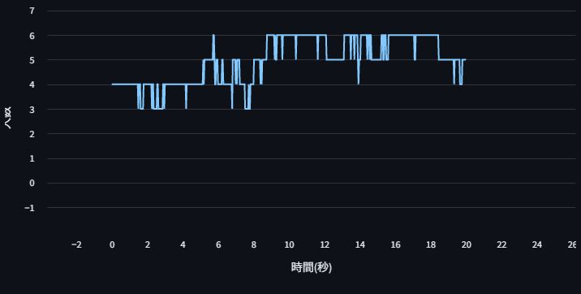
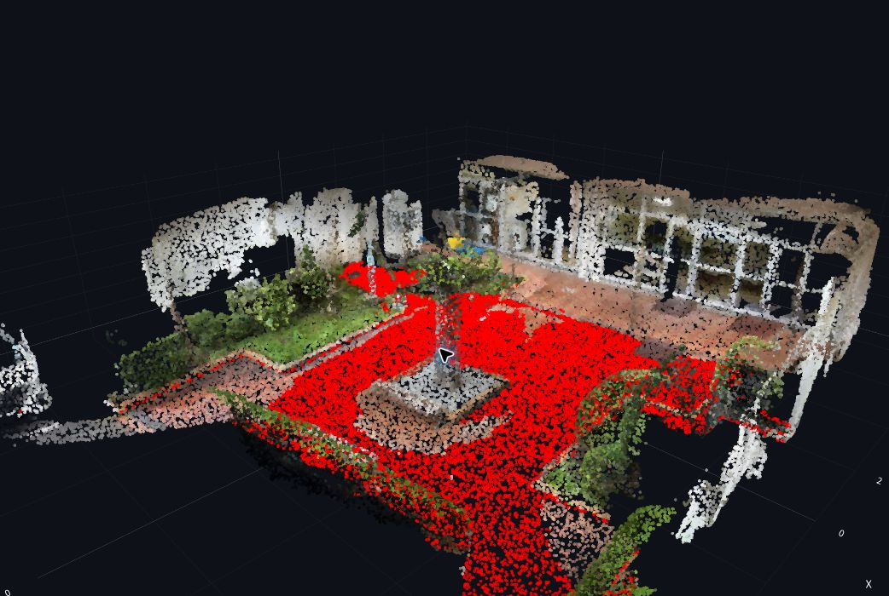
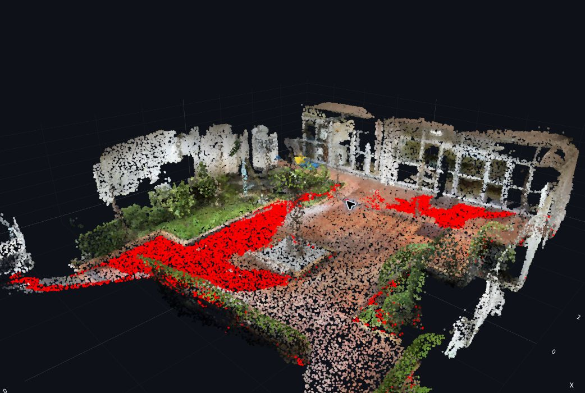
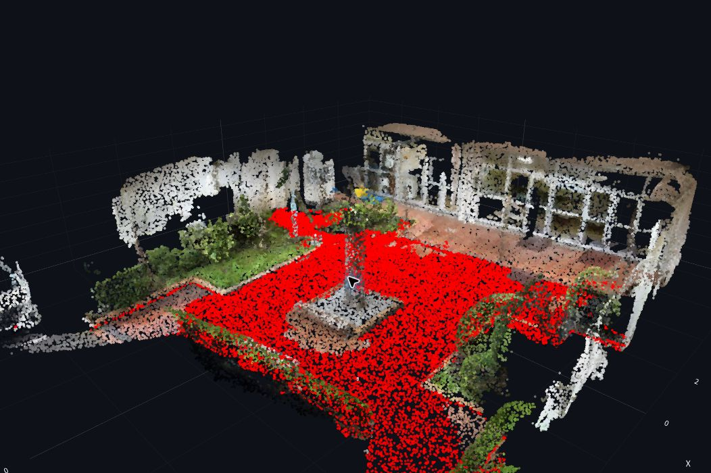

这是 2026 年 10 月 23 日《情報学実習B》的完整复习记录：先用 Python 做网页计算器，再让 YOLO 检测照片和视频里的人，最后读取三维点云，用 RANSAC 找出近水平的地面。

这篇把实际运行流程、四个程序的完整代码、关键变量、数学原理、调参结果和当天报错串在一起。第一次学可以按顺序看；已经运行成功，可以直接跳到相应程序的解析。

## 1. 今天完成了什么，文件从哪里下载

| 实验 | 输入 | 主要处理 | 输出 |
| --- | --- | --- | --- |
| 计算器 `calc.py` | 两个数字、计算方式 | 加法或乘法 | 计算结果 |
| 拍照检测 `camera_input.py` | 浏览器摄像头拍下的照片 | YOLOv8 物体检测 | 带类别和分数的框 |
| 视频人数统计 `human_detect.py` | MP4 视频 | 逐帧检测人、计数、编码 | 带框视频、人数随时间变化的曲线 |
| 点云地面检测 `pointcloud.py` | 彩色 PLY 点云 | 采样、RANSAC、SVD、三维绘图 | 可旋转的点云、标红的平面 |

**[下载完整复现包 ZIP](https://raw.githubusercontent.com/Milo-Guo/bytelife/main/downloads/colab-ai-spatial-2026.zip)** · **[浏览全部源代码和输入数据](https://github.com/Milo-Guo/bytelife/tree/main/examples/colab-ai-spatial-2026)** · **[先看运行说明](https://github.com/Milo-Guo/bytelife/blob/main/examples/colab-ai-spatial-2026/README.md)**

ZIP 解压后就是 `colab-ai-spatial-2026` 文件夹。包含四个应用、四份复现笔记本、启动辅助脚本、示例视频、点云、验证脚本、依赖清单和文件哈希。`originals/` 另存老师的三个未完成模板、清空令牌和输出的原笔记本，方便对比补了什么。

### 逐个文件下载与用途

| 文件 | 下载/查看 |
| --- | --- |
| [calc.py](https://github.com/Milo-Guo/bytelife/blob/main/examples/colab-ai-spatial-2026/calc.py) | 加法与乘法计算器完成版 |
| [camera_input.py](https://github.com/Milo-Guo/bytelife/blob/main/examples/colab-ai-spatial-2026/camera_input.py) | 摄像头拍照检测完成版 |
| [human_detect.py](https://github.com/Milo-Guo/bytelife/blob/main/examples/colab-ai-spatial-2026/human_detect.py) | 视频人物检测与人数曲线完成版 |
| [pointcloud.py](https://github.com/Milo-Guo/bytelife/blob/main/examples/colab-ai-spatial-2026/pointcloud.py) | 老师原始完整点云程序 |
| [launch_colab.py](https://github.com/Milo-Guo/bytelife/blob/main/examples/colab-ai-spatial-2026/launch_colab.py) | 新增启动/停止辅助脚本 |
| [情報学実習B_演習課題（序章）.ipynb](https://github.com/Milo-Guo/bytelife/blob/main/examples/colab-ai-spatial-2026/%E6%83%85%E5%A0%B1%E5%AD%A6%E5%AE%9F%E7%BF%92B_%E6%BC%94%E7%BF%92%E8%AA%B2%E9%A1%8C%EF%BC%88%E5%BA%8F%E7%AB%A0%EF%BC%89.ipynb) | 计算器复现笔记本 |
| [情報学実習B_演習課題（第１章）v1.ipynb](https://github.com/Milo-Guo/bytelife/blob/main/examples/colab-ai-spatial-2026/%E6%83%85%E5%A0%B1%E5%AD%A6%E5%AE%9F%E7%BF%92B_%E6%BC%94%E7%BF%92%E8%AA%B2%E9%A1%8C%EF%BC%88%E7%AC%AC%EF%BC%91%E7%AB%A0%EF%BC%89v1.ipynb) | 照片检测复现笔记本 |
| [情報学実習B_演習課題（第１章）v2.ipynb](https://github.com/Milo-Guo/bytelife/blob/main/examples/colab-ai-spatial-2026/%E6%83%85%E5%A0%B1%E5%AD%A6%E5%AE%9F%E7%BF%92B_%E6%BC%94%E7%BF%92%E8%AA%B2%E9%A1%8C%EF%BC%88%E7%AC%AC%EF%BC%91%E7%AB%A0%EF%BC%89v2.ipynb) | 视频人数统计复现笔记本 |
| [情報学実習B_演習課題（第２章）.ipynb](https://github.com/Milo-Guo/bytelife/blob/main/examples/colab-ai-spatial-2026/%E6%83%85%E5%A0%B1%E5%AD%A6%E5%AE%9F%E7%BF%92B_%E6%BC%94%E7%BF%92%E8%AA%B2%E9%A1%8C%EF%BC%88%E7%AC%AC%EF%BC%92%E7%AB%A0%EF%BC%89.ipynb) | 点云复现笔记本 |
| [work_space_video.mp4](https://github.com/Milo-Guo/bytelife/blob/main/examples/colab-ai-spatial-2026/work_space_video.mp4) | 课程示例视频 |
| [building1_garden.ply](https://github.com/Milo-Guo/bytelife/blob/main/examples/colab-ai-spatial-2026/building1_garden.ply) | 课程彩色点云 |
| [requirements.txt](https://github.com/Milo-Guo/bytelife/blob/main/examples/colab-ai-spatial-2026/requirements.txt) | Python 直接依赖 |
| [verify_materials.py](https://github.com/Milo-Guo/bytelife/blob/main/examples/colab-ai-spatial-2026/verify_materials.py) | 文件与算法验证脚本 |
| [SHA256SUMS.txt](https://github.com/Milo-Guo/bytelife/blob/main/examples/colab-ai-spatial-2026/SHA256SUMS.txt) | 输入与源文件完整性清单 |

本包的 `calc.py` 是补全后的版本，摄像头和视频程序使用本次课堂完成版；`pointcloud.py` 保留老师的原始完整代码。复现笔记本明确安装所需依赖，把工作目录改为本包目录，并使用新增启动器隐藏输入令牌、等待服务响应。原版笔记本在 `originals/`，所以能区分原课程写法和整理时的改动。

示例视频约 22.3 MB，PLY 约 9.8 MB。GitHub 大文件预览可能只显示下载入口：点 **Download raw file**，或直接下载上面的 ZIP。个人自拍、账号信息、真实令牌和整份讲义 PDF 没放进公开包。

## 2. 工具、网站和文件格式，各自负责什么

| 名称 | 是什么 | 本次具体用法 |
| --- | --- | --- |
| Python | 编程语言 | 写计算逻辑、读图片和视频、调用模型、处理点云 |
| Google Drive | 云端文件存储 | 放 `.py`、输入视频、PLY 等长期保存的材料 |
| Google Colab | 浏览器里的托管 Jupyter 笔记本环境 | 运行 `.ipynb` 单元，在云端安装库、启动 Python 服务 |
| Jupyter Notebook / `.ipynb` | 能混合说明文字、代码单元和运行输出的文档格式 | 保存安装、挂载、启动等步骤；不是 Streamlit 应用本体 |
| pip | Python 包安装工具 | 安装 Streamlit、Ultralytics、Trimesh 等依赖 |
| Streamlit | 用 Python 编写交互网页的库 | 数字输入框、侧栏、摄像头、文件上传、视频和图表 |
| ngrok | 将外部请求转发给某个本地服务的隧道工具 | 把 Colab 机器的 8501 端口映射为手机和电脑能打开的 HTTPS 地址 |
| pyngrok | 在 Python 中控制 ngrok 的库 | 设置账号令牌、建立和关闭隧道；本身不绘制网页 |
| Ultralytics / YOLOv8 | 模型工具库 / 目标检测模型系列 | 加载 `yolov8s.pt`，返回框、类别和置信分数 |
| OpenCV / `cv2` | 图像与视频处理库 | 解码相机图片、读取视频帧、写入检测结果视频、转换颜色顺序 |
| NumPy / `np` | 数值数组与运算库 | 图片字节转数组、坐标向量、叉积、点积、布尔筛选、SVD |
| pandas / `pd` | 表格数据处理库 | 把帧序号和人数整理成 DataFrame，再算出时间列 |
| FFmpeg | 独立的音视频处理程序 | 将中间视频转为浏览器更容易播放的 H.264 / yuv420p 格式 |
| Trimesh | 三维几何文件读取与处理库 | 读取 PLY 的顶点坐标和颜色 |
| Plotly | 交互图表库 | 用 Scatter3d 显示点云，拖动旋转、缩放、导出图片 |
| Scaniverse | 三维扫描工具 | 本次 PLY 文件头注明由它生成；今天直接使用已有扫描结果 |
| QRSTUDIO | 二维码生成网站 | 把应用公网 URL 编成二维码，方便手机打开 |
| Moodle | 课程与作业平台 | 下载资料、读取任务要求、输入回答、上传结果图片 |
| GitHub / ByteLife | 代码与版本管理平台 / 学习文章站 | 保存本篇、可下载的源码与数据，后续查阅和对比修改 |

入口分别是 [Drive](https://drive.google.com/)、[Colab](https://colab.research.google.com/)、[ngrok 控制台](https://dashboard.ngrok.com/get-started/your-authtoken)、[QRSTUDIO](https://qrstudio.creaman.com/single)。Moodle 使用学校给出的课程入口，公开文章不放个人课程会话链接。

### `.py`、`.ipynb`、`.pt`、`.mp4`、`.ply` 不要混淆

- `.py`：Python 源代码。Streamlit 实际运行它。
- `.ipynb`：笔记本。里面安排安装库、挂载 Drive、查看代码和启动服务。
- `.pt`：本课中的 PyTorch 模型权重。`yolov8s.pt` 已训练好，第一次加载时通常自动下载。
- `.mp4`：视频容器，里面可以装视频流和音频流；扩展名相同不代表编码完全相同。
- `.ply`：三维数据文件，可以保存点的位置、颜色以及其他属性；不一定有三角面。
- `.png`：结果图片，例如人数曲线或地面检测图，可以上传作业。

今天使用预训练 YOLO **做推理（inference）**：把新图像交给已有模型算结果。代码里没有训练循环、训练数据标注或反向传播，因此不是重新训练了一个人物识别模型。点云实验则主要是几何算法。

## 3. 整套运行关系：浏览器、云端、端口和文件

```text
Google Drive：保存代码、视频、点云
        │ 挂载后在 /content/drive/MyDrive/... 访问
        ▼
Colab 云端机器
  笔记本 → 安装依赖 → 运行 streamlit run xxx.py
                                │
                       Streamlit：8501 端口
                                ▲
                          ngrok 隧道
                                ▲
                HTTPS 公网 URL / 二维码
                                ▲
                    电脑或手机的浏览器
```

浏览器负责显示网页，摄像头也由浏览器请求权限；照片或上传的视频交给云端程序处理。浏览器里看得到网页，不代表 Python 就在自己电脑上运行。

### `localhost` 到底指谁

`localhost` 是“当前访问它的那台机器”。

- 在 Colab 代码里连 `127.0.0.1:8501`：连接 Colab 那台机器的服务。
- 在自己电脑浏览器打开 `http://localhost:8501`：连接自己电脑的 8501。
- 用本机 Python 启动 Streamlit 后：本机浏览器打开 localhost 正确，通常不需要 ngrok。
- 用 Colab 启动时：从自己电脑打开输出的 **HTTPS ngrok URL**。

隧道输出中 `https://…ngrok-free.dev → http://localhost:8501` 表示转发关系；右边不是另一个应该从电脑打开的公网入口。

### 这些位置也不一样

| 位置 | 作用 | 是否长期保留 |
| --- | --- | --- |
| 本机 Downloads | 下载资料 | 在本机，未上传就不能被 Colab 直接访问 |
| `/content` | Colab 临时工作区 | 运行时重置、回收后可能消失 |
| `/content/drive/MyDrive/...` | 挂载后的自己的 Drive | 一般保留在 Drive 中 |
| Python 的当前目录 | 相对路径的起点 | 由 `os.chdir(...)` 决定 |
| `st.session_state` | 某个网页会话内的状态 | 不是持久数据库；刷新重连等情况下可能重置 |

例如 `YOLO('yolov8s.pt')`、`./object_detection_app_results.mp4` 都依赖当前目录。先用 `os.getcwd()` 和 `os.listdir('.')` 确认位置，比反复改文件名有效。

[Colab 官方 FAQ](https://research.google.com/colaboratory/faq.html)说明笔记本和运行时的区别及运行时限制。这里用于课堂实验；持续运行的网站应选择专门的部署环境，按 Colab 当前资源规则使用。

## 4. 从下载到运行：四份 Colab 笔记本逐格解释

### 第一步：一次把材料放齐

1. 下载 ZIP 并解压。
2. 在 Google Drive 的 **マイドライブ / My Drive（我的云端硬盘）** 上传整个 `colab-ai-spatial-2026` 文件夹。
3. 打开 Colab 的 **File → Upload notebook（文件→上传笔记本）**，选择对应 `.ipynb`。
4. 序章运行计算器，第１章 v1 运行相机，第１章 v2 运行视频，第２章运行点云。
5. 按单元从上往下执行。每切换一个应用，先停止上一个服务。

只上传笔记本不够：`files.view('human_detect.py')` 需要实际存在的 `.py`，视频和点云上传控件也要选得到相应输入文件。

### 单元一：安装依赖

公开复现版按章节分别安装。例如视频课题：

```python
%pip install streamlit pyngrok ultralytics opencv-python numpy pandas
```

`%pip` 是 IPython 的魔法命令，面向当前笔记本内核安装包。课程原版使用 `!pip install ...`；开头的 `!` 表示执行 shell 命令，也不是普通 Python 语法。

`pip install opencv-python` 后，代码使用 `import cv2`；包名和导入名不一定相同。点云需要 `numpy trimesh plotly`，不调用 YOLO；复现版明确安装 Plotly，避免只依赖 Colab 预装环境。视频程序另需 FFmpeg 可执行文件，可在新单元运行 `!ffmpeg -version` 检查。

### 单元二：挂载 Drive 与切换目录

```python
from google.colab import drive
drive.mount('/content/drive')

import os
os.chdir('/content/drive/MyDrive/colab-ai-spatial-2026')
print('当前目录：', os.getcwd())
print('目录文件：', os.listdir('.'))
```

`from ... import ...` 导入需要的功能。`drive.mount` 请求自己的 Google 账号授权，使云盘出现在云端文件系统。`os.chdir` 改变后续代码的相对路径起点。目录不存在会报 `FileNotFoundError`，应检查上传位置，不能把 Windows 的 `C:\Users\...` 路径直接填进 Colab。

老师原版使用课程文件夹 `情報学実習2026（安藤）`。这份 ZIP 使用独立文件夹；如果保留老师目录，修改 `os.chdir` 一行即可，中文、日文和括号都要对应实际文件名。

### 单元三：查看并保存应用代码

```python
from google.colab import files
files.view('human_detect.py')
```

这是打开源文件查看/编辑的入口，不等于执行应用。改完要保存。Streamlit 检测到变更后，网页可能出现 **Rerun（重新运行）**；点击才会显示新逻辑。

### 单元四：启动应用与隧道

课程原版核心结构是：

```python
from pyngrok import ngrok
ngrok.set_auth_token('')  # 原版这里需要自己的令牌，公开文件保持为空

# 下面这行是 Colab shell 命令，不能直接当普通 Python 脚本运行
!streamlit run human_detect.py &>/content/logs.txt &

public_url = ngrok.connect(addr='8501')
print(public_url)
```

`&>` 将标准输出和错误输出一起写入日志，末尾 `&` 让进程在后台运行。这是 shell 写法；最后的 `print` 成功只说明隧道对象创建了，不能证明应用已经就绪。这正是今天要理解的排错点。

公开复现版改用：

```python
%run launch_colab.py human_detect.py
```

辅助脚本会检查文件和端口，隐藏输入令牌，用当前 Python 启动 Streamlit，等待网页返回 HTTP 200，再创建指向 IPv4 地址的隧道。它避免“刚启动立即打开”的常见空档，也不会自动结束占用端口的其他程序。根网页能响应仍不代表模型权重下载完成；应用异常继续看网页和日志。

<details>
<summary>展开 launch_colab.py 的完整代码</summary>

```python
"""Colab 课堂启动器：先检查服务，再创建 ngrok 隧道；不停止其他进程。"""
from pathlib import Path
import argparse
import getpass
import socket
import subprocess
import sys
import time
import urllib.error
import urllib.request


def stop_app(process, tunnel, log_file):
    """只关闭由本启动器返回的服务和隧道。"""
    from pyngrok import ngrok
    try:
        ngrok.disconnect(tunnel.public_url)
    finally:
        try:
            if process.poll() is None:
                process.terminate()
                try:
                    process.wait(timeout=10)
                except subprocess.TimeoutExpired:
                    process.kill()
                    process.wait(timeout=10)
        finally:
            log_file.close()
    print("本次应用和隧道已关闭。")


def start_app(app, port=8501):
    """返回进程、隧道、日志句柄，便于切换课题时精确关闭。"""
    from pyngrok import ngrok
    app_path = Path(app).resolve()
    if not app_path.is_file() or app_path.suffix != ".py":
        raise FileNotFoundError(f"找不到 Python 文件：{app_path}")
    # 防止把旧应用误当作本次启动成功，也不自动结束占用端口的程序
    with socket.socket() as probe:
        if probe.connect_ex(("127.0.0.1", port)) == 0:
            raise RuntimeError(f"{port} 端口已占用。先关闭上一课的服务，或换一个端口。")
    token = getpass.getpass("粘贴自己的 ngrok authtoken（输入不显示）：").strip()
    if not token:
        raise ValueError("没有输入 ngrok authtoken。")
    ngrok.set_auth_token(token)
    del token
    log_path = (Path("/content") if Path("/content").is_dir() else app_path.parent) / "logs.txt"
    log_file = log_path.open("w", encoding="utf-8")
    process = None
    try:
        process = subprocess.Popen(
            [sys.executable, "-m", "streamlit", "run", str(app_path),
             f"--server.port={port}", "--server.address=127.0.0.1", "--server.headless=true"],
            cwd=app_path.parent, stdout=log_file, stderr=subprocess.STDOUT,
        )
        deadline = time.monotonic() + 60
        while time.monotonic() < deadline:
            if process.poll() is not None:
                raise RuntimeError(f"Streamlit 提前退出，请查看 {log_path}")
            try:
                with urllib.request.urlopen(f"http://127.0.0.1:{port}/", timeout=1) as response:
                    if response.status == 200:
                        break
            except (OSError, urllib.error.URLError):
                pass
            time.sleep(0.5)
        else:
            raise TimeoutError(f"等待 Streamlit 超时，请查看 {log_path}")
        tunnel = ngrok.connect(addr=f"http://127.0.0.1:{port}", proto="http")
        print("Streamlit 网页服务已响应。请打开下面的 HTTPS 地址：")
        print(tunnel.public_url)
        print(f"模型加载或应用代码报错请查看网页与 {log_path}")
        return process, tunnel, log_file
    except Exception:
        if process is not None and process.poll() is None:
            process.terminate()
            try:
                process.wait(timeout=10)
            except subprocess.TimeoutExpired:
                process.kill()
                process.wait(timeout=10)
        log_file.close()
        raise


if __name__ == "__main__":
    parser = argparse.ArgumentParser(description=__doc__)
    parser.add_argument("app", help="要运行的 .py 文件")
    parser.add_argument("--port", type=int, default=8501)
    args = parser.parse_args()
    course_process, course_tunnel, course_log = start_app(args.app, args.port)
```

</details>

这段辅助代码中的 `subprocess.Popen` 启动并返回一个仍在运行的子进程，和稍后等待 FFmpeg 完成的 `subprocess.run` 不同。`sys.executable` 使用当前内核的 Python，避免启动到没安装依赖的另一个环境。日志文件句柄保持打开，直到停止应用。

`time.monotonic()` 用于计算等待期限，`urlopen` 轮询网页响应；失败时终止的只有本次新建进程。返回的 `course_process`、`course_tunnel`、`course_log` 分别是进程、隧道和日志句柄，供停止单元使用。

### 单元五：结束或切换实验

```python
stop_app(course_process, course_tunnel, course_log)
```

只在要结束时运行。它断开本次隧道，终止本次服务并关闭日志。再打开下一份笔记本运行对应应用。只关浏览器标签，云端后台进程仍可能占着 8501。

原版笔记本没有保存进程句柄时，若已经混乱，可以在 Colab 选择 **Runtime → Disconnect and delete runtime（运行时→断开连接并删除运行时）**，重新安装、挂载、启动。操作前把 `/content` 里需要的结果下载或保存到 Drive，因为这是重置临时运行环境。

令牌在 [ngrok 控制台](https://dashboard.ngrok.com/get-started/your-authtoken)取得。`getpass` 避免把输入打印在笔记本中；它不是加密保险箱，pyngrok 仍可能在当前运行环境保存认证配置。公开代码、截图、输出和 Git 提交都不要携带真实令牌。

## 5. 计算器 calc.py：输入、分支和输出

这是四个实验里最适合先读懂的程序。

```python
import streamlit as st

st.title("計算アプリ")

# 输入两个数字，再从侧栏选择计算方式
a = st.number_input("数字１")
b = st.number_input("数字２")
method = st.sidebar.selectbox("計算方法", ["足し算", "掛け算"])

# 根据选择执行对应的计算
if method == "足し算":
    c = a + b
elif method == "掛け算":
    c = a * b

# f 字符串会把计算方式填入标题
st.title(f"{method}結果")
st.text(c)
```

### 按执行顺序解释

| 代码 | 意思 | 为什么需要 |
| --- | --- | --- |
| `import streamlit as st` | 导入库并取短名 `st` | 后面用 `st.xxx` 创建网页控件 |
| `st.title(...)` | 显示大标题 | 让用户知道当前是什么应用 |
| `st.number_input(...)` | 创建数字输入框并返回当前数值 | 把用户输入存到变量 `a`、`b` |
| `st.sidebar.selectbox(...)` | 在侧栏创建下拉框 | 返回选中的日文字符串 |
| `if method == '足し算'` | 判断是否选中加法 | 只执行符合条件的分支 |
| `elif method == '掛け算'` | 否则继续判断乘法 | 计算 `a * b` |
| `c = ...` | 把计算值赋给 `c` | 后面统一显示 |
| `f'{method}結果'` | f 字符串插入变量内容 | 加法显示“足し算結果”，乘法显示“掛け算結果” |
| `st.text(c)` | 显示计算结果 | 完成 Output |

`=` 是赋值，`==` 是比较。`['足し算', '掛け算']` 是列表，里面是两个选项。Python 用缩进确定分支范围，不能把 `c = a * b` 的缩进随意删掉。

输入 `a=2`、`b=4`，选择 **掛け算（乘法）**：`method` 等于该字符串，跳过加法，计算 `c=2*4=8`。截图出现 `8.0` 属于浮点数的显示方式。

### 为什么修改输入后就能自动更新

Streamlit 默认在控件交互后，从上往下重新执行脚本，数字框返回新值，所以会重新计算。这也解释了为什么较重的模型初始化不能无条件当作“只执行一次”。官方说明见 [执行与会话状态](https://docs.streamlit.io/develop/concepts/architecture/session-state)。

老师最初的模板只有标题和 Input / Process / Output 注释，页面因此只有标题。这个现象首先应检查代码有没有填完，而不是先怀疑浏览器坏了。

## 6. camera_input.py：照片怎样变成检测结果

### 完整代码

```python
import streamlit as st
import cv2
import numpy as np
from ultralytics import YOLO

st.set_page_config(
    page_title="カメラによる物体検知",
    layout="centered"
)

st.title("カメラによる物体検知")

model = YOLO('yolov8s.pt')

# Input
camera_img = st.camera_input(label='インカメラ画像')

# Process
if camera_img is not None:
    bytes_data = camera_img.getvalue()
    cv2_img = cv2.imdecode(np.frombuffer(bytes_data, np.uint8), cv2.IMREAD_COLOR)
    if cv2_img is None:
        st.error("画像を読み込めませんでした。もう一度撮影してください。")
        st.stop()

    results = model(cv2_img, conf=0.4)
    output_img = results[0].plot(labels=True, conf=True)
    # OpenCV 和网页使用的颜色顺序不同，显示前需要转换
    output_img = cv2.cvtColor(output_img, cv2.COLOR_BGR2RGB)

    # Output
    st.image(output_img, caption='出力画像')
```

### 6.1 导入库、设置页面、加载模型

`st.set_page_config` 设置标签页标题和布局。`centered` 让内容居中；这类设置不参与图像算法。

`YOLO('yolov8s.pt')` 构造检测模型对象。`v8` 是模型系列，`s` 是这一系列中的 small 规格；不能因为现在有新系列就擅自替换课堂使用的模型。文件已存在时读取本地权重，缺失时通常自动下载。首次比后续慢，可能是下载和初始化。

`model` 是可调用对象，`model(image, ...)` 会执行推理。输出包含框的位置、类别 ID 和分数。课程使用的预训练检测权重采用 COCO 类别定义，`person` 是其中一类。模型资料见 [Ultralytics YOLOv8 官方页](https://docs.ultralytics.com/models/yolov8/)。

### 6.2 相机控件返回什么

```python
camera_img = st.camera_input(label='インカメラ画像')
if camera_img is not None:
    ...
```

浏览器先申请摄像头权限，拍照前返回 `None`。拍照后返回类似文件的对象，代码才进入 `if`。所以还没拍照时没有检测结果是正常的。这个控件拍摄的是**单张静态照片**，不会自动连续处理摄像头视频。接口定义见 [st.camera_input 官方文档](https://docs.streamlit.io/develop/api-reference/widgets/st.camera_input)。

### 6.3 字节到像素矩阵，分成两步

```python
bytes_data = camera_img.getvalue()
cv2_img = cv2.imdecode(
    np.frombuffer(bytes_data, np.uint8),
    cv2.IMREAD_COLOR
)
```

`getvalue()` 得到图片文件的原始字节。`np.frombuffer(..., np.uint8)` 把字节解释为一维无符号 8 位数组；0～255 对应一个字节的范围。此时还不是 H×W×3 的图片。

`cv2.imdecode` 才把 JPEG/PNG 等压缩内容解码为彩色像素矩阵。一般形状是 `(高度, 宽度, 3)`。读取失败可能得到 `None`，因此用 `st.error` 提示，并用 `st.stop()` 停止本次运行，避免把无效输入交给模型。

### 6.4 模型推理和画框是两个动作

```python
results = model(cv2_img, conf=0.4)
output_img = results[0].plot(labels=True, conf=True)
```

第一行算检测结果，`conf=0.4` 过滤低于阈值的候选结果。这是模型分数的筛选门槛，不能直接理解为“超过 40% 就一定对”或把某张图的分数当成总体准确率。

`results` 为结果列表；这里输入一张图，因此取 `results[0]`，Python 列表索引从 0 开始。第二行根据结果生成带框的新图片：`labels=True` 显示类别名称，`conf=True` 显示分数。比如 `person 0.89` 意味着模型给这个框的 person 检测结果打了该分数，不表示知道这个人的身份。

相机版没有设置 `classes=[0]`，所以它可以显示模型支持的其他物体类别。视频课题才明确只保留人。参数和结果字段可查 [Ultralytics predict 文档](https://docs.ultralytics.com/modes/predict/)。

### 6.5 为什么还要转换颜色

```python
output_img = cv2.cvtColor(output_img, cv2.COLOR_BGR2RGB)
st.image(output_img, caption='出力画像')
```

OpenCV 彩色数组通常按 **B、G、R** 排列，网页显示通常按 **R、G、B** 解释。不转换会出现红蓝颠倒。这里只在交给网页显示前转换；写入 OpenCV 视频时仍按它预期的 BGR 处理。

完整数据流：`摄像头照片文件 → 原始字节 → 一维字节数组 → BGR 像素矩阵 → YOLO 检测结果 → 画框图片 → RGB → 网页`。

当天实际操作是：补全云端文件并保存 → 网页 Rerun → 允许摄像头 → 拍照 → 出现人物框。公开文章不放个人自拍，用代码解释同样能复现流程。

## 7. human_detect.py：逐帧检测、人数曲线和视频编码

### 完整代码

<details>
<summary>展开 human_detect.py 完整代码</summary>

```python
import streamlit as st
import cv2
import numpy as np
from ultralytics import YOLO
import tempfile
import subprocess
import pandas as pd

st.set_page_config(
    page_title="カメラによる人物検出",
    layout="centered"
)

st.title("カメラによる人物検出")


model = YOLO('yolov8s.pt')

# Input
upload_file = st.file_uploader("動画アップロード", type='mp4')

# Process
if upload_file is not None:

    # 処理中表示
    status_text = st.empty()
    progress_bar = st.progress(0)

    status_text.text("現在、処理動作中…")

    # 写入后关闭临时文件，确保 OpenCV 能读到完整的视频
    with tempfile.NamedTemporaryFile(delete=False, suffix='.mp4') as temp_file:
        temp_file.write(upload_file.getvalue())

    cap = cv2.VideoCapture(temp_file.name)
    if not cap.isOpened():
        status_text.empty()
        st.error("動画を開けませんでした。MP4ファイルを確認してください。")
        cap.release()
        st.stop()

    width = cap.get(cv2.CAP_PROP_FRAME_WIDTH)
    height = cap.get(cv2.CAP_PROP_FRAME_HEIGHT)
    count = cap.get(cv2.CAP_PROP_FRAME_COUNT)
    fps = cap.get(cv2.CAP_PROP_FPS)

    if width <= 0 or height <= 0 or count <= 0 or fps <= 0:
        status_text.empty()
        st.error("動画のサイズ・フレーム数・FPSを取得できませんでした。")
        cap.release()
        st.stop()

    writer = cv2.VideoWriter('./object_detection_app_results.mp4',
                            cv2.VideoWriter_fourcc(*'mp4v',), fps,
                            frameSize=(int(width), int(height)))
    if not writer.isOpened():
        status_text.empty()
        st.error("VideoWriterのオープンに失敗しました")
        cap.release()
        writer.release()
        st.stop()

    num = 0
    nums = []
    persons = []
    while cap.isOpened():
        ret, img = cap.read()

        if ret:
            # YOLO 的类别 0 是人，限定类别后只统计人数
            results = model(img, conf=0.5, classes=[0])
            categories = results[0].boxes.cls
            person_num = len(categories)
            nums.append(num)
            persons.append(person_num)

            img = results[0].plot(labels=False, conf=True)
            writer.write(img)

            progress = min(int((num + 1) / count * 100), 100)
            progress_bar.progress(progress)
        else:
            break

        num = num + 1

    cap.release()
    writer.release()
    progress_bar.empty()

    if not nums:
        status_text.empty()
        st.error("動画からフレームを読み込めませんでした。")
        st.stop()

    # 将帧序号换算成秒，得到每个时刻对应的人数
    person_data = pd.DataFrame({'フレーム': nums, '人数': persons})
    person_data['時間(秒)'] = person_data['フレーム'] / fps
    person_data = person_data[['時間(秒)', '人数']]

    # ブラウザ再生用にH.264へ変換
    status_text.empty()
    status_text.text('動画表示の準備をしています…')
    input_video = './object_detection_app_results.mp4'
    output_video = './object_detection_app_results_h264.mp4'

    try:
        subprocess.run([
            'ffmpeg', '-y',
            '-i', input_video,
            '-vcodec', 'libx264',
            '-acodec', 'aac',
            '-pix_fmt', 'yuv420p',
            output_video
        ], check=True)
    except FileNotFoundError:
        status_text.empty()
        st.error("ffmpegが見つかりません。Colabの環境を確認してください。")
        st.stop()
    except subprocess.CalledProcessError:
        status_text.empty()
        st.error("動画の変換に失敗しました。Colabのログを確認してください。")
        st.stop()

    status_text.empty()

    # Output
    st.text('検出結果の動画を表示しました。')
    st.video(
        output_video,
        autoplay=True
    )
    st.text('以下は検出された人数の時系列グラフです。')
    st.line_chart(person_data, x="時間(秒)", y="人数")
```

</details>

与老师初始模板相比，这个完成版加入只检测人、每帧计数、DataFrame 时间列和折线图，也补充输入与视频元数据检查。写临时文件后先关闭，再让 OpenCV 读取，避免文件内容还没写完整就开始解码。

### 7.1 上传文件和临时文件

```python
upload_file = st.file_uploader('動画アップロード', type='mp4')
with tempfile.NamedTemporaryFile(delete=False, suffix='.mp4') as temp_file:
    temp_file.write(upload_file.getvalue())
cap = cv2.VideoCapture(temp_file.name)
```

上传控件没有选择文件时返回 `None`，主处理只在上传后运行。浏览器上传对象在内存中；OpenCV 按文件路径读取，所以把内容写到临时 `.mp4`。

`with` 结束会关闭并刷新文件，但 `delete=False` 表示关闭时不自动删掉该临时文件。完成版目前没有最终清理它，长时间多次上传会积累临时文件；可以作为后续改进，不能误说它已经自动回收。相关语义见 [Python tempfile 文档](https://docs.python.org/3/library/tempfile.html)。

`cap.isOpened()` 检查视频是否能打开。失败时释放对象并停止后续处理；不要继续读取宽高为 0 的数据。

### 7.2 宽、高、帧数和 FPS

| 变量 | 读取属性 | 本次样例 |
| --- | --- | --- |
| `width` | `CAP_PROP_FRAME_WIDTH` | 1280 像素 |
| `height` | `CAP_PROP_FRAME_HEIGHT` | 720 像素 |
| `count` | `CAP_PROP_FRAME_COUNT` | 601 帧 |
| `fps` | `CAP_PROP_FPS` | 30 帧/秒 |

元数据来自解码器，代码检查它们是否大于 0。总时长约 `601/30=20.0333` 秒；帧索引从 0 起，最后一帧的横坐标是 `600/30=20.0` 秒，两者没有矛盾。

### 7.3 创建输出视频

```python
writer = cv2.VideoWriter(
    './object_detection_app_results.mp4',
    cv2.VideoWriter_fourcc(*'mp4v',),
    fps,
    frameSize=(int(width), int(height))
)
```

`VideoWriter` 需要输出路径、编码标识、帧率和帧大小。`*'mp4v'` 将四个字符拆开传入 `fourcc`。宽高转整数；必须与实际写入帧的尺寸一致。`.mp4` 是容器扩展名，`mp4v` 是这里使用的编码标识。

打开失败应先检查编码支持、输出目录和磁盘，而不是继续执行。使用完必须 `writer.release()`，让文件封装写完。OpenCV 读写流程见 [官方视频教程](https://docs.opencv.org/4.x/dd/d43/tutorial_py_video_display.html)。

### 7.4 循环中每个变量怎样变化

```python
num = 0
nums = []
persons = []
while cap.isOpened():
    ret, img = cap.read()
    if ret:
        results = model(img, conf=0.5, classes=[0])
        categories = results[0].boxes.cls
        person_num = len(categories)
        nums.append(num)
        persons.append(person_num)
        img = results[0].plot(labels=False, conf=True)
        writer.write(img)
        progress = min(int((num + 1) / count * 100), 100)
        progress_bar.progress(progress)
    else:
        break
    num = num + 1
```

`cap.read()` 返回两个值：`ret` 是本次读取是否成功，`img` 是读取到的帧。视频结束或解码失败时 `ret=False`，跳出循环。`break` 立即离开循环，不再执行底部自增。

`classes=[0]` 只保留课堂 COCO 预训练模型中的 person 类。这个类别编号依赖模型的数据集，自定义模型不能无条件沿用 0。`boxes.cls` 中每个元素对应一个框的类别 ID；过滤后它们都是人，所以 `len(categories)` 就是该帧的人框数。

```text
第 1 帧：num=0，检测 4 人 → nums=[0]，persons=[4] → num 变 1
第 2 帧：num=1，检测 4 人 → nums=[0,1]，persons=[4,4] → num 变 2
第 3 帧：num=2，假设只检测 3 人 → persons=[4,4,3] → num 变 3
……直到 read 返回 False
```

上面第三帧的 3 是解释列表变化的假设例子，并不是对样例前三帧的实测结论。

`plot(labels=False, conf=True)` 把框画到视频帧，隐藏类别名但保留分数；`writer.write(img)` 把这帧加入输出。进度条以已处理帧数/元数据总帧数估算，`min(...,100)` 防止超过控件范围。进度不是模型准确率，也不保证剩余时间线性。

### 7.5 把帧序号变成时间，整理成表

```python
person_data = pd.DataFrame({'フレーム': nums, '人数': persons})
person_data['時間(秒)'] = person_data['フレーム'] / fps
person_data = person_data[['時間(秒)', '人数']]
st.line_chart(person_data, x='時間(秒)', y='人数')
```

字典的键成为列名，两个列表的长度必须一致。比如 30 FPS 下：第 0 帧是 0 秒，第 30 帧是 1 秒，第 150 帧是 5 秒。数组整列除以 `fps`，得到每行的时间。最后只保留横轴时间和纵轴人数。

`person_data[['時間(秒)', '人数']]` 外层方括号是在 DataFrame 里选列，内层是两个列名组成的列表。数据结构可查 [pandas DataFrame 文档](https://pandas.pydata.org/docs/reference/api/pandas.DataFrame.html)。

### 7.6 FFmpeg 转码为什么放在最后

```python
subprocess.run([
    'ffmpeg', '-y', '-i', input_video,
    '-vcodec', 'libx264', '-acodec', 'aac',
    '-pix_fmt', 'yuv420p', output_video
], check=True)
```

| 参数 | 作用 |
| --- | --- |
| `-y` | 同名输出存在时覆盖这个指定的结果文件 |
| `-i` | 指定输入的中间视频 |
| `-vcodec libx264` | 使用 x264 编码 H.264 视频 |
| `-acodec aac` | 有音频流时使用 AAC 编码 |
| `-pix_fmt yuv420p` | 指定常见播放器支持的像素格式 |
| `check=True` | 进程非零退出时抛出异常 |

它解决播放兼容性，不负责检测人。`FileNotFoundError` 表示没找到可执行程序，`CalledProcessError` 表示找到了程序但执行失败，要看 FFmpeg 日志。官方参数参考 [FFmpeg 文档](https://ffmpeg.org/ffmpeg.html)。

**输出视频没有保留原始声音。** OpenCV 的 writer 只写了图像帧，中间文件没有复制音轨；后面写一个 `-acodec aac` 不会凭空恢复原音频。想保留声音需要额外从原视频映射音轨并同步，这份课堂程序尚未实现。

### 7.7 这条人数曲线应该怎样读



*本次课堂界面中的人数曲线，保存为 PNG。横轴是秒，纵轴是每帧检测到的人数。*

样例开头画面中有 4 人，约 5～6 秒有人进入，约 8～9 秒又有人出现，约 18～20 秒有人离开。因此长时间从 4 到 5、再到 6、最后回到 5，与真实场景变化相符。很短的向下尖峰则可能由遮挡、低头、身体只露一部分或分数跌破阈值造成，需要回看对应视频判断。

这条曲线记录**每个时刻检测到多少人**。同一个人在 601 帧里被检测 601 次，不代表出现 601 个不同的人。要统计去重人数、进出次数，需要跟踪 ID、跨帧关联和进出线判断；本程序没有这些逻辑。

可以尝试把 `conf=0.5` 改为 0.3、0.7，对比漏检和误检；提高阈值通常会过滤更多结果，但不能保证每种场景都更正确。比较时使用同一输入、记录参数，抽看画面作人工核对。

## 8. pointcloud.py 全解：从 65 万个点到红色地面

这一部分的处理关系是：

```text
PLY 文件
  → 顶点坐标 points(N×3)、颜色 colors(N×3)
  → ①采样：indices(M)
  → display_points(M×3)、display_colors(M×3)
  → ②RANSAC：平面 normal(3)、d、floor_mask(M)
  → SVD 精修 → 用 mask 把选中点改成红色
  → Plotly Scatter3d 显示
```

### 8.1 完整源码与阅读方式

下面给出完整逻辑的紧凑排版，去掉了原文件大量空行和分隔注释，函数与控制流程保持一致，已用 Python AST 比较检查。下载的 `pointcloud.py` 则保留老师的原始排版和日文注释。

<details>
<summary>展开 pointcloud.py 完整逻辑代码（紧凑排版）</summary>

```python
import streamlit as st
import numpy as np
import trimesh
import plotly.graph_objects as go
import tempfile
import os
st.set_page_config(page_title='3D点群・床面検出', layout='wide')
st.title('3D点群表示・床面検出')
st.markdown('\n    <style>\n\n    /* 通常のボタン */\n    div.stButton > button {\n        background-color: #1f4e79;\n        color: white;\n        border: none;\n        border-radius: 8px;\n        font-size: 18px;\n        font-weight: bold;\n        padding: 0.6em 1em;\n        min-height: 50px;\n    }\n\n    /* マウスを乗せたとき */\n    div.stButton > button:hover {\n        background-color: #163a5c;\n        color: white;\n        border: none;\n    }\n\n    /* ボタンを押している間 */\n    div.stButton > button:active {\n        background-color: #102a43;\n        color: white;\n    }\n\n    /* 無効化されたボタン */\n    div.stButton > button:disabled {\n        background-color: #b0b0b0;\n        color: #eeeeee;\n        border: none;\n        cursor: not-allowed;\n    }\n\n    </style>\n    ', unsafe_allow_html=True)
if 'step' not in st.session_state:
    st.session_state.step = 1
if 'display_points' not in st.session_state:
    st.session_state.display_points = None
if 'display_colors' not in st.session_state:
    st.session_state.display_colors = None
if 'floor_mask' not in st.session_state:
    st.session_state.floor_mask = None
if 'floor_result' not in st.session_state:
    st.session_state.floor_result = None
if 'floor_detected' not in st.session_state:
    st.session_state.floor_detected = False
if 'uploaded_file_id' not in st.session_state:
    st.session_state.uploaded_file_id = None

def reset_session_state():
    st.session_state.step = 1
    st.session_state.display_points = None
    st.session_state.display_colors = None
    st.session_state.floor_mask = None
    st.session_state.floor_result = None
    st.session_state.floor_detected = False

def poisson_disk_sampling(points, target_count):
    n = len(points)
    if target_count >= n:
        return np.arange(n)
    if target_count <= 0:
        return np.array([], dtype=int)
    pmin = points.min(axis=0)
    pmax = points.max(axis=0)
    extent = pmax - pmin
    volume = np.prod(extent)
    if volume <= 0:
        return np.random.choice(n, size=target_count, replace=False)
    radius = (volume / target_count) ** (1.0 / 3.0)
    radius *= 0.8
    if radius <= 0:
        radius = 1e-06
    cell_size = radius
    grid = {}

    def grid_coord(p):
        return tuple(np.floor((p - pmin) / cell_size).astype(int))

    def is_far_enough(p):
        gc = grid_coord(p)
        for dx in [-1, 0, 1]:
            for dy in [-1, 0, 1]:
                for dz in [-1, 0, 1]:
                    key = (gc[0] + dx, gc[1] + dy, gc[2] + dz)
                    if key not in grid:
                        continue
                    for idx in grid[key]:
                        q = points[idx]
                        distance_sq = np.sum((p - q) ** 2)
                        if distance_sq < radius ** 2:
                            return False
        return True
    order = np.random.permutation(n)
    selected = []
    max_attempts = target_count * 30
    attempts = 0
    for idx in order:
        if len(selected) >= target_count:
            break
        attempts += 1
        if attempts > max_attempts:
            break
        p = points[idx]
        if is_far_enough(p):
            selected.append(idx)
            gc = grid_coord(p)
            if gc not in grid:
                grid[gc] = []
            grid[gc].append(idx)
    if len(selected) < target_count:
        selected_set = set(selected)
        remaining = [i for i in range(n) if i not in selected_set]
        needed = target_count - len(selected)
        if len(remaining) > 0:
            additional = np.random.choice(remaining, size=min(needed, len(remaining)), replace=False)
            selected.extend(additional.tolist())
    return np.array(selected, dtype=int)

def detect_floor_ransac(points, iterations=1000, distance_threshold=0.01, angle_threshold_deg=10.0, min_inliers=100):
    if len(points) < 3:
        return None
    reference_normal = np.array([0.0, 0.0, 1.0])
    angle_threshold = np.deg2rad(angle_threshold_deg)
    cos_threshold = np.cos(angle_threshold)
    best_count = 0
    best_inliers = None
    best_plane = None
    n = len(points)
    for _ in range(iterations):
        ids = np.random.choice(n, size=3, replace=False)
        p1 = points[ids[0]]
        p2 = points[ids[1]]
        p3 = points[ids[2]]
        v1 = p2 - p1
        v2 = p3 - p1
        normal = np.cross(v1, v2)
        norm = np.linalg.norm(normal)
        if norm < 1e-08:
            continue
        normal = normal / norm
        if normal[2] < 0:
            normal = -normal
        cos_angle = np.dot(normal, reference_normal)
        if cos_angle < cos_threshold:
            continue
        d = -np.dot(normal, p1)
        distances = np.abs(points @ normal + d)
        inliers = distances <= distance_threshold
        count = np.sum(inliers)
        if count > best_count:
            best_count = count
            best_inliers = inliers
            best_plane = (normal.copy(), d)
    if best_plane is None:
        return None
    if best_count < min_inliers:
        return None
    inlier_points = points[best_inliers]
    center = np.mean(inlier_points, axis=0)
    centered = inlier_points - center
    try:
        _, _, vh = np.linalg.svd(centered, full_matrices=False)
        refined_normal = vh[-1]
        refined_normal = refined_normal / np.linalg.norm(refined_normal)
        if refined_normal[2] < 0:
            refined_normal = -refined_normal
    except Exception:
        refined_normal = best_plane[0]
    cos_angle = np.clip(np.dot(refined_normal, reference_normal), -1.0, 1.0)
    angle_deg = np.degrees(np.arccos(cos_angle))
    d = -np.dot(refined_normal, center)
    distances = np.abs(points @ refined_normal + d)
    final_mask = distances <= distance_threshold
    return {'normal': refined_normal, 'd': d, 'mask': final_mask, 'count': int(np.sum(final_mask)), 'center': center, 'angle_deg': angle_deg}

def create_figure(points, colors, floor_mask=None, point_size=2):
    display_colors = np.array(colors, copy=True)
    if floor_mask is not None:
        display_colors[floor_mask] = [255, 0, 0]
    rgb_strings = [f'rgb({int(c[0])},{int(c[1])},{int(c[2])})' for c in display_colors]
    fig = go.Figure(data=[go.Scatter3d(x=points[:, 0], y=points[:, 1], z=points[:, 2], mode='markers', marker=dict(size=point_size, color=rgb_strings, opacity=0.8))])
    camera = dict(eye=dict(x=-1.0, y=-1.0, z=0.6), up=dict(x=0, y=0, z=1), center=dict(x=0, y=0, z=0))
    fig.update_layout(scene=dict(xaxis_title='X', yaxis_title='Y', zaxis_title='Z', aspectmode='data', camera=camera), height=700, margin=dict(l=0, r=0, b=0, t=0))
    return fig
uploaded_file = st.file_uploader('PLYファイルを選択してください', type=['ply'])
if uploaded_file is not None:
    file_id = (uploaded_file.name, uploaded_file.size)
    if st.session_state.uploaded_file_id != file_id:
        reset_session_state()
        st.session_state.uploaded_file_id = file_id
    with tempfile.NamedTemporaryFile(delete=False, suffix='.ply') as tmp:
        tmp.write(uploaded_file.getbuffer())
        tmp_path = tmp.name
    try:
        cloud = trimesh.load(tmp_path, process=False)
        if isinstance(cloud, trimesh.points.PointCloud):
            points = np.asarray(cloud.vertices)
            try:
                colors = np.asarray(cloud.colors)
                if colors.ndim != 2 or colors.shape[0] != len(points):
                    raise ValueError
                colors = colors[:, :3]
            except Exception:
                colors = np.zeros((len(points), 3), dtype=np.uint8)
                z = points[:, 2]
                zmin = z.min()
                zmax = z.max()
                if zmax > zmin:
                    normalized = (z - zmin) / (zmax - zmin)
                    colors[:, 0] = (normalized * 255).astype(np.uint8)
                    colors[:, 1] = ((1.0 - normalized) * 255).astype(np.uint8)
                    colors[:, 2] = 100
        elif isinstance(cloud, trimesh.Trimesh):
            points = np.asarray(cloud.vertices)
            try:
                colors = np.asarray(cloud.visual.vertex_colors)[:, :3]
            except Exception:
                colors = np.ones((len(points), 3), dtype=np.uint8) * 180
        else:
            st.error('PLYファイルから点群を読み込めませんでした。')
            st.stop()
        st.success(f'PLY読み込み完了：{len(points):,} 点')
        st.subheader('① 3D点群表示設定')
        max_points = len(points)
        default_points = min(10000, max_points)
        display_count = st.number_input('表示する点数', min_value=1000, max_value=max_points, value=default_points, step=1000, key='display_count_input')
        point_size = st.slider('点の大きさ', min_value=1, max_value=8, value=2, step=1, help='3D点群を画面上に表示するときの点の大きさです。', key='point_size_slider')
        display_button = st.button('① 3D点群を表示', use_container_width=True, disabled=st.session_state.display_points is None and st.session_state.step != 1, key='display_button')
        st.subheader('② 床面検出設定')
        col_a, col_b, col_c = st.columns(3)
        with col_a:
            ransac_iterations = st.number_input('RANSAC反復回数', min_value=100, max_value=10000, value=1000, step=100, key='ransac_iterations_input')
        with col_b:
            distance_threshold = st.number_input('平面距離しきい値', min_value=0.001, max_value=0.1, value=0.01, step=0.001, format='%.3f', key='distance_threshold_input')
        with col_c:
            angle_threshold = st.number_input('Z軸からの許容角度（度）', min_value=1.0, max_value=45.0, value=10.0, step=1.0, key='angle_threshold_input')
        floor_button = st.button('② 床を検出して赤色表示', use_container_width=True, disabled=st.session_state.display_points is None, key='floor_button')
        if st.session_state.display_points is None:
            st.info('まず①「3D点群を表示」を実行してください。')
        else:
            st.info('①で点数・点の大きさを変更して再表示できます。 ②では現在表示中の点群に対して床面検出を行います。')
        if display_button:
            with st.spinner('PDSによるサンプリングを実行しています...'):
                indices = poisson_disk_sampling(points, int(display_count))
                display_points = points[indices]
                display_colors = colors[indices]
                st.session_state.display_points = display_points
                st.session_state.display_colors = display_colors
                st.session_state.floor_mask = None
                st.session_state.floor_result = None
                st.session_state.floor_detected = False
                st.session_state.step = 2
            st.success(f'PDS完了：{len(display_points):,} 点')
            st.rerun()
        if floor_button:
            with st.spinner('RANSACによる床面検出を実行しています...'):
                display_points = st.session_state.display_points
                result = detect_floor_ransac(display_points, iterations=int(ransac_iterations), distance_threshold=float(distance_threshold), angle_threshold_deg=float(angle_threshold))
                if result is not None:
                    st.session_state.floor_mask = result['mask']
                    st.session_state.floor_result = result
                    st.session_state.floor_detected = True
                    st.success('床面を検出しました。')
                else:
                    st.session_state.floor_mask = None
                    st.session_state.floor_result = None
                    st.session_state.floor_detected = False
                    st.error('床面を検出できませんでした。')
            st.rerun()
    finally:
        if os.path.exists(tmp_path):
            os.remove(tmp_path)
if st.session_state.display_points is not None:
    st.subheader('3D点群')
    points_to_display = st.session_state.display_points
    colors_to_display = st.session_state.display_colors
    if st.session_state.floor_detected and st.session_state.floor_mask is not None:
        fig = create_figure(points_to_display, colors_to_display, st.session_state.floor_mask, point_size)
    else:
        fig = create_figure(points_to_display, colors_to_display, point_size=point_size)
    st.plotly_chart(fig, use_container_width=True)
```

</details>

这份源文件包括三个主要函数 `poisson_disk_sampling`、`detect_floor_ransac`、`create_figure`，一个状态重置函数，以及上传、参数控件、两个按钮和最终绘图区。下面按这些职责逐段解释。

### 8.2 页面设置和 CSS

`layout='wide'` 给三维图更多横向空间。`st.markdown` 里是一段固定 CSS：普通按钮设置蓝色底、白字、圆角，`:hover` 对应悬停、`:active` 对应按下、`:disabled` 对应禁用。`unsafe_allow_html=True` 使这段 HTML/CSS 能用于页面样式；这里是程序内常量，不是点云算法。

### 8.3 为什么要用 st.session_state

Streamlit 每次按按钮会重新执行脚本。如果采样点只存在普通局部变量里，下一次点“检测”就可能丢失。因此用会话状态保存采样与结果。

| 状态字段 | 初始值 | 保存什么 |
| --- | --- | --- |
| `step` | 1 | 当前流程阶段；完成①后设为 2 |
| `display_points` | None | 已选中的显示点 |
| `display_colors` | None | 与这些点一一对应的原颜色 |
| `floor_mask` | None | 长度等于显示点数的布尔数组 |
| `floor_result` | None | 平面法线、常数项、数量、中心、角度等 |
| `floor_detected` | False | 当前是否保存了成功的检测结果 |
| `uploaded_file_id` | None | 上传文件的名称与大小元组 |

初始化用 `if '字段' not in st.session_state`，所以只在首次建立。`reset_session_state()` 清掉采样、掩码、结果并回到第一阶段；不在函数里修改上传 ID，而由外部检测到新文件后赋值。

`st.rerun()` 立即开始新一轮运行，让界面根据新状态更新。例如保存采样后，②按钮就可以启用。会话状态的运行方式见 [Streamlit 官方说明](https://docs.streamlit.io/develop/concepts/architecture/session-state)。

### 8.4 读取 PLY：坐标、颜色和对象类型

`file_id=(uploaded_file.name, uploaded_file.size)` 用于发现换了文件，避免继续显示上一份点云的检测结果。它不是内容哈希：同名、同大小但内容不同的文件可能被当成同一份，这是模板可改进的地方。

上传内容先写入 `NamedTemporaryFile(delete=False, suffix='.ply')`，退出 `with` 关闭文件，再 `trimesh.load(tmp_path, process=False)`。

`process=False` 要求加载时不进行该入口的额外几何处理。`trimesh.load` 是兼容型加载入口，返回类型取决于数据，因此代码分别处理 `trimesh.points.PointCloud` 和 `trimesh.Trimesh`。新项目也可按 [Trimesh 加载文档](https://trimesh.org/trimesh.exchange.load.html)选择明确类型的加载函数。

- PointCloud：`cloud.vertices` 读坐标，`cloud.colors[:, :3]` 只取 RGB 三列；若有 alpha 透明度则不使用。
- 没有有效颜色时：按 Z 高度生成红绿变化、蓝色固定为 100 的伪彩色。这只是帮助看高度，不能当成物体类别。
- Trimesh：同样使用顶点坐标，颜色尝试读取 `cloud.visual.vertex_colors`，失败时统一灰色 180。
- 其他返回类型：提示无法读取并 `st.stop()`。

`finally` 中只删除本程序创建的临时 PLY 文件。即使处理异常或按钮触发 rerun，也会执行清理。它不会删除 Drive 里的原始 PLY。

本次 `building1_garden.ply` 是 binary little endian 格式，文件头写明由 Scaniverse 生成，包含 **651,990 个顶点**。每点是 x/y/z 三个 float32 与 r/g/b 三个 uint8，共 15 字节；文件主体可按此验证，不能直接当普通文本打开读坐标。

### 8.5 NumPy 写法先看懂

| 表达式 | 解释 |
| --- | --- |
| `points.shape == (N, 3)` | N 个点，每点三个坐标 |
| `points[:, 0]` | 所有点的 X 坐标；`:` 表示选中所有行 |
| `points[indices]` | 根据整数索引数组选取部分点 |
| `points[mask]` | 根据 True / False 数组选点 |
| `points.min(axis=0)` | 分别求 X、Y、Z 的最小值，结果三个数 |
| `np.sum((p-q)**2)` | 两点距离的平方 |
| `np.cross(v1,v2)` | 叉积，得到垂直于两个向量的方向 |
| `np.dot(a,b)` | 点积，可用于算方向夹角或平面常数项 |
| `points @ normal` | 每个点与法线做点积，一次得到 N 个数 |

坐标与颜色必须使用同一组索引筛选，否则会发生颜色和点的位置错配。布尔 mask 的长度也必须等于当前显示点数。

### 8.6 poisson_disk_sampling：为什么要采样

65 万点全部传到浏览器和绘制会增加计算、数据传输与渲染负担。显示 1 万或 10 万点，在保留结构和速度之间取平衡。这里返回的是**原数组里的索引**，调用处再取坐标和颜色。

函数先处理边界：目标数大于等于原点数，返回 `np.arange(n)`；目标数小于等于 0，返回空整数数组。

然后算包围盒：

```python
pmin = points.min(axis=0)
pmax = points.max(axis=0)
extent = pmax - pmin
volume = np.prod(extent)
radius = (volume / target_count) ** (1.0 / 3.0) * 0.8
```

`extent` 是三个方向的跨度，乘积是包围盒体积。用每点平均体积的立方根估算间距，再乘 0.8。这个半径是启发式选择，不是证明了对任意点云都最优。若某个方向完全没有跨度，体积为 0，函数退回不重复随机采样，防止除法和网格尺度出错。

内部的 `grid_coord(p)` 用 `(p-pmin)/cell_size`、`floor` 和整数转换，把点放进三维网格格子；字典 `grid` 保存每个格子已接受的点索引。

`is_far_enough(p)` 检查当前格及周围 26 格，共 27 格。对其中已选点算距离平方，小于 `radius**2` 就拒绝。比较平方距离避免每次开方。网格边长取半径，因此距离小于半径的点只能在这些邻格范围内。

外层用 `np.random.permutation(n)` 打乱检查顺序。接受点后加入 `selected`，并把索引写入相应网格。达到目标数或超过 `target_count*30` 次尝试就停止。

**最后还有“随机补足”分支。** 若按半径约束没选够，程序从未选中的点里随机补齐。所以这份实现是带间距筛选与随机补足的混合方法，最终全部点不保证严格满足 Poisson disk 最小间距。它能保证补入索引不重复；不要把展示名直接当成严格算法保证。

### 8.7 RANSAC：用三点反复提出平面候选

RANSAC 是 Random Sample Consensus，中文常称随机采样一致性。带噪声点云里既有地面，又有墙、树、柱子；直接把全部点拟合一个平面会被其他结构影响。它反复随机取少数点建立候选，再看哪些点支持该候选。

`detect_floor_ransac` 的输入包括点数组、迭代次数、距离阈值、角度阈值和最小内点数。少于 3 点不能建立一般平面，直接返回 None。

每次随机取 3 个不重复点：

```python
ids = np.random.choice(n, size=3, replace=False)
p1, p2, p3 = points[ids[0]], points[ids[1]], points[ids[2]]
v1 = p2 - p1
v2 = p3 - p1
normal = np.cross(v1, v2)
```

`v1`、`v2` 是从 p1 指向另外两点的向量，叉积是平面法线。如果三点重合或近共线，叉积长度很小，`norm < 1e-8` 就跳过。随后 `normal /= norm`，把法线归一化为长度 1。

法线正反方向描述的是同一个平面。若 `normal[2] < 0`，取负号，让它朝向 +Z，方便统一比较角度。

### 8.8 为什么看 Z 轴，为什么角度小才保留

代码假设 **+Z 向上**，参考法线是 `[0,0,1]`。水平地面的法线大致向上，竖直墙面的法线大致水平，因此可以用法线与 Z 轴的夹角筛掉墙面。

两个单位向量的点积等于夹角余弦。先把允许角度转弧度并算余弦：

```python
cos_threshold = np.cos(np.deg2rad(angle_threshold_deg))
cos_angle = np.dot(normal, reference_normal)
if cos_angle < cos_threshold:
    continue
```

例如允许 10°，就保留与竖直方向夹角不超过该范围的法线，即近水平平面。数据坐标系换成 Y 向上时不能照搬；需要先旋转数据或修改参考方向。

### 8.9 平面方程、距离和内点

平面方程写作 `a*x + b*y + c*z + d = 0`，其中 `(a,b,c)` 是法线。经过 p1，因此 `d = -dot(normal, p1)`。

一般点到平面的距离是 `abs(a*x+b*y+c*z+d) / sqrt(a*a+b*b+c*c)`。由于前面已经把法线归一化，分母是 1，于是代码可以写：

```python
distances = np.abs(points @ normal + d)
inliers = distances <= distance_threshold
count = np.sum(inliers)
```

`inliers` 是 True / False 掩码，True 代表该点足够靠近平面，称为内点。True 求和得到支持这个平面的点数。`best_count` 保存迄今最多的数量，`best_inliers` 保存对应掩码，`best_plane` 保存法线与 d。

循环结束仍没有平面，或最佳内点少于 `min_inliers=100`，返回 None。这里选的是**支持点最多的候选平面**，并没有直接比较真实几何面积；点密度不均匀时，点多不等于面积一定大。

例如平面 `z=0` 的法线是 `[0,0,1]`、d=0。点 `(1,2,0.015)` 距离它 0.015：阈值 0.010 时排除，阈值 0.020 时保留。若点云单位是米，这相当于 1.5 cm；但 PLY 的这些坐标属性本身并没有强制声明单位，换数据必须确认尺度。

### 8.10 SVD：用整片内点精修三点平面

三点候选受测量噪声影响。选出最佳候选后，代码用所有内点重新估计方向：

```python
inlier_points = points[best_inliers]
center = np.mean(inlier_points, axis=0)
centered = inlier_points - center
_, _, vh = np.linalg.svd(centered, full_matrices=False)
refined_normal = vh[-1]
```

先求内点中心，再让每个点减去中心。平面上的点沿两个方向展开，垂直平面的方向变化最小；SVD 给出这些主方向，`vh[-1]` 对应最小奇异值方向，因此用作精修法线。具体返回值与形状见 [NumPy SVD 文档](https://numpy.org/doc/stable/reference/generated/numpy.linalg.svd.html)。

归一化并统一朝上后，以中心点重新计算 d，再用同一个距离阈值重算最终 mask。`np.clip(...,-1,1)` 是为了防止浮点误差导致余弦略超出反余弦的定义范围；最后把弧度转为角度便于查看。

返回字典：

| 键 | 含义 |
| --- | --- |
| `normal` | 精修后的单位法线 |
| `d` | 平面方程常数项 |
| `mask` | 最终内点布尔数组 |
| `count` | 最终内点数量 |
| `center` | 用于精修的内点中心 |
| `angle_deg` | 法线与 +Z 的夹角 |

原代码在 SVD 失败时用 `except Exception` 退回原候选法线；它没有在精修后再次严格验证最终角度和最小内点数。理解这些边界比把结果都当真更有用。需要工程化时，可以补最终约束复核、有限值检查与明确异常提示。

### 8.11 create_figure：坐标没改，颜色改了

```python
display_colors = np.array(colors, copy=True)
display_colors[floor_mask] = [255, 0, 0]
```

这里复制颜色数组，再把 mask 为 True 的行改成红色。没有移动或删除地面点。复制可避免污染会话中保存的原始颜色，否则以后取消检测也可能留着红色。

每行颜色转换为 `rgb(r,g,b)` 字符串；`go.Scatter3d` 的 x/y/z 分别取 `points[:,0/1/2]`，`mode='markers'` 只画点，`size` 改显示大小，`opacity=0.8` 设置透明度。

相机配置 `eye=(-1,-1,0.6)` 是观察位置，`up=(0,0,1)` 规定画面朝上方向，`center=(0,0,0)` 设置视图中心偏移。`aspectmode='data'` 按数据比例显示三个轴，避免把长方形场景拉成正方体；高度 700、边距 0 是版面设置。更多交互与相机含义见 [Plotly 3D camera controls](https://plotly.com/python/3d-camera-controls/)。

### 8.12 两个按钮以及参数变更的实际顺序

① **3D点群を表示（显示 3D 点云）**：按当前显示点数运行采样，用同一索引取坐标和颜色，保存到 session_state，清除旧地面结果，step 改为 2，然后 rerun。

② **床を検出して赤色表示（检测地面并标红）**：使用①保存的显示点，调用 RANSAC。成功保存 mask、result 和 True 标记，失败清空；然后 rerun。它不会自动再采样。

最终绘图区只要发现 `display_points` 不是 None 就画图；若 `floor_detected` 为 True 且有 mask，就画红色结果，否则显示原颜色。

| 你改了什么 | 什么时候真正生效 |
| --- | --- |
| 显示点数 | 修改后再按①，才重新采样 |
| RANSAC 次数、距离、角度 | 修改后再按②，才重新检测 |
| 点大小 | 控件触发 rerun 后按新大小绘制；不改点的坐标 |
| 再按① | 采样可能变化，之前地面 mask 被清空，需要再按② |

按钮禁用条件用于避免还没显示点云就检测。`st.columns(3)` 只把三个参数并排放置。加载成功提示中的 `f'{len(points):,}'` 用千分位格式显示点数。

### 8.13 模板的其他限制，复现时提前知道

原程序面向课堂样例，保留了几个可以练习修复的边界：

- 显示点数控件最小 1000；若换成少于 1000 点的数据，最小值可能大于最大值，需要调整。
- 已经显示后清除上传文件，旧 session_state 可能仍在；绘图区使用的 `point_size` 又只在有上传文件时定义，可能触发变量未定义。可在无上传时重置状态，或从控件状态安全取得点大小。
- 上传 ID 只看名称和大小，严格区分内容可用哈希。
- 网页交互会重读上传文件，采样、绘图和模型加载也可考虑缓存；缓存时必须明确哪些参数决定结果。
- RANSAC 找近水平主平面，未检查“最低高度”或语义；平桌、天花板也可能成为候选。阶梯、斜坡和多层地面需要更复杂的处理。

这些是代码审读得出的边界，不表示当天课堂都发生过。下载版本保持原逻辑，便于跟着老师内容学习。

## 9. 点云参数怎么调：本次实际比较

这次使用 100,000 个显示点、点大小 1。为了比较检测参数，保持同一份采样，修改参数后只按②。

| 方案 | 迭代次数 | 距离阈值 | 角度 | 本次观察 |
| --- | --- | --- | --- | --- |
| 默认附近 | 1000 | 0.010 | 10° | 标红较保守，平面有较多断开区域 |
| 本次选用 | 2000 | 0.020 | 10° | 地面较连贯，误带入周边结构相对可控 |
| 更宽松 | 2000 | 0.030 | 10° | 可纳入更多边缘点，也更容易把植物底部等带入 |



*100,000 点、点大小 1、RANSAC 2000 次、距离阈值 0.020、允许角度 10°。红点是靠近最终平面的采样点，不是人工标注的全部真实地面。*

<details>
<summary>展开另外两组参数的实际界面对照</summary>



*1000 / 0.010 / 10°。同时改变了次数与距离，因此不能只把差异归因于单一因素。*



*2000 / 0.030 / 10°。与选用方案比较时，主要观察更宽距离阈值纳入的区域。*

</details>

这个样例没有人工地面真值，所以“本次选用”表示几组测试里目视较合适的结果，不等于经过准确率评测的全局最优值。每次随机采样与 RANSAC 都可能不同；要做严格对照，应固定随机种子、保持同一点集、一次只改一个参数。

### 迭代次数：多试一些候选，有代价

多迭代通常提高抽到合适三点的机会，但计算量也增加。粗略来说，若内点比例是 w，连续 K 次都没抽到三个内点的概率约为 `(1-w³)^K`；这是解释随机采样机会的理想化关系，还没考虑共线、角度过滤等因素，不能直接当最终正确率。

距离计算需要检查 M 个显示点，重复 K 次，因此主要计算量约随 K×M 增长。显示点由 1 万变 10 万、迭代由 1000 变 2000，运算和网页压力都可能明显上升。

### 距离阈值：接纳多厚的一层点

0.010 改到 0.020，会允许离平面更远的点。地面测量噪声能被更多包容，桌脚、墙边或低植物也可能被误纳入。红点更多本身不证明更准确。阈值的单位跟随点云坐标，换尺度后需要重新设定。

### 角度阈值：允许地面倾斜多少

角度小只接受更水平的候选，角度大能接受更斜的平面，也提高误选非目标面的可能。真实坡道超过 10° 时，仅把距离阈值调大并不能替代方向约束；仍需检查坐标系和任务目标。

### 显示点数、点大小都不是识别准确率

显示点数同时决定本程序 RANSAC 的输入规模，所以既影响速度也影响估计。点大小主要影响看起来是否密实、是否遮挡细节，不会改变内点的数学判定。图像显得“满了”，可能只是点画得更大。

## 10. 今天遇到的错误：现象、原因和实际处理

### 10.1 只有大标题，其他控件都没有

**现象：** 页面能打开，但只出现“カメラによる物体検知”。

**已确认原因：** 云端当时使用的是没填完的模板，代码没有创建摄像头输入和推理输出。

**实际解决：** 在 Colab 打开对应 `.py`，填入完成版并保存，网页点 **Rerun**。随后出现摄像头，允许权限并拍照，显示带框结果。

这说明服务可访问和功能代码完整是两个不同层次。若网页完全连不上，应查服务；能显示标题但没有控件，先看脚本、条件分支和错误信息。

### 10.2 电脑打开 localhost，出现 ERR_CONNECTION_REFUSED

在电脑浏览器输入 `localhost:8501`，会找自己电脑的服务。当天服务在 Colab，自己电脑没有对应服务，所以不能用它访问。正确入口是输出左侧的 HTTPS ngrok 地址。

如果是在本机运行 Streamlit，则 localhost 正确；此时连接拒绝应检查终端服务是否仍在运行、端口是否一致。

### 10.3 ngrok 地址出现 ERR_NGROK_8012

错误关键是：ngrok 收到了访问，但没连上它要转发的 8501 服务。**隧道已经建立，应用服务不一定就绪。** 这是 [ngrok 官方 8012 说明](https://ngrok.com/docs/errors/err_ngrok_8012)对应的含义。

当天排查时读取 `/content/logs.txt`，并在 Colab 内检查 `127.0.0.1:8501` 和 `::1:8501`。检查时两个地址都已能连接；随后重新访问正确 HTTPS 地址，视频上传界面正常出现。

因此能确认的是“出错时上游连接被拒绝，稍后服务恢复可访问”。初次错误是否恰好来自启动时间差，没有完整日志证据，只能作为可能原因，不能说已经证明是 IPv6 错误、库没装好或防火墙问题。当天没有靠改防火墙或重装一堆库来解决。

下次在 Colab 加一个排错单元：

```python
from pathlib import Path
import socket

log_path = Path('/content/logs.txt')
if log_path.exists():
    print(log_path.read_text(errors='replace')[-5000:])

for host in ['127.0.0.1', '::1']:
    try:
        with socket.create_connection((host, 8501), timeout=3):
            print(host, '8501 可以连接')
    except OSError as error:
        print(host, '8501 连接失败：', error)
```

日志可能包含路径和运行信息，贴到公开论坛前先检查。处理顺序是：确认 `.py` 路径 → 看日志有没有退出 → 确认端口监听 → 确认隧道转发端口 → 打开正确 HTTPS URL。新增启动器把网页等待纳入流程，但仍需保留这些诊断方法。

### 10.4 视频不能播放或没有曲线

先看处理是否完成，再看转码日志。`.mp4` 扩展名不能保证浏览器支持其中编码。曲线依赖每帧往两个列表追加数据、创建时间列和调用 `st.line_chart`；如果仍是原模板，视频有框也不代表曲线代码已写完。

### 10.5 地面只红一部分

算法只选一个近水平平面，台阶、坡面或另一个高度的地面本来就不一定属于它。也可能是距离阈值过严、采样变化、噪声或候选平面偏移。先保持采样不动，单独改变距离阈值对比，再考虑增加迭代；不要为了“全红”把误检也接受。

## 11. QRSTUDIO 做什么，二维码要交吗

[QRSTUDIO 的单个二维码页面](https://qrstudio.creaman.com/single)可以把文本或 URL 生成二维码。课程把它放在人物检测章节，是为了让手机方便打开自己的应用：

1. 复制 Colab 输出的 **HTTPS ngrok 公网地址**。
2. 打开网站，在 **テキスト（URL）（文本/网址）** 填入该地址。
3. 按需要选择 PNG / SVG / JPG 等输出格式和大小。
4. 点击 **ダウンロード（下载）**；用手机相机扫描。
5. 手机打开同一个应用，按需要允许摄像头权限。

不要填 Colab 编辑页地址，也不要填 `localhost:8501`。二维码只是 URL 的一种表示方式，不会把应用变成离线程序，也不会让 Colab 永久运行。隧道停了，二维码里的旧 URL 也就不能继续访问该服务。

讲义中有制作二维码、从手机体验应用的步骤，所以不能说课程完全没要求操作。**但本次作业提交说明列出的两项不包含二维码。** 课堂体验步骤和需要交的成果应分开看。

## 12. Moodle 到底交什么：对应这次课程的要求

这部分依据本次讲义和提交页整理，适用于本次演习；其他班次以自己的页面为准。

| 作业 | 在线文本 | 上传文件 |
| --- | --- | --- |
| 演習課題1 | 日文 200 字以上：分析人数曲线变化/突变的原因，讨论适合的应用场景 | 下载或保存的人数时间序列图 PNG |
| 演習課題2 | 日文 200 字以上：讨论点云技术还能用在哪里、需要什么相关技术 | 调整参数后选定的地面检测结果 PNG |

提交的是两样：**課題の解答（オンラインテキストで入力）**，即在线输入回答；**ダウンロードした画像ファイル**，即上传图片。这里没有要求把 `.py`、`.ipynb`、输入视频、PLY 或二维码一起压缩提交。GitHub 复现包用于学习，不能直接当作 Moodle 要求的作业附件。

操作顺序：

1. 打开课程中相应的 **演習課題の提出ポスト（演习课题提交处）**。
2. 点击 **提出をアップロード・入力する（上传/输入提交内容）**。
3. 在 **オンラインテキスト（在线文本）** 输入自己的分析。
4. 在 **ファイル提出（文件提交）** 添加对应 PNG，例如 `演習課題1_人数グラフ.png` 或 `演習課題2_床面検出.png`。
5. 点击页面实际显示的保存/提交按钮，例如 **この状態で提出する（按当前状态提交）**，再检查状态与附件。

本次页面写的截止时间是 **2026-10-30（周五）13:00，日本时间**。保存后应回看 **提出ステータス（提交状态）**，不要只因为图片上传完成就认为全部提交完毕。本文没有替读者提交学校作业。

图表上方的相机图标一般用于 **Download plot as a png（下载 PNG）**。若浏览器下载未出现，检查下载列表；界面截图应保留完整曲线、坐标轴和单位，不要只截中间线条。点云结果保存前调整到能看清场景与红色区域的视角。

Moodle 作业同时支持在线文本和附件是平台功能，具体启用哪些由老师配置，参见 [Moodle Assignment 官方说明](https://docs.moodle.org/en/Assignment_activity)。

## 13. 在 Windows 本机复现，不使用 Colab 也可以

解压后，用 PowerShell 进入 `colab-ai-spatial-2026` 文件夹。先用 `py --list` 查看已安装的 Python；下面以已安装 3.12 为例：

```powershell
py -3.12 -m venv .venv
.\.venv\Scripts\python.exe -m pip install -r requirements.txt
ffmpeg -version
.\.venv\Scripts\python.exe -m streamlit run calc.py
```

不需要激活环境也能通过完整解释器路径运行。把最后的文件名换为 `camera_input.py`、`human_detect.py` 或 `pointcloud.py` 即可。打开终端输出的 `http://localhost:8501`；关闭时在这个终端按 **Ctrl+C**。同时开多个应用时应使用不同端口。

FFmpeg 是另外安装的可执行程序，要能在终端找到。只安装一个同名 Python 包不等于系统里已有 `ffmpeg.exe`。先用 `ffmpeg -version` 判断，再运行视频课题。

第一次 YOLO 模型下载需要联网。GPU 可以加速一部分推理任务，CPU 也能运行但可能较慢；本课点云函数主要使用 NumPy，不会因为 Colab 选了 GPU 就自动变成 CUDA 算法。

为便于换环境，`requirements.txt` 列出八个直接依赖，没有把所有平台强行锁为同一套二进制版本。本次课堂观察到 Python 3.13、Streamlit 1.66.1、pyngrok 9.0.2、Ultralytics 8.4.184、NumPy 2.1.3、pandas 2.2.3、OpenCV 5.0.0.93；这是部分环境记录，不是完整锁文件。未来若安装失败，先读 pip 的 Python/平台兼容性提示，不要盲目混装全部版本。

## 14. 怎样验证自己真的复现了

### 可观察的成功标准

| 实验 | 成功时看到什么 | 先检查什么 |
| --- | --- | --- |
| 计算器 | 2 和 4，乘法结果 8 | 是否运行完成版、选择的方式是否正确 |
| 相机 | 拍照后显示带检测框的输出图 | 摄像头权限、是否实际拍照、模型加载是否完成 |
| 视频 | 可播放的检测视频与人数曲线 | 上传文件、FFmpeg、模型推理日志 |
| 点云 | 显示 651,990 点；①后有图，②后近水平区域变红 | 上传 PLY、按钮顺序、阈值与坐标系 |

在本包目录执行：

```powershell
python verify_materials.py
```

它验证文件哈希、Python 语法、笔记本没有输出/明文令牌，提取点云的纯数值函数进行边界和合成数据测试，并读取本次 PLY 做一次固定种子的算法检查。它不需要启动网页，也不会下载 YOLO 权重，因此通过它不等于摄像头权限、GPU、FFmpeg 或完整网页都已通过。

### 这次实际做过的验证

四个应用已在课堂 Colab 流程中实际使用，视频与点云结果见本文图片。发布材料还检查了源码语法、笔记本清理、输入文件哈希、ZIP 完整性，并对点云核心函数做数值测试。新增启动器用受控的本机 HTTP 子进程和模拟隧道接口验证了启动、端口占用检查和停止；没有把这个测试说成真实 ngrok 端到端部署。

点云测试使用固定随机种子，实际网页没有固定种子，所以测试数字和网页红点数量不必相同。文章站本身另运行构建、链接与安全回归检查，这与四个课堂应用的运行验证是两类检查。

### 值得自己继续做的练习

1. 计算器加一个减法选项，确认下拉框和分支一一对应。
2. 对同一张非私人测试照片改变 confidence，记录框数量及误漏检。
3. 给视频结果增加 `person_data.to_csv(...)`，把时间和人数下载为 CSV。
4. 回看曲线短暂下跌的时间段，区分真实离开和检测丢失。
5. 点云保持同一点集，只改距离阈值 0.01 / 0.02 / 0.03，用同一视角保存三张图。
6. 对原点云程序补上清除上传文件时的状态重置，验证不再引用未定义变量。
7. 工程化视频程序时，考虑模型缓存、任务触发按钮、每次任务独立结果路径和临时文件清理。

这些练习能把“照着运行成功”逐步变成“知道每个改动会影响哪一层”。

## 15. 资料来源与继续查阅

程序与示例视频、点云来自《情報学実習B》课程配布材料；PLY 文件头标注 Scaniverse。本文的中文讲解、计算器补全、人物统计补全与输入检查、启动辅助脚本、验证脚本及复现文件整理，依据本次实际操作完成。原材料保留原作者权利，没有擅自为老师资料添加新的开源许可。

按具体问题查这些官方资料即可：

- [Python 官方教程](https://docs.python.org/3/tutorial/)：变量、列表、分支、循环、函数。
- [Colab FAQ](https://research.google.com/colaboratory/faq.html)：运行时、Drive、资源限制。
- [Streamlit 会话状态](https://docs.streamlit.io/develop/concepts/architecture/session-state)、[摄像头控件](https://docs.streamlit.io/develop/api-reference/widgets/st.camera_input)、[文件上传控件](https://docs.streamlit.io/develop/api-reference/widgets/st.file_uploader)：控件与 rerun。
- [ngrok 8012](https://ngrok.com/docs/errors/err_ngrok_8012)：隧道连上但上游服务不可访问。
- [Ultralytics Predict](https://docs.ultralytics.com/modes/predict/)、[YOLOv8](https://docs.ultralytics.com/models/yolov8/)、[COCO 类别](https://docs.ultralytics.com/datasets/detect/coco/)：模型、过滤参数、结果对象与类别来源。
- [OpenCV 视频读写](https://docs.opencv.org/4.x/dd/d43/tutorial_py_video_display.html)、[FFmpeg](https://ffmpeg.org/ffmpeg.html)：帧处理与编码。
- [NumPy SVD](https://numpy.org/doc/stable/reference/generated/numpy.linalg.svd.html)、[pandas DataFrame](https://pandas.pydata.org/docs/reference/api/pandas.DataFrame.html)：数值和表格操作。
- [Trimesh 加载](https://trimesh.org/trimesh.exchange.load.html)、[Plotly 3D 相机](https://plotly.com/python/3d-camera-controls/)：点云读取和显示。
- [QRSTUDIO](https://qrstudio.creaman.com/single)、[Moodle Assignment](https://docs.moodle.org/en/Assignment_activity)：手机访问入口和课程作业平台。

后续复习时先判断问题在哪一层：文件与路径、Python 逻辑、模型/算法、网页状态、服务端口、隧道、结果提交。每层都能单独验证，排错就不需要靠反复重装来碰运气。
