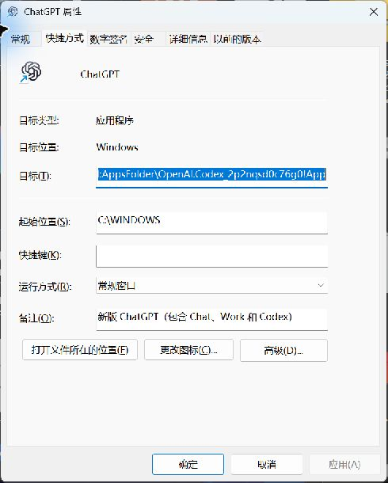
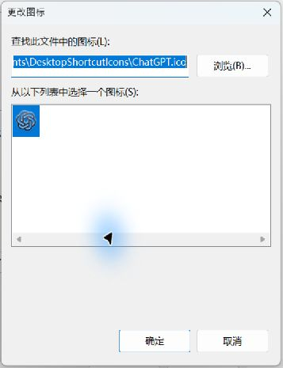

我之前桌面上的 ChatGPT 和 Claude 图标，反复变成两张白纸。改完当时能看见，过一阵或下次开机又没了。最烦的是，软件还照样能打开，让人很难判断到底哪里坏了。

后来查到，两个快捷方式的图标都引用了已经不存在的旧版程序文件。再往下修，又碰到图标保存目录在资源管理器里不可用的问题。只验证“文件存在”，没有确认桌面能不能读到，还是会白忙一场。

这篇把这件事拆开讲。**先判断你遇到的是哪种情况，再动手；不用一看到白图标，就卸载软件或者改注册表。**

> 以 Windows 11 为例。Windows 10 的主要思路相同，菜单位置可能不同。文中两张图是本机当前快捷方式的实拍，应用列表截图沿用上一篇实际操作。本文说的是桌面入口；开始菜单和任务栏同时异常时，还要进一步排查系统图标处理。

**按情况直达：** [判断问题](../content/desktop-icons.md#icons-check) · [图标为什么变白](../content/desktop-icons.md#icons-reason) · [整个图标不见了](../content/desktop-icons.md#icons-missing) · [重建快捷方式](../content/desktop-icons.md#icons-shortcut) · [只修图标来源](../content/desktop-icons.md#icons-source) · [刷新与缓存](../content/desktop-icons.md#icons-cache) · [怎样确认修好了](../content/desktop-icons.md#icons-verify)

<div><a name="icons-check"></a></div>

## 01｜先看：是图案变白，还是整个入口没了？

先点开始菜单，搜索软件名称，试着打开一次。然后看看桌面属于下面哪一种：

| 你看到的情况 | 先检查什么 |
| --- | --- |
| 名字、小箭头都在，图案变成白纸，双击能打开 | 图标来源和缓存，直接看第 05、06 节 |
| 图标在，双击却提示目标不存在、已移动 | 启动路径失效，先按第 04 节重建 |
| 某个软件的图标整个不见了，开始菜单能打开 | 快捷方式被移走、删除或没创建，按第 04 节补回来 |
| 桌面所有图标一起没了 | 先查“显示桌面图标”，再查桌面位置，见第 03 节 |
| 开始菜单也找不到，应用列表也没有 | 先确认是否装在当前账号下、是否已卸载，不能只修桌面 |

“图标没了”这句话太宽了。**白纸代表 Windows 还在显示一个入口，只是没正确画出它的图案；整个入口不见了，则要先找那个快捷方式文件。** 两种情况处理顺序不同。

桌面上带小箭头的通常是快捷方式，常见扩展名是 `.lnk`。它相当于一张记录了启动信息的卡片，不是整个软件。删除确认过的快捷方式，通常不会卸载软件；但桌面上也可能放着真实文档、文件夹或主程序，别把它们混在一起删。

<div><a name="icons-reason"></a></div>

## 02｜软件能打开，图标为什么还能坏？

一个普通快捷方式至少涉及两件事：

- **启动入口**：双击以后，去启动哪个程序、带什么参数。
- **图标来源**：到哪个 EXE、DLL 或 ICO 文件里取图案。

这两处可以相同，也可以完全不同。Windows 的快捷方式接口本来就允许单独设置图标文件和其中的图标编号。[微软接口说明](https://learn.microsoft.com/en-us/windows/win32/api/shobjidl_core/nf-shobjidl_core-ishelllinka-seticonlocation)



*本机实拍。“目标”负责启动；下方的“更改图标”负责外观。截图里的应用标识是这台电脑的现有配置，不要把它照抄给其他软件。*

### 我这次查到的是旧版本路径失效

当时 Claude 快捷方式的图标指向：

```text
C:\Program Files\WindowsApps\Claude_2.9939.4.0_x64__pzs8sxrjxfjjc\app\Claude.exe
```

但已经安装的是 `2.16120.0.0`，旧文件不存在了。ChatGPT 那个也一样：图标还指着 `26.924.2738.0`，应用已经更新到 `26.928.2636.0`。这些是当时排查到的历史版本，不是让你现在去找这些文件夹。

应用包更新后，带版本号的安装路径可能改变。**把图标固定引用到某个版本目录，就把它绑在了那个版本上。** 启动入口如果走的是 Windows 登记的应用标识，仍然能找到当前应用；图标却可能还在找旧文件。这就解释了“能用，但变白”。

WindowsApps 是应用包的受保护安装位置，相关背景可看[上一篇 WindowsApps 教程](../content/windowsapps.md)，以及[微软对应用包运行方式的说明](https://learn.microsoft.com/en-us/windows/msix/desktop/desktop-to-uwp-behind-the-scenes)。为了恢复桌面图标，一般不需要进入它，更不需要先修改它的权限。

### 为什么像是开机随机发生？

Windows 会缓存图标，省得每次显示都重新读取。源文件已经失效时，缓存里旧图案暂时还在，你可能看不出问题；更新、重启或缓存刷新后，重新读取失败，才显示白纸。

这是能解释我当时现象的一种机制，不能据此认定每一次开机变白都是同一个原因。反过来，缓存本身异常，也会让原本有效的图标显示错误。[微软的空白图标排查说明](https://learn.microsoft.com/en-us/troubleshoot/windows-client/shell-experience/application-shortcuts-show-blank-icons)

还有更直接的情况：图标放在临时目录，被清理掉；放在 U 盘、网络盘，开机时还没连接；放在云端占位文件里，本地没准备好；或者资源管理器无法访问那个位置。它们都会影响读取。

所以“今天刷新一下好了”和“更新后还会不会坏”，是两件需要分别验证的事。

<div><a name="icons-missing"></a></div>

## 03｜如果整个图标不见了，先找显示开关和桌面位置

### 所有图标一起消失

1. 在桌面空白处点击鼠标右键。
2. 把鼠标移到 **查看 / View**。
3. 检查 **显示桌面图标 / Show desktop icons** 前面有没有勾；没有就点一下。

恢复后，原来的图标应该一起重新出现。这个开关只是隐藏显示，不是把文件删掉了。[微软操作说明](https://support.microsoft.com/zh-cn/onedrive/where-have-my-desktop-icons-gone)

如果缺的是“此电脑”“回收站”等系统图标：桌面右键 → **个性化 → 主题 → 桌面图标设置**，勾选需要的项目 → **应用 → 确定**。这里控制的是系统图标，不负责给 Claude、微信等软件补快捷方式。

### 开关没问题，文件还是找不到

打开文件资源管理器，按 **Ctrl + L** 选中顶部地址栏，输入 `shell:desktop`，回车。确认你查看的是当前账号使用的桌面，而不是凭印象打开另一个旧文件夹。

如果近期改过 OneDrive 桌面备份、切换过 Windows 账号，或者把桌面移到其他盘，桌面位置可能不同。再检查资源管理器左侧 OneDrive 里的“桌面”和回收站。**先找到原文件，别为了恢复显示，就把两个桌面文件夹随意合并或改位置。** 微软也把桌面备份位置异常列为这一现象的排查方向。[OneDrive 桌面说明](https://support.microsoft.com/zh-cn/onedrive/where-have-my-desktop-icons-gone)

只少一个软件入口，开始菜单又能正常启动，就不用在所有桌面目录里翻到底，直接重建快捷方式更省事。

<div><a name="icons-shortcut"></a></div>

## 04｜重新创建快捷方式，先把启动入口恢复

### 商店应用、应用包：从应用列表创建

1. 打开 **文件资源管理器**。
2. 按 **Ctrl + L**，在顶部地址栏输入下面这一行，再按回车。不要填到右上角搜索框。

```text
shell:AppsFolder
```

3. 在打开的 **Applications / 应用程序** 列表里找到软件，例如 Claude。
4. 右键它，选择 **创建快捷方式**。界面较窄时注意往下看菜单。
5. 如果提示“Windows 无法在当前位置创建快捷方式。要把快捷方式放在桌面上吗？”，选择 **是**。
6. 回到桌面，检查新入口是否出现，再双击确认软件能启动。


*沿用上一篇的本机实拍。这里看到的是系统登记的应用入口，不是 WindowsApps 安装目录。*

也可以打开开始菜单 → **全部 / 所有应用**，找到应用，用鼠标左键按住它并拖到桌面。[微软：创建应用桌面快捷方式](https://support.microsoft.com/zh-cn/windows/experience/personalization/customize-the-desktop-icons-in-windows)

原来有同名入口时，先保留它，等新入口确认能用，再处理旧的。如果提示替换现有文件，先取消，把旧快捷方式改名为“软件名-旧”，再创建。不要在没确认类型时把桌面的真实文件当旧入口删除。

### 普通 EXE 或绿色软件

在开始菜单搜到软件后，右键 → **打开文件所在的位置**。有些应用还要先点“更多”；如果打开的是开始菜单的快捷方式目录，复制那个有效快捷方式到桌面即可。

如果你已经知道普通程序的安装位置，在资源管理器找到主程序 EXE，右键 → **显示更多选项 → 发送到 → 桌面快捷方式**。绿色软件先放到长期使用的目录，再创建入口，不要从准备删掉的解压临时目录创建。

**创建的是快捷方式，不是把主程序剪切到桌面。** EXE 往往还依赖旁边的资源和运行库，单独搬走可能直接打不开。

如果开始菜单也不能启动，先到 **设置 → 应用 → 安装的应用** 检查安装状态。有“高级选项 → 修复”的应用可以先尝试修复；“重置”可能清除应用数据，别当成刷新图标的同义词。确实需要重装时，先确认数据和设置的保存位置。

<div><a name="icons-source"></a></div>

## 05｜入口能用，只是白纸：检查图标从哪来

先右键桌面上的白图标 → **属性 → 快捷方式 → 更改图标**。有些系统生成的应用快捷方式没有普通“快捷方式”选项卡，这种情况优先按第 04 节重新创建，不必硬改。

在“更改图标”窗口中，看 **查找此文件中的图标** 那个输入框：

- 路径还在不在？可以复制它，到资源管理器地址栏打开文件所在目录核对。
- 是否带着已经过时的版本号？
- 是否在临时目录、已移走的文件夹、未连接的盘里？
- 在资源管理器里实际打开这个位置，会不会提示不可用或拒绝访问？

路径不存在时，反复刷新缓存不会把文件变回来。先重建快捷方式，或者重新指定有效的图标来源。

### 用独立 ICO 固定图标

如果软件更新后反复丢图标，可以让启动入口继续交给 Windows 管理，另把图案存成一个固定的 `.ico` 文件。操作分两部分：先准备文件，再让快捷方式引用它。

**先准备一个长期保留的文件夹：**

1. 打开资源管理器，点击左侧 **文档**。
2. 在右侧空白处右键 → **新建 → 文件夹**，命名为 `DesktopShortcutIcons`。
3. 把有效的图标文件放进去，例如 `ChatGPT.ico`、`Claude.ico`。这一步应当是复制，别从软件安装目录剪切文件。
4. 再从资源管理器实际进入这个文件夹，确认文件在本地可用。若“文档”由 OneDrive 备份，右键图标文件选择 **始终保留在此设备上**，等待下载完成。

图标可以使用软件作者提供的 ICO。没有独立 ICO 时，“更改图标”也能从可读取的 EXE、DLL 中选择图案；但若那个 EXE 仍在带版本号的更新目录里，就还存在路径变化的问题。要做独立文件，需要图标提取工具把资源导出为 ICO，或把已有的 PNG 用可信的图片转换工具转换成 ICO。**把 `logo.png` 的文件名改成 `logo.ico` 不算转换。** 不想折腾文件来源，先用第 04 节的系统入口即可。

**再指定给快捷方式：**

1. 桌面右键软件快捷方式 → **属性 → 快捷方式 → 更改图标**。
2. 点击 **浏览**，进入刚才的 `DesktopShortcutIcons` 文件夹。
3. 选择对应 `.ico` → **打开**。下方应出现可以选择的图案。
4. 点击图案 → **确定**，回到属性窗口后点击 **应用 → 确定**。
5. 回到桌面，确认图案出现，再双击测试启动。



*本机实拍。窗口顶部是图标来源，下方显示实际读出的图案。长路径在输入框里可能只露出末尾，点击后可以用方向键查看。*

我这次最后使用的是“文档”里的固定图标目录。中途选过的另一个目录，命令行可以读，资源管理器却提示位置不可用，换到可访问位置后才恢复。**这不代表 AppData 天生不能放图标；那台机器当时为什么出现访问差异，并没有进一步查清，不能推广成通用结论。** 对普通使用来说，选一个资源管理器能直接打开、文件始终在本地、不会随更新被删的地方就行。

独立图标是让显示更稳定，不是修复软件安装，也不能阻止其他工具以后重新生成或覆盖快捷方式。文件夹里这些 ICO 以后仍要保留。

<div><a name="icons-cache"></a></div>

## 06｜路径已经有效，还是白纸：再处理刷新和缓存

### 先刷新，再重启资源管理器

点击桌面空白处，按 **F5**。如果还没变，先保存工作、等文件复制或移动结束，然后：

1. 按 **Ctrl + Shift + Esc** 打开 **任务管理器**。
2. 在 **进程** 页面找到 **Windows 资源管理器 / Windows Explorer**。如果找不到，先打开一个文件夹，再回到任务管理器查看。
3. 右键它 → **重新启动**。

桌面和任务栏会短暂消失再回来。它们重新出现后检查图标，这次操作不会重启整台电脑。如果资源管理器没回来，在任务管理器点 **运行新任务**，输入 `explorer.exe`，确定。

### 仍然异常，再重建图标缓存

这一段只用于已经确认目标和图标来源有效、刷新仍无效的情况。下面采用备份后移动缓存的方式，不碰程序文件。它会重启当前登录会话的资源管理器；有文件复制、移动任务时先等它结束。

开始菜单搜索并打开 **Windows PowerShell**，复制整段代码，粘贴后按回车。若出现“粘贴多行文本”的提示，核对内容后再确认。不需要先修改执行策略。

```powershell
$ErrorActionPreference = 'Stop'
$backup = Join-Path ([Environment]::GetFolderPath('MyDocuments')) (
    'IconCacheBackup-' + (Get-Date -Format 'yyyyMMdd-HHmmss-fff')
)
New-Item -ItemType Directory -Path $backup | Out-Null
$cacheDir = Join-Path $env:LOCALAPPDATA 'Microsoft\Windows\Explorer'
$legacy = Join-Path $env:LOCALAPPDATA 'IconCache.db'
$cacheFiles = @()
if (Test-Path -LiteralPath $cacheDir) {
    $cacheFiles += Get-ChildItem -LiteralPath $cacheDir `
        -Filter 'iconcache*.db' -File -Force
}
if (Test-Path -LiteralPath $legacy) {
    $cacheFiles += Get-Item -LiteralPath $legacy -Force
}
if ($cacheFiles.Count -eq 0) {
    throw '没有找到图标缓存文件，请检查当前账号和缓存位置。'
}
$currentSession = (Get-Process -Id $PID).SessionId
try {
    # 仅重启当前登录会话的资源管理器。
    Get-Process explorer -ErrorAction SilentlyContinue |
        Where-Object { $_.SessionId -eq $currentSession } |
        Stop-Process -Force
    foreach ($file in $cacheFiles) {
        try {
            Move-Item -LiteralPath $file.FullName -Destination $backup
            Write-Host ('已备份：' + $file.Name)
        } catch {
            Write-Warning ('未移动：' + $file.Name + '；' + $_.Exception.Message)
        }
    }
} finally {
    Start-Process explorer.exe
}
Write-Host ('缓存备份目录：' + $backup)
```

正常时会出现“已备份：iconcache……”和最后的备份目录，桌面、任务栏重新出现，Windows 会按需生成新的缓存。出现“未移动”表示相应文件没有处理成功，不能算全部重建完成；常见情况是资源管理器自动恢复后又占用了文件。先重启电脑检查，不要继续扩大删除范围。

若任务栏没有恢复，仍可按 **Ctrl + Shift + Esc → 运行新任务 → `explorer.exe`**。备份目录先保留，不要覆盖回正在使用的缓存。

这里的做法参考了[微软的空白图标排查顺序](https://learn.microsoft.com/en-us/troubleshoot/windows-client/shell-experience/application-shortcuts-show-blank-icons)，把删除改成了移动备份，并包含新系统常见的多尺寸缓存文件。**代码已做语法检查，这次写帖没有在电脑上重新执行清缓存流程。**

如果连开始菜单、任务栏里的许多应用图标也一起异常，重建后仍不恢复，就需要按微软文档继续检查应用登记和图标处理组件。那已经超出某一个桌面快捷方式的问题，别为修一个图标就批量重注册所有应用、套用来源不明的注册表文件。

<div><a name="icons-verify"></a></div>

## 07｜怎样判断这次是真的修好了？

至少做完下面几项：

1. **桌面实际显示正常。** 不是只有属性窗口里预览正常。
2. **双击能打开正确的软件。** 图案好看，不代表目标有效。
3. **图标来源可访问。** 用资源管理器打开保存位置，确认不是临时文件、未连接盘或未下载的云端占位文件。
4. **重启电脑后再看一次。** 如果问题本来在更新后出现，还要在下一次应用更新后复查。

如果又复发，先回“更改图标”看路径：路径被改回旧 EXE，说明快捷方式可能被安装程序或其他工具重写；路径没变但文件不见，查文件清理或同步；路径和文件都正常，再往缓存、组件处理上排查。把变化记下来，比反复点“修复”更容易查到真正原因。

我这次最有用的经验是：**“软件存在”“能启动”“图标文件存在”“桌面能读到图标”是四个不同的验证点。** 把它们分开，很多看起来随机的问题，就有顺序可查了。