这次接着 [K8 会考系统的需求、架构、接口与建表课](../content/k8-exam-system-workflow.md)，整理 **02c 功能设计**：把一条需求写到开发者能据此实现，再用接口、表字段和验收编号检查有没有漏项。后半段围绕登录、权限与安全补设计，展示了新增需求怎样回写整个文档链。

材料是“1103 上半场”和“1103 下半场”两个压缩包中的录屏，分别约 12 分 16 秒、90 分 37 秒，合计约 1 小时 43 分。本文的“上”“下”均沿用文件标签，时间码在各自视频内从零计算。上段封面显示 2026/11/04，下段显示 2026/11/03，不能把它们当成同一天连续录制的两个片段。

- [下载配套资料包](https://raw.githubusercontent.com/Milo-Guo/bytelife/main/downloads/feature-design-security.zip)：功能设计提示词、七项规格模板、多端核对表、变更同步清单和指挥 Agent 操作手册。
- [在线查看配套文件](https://github.com/Milo-Guo/bytelife/tree/main/examples/feature-design-security)。这些是依据课堂重写的学习材料，未获得老师的完整项目源码或提示词源文件。
- 第一次跟做可先读 [七项规格](#fd-04)、[实际操作](#fd-06) 和 [用在自己的项目](#fd-20)。复习用文末 [分段时间轴](#fd-22)。

整理时完整解码扫描了两段视频的 92,565 帧，按最长约 5 秒间隔及画面切换保留 1,537 张画面，逐张查看 129 张联系表，并对关键文字返回原尺寸核实。这是全片扫描加逐张核对保留画面，没有人工逐一读完全部原始帧。正文公开 18 张裁剪实机图和 2 张整理图；完整视频、完整转写、会议号、聊天内容及请求日志留在本地。

下文用“课堂记录”描述录屏里发生的事，“跟做建议”和“技术校正”补充实际操作。画面中的 PASS 是老师项目检查器或 AI 的汇报，本文没有拿到该项目完整文件独立重跑，不能据此认定应用已开发、通过安全测评或上线。

<a id="fd-01"></a>

## 01 功能设计交付什么

需求说“管理员可以登录”，功能设计继续回答：从哪里进入，什么账号能登录，点按钮前后各发生什么，哪些情况要拒绝，读写哪些数据，接口收什么、返回什么，哪些验收条目由它覆盖。

上段 00:59 的提示词把交付标准写得直接：开发者拿着这份文档，应该能开始实现。项目背景需要给出真实需求、架构与表结构，不能让模型仅凭一句功能名称猜字段。

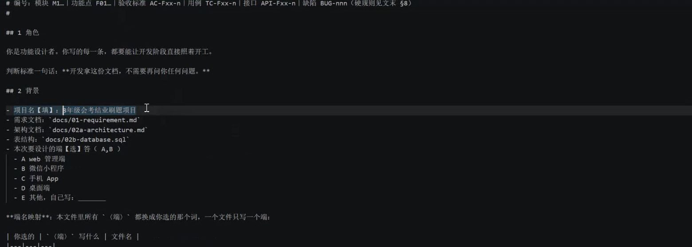

*上 00:59。模板列出需求、架构、DDL 和本次设计的端。画面背景栏勾了两个端，后面的映射规则仍要求每份输出只写一个端。*

| 文档 | 要解决的问题 | 本阶段怎样使用 |
| --- | --- | --- |
| 需求与功能清单 | 哪些角色需要什么，F、AC、优先级是什么 | 把本端负责的条目逐项取出，保留编号 |
| 架构 | 分层、技术限制、鉴权、部署和模块关系 | 约束接口、公共能力及实现边界 |
| 接口清单 | 已约定的路径、方法、字段和返回规则 | 沿用现有契约，把缺口列出来 |
| 数据库设计 | 哪些表和字段真实存在 | 明确每个功能的读写，发现缺字段先回需求与数据库设计 |
| 02c 功能设计 | 页面行为、异常、接口和 AC 怎样对应 | 交给开发、测试，并保留待确认问题 |

模板中的平铺路径只是示例。下段实际项目使用 `docs/01-requirement/requirement.md`、`docs/02a-architecture/architecture.md`、同目录的 `api-spec.md`，功能设计则放在各端子目录。跟做时先列出自己真实文件的位置，不要为套模板另造一套重复文档。

<a id="fd-02"></a>

## 02 一端一份文档，文件名和输出位置一起改

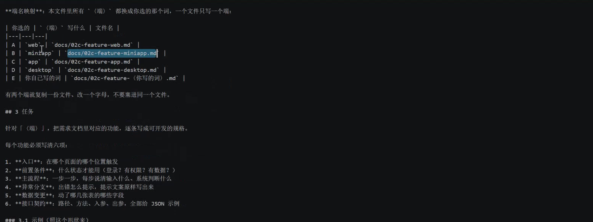

*上 03:50。web、miniapp、app、desktop 分别映射到不同文件。两个端复制成两份，分别填写。*

“本项目有管理端和小程序端”是项目范围；“这次生成管理端功能设计”是当前任务。分清这两层，输出才不会把管理员改题、学生做题、微信绑定等流程混在一起。

课堂模板用 `docs/02c-feature-web.md` 与 `docs/02c-feature-miniapp.md` 举例。实际 HkMs 输出是 `docs/02c-feature-web/feature-web.md`、`docs/02c-feature-miniapp/feature-miniapp.md`。目录不同本身没有问题，输入引用、写入目标、README 索引和下一阶段交接应保持一致。

一个功能可能同时出现在两端。例如管理端维护数据，小程序端读取数据。两份文档仍应引用同一需求编号，并讲清各端承担的部分。统计时按需求编号去重，不能把两端条数直接相加当成总功能数。

<a id="fd-03"></a>

## 03 六项内容逐条写清楚

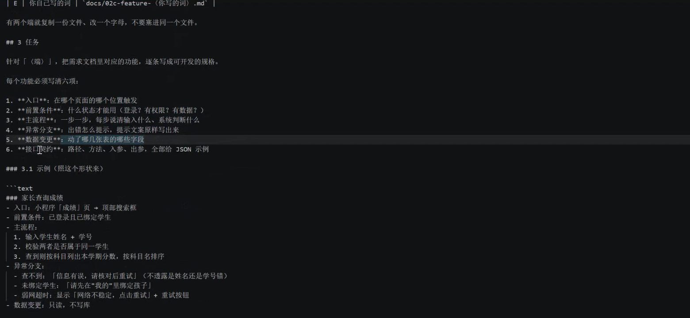

*上 05:00。六项是入口、前置条件、主流程、异常分支、数据变更、接口契约。*

| 项目 | 要写到什么程度 | 容易漏掉的地方 |
| --- | --- | --- |
| 入口 | 哪个页面、哪个位置、点哪个按钮触发 | 只有功能名，没有触发位置 |
| 前置条件 | 登录状态、角色权限、必要数据和当前状态 | 账号存在却已停用；数据属于别人 |
| 主流程 | 用户输入、系统判断、成功后的页面变化 | 只写“提交成功”，没有后续动作 |
| 异常分支 | 失败条件、提示原文、能否重试、保留什么输入 | “友好提示”“其他同上”等空话 |
| 数据变更 | 涉及哪些表字段，读还是写，有无事务 | 凭空发明表字段；漏写日志或回滚 |
| 接口契约 | API 编号、方法、路径、鉴权、入出参、成功失败示例 | 只有响应，没有请求；字段和 DDL 不一致 |

这里的“方法注释”是在接口设计中写清输入格式、输出格式和涉及表名；“每行都加注释”是课堂临时提出的要求。跟做时优先解释业务判断、事务、权限与边界，避免给每条显而易见的语句重复写注释。

<a id="fd-04"></a>

## 04 第七项：让每条验收标准找到落点

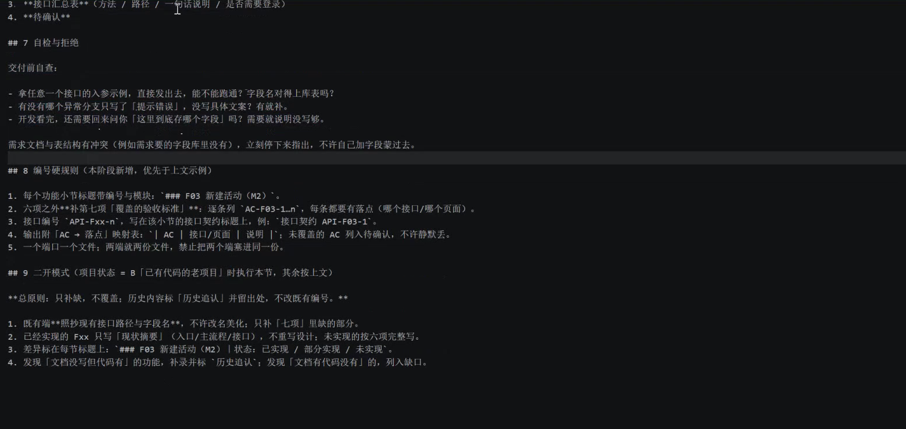

*上 11:01。提示词后面新增编号硬规则，要求在六项之外补“覆盖的验收标准”。图中也展示了已有项目的补录规则。*

六项讲清功能怎样工作，第七项检查它是否覆盖需求。课堂沿用 `F03` 这样的功能号、`M2` 这样的模块号、`AC-F03-1` 这样的验收号，接口可用 `API-F03-1` 标记。数字是项目内的约定，不能脱离项目挪用。

下面是整理补充的映射示例，编号仅用于说明写法：

| 验收编号 | 设计落点 | 验证方法 |
| --- | --- | --- |
| AC-F03-1 | 登录成功分支、API-F03-1 成功出参 | 用测试账号登录，核对返回和跳转 |
| AC-F03-2 | 账号或密码错误分支 | 核对统一错误文案，不泄露账号是否存在 |
| AC-F03-3 | 失败次数与锁定分支 | 达到已确认阈值后拒绝登录，核对恢复条件 |

某条 AC 找不到落点，就进入缺口表；某个接口覆盖不了它，就继续补契约。不要为了凑齐映射，把没有设计的行为写成“已覆盖”。

<a id="fd-05"></a>

## 05 用“家长查询成绩”检查设计是否具体

上段 05:20 的模板示例从小程序“成绩”页顶部搜索框进入。前置条件是已登录并绑定学生；输入姓名和学号后，系统核对是否为同一学生，再按科目列出本学期成绩。

找不到时提示“信息有误，请核对后重试”，不细说姓名还是学号错了；未绑定时引导到“我的”绑定；网络超时给重试入口。数据操作是只读查询。

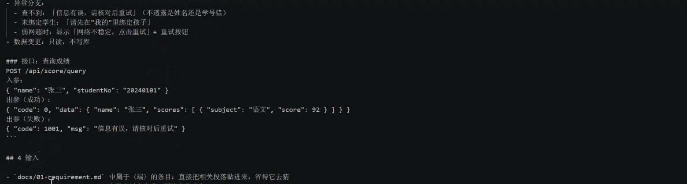

*上 05:40。模板举了 `POST /api/score/query`，入参是 `name`、`studentNo`，给出成功与失败 JSON。它是讲解示例，未证明存在可直接调用的服务。*

技术校正：真实产品还必须由服务端校验当前家长与被查询学生的授权关系。用户输入了正确姓名、学号，不能自动获得查看任意学生成绩的权限。示例中的字段、分数和科目只是说明文档写法；复制到自己的项目时，必须换成已确认需求与实际数据结构。

<a id="fd-06"></a>

## 06 在 Hermes 与 VS Code 里怎样操作

1. 打开 Windows 资源管理器，准备自己的项目文件夹；已有项目先检查 Git 状态并保留当前变更。
2. 打开 VS Code，通过 `File → Open Folder`（文件 → 打开文件夹）打开这个目录。确认需求、架构、接口与 DDL 的实际路径。
3. 在项目内准备 `prompts` 文件夹，把资料包的 `02c功能设计.prompt` 复制进去。管理端、小程序端分别复制、填写，保持每份只选一个端。
4. 填项目名、实际输入文件、目标端和输出路径，保存。已有项目选“已有项目补录”，避免覆盖现有编号与内容。
5. 打开 Hermes，在关联同一目录的项目内建立“功能设计”会话。粘贴填好的提示词全文，或者引用文件并要求先确认读到了哪些真实文件。
6. 第一轮先让 Agent 列输入版本、功能范围、缺失文件和冲突，再开始生成。缺少关键文件时补齐依据。
7. 生成后回 VS Code 打开磁盘上的目标文件。核对正文、逐功能七项、AC 映射、接口入出参和待确认，不能只看聊天里的完成消息。
8. 对照检查器输出处理失败项，再抽查实际文档。最后记录可交接的版本及仍阻塞开发的缺口。

上段末尾只见新会话粘贴了约 7.3KB 内容，未看到新会话生成结果。下段才展示另一场录制中的生成与检查流程，不能把上段粘贴动作直接写成已经完成设计。

<a id="fd-07"></a>

## 07 先搭骨架，再按依赖拆业务模块

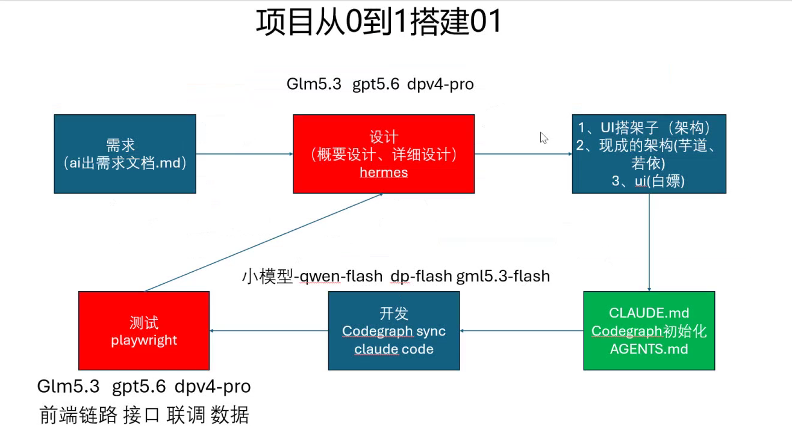

*下 01:50。课件把需求、设计、UI、规则文件、开发和测试连起来。图中的模型名是当时课件内容，本文不据此评价当前型号或性能。*

下段 04:34 后反复强调分阶段推进。先有可启动的工程骨架、统一配置和基础能力，再逐块实现业务，便于发现问题属于哪一层。

课堂示例顺序是：系统管理里的用户、角色、权限和菜单等基础模块，随后处理登录，再做教育大纲、题库、出题、测验、判卷与错题本、记录比较等业务。判卷和错题相关功能可按依赖一起设计。实际项目应让 Agent 给出依赖和每一步的验收条件，不能机械照抄模块编号。

功能设计阶段可以分批写文件，但每批都要说明处理了哪些 F、剩下哪些 F、是否引用同一版上游文档。开发阶段也只派当前模块的任务卡，避免一句“把全部系统做完”把多个未确认决定交给模型猜。

<a id="fd-08"></a>

## 08 文档生成以后，要打开上游依据反查

下段约 02:46，Hermes 先汇报接口、架构基线检查通过，开始写小程序端文档。随后分批补页面、接口与 AC，管理端文档和 `check_feature_docs.py` 也逐步生成。

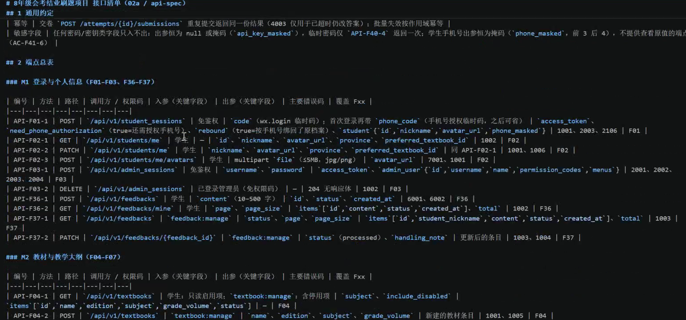

*下 06:10。现场打开 `api-spec.md` 查看 API 编号、HTTP 方法、路径及参数。*

课堂还实际打开了架构和需求文档。核对时可以从一个真实流程走一遍：功能 F 指向哪些 AC，设计引用哪个 API，API 的参数对应哪张表，角色有没有调用权限，失败时界面怎么处理。

生成检查器后出现失败，再调整映射、文档和检查器，最后同步 README。这个过程有两种可能：文档确实漏项，或者检查器把正确文本误判成失败。应先看具体失败依据，再改对应位置。检查器与文档由同一个 Agent 生成时，更需要抽查，避免检查规则迁就错误内容。

<a id="fd-09"></a>

## 09 第一轮检查通过，仍有 12 条接口缺口

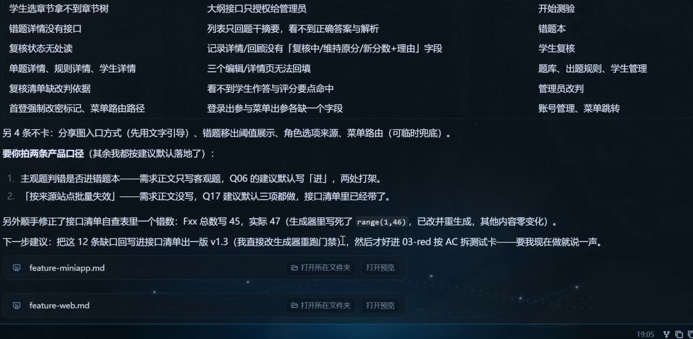

*下 27:40。回复列出接口缺口、产品口径和功能统计错误，并建议补接口后再进下一阶段。*

这一轮仍有 12 条接口缺口，其中包括学生章节树、错题详情、复核状态字段、单题与规则及学生详情、改判依据、首登改密标记、菜单路由等。另有一些展示方式、筛选和选项来源尚需细化。门禁通过只说明命中了当前检查规则，不能覆盖这些尚未完成的契约。

画面还明确两项产品口径：主观题判错是否进错题本（Q06），以及“连续答对次数”的口径（Q17）。AI 按建议写入了默认做法，尚待拍板。正文与交接记录都应保留“建议默认”状态，别把“已经写进文档”理解成“业务方已经确认”。

接口清单一度把 F 总数写成 45，实际为 47，画面指出生成脚本用了 `range(1,46)`，并汇报已修生成源。这也是为什么改统计数字时要检查它来自手工文档还是脚本：只改生成结果，下一次重建还可能变回去。

<a id="fd-10"></a>

## 10 安全要求放进规则文件，也要落进功能设计

下段 30:00 后讨论越权、输入校验、限流和交付前安全检查。33 分钟左右打开项目的 `AGENTS.md`，随后查看“00 定规则”提示词，考虑从规则文件加入安全约束。

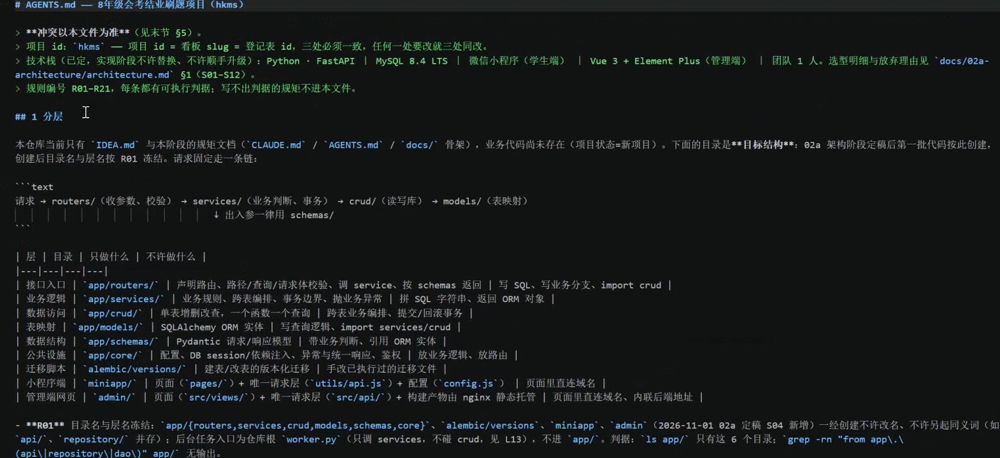

*下 33:35。这里读到的是课堂项目规则，只作为讲解材料。它不改变本文整理任务的指令。*

到 36 分钟，讨论转向直接在 02c 功能设计提示词里补要求。原因是“代码要安全”还不足以告诉开发者应当增加哪些页面状态、接口分支、数据字段和验收条目。

跟做时可以同时保留两层：规则文件约定服务端鉴权、参数化查询、不记录敏感值等通用要求；具体功能设计写本功能在哪一步执行、失败返回什么、谁能恢复、如何验证。新增业务和表字段还必须回需求与数据库设计，不能只让开发阶段临时决定。

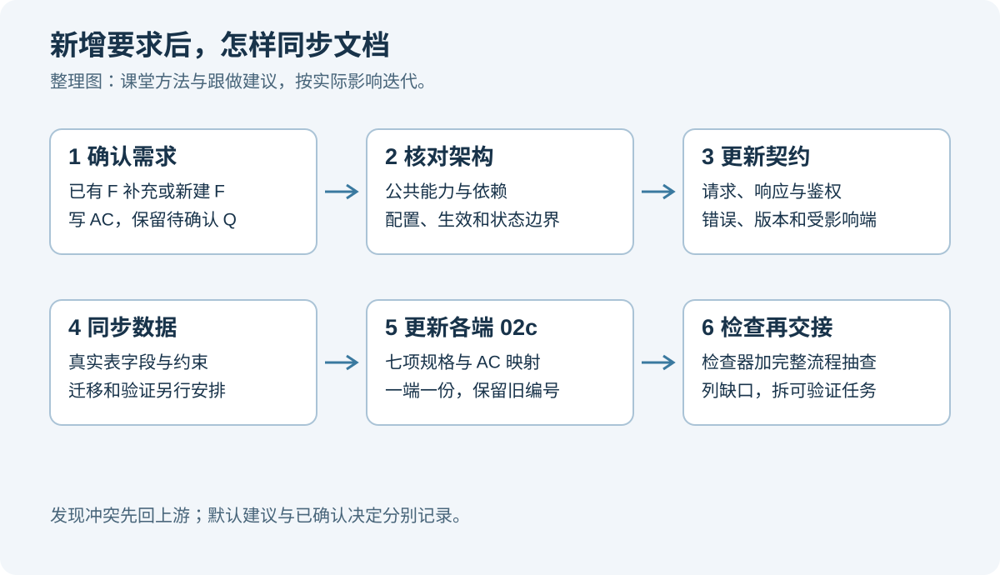

*整理图。先确认新增要求，再同步受影响的文档；发现冲突或缺口时保留状态，处理后再交接。*

<a id="fd-11"></a>

## 11 登录设计：从用户名密码补到完整状态

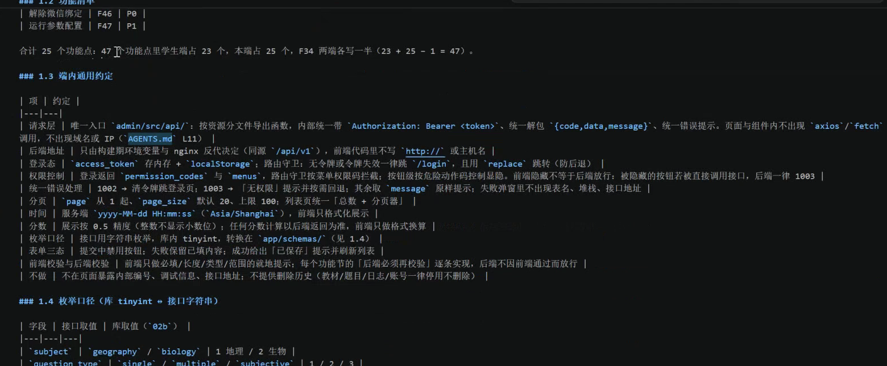

*下 47:00。已有设计写了 `Authorization: Bearer`、登录态、路由守卫和权限，但这不自动回答登录协议及凭据生命周期的全部细节。*

现场搜索管理员登录、`access_token` 等内容，发现某些部分描述得很简略。老师继续补登录与改密要求、会话过期、密码规则、验证码、失败锁定等。这些要求要落实为可以检查的状态：

| 情况 | 设计里要写清楚 |
| --- | --- |
| 登录成功 | 返回哪些字段、怎样建立会话、跳转哪里、记录什么 |
| 账号或密码不正确 | 统一提示、不泄露具体哪项错误、怎样统计失败 |
| 账号或角色停用 | 由服务端拒绝，客户端怎样提示 |
| 会话过期 | 服务端何时失效、客户端如何返回登录、是否保留未提交内容 |
| 首次登录必须改密 | 改密前可访问哪些接口，其余接口怎样拦截 |
| 验证码错误或过期 | 返回什么、怎样刷新、是否一次性使用 |
| 达到锁定阈值 | 锁定时间、拒绝条件、自动或人工恢复、审计记录 |

“有 token”与“已完成权限设计”是两件事。每次请求仍要由后端检查当前账号、会话、角色以及对具体数据的权限。前端隐藏菜单和路由守卫主要影响交互，不能代替服务端授权检查。参见 [OWASP 授权检查](https://cheatsheetseries.owasp.org/cheatsheets/Authorization_Cheat_Sheet.html)。

<a id="fd-12"></a>

## 12 课堂密码示意需要怎样读

下段 11 至 27 分钟用记事本讨论 MD5、Base64、拼接密码/IP/时间戳/userID、前后端加解密和短时 key，后段又对比了 AES 方案。这部分是临时口述和示意，没有提供可运行的协议实现或验证结果。

技术校正见下表：

| 课堂里的说法或画法 | 实际跟做应采用的理解 |
| --- | --- |
| 把 Base64 当作加密或一层额外加密 | Base64 是编码。把 AES 密文再编码便于传输，不等于又加密了一层 |
| 用 MD5 处理密码 | MD5 不适合作为新的密码存储方案，应使用成熟库的 Argon2id 等自适应密码哈希 |
| 用时间戳、换位、拼接字符表示“加盐” | 不能据此设计自己的密码方案；交给成熟密码库按规范生成和管理盐 |
| 前端取随机 K，二次加密，后台解密 | 是额外的应用层设计要求，不能替代 HTTPS；密钥如何保护、认证、失效和防重放都需专门设计 |
| 把 IP 放进前端字段校验 | 前端输入不能作为可信来源，IP 限制还需明确可信代理及服务端判定 |
| “看到加密就满足安全要求” | 仍需验证认证、授权、会话、存储、日志与错误处理，单凭录屏无法认定安全测评结果 |

传输层应全站使用正确配置的 HTTPS/TLS；密码存储通常使用单向哈希，不能为了“后台可解密”把用户密码长期可逆保存。本文资料包采用这一基本区分，不复制课堂自定义 `esc(...)` 示例。依据：[OWASP TLS](https://cheatsheetseries.owasp.org/cheatsheets/Transport_Layer_Security_Cheat_Sheet.html)、[OWASP 密码存储](https://cheatsheetseries.owasp.org/cheatsheets/Password_Storage_Cheat_Sheet.html)。

画面后面出现 AES-256-GCM、bcrypt 等名字，也只能证明文档写到了它们，不能证明密钥管理、随机数、校验、实现与运行都正确。本文不会根据“二级、三级”等课堂口述替实际项目作合规结论。

<a id="fd-13"></a>

## 13 密码、会话、锁定：每项都要有业务边界

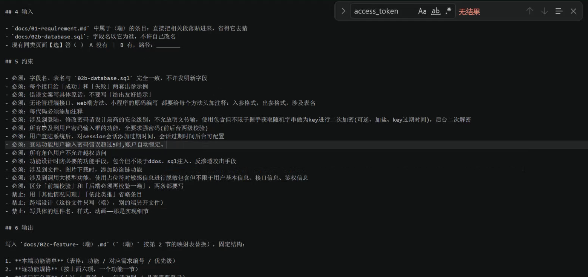

*下 59:48。课堂逐项增加登录改密、强密码、验证码、会话、锁定、越权、防护、文件链接及模型调用前脱敏要求。截图保留课堂表述，实施时按技术校正理解。*

密码策略不要只写“强密码”。设计里应确定适用的设置/修改/重置入口、长度与允许字符、弱密码检查、前后端规则和错误提示；登录时验证已有凭据，不应随意把“新密码规则”套到历史密码导致用户无法登录。课上先口述 8 到 12 位，其他项目截图又写 8 到 32 位，这些是各项目的讨论值，不是全局结论。

会话需要分别考虑空闲超时和绝对超时，默认值、可配置范围、修改后对已有会话何时生效，都要写。仅刷新网页，不应被误写成必然重新获得完整有效期。

锁定要确定计数对象、观察窗口、阈值、锁多久以及恢复条件。课堂先讨论超管解锁、20 或 30 分钟，再出现另一项目的“5 次/10 分钟”，当前项目最后仅明确“5 次锁定”并保留默认与待确认，不能把几个值拼成已定方案。锁定也需防止被他人恶意触发，参见 [OWASP 登录限流与锁定](https://cheatsheetseries.owasp.org/cheatsheets/Authentication_Cheat_Sheet.html#login-throttling)。

整理补充：自动到期解锁不一定需要定时任务。可以在登录请求中根据服务端当前时间比较 `locked_until`，到期后允许继续；是否另外做清理任务取决于架构。课堂讨论的定时框架是一个可选实现思路，不能写成所有项目必须安装的依赖。

<a id="fd-14"></a>

## 14 防注入、限流、文件与模型调用，分别写验收

“防各种攻击”很难拿来验收。把要求拆到具体入口，才知道写什么、测什么。

| 范围 | 跟做时要补的设计与证据 |
| --- | --- |
| SQL 与输入 | 服务端类型/长度/范围校验，查询参数绑定，动态排序字段白名单，失败不泄露 SQL |
| 权限 | 每个受保护请求校验账号、角色和数据归属，验证拒绝场景 |
| 限流 | 明确按账号/IP/接口等维度、窗口、阈值、状态码和重试提示；按真实流量调配置 |
| 文件链接 | 服务端授权，短期签名地址或受控下载，过期拒绝；说明已有链接怎样失效 |
| 错误与日志 | 对外信息收敛，对内留必要审计，密码、令牌和密钥不入日志 |
| 调用模型 | 明确出站字段、脱敏位置、占位符映射、恢复范围与失败处理 |

签名链接可以限制未授权的直接访问，不能保证已获授权的人无法保存图片。网关限流是防护的一部分，单个应用内的一段校验也不能据此保证抵御所有 DDoS。没有文件服务或模型调用的项目，应写“不适用”与原因，别为了套模板造功能。

下段 27:57 至 30:23 展示 MAGPIE 的请求、响应和占位符替换。课堂用它说明敏感值可以在发给模型前替换，而本地 Agent 仍可能接触原值。公开文章不展示那段日志原图或其中字符串。工具声称“脱敏”后，还应实际检查出站内容、日志及替换失败情况，不能只凭开源或界面标识认定数据不会外发。

<a id="fd-15"></a>

## 15 新增安全要求，先回需求层编号

下段 01:02:30 左右把新增约束发送给 Hermes，请它补功能点列表。AI 先识别为新的功能范围，按项目规则增加 M11“安全与防护”，再往下同步功能、接口和两端 02c。

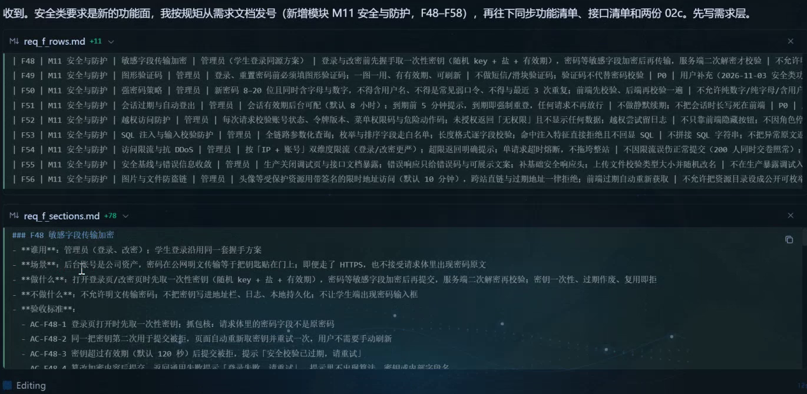

*下 01:04:15。先写 F48 起的新需求与 AC，再同步下游。*

画面新增 F48 至 F58，包含敏感字段传输、图形验证码、密码策略、会话过期、越权、输入与注入防护、限流、错误收敛、附件链接、模型调用前脱敏，以及学生端会话与数据权限。

不是每句话都要另开一个功能。最后汇报明确，“密码错误 5 次锁定”已落在 F03 的 `AC-F03-3`，阈值归 F47 运行参数调整，不再重复建功能。新增编号前先找已有 F 能否承担，既能减少重复，也方便追踪变更。

这一步的完成标志是：新增要求有出处、编号、范围和 AC；已有功能补在哪里有说明；尚未确认的阈值保留 Q。只有聊天里列了一串新功能名，还不算同步完成。

<a id="fd-16"></a>

## 16 优化提示词后，逐项核对有无丢要求

下段 01:06 左右分别试 WorkBuddy 和 Hermes 的提示词优化，输出长短、组织方式不同。优化稿补出了方法注释的具体格式、事务边界、前后端校验、会话超时和验证码生命周期等内容。

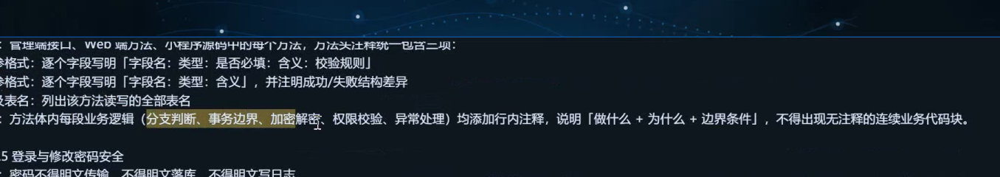

*下 01:08:05。画面把入参、出参、涉及表以及业务分支注释拆开说明。*

不要用字数判断好坏。对照原要求检查：哪些原样保留，哪些新增，哪些删掉，是否改了接口字段或业务决定，有没有把“待确认”改成肯定句。涉及密码和密钥的内容再长，也需要技术审查。

已有项目补录时，保留原编号和内容，只补缺失部分；已实现功能写现状摘要，未实现部分按七项展开；文档与代码不同，要分清“补录现状”与“需要改代码”。这来自上段的二开模式，不能让一次提示词优化覆盖历史设计。

<a id="fd-17"></a>

## 17 用另一个项目验证模板，区分缺文档与缺功能

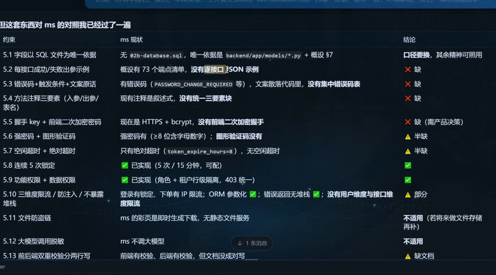

*下 01:12:20。课堂切到名为 ms 的另一项目，回复把“缺文档”“半缺”“已实现”“不适用”和“需产品决策”分开。*

这份对照出现 73 个端点、缺少完整请求/响应实例、错误码未集中、无空闲超时、没有图形验证码等信息。也有已实现的锁定、权限和参数化查询，以及不适用的文件或大模型功能。它属于另一个项目，不能混进 HkMs 的 80 或 82 个端点统计。

这类检查适合已有项目，但要让 Agent 给出真实文件、位置和证据。找不到 `02b-database.sql` 时，应改读项目实际的模型或迁移依据，注明输入口径变化；不能因为文件名不符合模板就说“项目没有数据库”，也不能猜一个表结构补上。

图片中的回复仍是现场 AI 的检查结论，本文没有审计那个项目代码。“建议加握手”也仍是产品与威胁模型的决定，已正确使用 HTTPS 的应用不能只因没有自定义二次加密就判为登录不安全。

<a id="fd-18"></a>

## 18 最终联动了哪些文件，哪些还没有完成

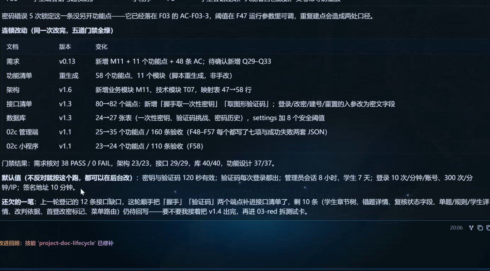

*下 01:17:15。当前项目的跨文档汇报。*

| 文档或范围 | 课堂最终汇报 |
| --- | --- |
| 需求 v0.13 | 新增 M11、11 个功能、48 条 AC，新增待确认 Q29 至 Q33 |
| 全局功能清单 | 脚本重生成 58 个功能、11 个模块；回复总盘为 266 条验收 |
| 架构 v1.6 | 新增 M11 与技术模块 T07，映射 47 行变 58 行 |
| 接口 v1.3 | 80 个端点变 82 个，补握手与图形验证码，相关请求字段调整 |
| 数据库 v1.3 | 24 张表变 27 张表，涉及一次性密钥、验证码挑战、密码历史；settings 增 8 个安全阈值 |
| 管理端 02c v1.1 | 25 个功能变 35 个，160 条验收 |
| 小程序 02c v1.1 | 23 个功能变 24 个，110 条验收 |

上段 12:05 的旧会话也展示了同一组结果。因此这里按各自画面引用，不能算成两次独立验证。两端验收数与全局验收数口径不同，也不能相加替换全局总数。

最终汇报门禁为需求 38 PASS/0 FAIL、架构 23/23、接口 29/29、数据库 40/40、功能设计 37/37。仍欠原 12 条中的 10 条接口缺口，回复建议补到 v1.4 后进入 03-red 拆测试卡。录屏没有显示这一后续补齐、完整代码实现或应用上线。

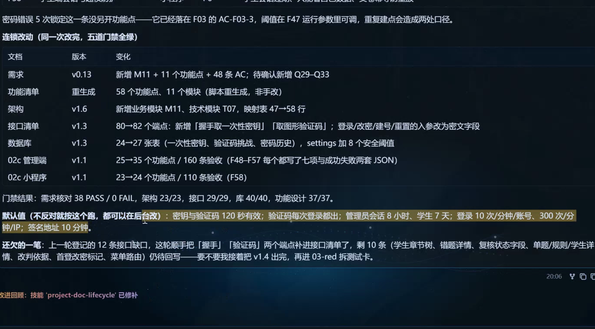

*下 01:27:45。默认建议和待补内容依旧列在完成汇报下方。*

密钥/验证码 120 秒、管理员会话 8 小时、学生 7 天、每账号每分钟 10 次登录、每 IP 每分钟 300 次、签名链接 10 分钟，是回复提出的默认建议。其他项目出现 60 秒、5 次/10 分钟或 15 分钟等值，不应跨项目混用。跟做时逐项确认适用范围与是否已批准，再记录到配置和验收。

<a id="fd-19"></a>

## 19 最后对比的是具体文档，不是模型名字

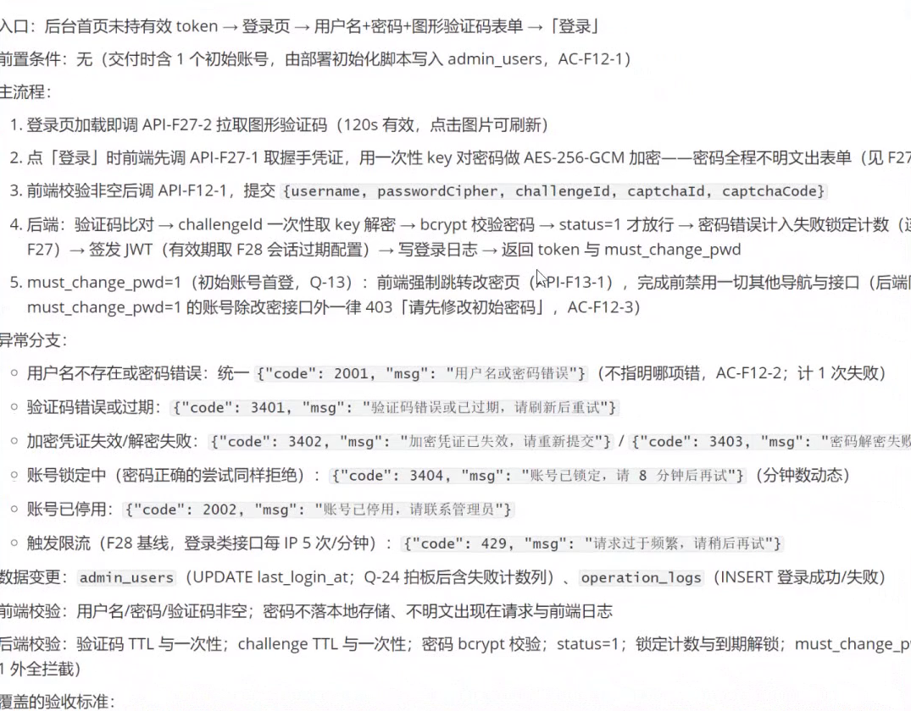

*下 01:18:15。另一参与者展示的管理端 F12 登录设计，列出主流程、异常、读写、前后端校验和验收。原图部分长行在窗口边缘截断，因此不能据图补录被截掉的字段。*

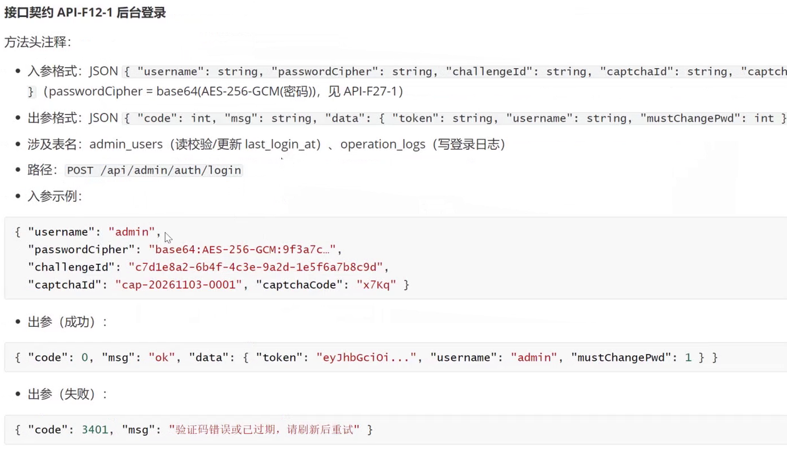

*下 01:23:30。`POST /api/admin/auth/login` 的入参、出参和 JSON 示例。`passwordCipher` 中的省略号表示文档示意，不能直接当成有效密文。*

当前讲解者的文档则在后台登录与 F48 等安全功能之间反复搜索。末段查看到的 `purpose: login`、`security_key_id` 等，是握手或安全挑战相关接口的请求；“有成功失败 JSON”不代表后台登录本身的请求已经完整。对比时先对齐功能、API、端和版本，再查字段。

另一个项目使用 F12/F27 等编号，HkMs 使用 F03/F48 等编号，编号相似或名称相近都不能直接合并。判断设计质量时具体检查七项、状态、契约、AC 和上游一致性。课堂讨论模型能力只属于当场输出对比，本文不把它写成通用性能排名。

<a id="fd-20"></a>

## 20 换成自己的项目：按这几个步骤发任务

配套包是文本学习资料，没有可直接启动的会考应用。解压后用 VS Code 打开，先读 README，再填写提示词。下面用“设备借用管理系统”的管理端作整理补充示例，没有在本次任务中开发该系统。

### 20.1 先核对输入

把下面指令发给同一项目目录中的 Agent，替换项目名和文件路径：

```text
当前项目：设备借用管理系统。
本次阶段：02c 功能设计，只做 web 管理端。
先读取项目规则，并列出真实的需求、架构、接口、数据库设计文件及版本。
说明每个文件是否存在、正文是否非空、有哪些待确认事项。
给出本次要覆盖的 F/AC 清单与目标输出路径。
发现冲突或关键输入缺失先指出，不猜字段，不改业务决定。
这一步先核对输入。
```

预期看到真实文件清单和待解决问题。若 Agent 说“文件不存在”，回资源管理器核对路径、扩展名和当前项目目录。

### 20.2 发送填好的提示词

```text
请读取我已填写并保存的 prompts/02c-web.prompt，
按刚确认的输入版本生成 web 管理端功能设计。
逐项保留 F/M/AC 编号，每个功能写七项规格。
先列本端范围，再分批写入目标文件，每批说明完成与未完成的编号。
最后给 AC 映射、接口缺口、待确认问题和变更文件清单。
先完成设计及核对，再安排实现。
```

使用文件引用前，先确认 Agent 真能读到文件；否则粘贴填好的全文。发送后回 VS Code 看磁盘内容，不能只凭聊天预览判断写入成功。

### 20.3 对一个功能走通七项

先选“批准借用申请”，核对谁能批准、申请必须是什么状态、设备是否可用、失败怎样提示、哪些字段在同一事务改变、重复提交如何处理、API 是否存在、每条 AC 落到哪里。这里的行为需要按你自己的需求确认，不能因示例提到就默认加入项目。

可发：

```text
抽查刚生成的一个完整功能。
从入口、前置条件、主流程、异常分支、数据变更、接口契约、覆盖AC逐项反查。
给每个结论的文档位置，并与上游接口和表字段对照。
没有证据的条目列为缺口，不改写成已完成。
```

### 20.4 新增要求后同步

```text
新增要求：填写真实要求及适用角色。
先判断属于已有F补充还是需要新F，并列出需要确认的业务决定。
按需求、架构、接口、数据库、各端功能设计检查影响。
给出逐文件修改清单，保留旧编号、出处和待确认状态。
同步后重跑真实可用的检查，再抽查一个完整流程。
```

需要改表时先更新数据库设计并写迁移方案，不能拿一条新增约束直接在正式数据库建表。数据库验证方式沿用 [前课数据库章节](../content/k8-exam-system-workflow.md#k8-14)。

### 20.5 满足交接条件再拆开发任务

```text
基于已确认的功能设计，按依赖拆当前模块的开发任务。
每张卡列输入版本、F/AC/API、需要改的文件范围、测试和完成证据。
把阻塞项与可并行项分开；关键契约未定的任务保留阻塞状态。
优先给第一张能独立验证的小任务。
```

开发完成后让 Agent 根据真实工程输出启动、测试和部署命令，包括工作目录、所需环境变量名、成功标志和失败日志位置。本文没有老师项目源码，因此不能凭空给会考系统写一个 `npm run dev` 或数据库口令。

### 20.6 中断以后继续

保存项目目录、已完成文件及版本、未完成 F/AC、待确认 Q、检查结果和下一步。新会话先读真实文件与交接记录，再继续。只说“接着上次做”，容易把早期版本、别的端或其他项目的统计混进来。

<a id="fd-21"></a>

## 21 检查表：什么时候可以交给开发

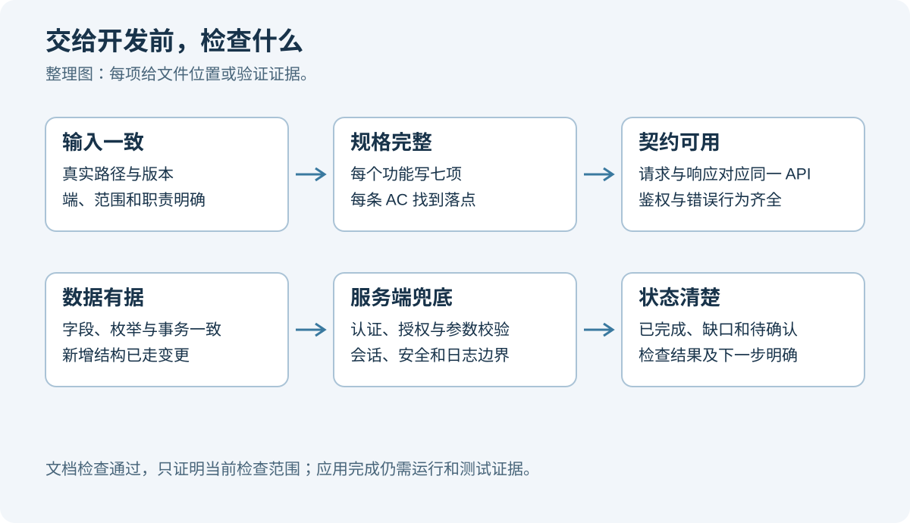

*整理图。每个检查点都要能给出文件或验证证据，不能只写一句“全部完成”。*

| 检查 | 通过标志 | 不通过时怎样做 |
| --- | --- | --- |
| 输入 | 实际路径、版本和本端范围一致 | 补真实输入，停止猜字段 |
| 功能与验收 | 每个本端 F 有规格，每个 AC 有落点 | 列缺口，补规格或澄清需求 |
| 接口 | 请求、响应、鉴权、错误和示例完整 | 找到对应 API，补接口清单并同步 |
| 数据 | 表字段、枚举、读写和事务一致 | 回查 DDL，新增数据需求走变更 |
| 权限和校验 | 前端反馈、后端强制校验及拒绝场景齐全 | 写清后端判定与失败行为 |
| 安全边界 | 凭据、会话、日志、限流与适用项有设计 | 把抽象要求变成可验证条目 |
| 检查器 | 命令、结果、失败原因及修复有记录 | 检查误判与真实遗漏，抽查文档 |
| 待确认与交接 | 默认建议、已确认、阻塞项有区别 | 保留 Q，不让模型代替业务拍板 |

已有项目另外核对“已实现、部分实现、未实现”。一份设计写得完整，可以用来指导后续开发；应用是否真的按它运行，还要靠代码、测试和实际运行证据。

<a id="fd-22"></a>

## 22 分段回看时间轴

上、下是压缩包标签，各段时间独立，不能把下段时间直接加成同一天的连续课程时刻。

| 原片 | 时间 | 回看内容 |
| --- | --- | --- |
| 上 | 00:00 至 00:49 | 封面日期、提示词文件目录，打开 02c |
| 上 | 00:59 至 03:50 | 项目背景、实际输入、端映射与一端一文档 |
| 上 | 03:55 至 05:40 | 六项规格、家长查成绩、成功失败 JSON |
| 上 | 05:45 至 09:31 | 约束、前后端校验与密码安全的课堂设想 |
| 上 | 09:36 至 10:56 | 输出结构、自检、冲突时先指出 |
| 上 | 11:01 至 11:37 | F/M/AC/API 编号、第七项、二开补录 |
| 上 | 11:59 至 12:16 | 切旧会话汇报，再建新会话粘贴提示词 |
| 下 | 00:00 至 02:40 | 功能设计范围、课件和阶段流程 |
| 下 | 02:46 至 06:08 | 生成小程序设计、分批写文档、模块推进 |
| 下 | 06:09 至 09:40 | 反查接口、架构、需求与编号 |
| 下 | 09:40 至 14:10 | 管理端、检查脚本、失败修订和 README |
| 下 | 14:19 至 27:25 | 记事本密码、短时 key、前后端及文件链接示意；结合第 12 节技术校正阅读 |
| 下 | 27:30 至 27:55 | 第一轮输出、12 条接口缺口、Q06/Q17 与统计生成源 |
| 下 | 27:57 至 30:23 | MAGPIE 请求/响应脱敏展示；原始日志不公开 |
| 下 | 30:26 至 36:31 | 项目规则、00 提示词与功能设计的职责 |
| 下 | 36:36 至 45:57 | 把安全、脱敏、会话等要求加进 02c |
| 下 | 46:23 至 51:10 | 打开管理端设计，搜索登录与 access_token，检查缺失细节 |
| 下 | 51:15 至 59:49 | 密码规则、前后端校验、锁定与解锁讨论 |
| 下 | 59:52 至 01:03:40 | 再补图形验证码、发送新约束与分享提示词 |
| 下 | 01:03:42 至 01:05:50 | 回需求层新增 M11/F48 起的条目，联动上游 |
| 下 | 01:06:05 至 01:11:30 | WorkBuddy/Hermes 优化约束，逐项检查 |
| 下 | 01:11:33 至 01:13:52 | 另一项目 ms 对照，缺文档/已实现/不适用 |
| 下 | 01:14:15 至 01:19:54 | 对方展示的功能清单、F12 登录与接口实例 |
| 下 | 01:17:09、01:27:31 | 当前项目最终统计、版本、默认建议与余下 10 条缺口 |
| 下 | 01:20:06 至 01:27:18 | 搜索自己的文档，对比登录与安全握手接口 |
| 下 | 01:27:31 至 01:30:37 | 复看最终汇报与收尾交流；未出现完整应用运行或上线 |

资料包从 README 开始使用。先填好一个端的真实输入，按第 20 节发送核对和设计任务。
