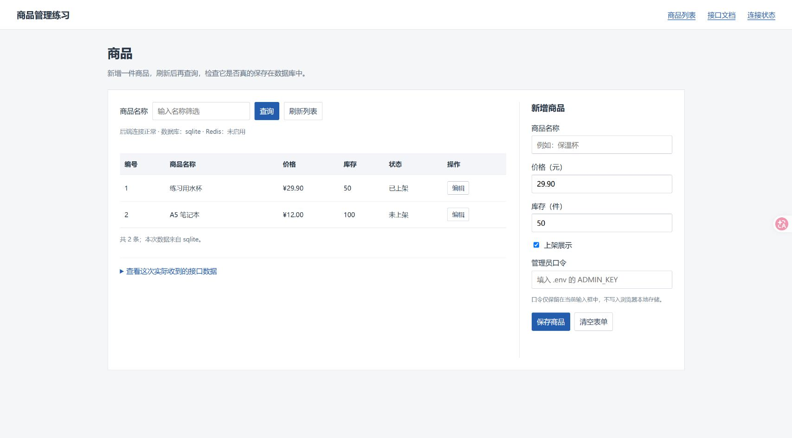
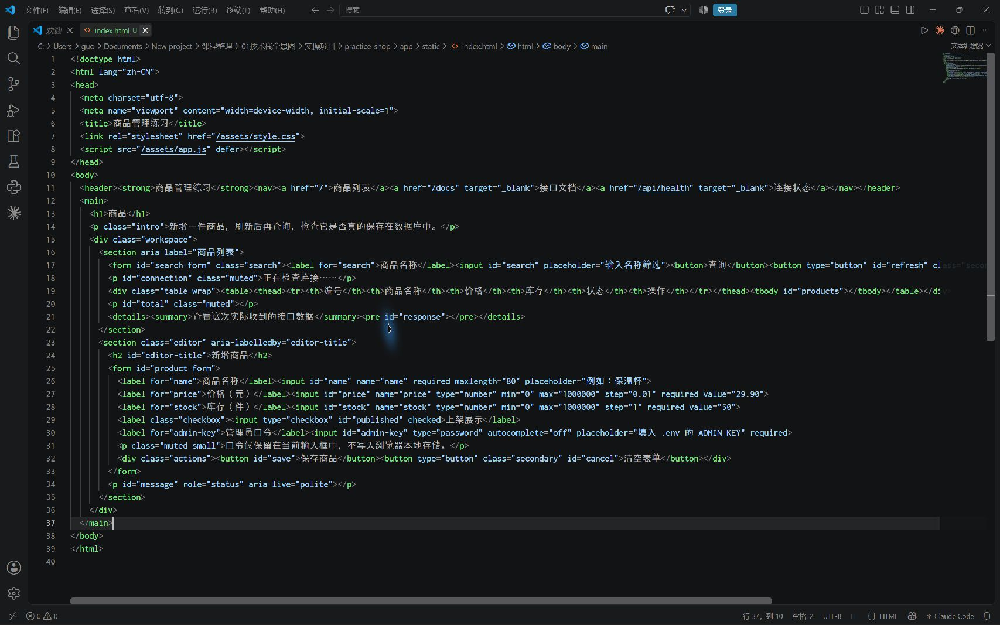
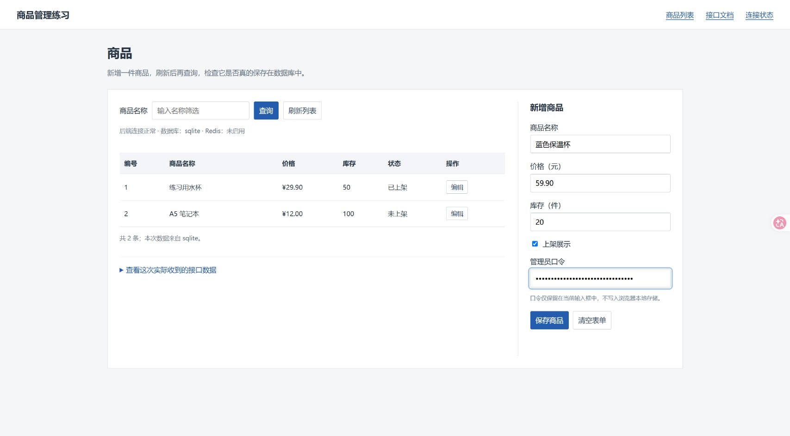
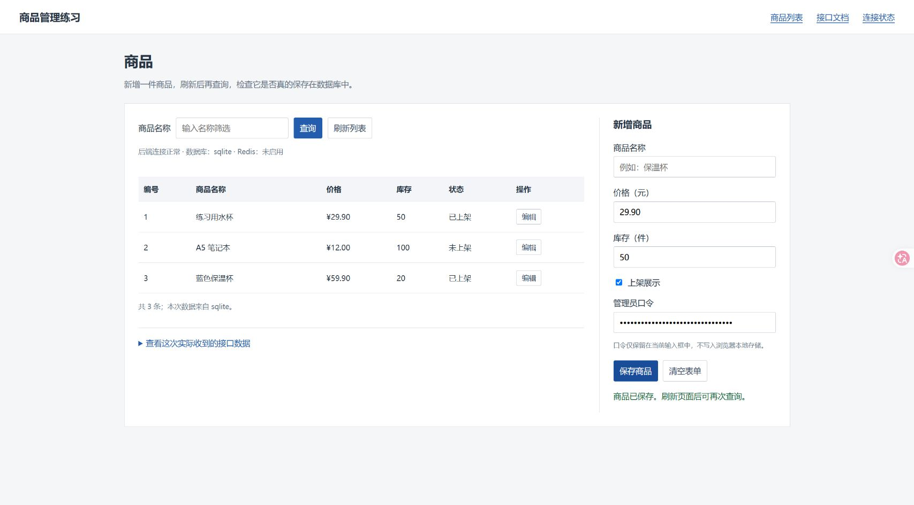
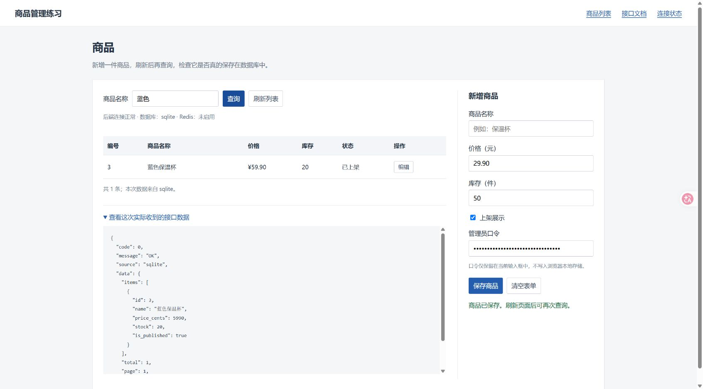
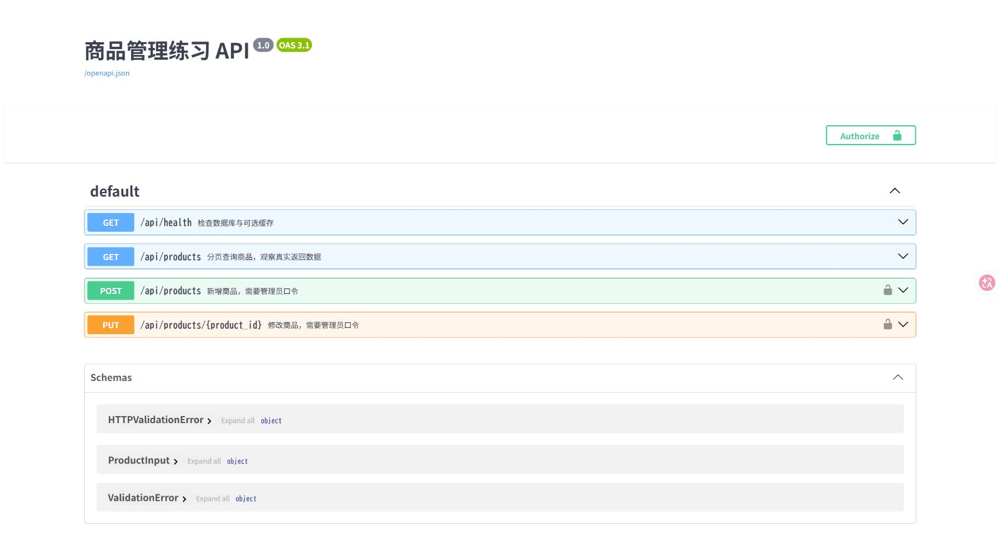
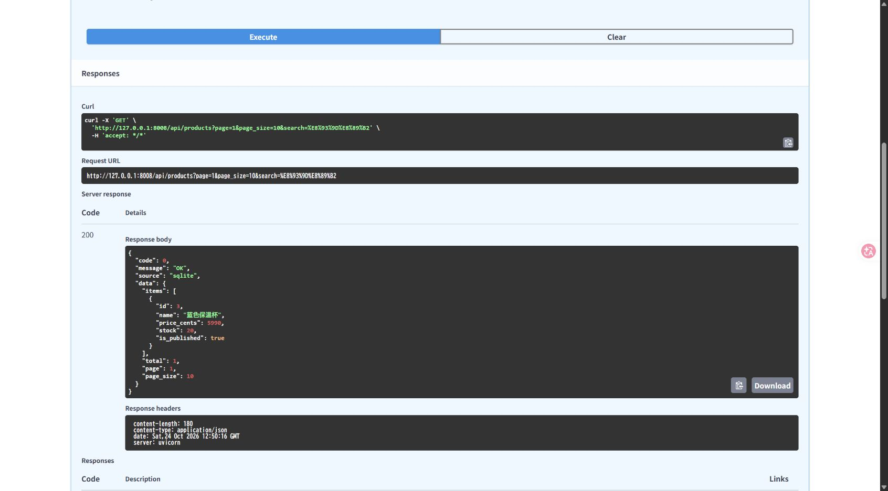
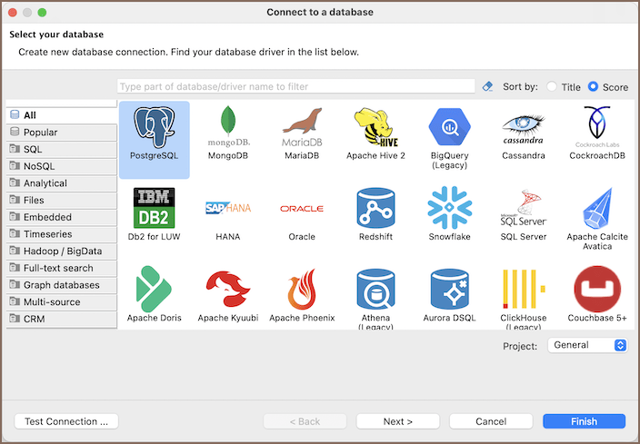
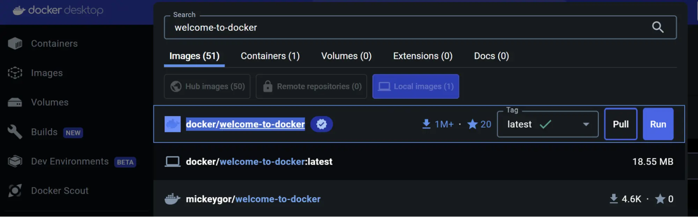
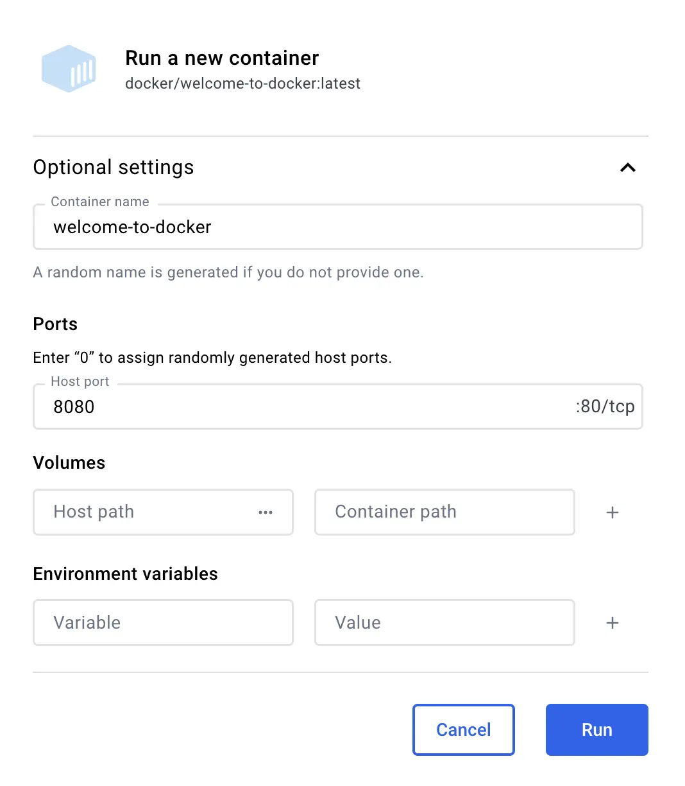

这份笔记接着《技术栈全景图》这节课，补上最容易被略过去的一步：**软件装在哪里，打开后点哪里，代码怎样启动，怎样判断自己做对了。**

**[下载商品练习源码 ZIP](https://raw.githubusercontent.com/Milo-Guo/bytelife/main/downloads/practice-shop.zip)** · **[浏览源码与运行说明](https://github.com/Milo-Guo/bytelife/tree/main/examples/practice-shop)**

配套的商品管理小项目可以直接运行。下面先看到的就是它在本机运行后的画面。



*图 1｜本机实拍。地址为 `http://127.0.0.1:8008`，前端已从后端读到 SQLite 数据库中的两条商品记录。这个练习项目是为补课编写的示例，不是老师原项目。*

## 先把这份补课的范围说清楚

录课、17 页 PPT 和两张补充图的概念整理仍保留在 [课程概念详解](../content/full-stack-overview.md)。本篇侧重实际使用这一部分，避免把几十个名字同时塞给第一次接触的人。

阅读时按下面顺序来。做到第 5 部分，已经能亲手验证“页面、接口、数据库”的关系；Docker 和服务器可以以后再练。

1. [软件分别拿来干什么](#practice-01)
2. [准备文件夹、编辑器和命令窗口](#practice-02)
3. [第一次启动项目](#practice-03)
4. [新增、查询和修改一件商品](#practice-04)
5. [用接口文档检查后端](#practice-05)
6. [打开数据库，看到真实记录](#practice-06)
7. [第一次使用 Docker Desktop](#practice-07)
8. [把商品项目放进 Docker](#practice-08)
9. [换成 MySQL，再接 Redis](#practice-09)
10. [把项目部署到 Linux 服务器](#practice-10)
11. [Vue、Java、Go 到底怎样开始用](#practice-11)
12. [其他软件什么时候用、怎样第一次操作](#practice-12)
13. [Git、GitHub 和 AI 写代码的实际流程](#practice-13)
14. [报错对照、完成标准和验证记录](#practice-14)

图片有两种来源，图下注明了区别：“本机实拍”对应这次真实运行的页面与软件；“官方文档图”对应厂商提供的界面截图。Docker、MySQL、Redis 和云服务器没有在本机实际部署成功的记录，不能把下面的配置示例当成已实测结果。官方资料核对日期：2026 年 10 月 24 日。

<a id="practice-01"></a>
## 1. 先认清：哪些是软件，哪些是写进项目里的东西

很多新手会以为，每听到一个名字，就要下载一个新软件。实际上，你多数时候只会在几个窗口之间切换。

| 你会打开的窗口 | 在里面做什么 | 第一次需要吗 |
| --- | --- | --- |
| Windows 文件资源管理器 | 找文件夹、解压项目、确认文件有没有放对 | 需要 |
| VS Code | 看和修改项目里的代码、配置 | 需要；已有同类编辑器也可以 |
| PowerShell | 输入启动、安装依赖、查看状态的命令 | 需要，Windows 通常自带 |
| Chrome 或 Edge | 使用网页，观察接口请求 | 需要，选一个即可 |
| DBeaver | 用表格查看数据库，执行 SQL | 第 6 部分可选 |
| Docker Desktop | 下载镜像、启动容器、看容器日志 | 第 7 部分再装 |
| 云厂商控制台 | 管理远程服务器和域名解析 | 准备上服务器时再接触 |

Python、Java 的 JDK、Node.js、Go，主要是让程序运行或构建的环境。装完后通常不会像微信一样出现一个“业务首页”。检查是否可用，要在 PowerShell 中输入 `python --version`、`java -version` 等命令。

FastAPI、Spring Boot、Vue、Pinia、MyBatis 等多数是**项目使用的代码工具**。你在编辑器里编写它们的代码，用包管理命令安装，最后在浏览器里看运行结果。没有一个统一的“Vue 软件图标”需要双击。

MySQL、Redis、Nginx 等是后台服务，启动后会等待别的程序来连接。DBeaver 是连接数据库的客户端，安装 DBeaver 不等于已经安装 MySQL。Docker Desktop 是容器管理界面，打开它也不等于所有数据库都已启动。

### 本篇为什么先选 Python + SQLite

这条路线需要安装的东西较少，能先完成一件具体的事：在网页新增商品，再把它从数据库查出来。先不要求学习三种后端语言，也不要求同时启动十个服务。

SQLite 是 Python 自带支持的文件数据库；FastAPI 用来写接口；Uvicorn 负责启动这个接口程序；浏览器负责展示 HTML、CSS 和 JavaScript。你先会使用它们，再回头看课件的名称，会容易得多。

这里的选择是补课安排，不代表 Java、MySQL 或 Docker 不重要。第一步的目标是亲手完成一个能用的小功能。

<a id="practice-02"></a>
## 2. 准备：文件夹、编辑器和命令窗口

### 2.1 下载和解压什么

配套文件名是 `practice-shop.zip`。建议自己新建 `C:\learn`，把压缩包解压到这里，最后得到：

```text
C:\learn\practice-shop
```

打开这个文件夹，应该直接看到 `README.md`、`requirements.txt`、`app`、`scripts`。如果只看到另一个同名文件夹，就再往里进入一层。下面把这一层叫作“项目根目录”。

不要在压缩包预览窗口里运行。压缩包里的文件需要先解压成磁盘上的普通文件。

### 2.2 在 VS Code 打开它

没有编辑器时，从 [VS Code 官网](https://code.visualstudio.com/) 下载 Windows 安装包。已有 VS Code 就直接使用，不必重装。

1. 打开 VS Code。
2. 点 `File > Open Folder…`，意思是“文件 > 打开文件夹”。中文版是“文件 > 打开文件夹”。
3. 选中 `practice-shop`，点“选择文件夹”。
4. 左侧应能看到 `app`、`scripts` 等项目文件。
5. 点击 `app` 中的 `static`，再点 `index.html`，会看到网页源码。



*图 2｜本机实拍。编辑器里打开的是配套项目的 `index.html`。源码中的商品名称、价格、库存输入框，对应图 1 浏览器中的表单。源码文件与运行界面是同一项目的两个视角。*

刚开始不用读懂全部代码。先记住这几个位置：

| 文件 | 你修改它时，通常想改变什么 |
| --- | --- |
| `app/static/index.html` | 页面上有哪些文字、输入框和按钮 |
| `app/static/style.css` | 字体、间距、颜色、排列方式 |
| `app/static/app.js` | 点按钮后做什么，怎样向后端发送数据 |
| `app/main.py` | 有哪些接口、怎样校验数据、怎样读写数据库 |
| `.env` | 本机运行配置和管理员口令；初始化后才生成 |
| `data/shop.db` | 保存商品记录的数据库文件；第一次启动后才生成 |

### 2.3 命令究竟输入在哪里

为了先排除编辑器配置问题，本篇使用单独的 PowerShell 窗口。

1. 在 Windows 文件资源管理器中打开 `practice-shop` 文件夹。
2. 点击顶部显示文件夹路径的地址栏。
3. 输入 `powershell`，按回车。
4. 在新窗口中输入 `Get-Location`，按回车。
5. 输出路径末尾应是 `practice-shop`。接着输入 `Get-ChildItem`，应能看到 `requirements.txt`。

也可以在已经打开的 PowerShell 输入：

```powershell
Set-Location 'C:\learn\practice-shop'
Get-Location
Get-ChildItem
```

`Set-Location` 是进入文件夹。路径中有空格时保留引号。**后面每段 Windows 启动命令，都在这个目录里执行。**

代码块中的 `powershell`、`bash` 是告诉读者“该用哪种命令窗口”，不用把这个单词复制进去。也不要复制 `PS C:\…>` 这种提示符。

<a id="practice-03"></a>
## 3. 第一次启动：每一步都知道自己在做什么

### 3.1 先检查 Python

在项目根目录的 PowerShell 输入：

```powershell
python --version
```

本次实测使用 Python 3.10。配套代码要求 Python 3.10 或以上；新装可选择 Python 3.12 的 Windows 安装包，避免刚入门就追新版本兼容问题。下载入口见 [Python 官方下载页](https://www.python.org/downloads/windows/)。

如果传统安装器里有 `Add python.exe to PATH`，勾选它；它的意思是允许命令窗口找到 Python。安装器版本不同，界面可能不同，当前安装方式见 [官方 Windows 使用说明](https://docs.python.org/3/using/windows.html)。安装完成后重新打开 PowerShell，再检查版本。

成功会显示 `Python 3.x.x`。如果提示“无法将 python 识别为…”，或者跳转应用商店，说明当前窗口还没找到可用的 Python，先处理这一项，不要继续粘贴后面的命令。也可以试 `py --version`；如果只有 `py` 可用，下面创建环境那一步改用 `py -m venv .venv`。

### 3.2 创建这个项目自己的 Python 环境

```powershell
python -m venv .venv
```

执行完不一定有大段输出。看到项目里多出 `.venv` 文件夹，就是这一步的结果。它把本项目需要的 Python 工具放在自己的目录中，减少不同项目之间互相影响。

本篇直接调用 `.venv` 中的 Python，不要求执行激活脚本，也不需要为了“激活失败”修改 PowerShell 安全策略。

### 3.3 安装项目需要的代码工具

```powershell
.\.venv\Scripts\python.exe -X utf8 -m pip install -r requirements.txt
```

这一行拆开看：

- `.\.venv\Scripts\python.exe`：使用刚才创建的 Python。
- `-X utf8`：让 Python 使用 UTF-8，减少中文路径或日文系统下的乱码问题。
- `-m pip install`：用 Python 的包管理工具安装依赖。
- `-r requirements.txt`：按照这个文件里的清单安装。

清单包含 FastAPI、Uvicorn、SQLAlchemy 等。它们不会分别弹出安装向导，而是下载到 `.venv` 中。

成功时会看到 `Successfully installed …` 或 `Requirement already satisfied …`，并回到命令提示符。遇到下载超时，要检查网络后重试本行；遇到 `No matching distribution`，检查 Python 版本和错误中提到的包，不能靠反复启动后端解决。

### 3.4 生成本机配置

```powershell
.\.venv\Scripts\python.exe -X utf8 scripts\initialize_demo.py
```

成功时项目根目录会生成 `.env`。已有 `.env` 时脚本会保留它，不会替换原来的口令。

回到 VS Code，点击 `.env`。找到 `ADMIN_KEY=`，后面的字符串就是这次练习的管理员口令。稍后复制到商品页面即可。不要把这一行贴进论坛，也不要截入口令明文。

`.env.example` 是可公开的空白示例；`.env` 是自己的实际配置。这两个文件用途不同。

### 3.5 真正启动

```powershell
.\.venv\Scripts\python.exe -X utf8 -m uvicorn app.main:app --host 127.0.0.1 --port 8008
```

看到下面这句关键提示后再打开浏览器：

```text
Uvicorn running on http://127.0.0.1:8008
```

这是成功输出的文字示例，不是伪造的终端截图。实际运行时前面还可能有进程编号等日志。

在 Chrome 或 Edge 地址栏输入：

```text
http://127.0.0.1:8008
```

页面应与图 1 相近，首次有“练习用水杯”和“A5 笔记本”。保持 PowerShell 窗口打开，它此时正在运行后端；窗口没有回到输入提示符，是正常的。

不要双击 `index.html` 代替这一步。直接打开文件时地址以 `file:///` 开头，网页向后端发出的请求可能到不了正确位置。

### 3.6 下次启动和停止

停止：选中正在运行的 PowerShell 窗口，按 `Ctrl+C`。

下次使用：回到项目根目录，只执行 3.5 的启动命令。安装依赖和生成配置不需要每天重做。`.venv` 不适合从另一台电脑复制过来；换电脑时解压源码，重新创建环境。

<a id="practice-04"></a>
## 4. 亲手完成一个功能：新增商品，再查回来

### 4.1 填表并保存

在图 1 右侧“新增商品”中填写：

| 页面字段 | 这次练习填什么 |
| --- | --- |
| 商品名称 | 蓝色保温杯 |
| 价格（元） | 59.90 |
| 库存（件） | 20 |
| 上架展示 | 保持勾选 |
| 管理员口令 | 复制自己 `.env` 中 `ADMIN_KEY=` 后面的值 |



*图 3｜本机实拍。右侧填写了练习商品；管理员口令框显示圆点。这里填写的是自己初始化生成的口令，不能照抄别人截图中的内容。*

点击“保存商品”。成功时会出现“商品已保存。刷新页面后可再次查询。”，左侧出现新商品。



*图 4｜本机实拍。“蓝色保温杯”已出现在列表中，页面底部有实际保存成功的提示。*

如果提示口令不正确，检查复制时有没有遗漏或多余空格。如果修改过 `.env`，先停止后端再启动，程序才会重新读取配置。

### 4.2 确认它真的保存了

1. 按 `Ctrl+R` 刷新浏览器。
2. 在左上方商品名称查询框填“蓝色”。
3. 点击“查询”。
4. 应只出现对应商品。
5. 点击“查看这次实际收到的接口数据”。



*图 5｜本机实拍。上方筛选出“蓝色保温杯”，下方展开的是后端实际返回的 JSON。页面按钮、接口返回数据、数据库记录在这里对应起来。*

里面的 `price_cents: 5990` 表示 5990 分，也就是 59.90 元。这样保存金额，可以避免直接用小数计算时出现部分精度问题。`stock: 20` 是库存；`is_published: true` 表示已上架。

`items` 是这次返回的商品数组，`total` 是符合查询条件的总条数。本练习页面一次最多显示 50 条，接口支持分页；它没有做完整的商城分页界面。

### 4.3 修改和下架

在新商品那一行点“编辑”。右侧标题变成“编辑商品 #编号”。把库存改为 `18`，取消“上架展示”，输入口令，再点“保存商品”。

成功后左侧库存变为 18，状态变成“未上架”。这一步仍是修改商品记录，不是删除记录。练习页作为管理界面会显示下架商品；真正面向顾客的商城还应有只返回上架商品的查询规则，本示例没有冒充完整商城。

### 4.4 这一次操作串起了课堂里的哪些词

你填写的是“前端表单”；点击保存时，`app.js` 发出 HTTP 请求；`app/main.py` 接收并检查数据；SQLAlchemy 把记录保存进 SQLite；后端返回结果；网页重新查询并显示列表。

课堂补充图里“产品管理、产品 API、产品表”的关系，在这次练习里分别是你看到的表单、`/api/products` 接口和数据库中的 `products` 表。理解它们，先不需要拆成微服务，也不需要让多个 AI 同时写代码。

<a id="practice-05"></a>
## 5. 接口文档怎么用：先真的点一次

### 5.1 打开接口文档

保持后端运行，在浏览器打开：

```text
http://127.0.0.1:8008/docs
```



*图 6｜本机实拍。FastAPI 生成的 Swagger UI，是真实接口的操作页面。它在浏览器里使用，不是又要安装的一款桌面软件。相关机制见 [FastAPI 官方说明](https://fastapi.tiangolo.com/tutorial/first-steps/)。*

先看三种按钮前面的英文：`GET` 用来查询；`POST` 在本项目里用于新增；`PUT` 在本项目里用于修改已有商品。

### 5.2 查询一次商品

1. 点 `GET /api/products` 这一整行。
2. 点 `Try it out`，意思是“试着调用”。
3. `page` 保持 `1`，`page_size` 保持 `10`。
4. 在 `search` 填“蓝色”。
5. 点 `Execute`，意思是“执行”。
6. 往下看 `Server response`，意思是“服务器实际响应”。



*图 7｜本机实拍。已经点击 Execute。左侧 HTTP 状态为 `200`，Response body 中返回“蓝色保温杯”。这一块实际响应要和页面底部的示例响应区分开。*

你在这里看到的请求不依赖商品页面的按钮。这样就能区分两种问题：接口正常但网页显示不对，优先查页面；接口自己都报错，先查后端。

HTTP 的 `200` 和 JSON 里的 `"code": 0` 不是同一种状态码。前者是 HTTP 协议状态；后者是本项目自己约定的业务字段。别的项目完全可能用另一种业务码。

### 5.3 用文档新增商品

先完成网页新增，再练这一步即可。

1. 点右上方 `Authorize`，意思是“填写接口授权信息”。
2. 在 `Value` 输入自己的管理员口令，点对话框中的 `Authorize`，再 `Close`。
3. 展开 `POST /api/products`，点 `Try it out`。
4. 将 Request body（请求正文）中的内容换成：

```json
{
  "name": "练习用雨伞",
  "price_cents": 3500,
  "stock": 10,
  "is_published": true
}
```

5. 点 `Execute`。本项目成功新增会返回 HTTP `201`。
6. 回商品页面刷新，应该能查到雨伞。

授权后，文档生成的 Curl 命令可能包含你的口令。不要把这一部分截图发到论坛。普通 GET 查询无需口令，适合用于学习截图。

### 5.4 浏览器里的 Network 怎么查

在商品页按 `F12`，如果笔记本拦截功能键，试 `Fn+F12`，或使用浏览器菜单中的“更多工具 > 开发者工具”。

点击 `Network`（网络），再点击 `Fetch/XHR`（筛出接口请求）。回商品页点“查询”，请求列表中应出现名称类似 `products?page=…` 的记录。点这一条，依次看：

- `Headers`（标头）：请求地址、请求方法、状态码。
- `Payload`（请求载荷）：你发给后端的内容，保存商品时特别有用。
- `Response`（响应）：后端实际返回的数据。

Network 面板通常只记录打开之后的请求。列表空白时，先点一次查询或刷新页面。看见 `401` 先查口令，看见 `422` 先查字段格式，看见 `500` 再看运行后端的窗口日志。

<a id="practice-06"></a>
## 6. 数据库怎样打开：从一张商品表开始

### 6.1 先用 SQLite，避免一开始就配数据库服务器

完成前面的操作后，项目根目录会生成 `data/shop.db`。它保存了商品记录，关闭网页不会把它清空。

不要把数据库文件当作文本用记事本修改。可以使用数据库客户端查看。本节以免费的 [DBeaver Community](https://dbeaver.io/download/) 为例；它是补充学习工具，不是这节课要求每个人立刻安装的全部软件之一。



*图 8｜官方文档图，非本机 DBeaver 实拍。作用是帮助认出“选择数据库类型”的向导。来源：[DBeaver 新建连接文档](https://dbeaver.com/docs/dbeaver/Create-Connection/)，不同版本的布局可能变化。*

### 6.2 连接配套项目的数据库

1. 打开 DBeaver。
2. 点 `Database > New Database Connection`（数据库 > 新建数据库连接），也可按 `Ctrl+Shift+N`。
3. 搜索并选择 `SQLite`，点 `Next`（下一步）。
4. 在数据库文件位置选择自己项目中的 `data\shop.db`。如果没有这个文件，先启动一次项目。
5. 点 `Test Connection`（测试连接）；第一次使用可能提示下载驱动，按向导下载。
6. 测试通过后点 `Finish`（完成）。
7. 在左侧连接中展开 `Tables`（表），找到 `products`，双击后切到 `Data`（数据）。

这里应能看到 `id`、`name`、`price_cents`、`stock`、`is_published`。你在网页保存的新商品也应在表中。DBeaver 不一定自动刷新，点数据页的刷新按钮再看。

### 6.3 执行第一句 SQL

选中刚建立的连接，点 `SQL Editor > New SQL Script`（SQL 编辑器 > 新建 SQL 脚本），输入：

```sql
SELECT id, name, price_cents, stock, is_published
FROM products
ORDER BY id;
```

按 `Ctrl+Enter` 执行当前语句。成功时下方出现结果表格。这句只是读取，不会修改商品。

`SELECT` 指定查看哪些列，`FROM products` 指定从哪张表读取，`ORDER BY id` 表示按编号排列。先会查询自己的数据，再学建表、关联、索引和事务。

如果查不到网页新增的商品，优先检查打开的是不是同一份 `shop.db`。本机 SQLite、Docker SQLite 和 MySQL 是三套独立数据库，不会因为项目名称一样就自动同步。

### 6.4 练习数据怎样备份

本机 SQLite 版先按 `Ctrl+C` 停止后端，在资源管理器复制 `data` 文件夹，粘贴成带日期的新文件夹，例如 `data_backup_20261024`。不要用旧数据库覆盖当前文件来试错。

这一方法针对当前本机 SQLite 练习。Docker 命名卷里的数据库不在项目 `data` 目录里；不能靠复制源码文件夹备份它。

<a id="practice-07"></a>
## 7. 第一次使用 Docker Desktop：认界面，再启动一个现成程序

### 7.1 它解决的具体问题

前面是你在 Windows 上安装 Python，再安装代码工具。换一台电脑时，需要重复准备环境。Docker 的做法是把程序与运行环境组织成镜像，按镜像启动容器。

先记住三个界面词：`Images` 是镜像列表，类似已下载的运行模板；`Containers` 是容器列表，展示实际创建并启动的程序；`Volumes` 是数据卷，用来在容器之外保存数据。

Docker Desktop 是 Windows 上常用的管理入口。Linux 服务器通常安装 Docker Engine，通过命令管理，不一定有这个桌面界面。

### 7.2 安装前与安装后分别看什么

本节没有代替你安装 Docker，也没有修改 WSL、BIOS 或系统设置。准备练这一章时，打开 [Docker 官方 Windows 安装页](https://docs.docker.com/desktop/setup/install/windows-install/)，按自己的系统与处理器选择安装包。WSL 2、系统版本、硬件虚拟化等要求以这页为准。

安装后从开始菜单打开 `Docker Desktop`，等待引擎启动完成。在 PowerShell 检查：

```powershell
docker version
docker compose version
```

第一条应能看到 Client 和 Server 信息；只有 Client，下面却出现连接引擎失败，说明后台还没有准备好。第二条应显示 Compose 的版本。

如果提示 WSL 版本或虚拟化异常，按官方安装页对应的提示处理，再回来验证。不要把“安装器结束了”直接当作“引擎可用”。

### 7.3 先运行 Docker 官方欢迎页

下面三张是 **Docker 官方提供的真实软件界面图**，不是本机已安装 Docker 的证明。来源均为 [Docker 官方容器入门](https://docs.docker.com/get-started/docker-concepts/the-basics/what-is-a-container/)。



*图 9｜官方文档图。顶部搜索框用于查找镜像。先搜索 `welcome-to-docker`，认准官方示例 `docker/welcome-to-docker`，点 `Pull`（下载镜像）。*



*图 10｜官方文档图。下载完成后点 `Run`（运行），展开 `Optional settings`（可选设置），Container name 填 `welcome-to-docker`，Host port 填 `8080`，再点 Run。*


*图 11｜官方文档图。在 `Containers`（容器）中看运行状态和端口，点击端口链接，或在浏览器输入 `http://localhost:8080`。看到官方欢迎页，才说明这个容器真正提供了网页服务。*

`Host port` 是你这台电脑接收连接的端口，不是“给容器取名字”。如果本机 8080 已被占用，可把它改为 8081，浏览器也要访问 8081。

练完后在 Containers 里找到这个容器，点 `Stop`（停止）。再次启动点 Start。第一次先掌握下载、运行、访问、停止这几个动作，不需要清空镜像或数据卷。

<a id="practice-08"></a>
## 8. 用 Docker 启动同一个商品项目

这一章是可选部署方法。**不要一边运行前面的 Python 后端，一边再启动同端口的 Docker 版。** 先在原 PowerShell 按 `Ctrl+C`。

### 8.1 项目里已经准备了哪些文件

`Dockerfile` 描述程序镜像怎样构建；`compose.yaml` 描述启动哪个服务、映射哪个端口、数据放在哪里。你不需要先自己写一遍它们。

在项目根目录的 PowerShell 逐行执行：

```powershell
docker compose config --quiet
docker compose up -d --build
docker compose ps
```

执行前仍须已有本机 `.env`；没有就先完成第 3.4 步。第一行检查 Compose 配置，成功时可以没有输出。`up` 是创建并启动，`-d` 表示后台运行，`--build` 表示构建项目镜像。

第一次需要下载 Python 镜像并安装依赖，通常比第二次慢。成功时 `ps` 应列出 app 服务，状态为运行，健康检查通过后显示 healthy，端口含 `127.0.0.1:8008`。浏览器再访问 `http://127.0.0.1:8008`。

### 8.2 去 Docker Desktop 哪儿看

打开 Docker Desktop 的 Containers，找到 `practice-shop` 这个 Compose 项目，展开后点 `app` 对应的容器。查看 `Logs`（日志），应能找到 Uvicorn 启动信息；点击端口链接或手动访问本机地址。

注意日志里显示的 `0.0.0.0:8008` 是容器内监听地址。浏览器访问本机映射的 `127.0.0.1:8008`，不要把 `0.0.0.0` 当成要发给别人的网址。

遇到失败，在项目目录执行：

```powershell
docker compose logs --tail 80 app
```

日志里若是下载失败，先处理网络；若是端口被占用，先停掉前一版后端；若提示 `.env` 变量缺失，先检查初始化步骤。不同错误不能靠同一条“重新安装全部软件”解决。

### 8.3 停止、再启动、改代码

```powershell
docker compose stop
docker compose start
```

修改 Python 或前端源码后，需要重新构建再启动：

```powershell
docker compose up -d --build
```

容器中运行的是构建时复制进去的代码。这里只保存源码，不会让正在运行的镜像自动变成新版。

### 8.4 为什么第一次又只看到两件商品

Docker 版使用名为 `shop-data` 的数据卷保存 SQLite；前面的直接运行版使用项目目录里的 `data/shop.db`。两者是独立的练习数据，没有自动迁移。

停止容器后再启动，命名卷里的商品仍应存在。不要把删数据卷当作普通排错方法，也不要照抄不理解的清理命令。关于数据卷的原理可查 [Docker 数据卷文档](https://docs.docker.com/engine/storage/volumes/)。

<a id="practice-09"></a>
## 9. 再加两样：MySQL 保存商品，Redis 缓存查询结果

### 9.1 先说明改变了什么

SQLite 已经能保存数据。换 MySQL 是学习“独立数据库服务怎样连接”；接 Redis 是学习“查询结果怎样临时缓存”。不是因为小项目必须把这两样全装上才能工作。

项目中另有 `compose.mysql.yaml`，会启动 app、mysql、redis 三个服务。程序通过 Docker 内部网络连接数据库，MySQL 和 Redis 没有直接开放到公网。

### 9.2 启动另一套配置

先停止当前占用 8008 的版本。如果正在运行的是 Docker SQLite 版，在项目根目录执行 `docker compose stop`；如果是直接 Python 版，则在对应窗口按 Ctrl+C。

接着执行：

```powershell
docker compose -f compose.mysql.yaml config --quiet
docker compose -f compose.mysql.yaml up -d --build
docker compose -f compose.mysql.yaml ps
```

`-f compose.mysql.yaml` 表示明确选用这份配置。以后看这套服务的状态、日志、停止它，都要带同样的 `-f`。

成功标准：MySQL 和 Redis 显示健康，app 保持运行；访问商品页或 `/api/health`，数据库应为 `mysql`，Redis 应为“连接正常”。app 需要等待 MySQL 初始化，第一次启动慢一些，日志见：

```powershell
docker compose -f compose.mysql.yaml logs --tail 80 app
docker compose -f compose.mysql.yaml logs --tail 80 mysql
```

这里没有自动把 SQLite 商品搬到 MySQL。第一次进入 MySQL 版仍会创建两条练习记录。

### 9.3 直接查询 MySQL 中的商品

在项目根目录执行：

```powershell
docker compose -f compose.mysql.yaml exec mysql mysql -u shop_user -p practice_shop
```

出现 `Enter password:` 后，输入自己 `.env` 中的 `MYSQL_PASSWORD`，按回车。输入时不显示字符是正常的。看到 `mysql>` 后再输入：

```sql
SELECT id, name, price_cents, stock FROM products ORDER BY id;
```

成功时输出商品表。结束输入 `exit`，回到 PowerShell。不要把 `mysql>` 提示符复制进 SQL，也不要在 PowerShell 直接输入这句 SQL。

本配置没有开放本机 3306 端口，所以 DBeaver 直接填 `localhost:3306` 不会连上它。先用上面的容器内客户端就能完成验证，不需要为第一次查询额外开放数据库端口。

### 9.4 Redis 怎样确认接上了

```powershell
docker compose -f compose.mysql.yaml exec redis redis-cli PING
```

预期返回 `PONG`，表示 Redis 服务可响应。但这只能证明 Redis 活着，不能证明应用正在用缓存。

要检查应用：在商品页面连续点两次“刷新列表”。同样的查询参数在缓存有效期内再次查询，页面显示的数据来源应变成 `redis`。本示例缓存 30 秒；新增、修改后会更新本项目的缓存版本，使旧查询不再继续命中。

Redis 暂时连不上时，程序会回到数据库查询。缓存不是商品的唯一存档，更不能因为“有 Redis”就不做数据库备份。

### 9.5 关闭这套练习

```powershell
docker compose -f compose.mysql.yaml stop
```

再启动用 `start`。如果 MySQL 卷已经初始化，后来单纯改 `.env` 的密码不会自动修改数据库内用户密码；不要反复改配置碰运气。先保留现有卷和配置，再根据数据库日志排查。镜像版本、初始化环境变量的含义可查 [MySQL 官方容器说明](https://dev.mysql.com/doc/refman/8.4/en/docker-mysql-getting-started.html)。

<a id="practice-10"></a>
## 10. 真正放到服务器：先讲清在哪台电脑操作

### 10.1 本节的前提和验证范围

下面按 **新建的 Ubuntu 24.04 云服务器、登录账户 ubuntu、有 sudo 权限、一个已解析到这台服务器的域名** 写示例。登录账户或系统不同，不要原样复制用户路径。

本节没有购买服务器，没有登录你的云账户，没有实际远程部署。它是配套项目的操作方案。本次也没有服务器实拍，不能把本机截图当作服务器部署截图。

第一次部署先只运行 SQLite 版，使用 systemd 管住 Python 进程，Nginx 接收浏览器访问。Docker 是另一种运行方式，不要求再和这套 systemd 同时运行同一个 app。

### 10.2 三种窗口别混淆

| 当前窗口 | 你正在操作哪里 | 适合输入什么 |
| --- | --- | --- |
| Windows PowerShell，尚未 ssh | 自己的电脑 | 上传压缩包、发起 SSH 登录 |
| PowerShell 中已经 ssh 登录成功 | 远程 Linux 服务器 | apt、systemctl、nginx、Linux 路径 |
| 云厂商网站控制台 | 云资源的管理页面 | 查看公网 IP、管理安全组、设置 DNS |

`127.0.0.1` 总是“正在执行这条访问的那台机器自己”。自己电脑的 127.0.0.1 和服务器的 127.0.0.1 不是同一个地方。

### 10.3 上传与登录

准备登录地址时，先在云控制台记下服务器公网 IP 和实际登录用户。下面的 `SERVER_IP` 要替换成自己的服务器 IP，`ubuntu` 也要按实际账户修改。

在自己 Windows 的 PowerShell 中，先进入保存 `practice-shop.zip` 的文件夹，再运行：

```powershell
scp .\practice-shop.zip ubuntu@SERVER_IP:~/
ssh ubuntu@SERVER_IP
```

如果服务器要求 SSH 私钥，使用自己的私钥路径加 `-i` 参数，不能把私钥发给别人。首次连接显示主机指纹时，先与云控制台提供的信息核对。登录成功后执行 `whoami`、`pwd`，确认账户和目录。

### 10.4 在服务器准备环境并启动一次

下面都是 **SSH 登录后的 Linux 命令**。先确认 `~/practice-shop` 不存在；如果已有旧项目，就用另一份目录和对应配置，避免覆盖。

```bash
sudo apt update
sudo apt install -y python3 python3-venv unzip nginx nano certbot python3-certbot-nginx
unzip practice-shop.zip -d "$HOME"
cd "$HOME/practice-shop"
python3 -m venv .venv
.venv/bin/python -m pip install -r requirements.txt
.venv/bin/python scripts/initialize_demo.py
chmod 600 .env
.venv/bin/python -m uvicorn app.main:app --host 127.0.0.1 --port 8008
```

解压包本身包含顶层 `practice-shop` 目录。预期最后显示 Uvicorn 启动信息。需要另一个窗口测试时，在自己电脑新开一个 PowerShell，再 ssh 登录同一台服务器，执行：

```bash
curl http://127.0.0.1:8008/api/health
```

预期返回含 `"status":"ok"`、`"database":"sqlite"` 的 JSON。先通过这一步，才继续配置 Nginx。不要先开放公网 8008 来代替排错。

### 10.5 让程序在退出 SSH 后继续运行

回到运行 Uvicorn 的窗口按 `Ctrl+C`。接下来启用 systemd 服务。

先在项目目录打开配置检查：

```bash
nano deploy/practice-shop.service
```

确认 `User=ubuntu`、`WorkingDirectory=/home/ubuntu/practice-shop`、`ExecStart` 中的路径与自己的服务器一致。修改时 `Ctrl+O` 保存，回车确认文件名，`Ctrl+X` 退出。

```bash
sudo cp deploy/practice-shop.service /etc/systemd/system/practice-shop.service
sudo systemctl daemon-reload
sudo systemctl enable --now practice-shop
sudo systemctl status practice-shop --no-pager
```

预期状态为 `active (running)`。再用 curl 检查健康接口。失败时查看：

```bash
sudo journalctl -u practice-shop -n 80 --no-pager
```

常见原因是服务文件路径写错、虚拟环境没建好、依赖没安装，或者手动启动的旧进程仍占用 8008。systemd 的作用是管理进程，不会自动修复程序本身。

### 10.6 用 Nginx 接收域名访问

在云控制台的 DNS/域名解析中，添加一条 `A` 记录：主机记录例如 `shop`，记录值填服务器公网 IP。这样得到自己的 `shop.实际域名`。

在服务器项目目录：

```bash
nano deploy/nginx/practice-shop.conf
```

将 `server_name shop.example.com;` 改成自己的完整域名。`shop.example.com` 是保留的示例域名，不是提供给你使用的网站。

```bash
sudo cp deploy/nginx/practice-shop.conf /etc/nginx/sites-available/practice-shop
sudo ln -s /etc/nginx/sites-available/practice-shop /etc/nginx/sites-enabled/practice-shop
sudo nginx -t
```

成功应包含 `syntax is ok` 和 `test is successful`。若检查失败，先修配置，不执行重载。若提示链接已存在，检查已有链接，不要强制替换未知配置。

检查通过再执行：

```bash
sudo systemctl reload nginx
```

云厂商安全组需要允许 HTTP 80、HTTPS 443；SSH 22 建议仅允许自己的来源地址。若服务器另有防火墙，还要检查对应规则。MySQL 3306、Redis 6379、应用 8008 不需要因此开放公网。

此时可用普通 HTTP 验证页面能否到达；先不要提交管理员口令。代理规则的含义见 [Nginx 官方入门](https://nginx.org/en/docs/beginners_guide.html)。

### 10.7 配置 HTTPS 后再使用管理功能

域名已解析、HTTP 可达后，在服务器运行，把域名换成自己的：

```bash
sudo certbot --nginx -d shop.example.com
sudo certbot renew --dry-run
systemctl list-timers --all | grep certbot
```

按 Certbot 提示完成证书配置，选择将 HTTP 重定向到 HTTPS。第一条成功后，用浏览器访问 `https://自己的域名`，检查没有证书警告；第二条用于测试续期过程，第三条查看是否已有自动续期定时器，避免误以为测试通过就等于续期已安排好。没有定时任务时按当前发行版与 [Certbot 官方说明](https://certbot.eff.org/instructions) 补齐续期配置。

证书申请失败先看 DNS、80 端口和 Nginx 配置，不要绕过浏览器证书警告。课堂提到的 acme.sh 是另一种证书工具；这里选 Certbot 是为了减少第一次配置的步骤，不需要两个工具同时管理同一张证书。

### 10.8 部署完成后做这四件事

1. 用 HTTPS 打开页面，新增一件明确标记为测试的商品。
2. 刷新后查询，确认数据库保存。
3. 退出 SSH 后重新访问，确认 systemd 仍在管理进程。
4. 在服务器重启服务后再次查询，确认数据仍在。

常用维护命令：

```bash
sudo systemctl restart practice-shop
sudo systemctl status practice-shop --no-pager
sudo journalctl -u practice-shop -n 80 --no-pager
sudo nginx -t
```

改 Python 代码或 `.env` 后重启应用；改 Nginx 配置后先检查再 reload。更新前另存源码版本，并对数据库做停服备份。这个项目使用单一管理员口令，只适合学习和受控演示，正式多人管理系统还要做账户与角色、限流、审计和备份恢复。

<a id="practice-11"></a>
## 11. 课里提到 Vue、Java、Go：第一次到底怎样用

下面是三条独立的入门路线，不需要全部安装。它们也不是前面商品示例的必需依赖。本节给出首次启动方法，未在本次分别创建并运行这些项目。

### 11.1 Vue、Vite、Node.js、npm 是怎样一起出现的

先装 [Node.js 官网](https://nodejs.org/en/download) 标为 LTS（长期支持版）的 Windows 版本。安装完成重新打开 PowerShell，执行：

```powershell
node --version
npm.cmd --version
```

两条都应输出版本号。Node.js 是运行环境；npm 是安装项目代码工具的包管理器；Vue 帮你编写页面；Vite 帮你启动开发环境和生成发布文件。

在自己的练习父目录，例如 `C:\learn`，运行：

```powershell
npm.cmd create vite@latest vue-first -- --template vue
Set-Location .\vue-first
npm.cmd install
npm.cmd run dev
```

如果询问是否下载创建工具，确认下载的是预期的 create-vite。看到 Vite 输出 `Local:` 地址后，在浏览器打开它；端口常为 5173，但要以窗口输出为准。Windows 使用 `npm.cmd`，可以避开部分 PowerShell 对 npm.ps1 的执行策略限制。

在 VS Code 打开 `vue-first`，修改 `src/App.vue`，保存后回浏览器观察变化。先完成这一件事，再加入路由、Pinia 和 Element Plus。

准备发布时，在项目根目录运行：

```powershell
npm.cmd run build
```

成功会生成 `dist` 文件夹，普通 Vue 单页项目通常发布这里的静态文件。`npm run dev` 是开发服务，不应直接当正式公网网站长期运行。与后端连接还涉及 API 地址和代理配置，不能只把页面上传就认为数据库也上线了。详细命令以 [Vite 官方入门](https://vite.dev/guide/) 为准。

| 后续遇到的名称 | 它放在哪儿，怎样开始接触 |
| --- | --- |
| Pinia | Vue 项目的依赖；需要多个页面共享登录状态、购物车时，再按官方文档安装并注册 |
| Element Plus | Vue 的组件库；安装到项目后，在代码中使用表格、表单等组件，不是单独的后台系统 |
| axios | 项目中的 HTTP 请求库；浏览器原生 fetch 也能发请求，本篇示例就使用 fetch |
| TypeScript | 在 JavaScript 基础上加入类型检查；刚入门先认清代码类型，不必误当服务器 |
| uni-app | 跨端开发框架；想做小程序时还要安装目标平台开发者工具，准备对应项目配置 |

### 11.2 Java、JDK、Spring Boot、Tomcat 怎样开始

JDK 是 Java 的开发环境。按项目要求安装对应版本，第一次可以使用受支持的 JDK 21。先在 PowerShell 验证：

```powershell
java -version
javac -version
```

`java` 能运行不代表 `javac` 一定能编译，两条都要检查。

要创建 Spring Boot 入门项目，打开 [Spring Initializr](https://start.spring.io/)：

1. Project 选 `Maven`，Language 选 `Java`。
2. Spring Boot 选稳定版本，避开名称中带 SNAPSHOT、M 等预发布标记的选项。
3. Artifact 填 `java-first`，Packaging 选 `Jar`，Java 选与自己安装的 JDK 匹配的版本。
4. 点 `ADD DEPENDENCIES`，添加 `Spring Web`。
5. 点 `GENERATE` 下载并解压，在 VS Code 或 IntelliJ IDEA 打开。
6. 在解压项目的根目录 PowerShell 运行：

```powershell
.\mvnw.cmd spring-boot:run
```

看到 `Started …Application` 表示应用启动。这个最小项目若没有自己写接口，访问 `/` 可能返回 404；404 并不能单独证明启动失败。接着按照 [Spring 官方第一个 Web 应用教程](https://spring.io/guides/gs/rest-service/) 添加接口，再访问它。

构建发布包通常用 `mvnw.cmd package`，生成的 Jar 位于 `target`。运行时执行 `java -jar` 加实际 Jar 文件名，不能把文件名照抄成不存在的名称。

普通 Spring Boot Web 项目通常已经带嵌入式 Tomcat，无须先另外装一个 Tomcat。只有项目明确采用外部容器部署时，才按它的 War 包部署说明操作。[Spring Boot 官方示例](https://spring.io/guides/gs/spring-boot/)

MyBatis 是 Java 项目里连接 SQL 和程序的工具；Nacos、Gateway、Feign、Sentinel 是继续做分布式系统时才会接触的组件。SSM、SSH 是一些传统项目的技术组合名称。它们不是你启动第一个 Java 项目前必须全部装齐的桌面软件。

### 11.3 Go 和 Gin 怎样开始

从 [Go 官方安装页](https://go.dev/doc/install) 安装，重新打开 PowerShell，先检查：

```powershell
go version
```

在新的空文件夹中运行 `go mod init example.com/go-first`，为项目创建依赖描述。初次接触可以先按 [Go 官方入门](https://go.dev/doc/tutorial/getting-started) 写并运行一个最短程序，再使用 [Gin 官方快速开始](https://gin-gonic.com/en/docs/quickstart/) 创建 Web 接口。

`go run .` 用来运行当前项目；`go build` 用来构建程序。构建出来的可执行文件依赖目标操作系统与处理器架构，Windows 上生成的 exe 不能直接当作 Linux 服务器程序运行。Gin 是 Go 项目的代码依赖，也没有独立的“Gin 管理软件”要打开。

### 11.4 Flask、Django 与 FastAPI 如何选择

前面已经实际使用了 FastAPI，不需要为了这节概览课再安装另外两个框架。Flask、Django 都在 Python 项目中通过依赖安装和代码使用。

后续接手现成项目时，先看它的 README、`requirements.txt` 或 `pyproject.toml`，照项目的命令创建环境和运行。不要把 FastAPI 的 `uvicorn app.main:app` 生搬到所有 Python 项目上。Django 常见的是 `manage.py`；Flask 有自己的应用入口。名字相近不代表启动命令通用。

<a id="practice-12"></a>
## 12. 其他软件：在什么任务里，第一次做什么

这一节对应课里提到但前面的最小练习没有使用的工具。先按自己的任务选择一项，不要求同一天把它们全部装好。

### 12.1 Nginx / Apache：网页入口服务

本篇第 10 部分已经给出 Nginx 的文件位置、检查命令和代理配置。你实际使用它，多数时候是在 Linux 编辑配置，再运行 `nginx -t` 检查，最后 reload。

Apache 也是 Web 服务器，但配置格式与 Nginx 不同。项目选 Nginx 时，不需要为“技术栈完整”同时再启动 Apache 占用同一个 80 端口。

### 12.2 FFmpeg：处理音视频文件

FFmpeg 主要用命令操作，常用于提取音轨、转码、截帧。它不会替你总结视频内容，语音转写和内容分析是另外的步骤。[官方文档](https://ffmpeg.org/documentation.html)

先按 FFmpeg 官网说明安装，并确认命令窗口可以找到 `ffmpeg`。在存放自己练习视频的文件夹中，用 PowerShell 执行：

```powershell
ffmpeg -version
```

返回版本信息说明能运行。如果提示找不到命令，先检查自己的安装位置和 PATH；也可以改用自己电脑上 ffmpeg.exe 的完整路径。

把自己的视频命名为 `input.mp4`，放在当前目录，再运行：

```powershell
ffmpeg -n -i .\input.mp4 -vn -ac 1 -ar 16000 .\audio.wav
```

`-vn` 表示不要画面，`-ac 1` 表示单声道，`-ar 16000` 表示音频采样率。`-n` 表示目标文件已存在时不覆盖。成功后应得到可播放的 `audio.wav`，原视频仍保留。

### 12.3 Nacos：服务注册与配置管理

你先做一个单体商品程序，不用 Nacos 也能运行。等项目真的出现多个服务，需要让它们找到彼此，或集中管理部分配置，再练这一项。

新版 Nacos 和旧视频的端口、控制台入口可能不同。当前 [官方 Docker 快速开始](https://nacos.io/en/docs/latest/quickstart/quick-start-docker/) 使用单机测试方式，要求配置认证相关变量，控制台入口为本机 8080，服务接口使用 8848，另有客户端通信端口。不要只记住一个旧端口就随意开放到公网。

第一次应按官方页面选择固定版本并配置令牌、服务身份参数；启动后先看容器日志是否出现 `Nacos started successfully`，再打开控制台，按提示初始化管理员密码。进入后先在配置管理里新建一条无敏感内容的测试配置，确认能保存和读取，再尝试服务注册。

本篇没有附一条不带配置的旧启动命令，也没有把公共演示站当作你自己的部署。Nacos 是内部组件，不能靠“能打开控制台”就认为已接入自己的应用。

### 12.4 MinIO / S3 / OSS / COS：保存图片和附件

商品名称和价格适合放数据库；图片文件通常放文件系统或对象存储，数据库保存它的位置或对象标识。S3 是常见对象存储接口体系；OSS、COS 是不同云厂商的产品名称；MinIO 是课里提到的 S3 兼容对象存储软件。

**版本情况需要更新：核对时 MinIO 官方社区仓库已于 2026 年 4 月 25 日归档，README 说明社区版本为源码分发。** 因此不能把旧视频中的预编译包或旧 `latest` 镜像命令当作持续维护的全新安装方案。[MinIO 官方仓库现状](https://github.com/minio/minio)

如果只是认识它怎样用，可以先看项目已有的存储服务，再做这几个动作：

1. 打开该服务自己的管理控制台，用管理员分配的账号进入。
2. 找到 `Bucket`（桶），创建或选择专门的练习桶。
3. 上传一张无隐私的测试图片，记录 Object key（对象标识）。
4. 在项目后端通过 SDK 使用受限凭据访问，前端通过后端生成的访问地址展示图片。
5. 默认保持私有；需要给浏览器临时访问时使用限时地址。不要把管理密钥放进网页 JavaScript。

具体控制台和 SDK 以当前实际产品为准。第一次补课完全可以先把商品图片存到项目专用目录，再学习对象存储；不必为了复现旧画面先部署停止维护的软件。

FTP 是文件传输协议，不能直接当成 S3 的另一种叫法。上传入口、授权方式和程序接口都可能不同。

### 12.5 Elasticsearch：全文搜索

商品名称用数据库查询已经够做第一次练习。等需要更复杂的搜索、相关性排序、中文分词时，再学习 Elasticsearch。

第一次试用按 [Elastic 官方单节点 Docker 文档](https://www.elastic.co/docs/deploy-manage/deploy/self-managed/install-elasticsearch-docker-basic) 配置本地测试环境：选择固定版本、准备内存、保留启动时生成的认证信息和证书，然后按文档通过 HTTPS 查询。若使用 Kibana，其版本也应匹配，不要把旧教程里关闭安全认证的启动参数复制到服务器。

进入 Kibana 的 `Dev Tools`（开发工具）后，可以先在自己的练习索引执行：

```text
PUT learn_products/_doc/1
{"name":"蓝色保温杯","description":"不锈钢杯体，日常通勤使用"}
```

再查询：

```text
GET learn_products/_search
{"query":{"match":{"name":"保温杯"}}}
```

成功的响应中应出现 `hits`。以上是基础搜索练习，没有安装 IK 中文分词插件；中文命中效果受分析器影响，不能把它当成完整中文检索方案。IK 等插件需要与 Elasticsearch 版本兼容。

Elasticsearch 中新增一条记录，不会自动写入 MySQL；反过来也一样。真正项目需要明确数据同步方式。

### 12.6 OCR、向量数据库、RAG、MCP 怎样落到实际任务

不要先找“全栈必装 AI 软件包”。先看输入是什么、想得到什么：

| 想完成的任务 | 第一次可以做的具体练习 | 怎样判断成功 |
| --- | --- | --- |
| 扫描 PDF 里提取文字 | 选一页无隐私的扫描件，用项目选择的 OCR 工具提取，逐句对照原图 | 文字可复制，关键数字、表格没有明显错位 |
| 让问答查自己的资料 | 只选一篇短文，切段后建立检索；先单独查“找回了哪几段” | 返回段落确实来自该文章，并能定位出处 |
| 体验 Embedding | 对几句测试文本生成向量，观察相近文本是否更接近 | 检索结果有合理关联；不是只看接口返回 200 |
| 体验向量存储 | 在选定的 pgvector、Chroma、Qdrant 等方案中存少量测试段落，再检索 | 查回正确段落和来源编号 |
| 让 AI 调一个工具 | 先接只读的商品查询工具，观察参数、结果和错误处理 | 模型确实使用查询结果，失败时没有编造商品 |

这些是后续练习目标，不是本篇已部署的能力。FAISS、Milvus、Qdrant、Chroma、pgvector 的安装与运行方式不同，也不需要全装。MCP 用来约定模型应用与工具、数据源的连接方式，不会自动替你安装数据库或部署后端。

先把“一个文件能提取文字、一次查询能找回正确资料、一次工具调用能返回真实结果”各自验证，再组合成 RAG 或 Agent 应用。课堂提到的名称不等于已经提供了可直接使用的完整系统。

### 12.7 原型、后台框架和小程序工具

墨刀等原型工具用来画页面和点击流程，第一次先画“商品列表、编辑表单、保存后返回列表”，不需要连接数据库。原型不是可以直接上线的业务系统。

若依、芋道等现成后台项目，应该先识别具体仓库，再读对应版本的 README，查看前端 `package.json`、后端构建文件、SQL 初始化脚本和配置样例。录音中不能确认到唯一仓库的名称，不擅自补成某个下载链接。

小程序还需要对应平台的开发者工具。例如微信小程序通常会进入微信开发者工具创建或导入项目，并使用自己的合法项目配置。手机预览成功之后，发布仍有平台账号、权限和审核流程；它不同于把一个 HTML 文件复制到服务器。

<a id="practice-13"></a>
## 13. Git、GitHub 和 AI 写代码：从一件商品功能开始

### 13.1 Git 装完怎么用

Git 是本机记录代码版本的工具，GitHub 是托管和协作平台。在 PowerShell 输入：

```powershell
git --version
```

看到版本号说明命令可用。第一次在一个项目里使用 Git 时，先进入项目根目录，执行 `git status`。如果提示这里不是 Git 仓库，不一定是 Git 没装好，可能只是这个文件夹还没有版本记录。

若自己解压出来的 `practice-shop` 只是普通文件夹，准备开始记录版本时可以运行 `git init`，再 `git status`。解压的练习源码不包含 Git 历史，需要记录自己的修改时再初始化仓库。Git 使用方式可查 [Git 官方入门](https://git-scm.com/book/zh/v2)。

先打开项目的 `.gitignore`，确认忽略 `.env`、`.venv`、`data`、缓存文件。第一次暂存时选清楚文件：

```powershell
git status
git add README.md requirements.txt app scripts deploy Dockerfile compose.yaml compose.mysql.yaml .gitignore .dockerignore .env.example
git diff --cached
```

最后一条用来检查“准备记录哪些改动”。确认没有口令、自己的数据库或无关文件，再自行决定是否提交。提交和推送是后续动作，本次没有执行。

GitHub 上新建仓库、上传代码，与论坛发帖是两件事。GitHub Discussions（讨论区）用于发文字、贴图片、讨论；仓库用于保存文件和版本。不要因为要发学习笔记，就把原始录课视频和本机 `.env` 一起上传。

### 13.2 给 AI 的第一个任务怎样写

比“帮我做完整商城”更容易核对的任务是：

> 在现有商品练习中增加一个“商品备注”字段。先检查现有表结构和接口，不覆盖数据库；说明旧数据怎样处理。页面新增与编辑都能填写，保存刷新后仍能查到。完成后列出改动文件、运行方式、实际验证结果。

这段要求限定了一个可见功能，也说明了保存、查询和旧数据处理。AI 生成之后，仍按第 4、5、6 部分实际操作检查。

本项目的 `create_all` 只负责创建缺少的表，不会替已有表自动添加所有新字段。后续新增字段需要安排数据库结构迁移，不能只改 Python 类就断言旧库已升级。

### 13.3 一次完整工作怎么收尾

先读现有文件，明确这次只改一个功能；让 AI 提交具体改动；运行项目；亲手点击验证；看接口和数据库；查看差异；最后决定是否记录版本和发布。

如果功能失败，把准确报错、请求路径、返回状态和相关日志给 AI。不要只说“又坏了”，也不要把整份口令配置和个人文件上传。日志中有疑似敏感信息时，先去掉敏感值再分享。

不必把每个字段交给不同 Agent。任务拆分的实际标准，是每一份工作有清晰输入、输出和验收方法，并且不会同时冲突修改同一段代码。

### 13.4 文字、图片和源码一起维护

本文图片保存在仓库的 `assets/images/full-stack/`，练习源码保存在 `examples/practice-shop/`，下载包保存在 `downloads/practice-shop.zip`。修改文章时检查相对路径，避免把只在自己电脑上存在的文件地址发布出去。

原始录课、转写中间文件、本机虚拟环境、管理员口令和数据库未放入公开练习包。

<a id="practice-14"></a>
## 14. 卡住时按现象查，练完时按结果验收

### 14.1 最常见的十种情况

| 你看到的现象 | 先查什么 | 下一步具体怎么做 |
| --- | --- | --- |
| 找不到 `requirements.txt` | PowerShell 是否在项目根目录 | `Get-Location`、`Get-ChildItem`，进入含该文件的目录 |
| 找不到 `.venv\Scripts\python.exe` | 虚拟环境是否创建成功 | 在项目根目录执行 `python -m venv .venv`，检查错误 |
| `No module named fastapi` | 是否用错 Python 或没装依赖 | 用本文完整 `.venv` 路径执行 pip 安装和启动 |
| 中文路径出现编码错误 | 当前 Python 输出编码 | 保留命令中的 `-X utf8`；本次本机确实遇到并处理了这一项 |
| VS Code 有黄线，命令却能运行 | 编辑器选择了另一份 Python | `Ctrl+Shift+P`，搜索 `Python: Select Interpreter`，选择本项目 `.venv`；具体入口见 [官方文档](https://code.visualstudio.com/docs/python/environments) |
| `WinError 10048` 或端口占用 | 8008 上是否已有旧后端 | 回原运行窗口 Ctrl+C，或停止另一套练习容器；不要随意结束未知进程 |
| 浏览器无法访问 | 后端窗口是否还开着、地址是否准确 | 先看 Uvicorn 是否启动，再打开 `/api/health`；确认不是 `file:///` 地址 |
| 保存返回 401 | 管理员口令 | 从自己的 `.env` 重新复制；改过配置就重启后端 |
| 保存返回 422 | 输入格式与范围 | 名称非空、金额非负、库存整数；看接口返回 detail |
| Docker 显示连接引擎失败 | Docker Desktop 后台状态 | 打开 Desktop，等待引擎，检查 `docker version` 中 Server 部分 |

远程看到 `502 Bad Gateway` 时，Nginx 通常已收到请求，但后端连接有问题。先在服务器执行 `curl http://127.0.0.1:8008/api/health`，再查 systemd 日志。域名完全打不开时，则先看 DNS、安全组、Nginx 服务和端口，不要先改商品代码。

### 14.2 不靠背术语判断自己是否入门

完成这几件事，比背完所有软件名称更能说明你已经开始理解：

1. 能在正确目录启动项目，知道哪个窗口不能关。
2. 能在网页新增、查询、编辑商品，刷新后数据仍在。
3. 能从 Swagger 发一次 GET 请求，指出实际响应和状态码。
4. 能找到商品记录存在哪个数据库文件或服务中。
5. 能分清自己电脑、容器、远程服务器，知道它们的 localhost 各指谁。
6. 能在错误发生时找到对应请求或后端日志。
7. 知道代码、配置、数据库、镜像各自保存在哪里。

第一轮先完成前四项。后续再用 Docker 重跑同一项目，最后尝试服务器部署。不用为了“全栈必备”一次装齐所有中间件。

### 14.3 本次实际验证到哪里

| 内容 | 本次结果 |
| --- | --- |
| 原课整理依据 | 98 分 54 秒录课、17 页 PPT、两张补充图；详细内容覆盖见 课程内容覆盖核对表 |
| 本机环境 | Windows，Python 3.10；项目独立 `.venv`，没有替换系统 Python |
| 商品页面 | 浏览器实际打开，填写“蓝色保温杯”并保存，查询返回真实记录 |
| 接口 | 健康检查、静态页面、OpenAPI、查询、新增、修改、鉴权、参数校验、无效编号、重开应用后数据保留已验证 |
| 实机截图 | 本机商品页、填写、保存、查询、Swagger、VS Code；图片说明均标注来源 |
| Docker 配置 | 两份 YAML 通过 Compose 官方 JSON Schema 结构校验；未启动 Docker 引擎验证 |
| MySQL、Redis | 已准备可选代码与 Compose 配置，未进行容器运行验证 |
| Linux、Nginx、HTTPS | 已给项目配置与逐步部署方案；未连接云服务器实测 |
| Vue、Spring Boot、Go 等路线 | 官方资料核对与操作补充；不是本次均已执行的安装记录 |
| 发布方式 | 文章、配图和练习源码由本仓库统一发布；原始视频与本机配置不公开 |

概念内容是否漏项，可回查 [课程内容覆盖核对表](https://github.com/Milo-Guo/bytelife/blob/main/docs/full-stack-coverage.md)。本篇覆盖的是第一次实际使用的过程，不声称一篇文章已经把所有工具的全部功能、所有部署方式讲完。

下次遇到课件里的某个名字，先问自己三个具体问题：我现在要完成什么任务，它装在哪台机器上，怎样验证它已经起作用。答案明确后，再决定是否需要安装它。
