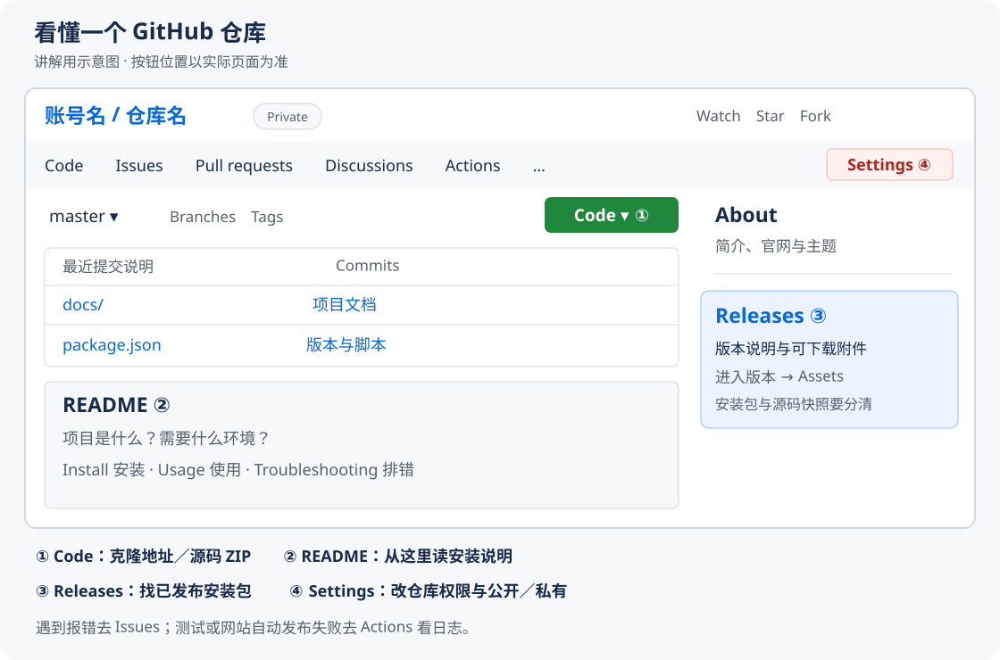

我之前遇到一个很实际的问题：别人给我一个 GitHub 链接，我知道项目有用，却不知道应该点哪里下载、下载后怎么运行；出了错，也分不清是项目坏了、自己装错了，还是 API 有问题。

这篇就用 **dsh-purge 在 DeepSeek Harness 桌面版上的部署、修复和备份**做例子，把从打开仓库到长期维护的流程走一遍。涉及的修复与部署记录来自 2026-10-22，页面和操作方法核对于 **2026-10-23（日本时间）**。

> [!NOTE]
> 本文面向 **Windows + PowerShell**。普通读者可先看第 1—6 节；排错看第 7—8 节；更新、备份和公开／私有设置看第 9—13 节。
>
> **这台电脑已经部署完成，不需要跟着重装。** 后面的安装、合并和建库命令是以后恢复或维护时使用的操作手册。标为“只读”的命令用于查看；标为“会改本机”或“会上传”的步骤，在确实需要时再执行。命令如果报错，先处理这一步，不要继续往下粘贴。

如果连工作区、提交、分支都还不熟悉，可以同时打开本站的 [Git 零基础教程](../content/git-basics.md)。那篇讲 Git 怎么记录版本，这篇讲怎么把 GitHub 上的项目拿来用。

## 01｜先分清：保存项目、部署项目、使用项目

拿到一个项目后，可以把事情分成四层：

| 层次 | 存放在哪里 | 做什么 | dsh-purge 这次的例子 |
| --- | --- | --- | --- |
| 远程仓库 | GitHub | 保存源码、版本记录、说明和讨论 | 作者仓库、镜像仓库、自己的备份仓库 |
| 本地源码 | 电脑上的一个项目文件夹 | 阅读、修改、测试、打包 | 克隆下来的 dsh-purge 源码 |
| 安装与运行环境 | 实际使用的软件及其配置目录 | 加载插件、应用兼容修改 | Harness 的 desktop profile 和客户端 |
| 使用数据 | 软件的个人数据目录 | 保存账户、会话、个人设置 | Harness 的会话和凭据 |

**把文件上传到 GitHub，只完成了保存。软件是否在电脑上运行，是另外一件事。**

这次实际走的是：

~~~text
找到 dsh-purge 仓库
  ↓
确认它是 Harness 插件，确认宿主版本
  ↓
取得源码，修复与新版宿主不兼容的地方
  ↓
运行测试，打成 .tgz 安装包
  ↓
安装到 desktop profile
  ↓
在插件界面应用修改，重启并检查状态
  ↓
将修复版源码、历史和安装包保存到自己的 GitHub
~~~

其中：

- **下载／克隆**：把代码拿到电脑上。
- **安装依赖**：准备代码需要的运行库。
- **构建／打包**：把源码整理成软件能使用的产物。
- **部署／安装**：把产物放进实际运行的位置，并完成配置。
- **验证**：确认入口、功能和关键测试确实正常。
- **备份**：留下以后能取回、能恢复的版本。

有的项目只有两三步，有的每一步都需要。具体看作者的说明。

### 为什么有的项目上传后就能出现网站？

ByteLife 有自己的发布流程：提交到 `main` 后，GitHub Actions 构建文章，再发布到 GitHub Pages。这个自动化流程是仓库已经配置好的。

而 dsh-purge 是桌面软件插件，上传源码后，GitHub 不会自动到你的电脑里安装它。GitHub Pages 主要托管 HTML、CSS、JavaScript 等静态网站；Python 后端、数据库或桌面插件需要相应的运行环境。[GitHub Pages 官方说明](https://docs.github.com/en/pages/getting-started-with-github-pages/what-is-github-pages)

## 02｜GitHub 仓库页面，哪些地方干什么用？

先看一个示意图。它是为讲解画的页面地图，**不是实际页面截图**，按钮顺序和显示位置可能随屏幕宽度变化。

*新手先认出 Code、README、Releases、Issues 和 Settings，已经足够完成大部分日常操作。*

### 账号和仓库名

以 `mmparko/dsh-purge` 为例：

- `mmparko`：仓库所属的用户或组织。
- `dsh-purge`：仓库名。
- `Milo-Guo/dsh-purge`：另一个账号下的同名仓库，是另一份远程仓库。

完整地址里的路径也有含义：

| 地址中出现的部分 | 表示什么 |
| --- | --- |
| `/仓库名` | 仓库首页 |
| `/blob/master/README.md` | master 分支中的一个文件 |
| `/tree/master/docs` | master 分支中的一个文件夹 |
| `/issues/4` | 这个仓库的第 4 号 Issue |
| `/pull/数字` | 一条 Pull Request |
| `/commit/一串字符` | 一次具体提交 |
| `/releases/tag/版本标签` | 某个版本的发布页 |

这里的 `blob`、`tree` 不是需要下载或安装的组件，只是 GitHub 地址的组成部分。不同仓库的 Issue 编号互不相通。

### 顶部功能栏

| 原按钮名 | 中文理解 | 什么时候打开 |
| --- | --- | --- |
| **Code** | 代码首页 | 看文件、README、分支 |
| **Issues** | 问题跟踪 | 搜已有报错、提 Bug、看维护进展 |
| **Pull requests** | 修改提案 | 看别人准备合并的修改、提交自己的修复 |
| **Discussions** | 讨论区 | 问使用问题、交流经验、发教程入口；仓库需要启用此功能 |
| **Actions** | 自动任务 | 看测试、构建、自动发布是否成功 |
| **Projects** | 任务看板 | 管理待办和进度，一般不负责安装 |
| **Wiki** | 项目知识库 | 有些作者把长文档放这里 |
| **Security** | 安全相关 | 看安全政策、公告及自己有权限查看的安全功能 |
| **Insights** | 项目活动统计 | 辅助了解提交和协作情况 |
| **Settings** | 仓库设置 | 改名称、权限、公开／私有、Pages 等；需要相应权限 |

菜单太多时，部分会收进 `…` 或下拉菜单。看不到 `Settings`，常见原因是正在看别人的仓库，或者当前账号没有管理权限。

### Code 页里最常用的地方

| 位置 | 作用 | 注意 |
| --- | --- | --- |
| **README.md / README.zh-CN.md** | 项目说明书／中文说明 | 优先找 Install、Usage、Requirements、Troubleshooting |
| **分支下拉框** | 选择 main、master 或其他分支 | main 和 master 都可能是默认分支，别想当然地换名 |
| **Tags** | 版本标签 | 便于定位某个历史版本 |
| **Commits / 提交记录** | 看每次修改 | 新提交不一定已经打包发布 |
| **绿色 Code 按钮** | 复制克隆地址、Download ZIP | ZIP 通常是当前分支的源码快照 |
| **Releases** | 发布说明与可下载产物 | 通常从这里找安装程序或安装包 |
| **About** | 一句话介绍、官网、主题标签 | 官网有时才是真正的在线使用入口 |

点开单个文件后，常见的 **Raw** 是原始文本，**History** 是该文件的修改历史，**Blame** 是按行追踪修改来源。想知道“这一行什么时候变的”，可以从这里查。[文件查看官方说明](https://docs.github.com/en/repositories/working-with-files/using-files/viewing-and-understanding-files)

### Star、Watch、Fork 有什么区别？

- **Star**：收藏或表达关注，方便以后找回。
- **Watch**：订阅仓库通知；可按需只关注 Releases。
- **Fork**：在自己的账号下建立与来源关联的仓库副本，常用于协作和提交修改。

Star 和 Watch 都没有替你保存完整源码。Fork 也不能代替安装，更不会自动替电脑更新软件。关于 Fork 与独立备份的区别，第 10 节继续讲。

## 03｜下载前先判断：我拿到的到底是什么项目？

先花几分钟回答五个问题：

1. **它是什么？** 桌面软件、命令行工具、Python 程序、网页、服务端，还是其他软件的插件？
2. **在哪运行？** Windows、Linux、macOS，还是某个特定宿主软件？
3. **需要哪个版本？** Python、Node.js、Java 或宿主的版本要求是什么？
4. **下载哪个产物？** 安装程序、压缩包、插件包，还是只能从源码构建？
5. **有没有与你环境一致的已知问题？** 去 Issues 搜版本号和报错关键词。

不要只因为仓库里有很多文件，就运行 `npm install` 或 `pip install`。要先看项目说明和依赖文件。

| 看到什么 | 可能是什么 | 下一步 |
| --- | --- | --- |
| Release 里的 `.exe`、`.msi` | Windows 安装程序 | 核对系统和架构后按作者步骤安装 |
| 标有 portable 的压缩包 | 便携版程序 | 解压到固定目录，找作者指定的启动文件 |
| `requirements.txt`、`pyproject.toml` | Python 项目 | 按说明准备 Python 和虚拟环境 |
| `package.json` | Node.js 项目或插件 | 看 engines、scripts 和作者安装方式 |
| `Dockerfile`、Compose 配置 | 容器项目 | 看端口、数据卷、环境变量的部署说明 |
| `index.html`、CSS、浏览器 JS | 可能是静态网页 | 确认是否需要构建或本地 HTTP 服务 |
| 指定某软件、profile、插件目录 | 宿主插件 | 先安装并确认宿主，再装插件 |

这些是判断线索，**具体命令仍以项目文档为准**。例如同样有 `package.json`，一个项目用 `npm run dev`，另一个可能根本没有 `dev` 脚本。

### Release 里的文件怎么选？

常见标记包括：

- `win` / `windows`：Windows。
- `x64` / `amd64`：常见的 64 位 Intel／AMD 架构；`arm64` 是另一种架构。
- `alpha`、`beta`、`rc`：预发布阶段。通常要格外核对兼容要求。
- `.tgz`：压缩包格式；这次的 dsh-purge 文件是供包管理器安装的插件包，不用把它当 EXE 双击。

**文件扩展名相同，也可能用途不同。先看文件名和发布说明。**

GitHub 自动附带的 **Source code (zip)** 和 **Source code (tar.gz)** 是标签所指源码的快照，不保证是已经构建好的软件。[源码归档官方说明](https://docs.github.com/en/repositories/working-with-files/using-files/downloading-source-code-archives)

### 下载 ZIP 与 git clone

| 方式 | 适合什么 | 保留什么 |
| --- | --- | --- |
| Code → Download ZIP | 临时看源码、只要这一版文件 | 当前选择版本的文件；没有完整 Git 历史 |
| `git clone` | 以后准备修改、更新、看历史 | 本地 Git 仓库及可获取的历史、分支信息和标签 |
| 下载 Release 附件 | 安装或恢复某个已发布版本 | 作者实际上传的那个文件，内容取决于附件 |

普通 clone 不等于迁移整个 GitHub 网站，Issue、讨论和 Release 附件不会因此全部下载下来。浅克隆还会截断历史；要做完整存档时不能只拿一份 `--depth 1` 的副本。[克隆仓库官方说明](https://docs.github.com/en/repositories/creating-and-managing-repositories/cloning-a-repository)

## 04｜这次 dsh-purge，具体有哪些版本和位置？

这是复盘实际环境，不是让所有读者照搬相同路径。

| 项目 | 本次记录 |
| --- | --- |
| 原作者与项目署名 | [YuJunZhiXue/dsh-purge](https://github.com/YuJunZhiXue/dsh-purge) |
| 本次取得源码的来源 | [mmparko/dsh-purge](https://github.com/mmparko/dsh-purge) |
| 来源默认分支基准 | `033e6bd1e0f101352b39075ecd0d758ffef26b76` |
| 实际宿主 | DeepSeek Harness 官方桌面版 `0.2.1-rc.2` |
| 本地修复版插件 | `1.1.71-local.20261022.4` |
| 修复提交 | `89241aaa9854e5adadc61241c3b2e1100467f71f` |
| 安装目标 | `desktop` profile |
| 自己的存档 | `Milo-Guo/dsh-purge`，独立私有仓库 |
| 发布标签 | `v1.1.71-local.20261022.4` |

原始 README 中仍能看到 `0.2.0-rc.2` 等旧目标说明，因为存档保留了原文。本次针对 `0.2.1-rc.2` 的兼容结论，要看个人修复版的发布说明和修复文档，不能把旧徽章当作新测试结果。

### 为什么要区分 desktop 和 web？

这次用的是官方桌面 EXE，因此装进 `desktop`。命令行启动的官方 `dsh web` 使用 `web`。两者有各自的 profile。

**只给 web 装了插件，再打开桌面客户端，不能据此认为 desktop 也已安装。**

本次的几类本地文件各有用途：

~~~text
本地源码文件夹
  修改、测试和打包使用

稳定保存的 .tgz 安装包
  用来安装和恢复这一版插件

用户数据目录下的 .dsh/profiles/desktop
  桌面客户端实际读取的插件配置与依赖

Harness 安装目录下的客户端及 resources
  软件本体；本次还做了宿主兼容处理

单独的部署备份目录
  部署前文件与验证记录，只留在本机
~~~

`DSH_HOME` 或便携版设置可能改变个人数据位置。本次使用的 profile 在用户目录 `.dsh` 下；其他电脑需要确认实际运行的那一份，别只凭文件夹同名判断。[项目中文安装说明](https://github.com/mmparko/dsh-purge/blob/master/README.zh-CN.md)

### 现在日常使用，要做什么？

这台已经部署好的电脑：

1. 打开原来的 **DeepSeek Harness**。本次安装位置是 `D:\deepseek\DeepSeek Harness.exe`。
2. 点击输入框上方附近的 **dsh-purge** 入口。
3. 进入 **Clean／清洗** 页面检查状态。
4. 新建会话，完成所需的模型登录或 API 配置后，再发一条普通测试消息。

2026-10-22 的部署验收记录为：`ok=true`、`ready=true`，**62 项补丁生效、0 项待应用、4 项因版本或组件不适用而跳过**。这些数字是这一次环境的记录，别要求以后每个版本都一样。

本次没有发起真实云端模型请求。因此，“插件加载和本地检查通过”与“账号、额度、API 已能正常回复”要分别验收。

## 05｜以后重装：从 GitHub 取回修复版并安装

> [!IMPORTANT]
> **已有部署正常时跳过本节。** 下面适用于在相同目标版本上恢复安装。新电脑、不同 Harness 版本或安装路径，需要先重新核对兼容性。
>
> dsh-purge 会修改宿主文件。本次曾遇到客户端打包布局与 CLI 路径问题，并做了专门适配；不能保证新安装包只执行一条命令就能复现全部宿主状态。安装后必须继续检查 Apply 和重启结果。

### 第一步：打开自己的 Release，认准安装包

登录 GitHub，打开：

[个人修复版 Release：v1.1.71-local.20261022.4](https://github.com/Milo-Guo/dsh-purge/releases/tag/v1.1.71-local.20261022.4)

这是私有仓库，只有有权限的账号能打开。其他人看到 404，可能只是没有访问权限，不代表文件已经被删。

向下找到 **Assets**，认准这四个附件：

| 文件 | 用途 |
| --- | --- |
| `dsh-purge-1.1.71-local.20261022.4.tgz` | 实际部署过的插件安装包 |
| `dsh-purge-fixed-source-20261022.zip` | 修复版源码快照 |
| `dsh-purge-full-20261022.bundle` | Git 历史和引用的离线备份 |
| `SHA256SUMS.txt` | 三个文件的 SHA-256 校验值 |

安装插件选第一项。不要误把 bundle 当插件安装，也不要把自动生成的 Source code ZIP 当作 Windows 安装程序。

### 第二步：把安装包保存到固定位置

可以用浏览器点击附件下载，随后移到一个长期保留的目录。这里约定示例位置为：

~~~text
用户目录\Documents\HarnessPackages\
~~~

不要一会儿放临时目录、一会儿清理下载目录。这个安装方式可能在 profile 中保留 `file:` 路径，包留着便于后续恢复。

### 第三步：校验下载文件，只读

打开 **Windows Terminal／终端**，选择 **PowerShell**。切到保存下载文件的目录，执行：

~~~powershell
Set-Location -LiteralPath (Join-Path $env:USERPROFILE 'Documents\HarnessPackages')
Get-FileHash -Algorithm SHA256 -LiteralPath '.\dsh-purge-1.1.71-local.20261022.4.tgz'
~~~

用记事本打开 `SHA256SUMS.txt`，对照相同文件名后的一串字符。大小写不影响比较。

两边一致，说明文件与该校验记录对应；不一致先重新下载，别继续安装。校验值用于检查文件完整性，还需要确认下载来源确实是自己的可信 Release。

### 第四步：完全退出 Harness，并做本地备份

使用客户端的 **应用 → 退出**；如果有托盘常驻，也确认它已经退出。需要时在任务管理器检查对应进程。

把现有 desktop profile 中的 `package.json`、锁文件和自定义覆盖配置另存到带日期的本地备份目录。宿主文件备份也要保留。这类备份可能含私人设置，和公开源码分开存放。

不要为重装删除整个 `.dsh`，里面可能还有会话和个人配置。

### 第五步：调用真实存在的 CLI 安装，会改本机

本次电脑的官方 CLI 在这个位置。先检查：

~~~powershell
$dshCli = 'D:\deepseek\resources\runtime\cli\bin\dsh.cmd'
Test-Path -LiteralPath $dshCli
& $dshCli plugin --help
~~~

`Test-Path` 应返回 `True`，帮助中应能看到 `--profile`。如果返回 `False`，先找实际客户端安装目录，别照搬这个盘符。

确认安装包和 CLI 都存在，再执行：

~~~powershell
$pluginPackage = Join-Path $env:USERPROFILE 'Documents\HarnessPackages\dsh-purge-1.1.71-local.20261022.4.tgz'
if (-not (Test-Path -LiteralPath $pluginPackage)) { throw '找不到安装包，请先确认下载位置。' }
& $dshCli plugin --profile desktop add $pluginPackage
~~~

PowerShell 前面的 `&` 表示“执行这个路径指向的命令”。包管理器会安装依赖，必要时需要联网。没有错误退出、能找到已安装插件的 `package.json`，才进入下一步。

这不是全局 `npm install -g`；也不是在源码目录运行 `npm install`。安装目标由 `--profile desktop` 明确指定。

### 第六步：在客户端完成应用与重启

1. 重新打开 Harness。
2. 找到 **dsh-purge → Clean／清洗**。
3. 核对插件版本、宿主和待应用项。
4. 需要应用时，点击 **Apply／应用**，看它是否完成并正常重启。
5. 如果页面提示还有未完成项，保留错误信息，按第 8 节定位。
6. 完成后新建会话，再测试普通消息。

**“包已安装”“插件已加载”“补丁已应用”“模型能回复”是四个检查点。** 终端里安装成功，不代表后面三项已经自动完成。

本次对宿主资源布局做过处理，CLI 找不到宿主入口、文件锁定或补丁版本不匹配时，都应该先停在错误处检查。不要把网上某段删除 `app.asar` 的命令当通用修复。

### 可选：用 GitHub CLI 下载附件

这台电脑已经安装 Git 和 GitHub CLI；正常情况下无需重装。换电脑后可先运行：

~~~powershell
git --version
gh --version
~~~

若没有相应命令，先从 [Git for Windows](https://gitforwindows.org/) 和 [GitHub CLI](https://cli.github.com/) 的官方入口安装，重新打开终端再检查。

私有仓库下载前，需要登录有权限的 GitHub 账号：

~~~powershell
gh auth login --hostname github.com --git-protocol https --web
gh auth setup-git
~~~

按浏览器授权提示完成登录。无需把密码或 Token 写进教程、仓库或命令行。登录方式参考 [gh auth login 官方帮助](https://cli.github.com/manual/gh_auth_login)。

在准备存放文件的父目录运行：

~~~powershell
gh release download v1.1.71-local.20261022.4 --repo Milo-Guo/dsh-purge --dir dsh-purge-download-20261023
~~~

这会下载该 Release 的附件。目录中若已有同名文件，先核对旧文件，不要随意增加覆盖参数。[gh release download 官方帮助](https://cli.github.com/manual/gh_release_download)

## 06｜怎么看源码、验证修复，而不影响已安装的软件？

建议把实验放在**新的文件夹**。示例中若目标目录已存在，换一个新名字。

打开 PowerShell，切到自己准备保存代码的父目录：

~~~powershell
gh repo clone Milo-Guo/dsh-purge dsh-purge-learning
Set-Location -LiteralPath '.\dsh-purge-learning'
git status
git log -1 --oneline
~~~

自己的远程仓库默认分支是 `master`。克隆默认分支后，应能看到修复提交；原来源快照保存在 `upstream/...` 分支中。

这个“新克隆”和之前部署时用的本地文件夹是两份副本。之前的工作文件夹当前在 `codex/harness-0.2.1-fixes` 分支，旧本地 `master` 仍是来源版本。**不要因为两个地方都有一个 master，就以为它们一定指向相同提交。**

只读检查几个文件即可：

| 文件 | 这次为什么看它 |
| --- | --- |
| `README.zh-CN.md` | 作者安装与使用说明 |
| `package.json` | 包名、版本、Node 要求、可运行的脚本 |
| `docs/本机部署与修复说明.md` | 本地兼容修复的说明 |
| `docs/备份与恢复说明.md` | 归档内容和恢复方式 |
| `scripts/test-cwd-compat.mjs` | 本次修复的回归检查 |

检查 Node/npm 是否可用：

~~~powershell
node --version
npm --version
~~~

这个修复版的回归脚本使用 Node 内置模块；以本次验证用的 **Node 24** 为准，无需为了这条测试先安装整套宿主依赖。项目元数据中的最低 Node 要求与具体测试脚本的实测环境，是两个不同信息。

在源码目录运行：

~~~powershell
npm run test:cwd-compat
~~~

应看到三类“通过”提示：

1. 7 组提示词及旧格式迁移等检查。
2. 固定同一毫秒的 12 次并发备份、12 次并发原子写入。
3. 0.2.1 提示词补丁匹配、必需工作目录上下文保留。

这条命令会在系统临时目录创建小型测试文件，不会调用模型 API，也不会把这份源码自动安装进 Harness。**源码测试通过后，实际软件仍需单独做部署验证。**

### 把自己的部署笔记上传到自己的仓库

这一步用于练习 **编辑 → 提交 → 推送 → 网页确认**，会在自己的远程仓库创建一个分支；它不会重新部署插件。只在上面新建的学习副本中操作。

先建立分支：

~~~powershell
git switch -c codex/my-deployment-notes
~~~

用 VS Code 打开这个文件夹，在已有的 `docs` 目录里**新建** `my-deployment-notes.md`。如果同名文件已经存在，就换新文件名，不要覆盖。写入自己实际确认过的内容，例如：

~~~text
我的部署记录

宿主版本：待填写
插件版本：待填写
安装方式：待填写
验证结果：待填写
遇到的问题与处理：待填写
~~~

把“待填写”改成自己的事实，不要填账号凭据。保存后回到终端：

~~~powershell
git status
git add docs/my-deployment-notes.md
git diff --cached
~~~

`git add` 把指定文件放进本次准备提交的范围；`git diff --cached` 用来检查这些即将提交的文字。确认只有自己的笔记，没有敏感信息，再执行：

~~~powershell
git commit -m '记录本机部署与验证过程'
git push -u origin codex/my-deployment-notes
~~~

- `commit`：在本机记录一个版本。
- `push`：把这个分支的提交发到 origin 对应的 GitHub。
- `-u`：记录分支对应关系，便于后续推送。

提交会记录作者名和邮箱。首次使用时若提示身份未配置，先按 [Git 基础教程](../content/git-basics.md) 配置；希望隐藏个人邮箱时，使用 GitHub 账号设置 **Emails** 页面提供的 noreply 地址。

成功后打开自己的 GitHub 仓库，切换到 `codex/my-deployment-notes`，查看 `docs/my-deployment-notes.md`。想将它合入默认分支，再创建 PR、检查差异并合并；只推送这个练习分支，不会自动修改默认分支的文件。

## 07｜用 Issue #4 学会读报错：为什么清空设置也没用？

这次的问题来自 [mmparko/dsh-purge Issue #4](https://github.com/mmparko/dsh-purge/issues/4)。

报错中的关键部分是：

~~~text
unknown prompt variable "{{cwd}}"
in section "deployment:persona-suffix"
registered variables: provider, model
~~~

逐段读：

| 报错片段 | 意思 | 能帮我们判断什么 |
| --- | --- | --- |
| unknown prompt variable | 提示词中有无法识别的变量 | 先查模板渲染 |
| `{{cwd}}` | 旧模板里表示当前工作目录的占位符 | 具体出问题的变量 |
| persona-suffix | 出错的提示词段落 | 缩小到身份后缀处理 |
| registered: provider, model | 当前只注册这两个变量 | 这版宿主没有给 cwd 提供插值值 |

`cwd` 通常是 current working directory，即当前工作目录。这里的重点是：**新版提供工作目录的方式变了，插件仍在生成旧格式模板。**

当时的链路是：

~~~text
用户启动会话
  → 插件组装提示词
  → 插件又写入 {{cwd}}
  → 宿主检查已注册变量
  → 找不到 cwd，提前报错
  → 这一轮还没有发到模型 API
~~~

因此，光换 API Key、换模型，不能解决这个特定错误。

### 为什么把设置里的后缀清空还会报错？

因为运行时代码会在发现后缀为空或匹配旧身份文本时，再填回默认句：

~~~text
Your working directory is {{cwd}}.
~~~

改配置后，代码又把它写回来。这个现象说明要检查“最终是谁生成了文本”，不能只看设置框里现在是什么。

### 这次修复改了什么？

针对本地兼容问题，修改集中在几个相关位置：

| 位置 | 修复内容 | 原因 |
| --- | --- | --- |
| `lib/identity.js` | 默认说明改成不含 cwd 插值的静态句 | 避免生成宿主不认识的变量 |
| 同一文件的旧文本处理 | 迁移旧后缀，清除会重新产生 cwd 模板的旧身份句 | 兼容已有配置 |
| 变量白名单 | 与新版实际支持的 model/provider 对齐 | 避免继续按旧假设渲染 |
| `cordis.patch.yml` | 同步默认配置 | 防止新装时又带入旧模板 |
| 相关旧常量和注释 | 清理无引用旧内容、修正说明 | 减少以后维护误判 |
| 回归脚本 | 覆盖缺省、空值、旧句、自定义内容等情况 | 保证修复没有只照顾一个输入 |

工作目录仍由宿主的运行时上下文提供，这次修复并不是让会话失去工作目录。

截至 **2026-10-23 本次核对时**，原 Issue 仍显示 **Open**，有其他用户的复现及本地修复反馈。别人说“我修好了”，不等于维护者已发布官方修复版；我们的修复保存在自己的仓库和安装包里。

### 部署中还遇到了两个独立问题

一是 Apply 并发备份时，临时文件名使用进程号和毫秒时间，并发任务可能取到相同名字，随后出现 `ENOENT`。这次给每次原子写入和复制增加 UUID，并用固定时间的并发测试验证。

二是新版宿主中 complete prompt 的代码形状发生变化，旧补丁匹配不到，影响重启前的完整性检查。这次补充了对应匹配，同时保留新版要求的运行时上下文。

这三个问题发生在不同环节。提示词错误修好后，仍然可能在“应用补丁”阶段遇到另一个错误，所以部署验收要走完整条链路。

2026-10-22 的记录还包括真实宿主渲染验证和 41 个宿主目标文件的语法检查；2026-10-23 写本文时重新运行了源码回归脚本。**两次验证的时间和范围分开记录，未把本地测试写成云端回复已验证。**

## 08｜以后出错，按发生位置排查

先记下：**我做到了哪一步，哪一步第一次出现错误？**

| 现象 | 优先检查 | 不要急着做什么 |
| --- | --- | --- |
| 私有仓库 404 | 登录账号、仓库访问权限、链接是否正确 | 不要直接判定原作者删库 |
| 下载超时、连接失败 | 网络、代理、目标地址、是否能打开对应页面 | 不要直接改项目代码 |
| `git`、`node`、`npm` 不是命令 | 是否安装、是否重开终端、真实可执行文件路径 | 不要在每个文件夹反复安装 |
| 找不到 package.json | 当前目录是不是源码根目录 | 不要随便 `npm init` 新建一个 |
| 安装成功却没有插件入口 | desktop/web 是否装对、实际 profile、重启与加载日志 | 不要覆盖整份个人配置 |
| `unknown prompt variable` | 提示词变量与宿主版本 | 不要先换 API Key |
| `ENOENT` | 错误中的具体文件路径、调用位置、是否并发临时文件问题 | 不要把所有 ENOENT 都归为同一个原因 |
| `EPERM`、访问被拒绝 | 软件是否仍在运行、文件锁、实际权限 | 不要先改系统目录权限 |
| Apply 后仍有未完成项 | 补丁匹配、宿主版本、备份和校验日志 | 不要认为“写过文件”就一定成功 |
| 401、403 或额度错误 | 看清是哪台服务返回；检查登录、API 权限、额度和请求配置 | 不要据此反推插件必然装坏 |
| 网页按钮正常，模型不回复 | 服务端日志、网络、API 配置、模型名称 | 不要只凭界面截图判断全部正常 |
| Actions 红叉 | 点开这次运行的失败步骤与日志 | 不要把所有红叉都当成桌面安装错误 |

### 如何在 Issues 找到已有问题？

1. 打开**实际使用源码的那个仓库**。
2. 点 **Issues**。
3. 搜错误最有辨识度的一小段，如 `unknown prompt variable` 或 `cwd`。
4. 默认筛选常含 `is:open`；去掉这个条件，再看已关闭的问题。
5. 比较插件版本、宿主版本、系统和 profile 是否接近。
6. 看维护者有没有明确指出修复提交、发布标签或替代安装包。

**Closed** 只表示该问题单已关闭；可能是修复、重复、无法复现等原因。要继续看关闭说明，也要确认修复是否已进入自己安装的版本。

### 自己提 Issue，怎样让别人能帮忙？

点 **Issues → New issue**，选择 Bug 模板；没有合适模板时按页面选项创建空白问题。模板可参考：

~~~text
标题：
dsh-purge 某版本 + Harness 某版本：启动会话时报 unknown prompt variable

环境：
- Windows 版本：
- Harness 版本：
- 插件版本：
- 使用 desktop 还是 web：
- 安装方式：具体 Release 包／npm 包／源码

复现步骤：
1. 打开……
2. 点击……
3. 出现……

预期结果：
应该……

实际结果：
实际……

原始错误：
粘贴关键错误文本和必要的堆栈，已去除敏感内容。

已经尝试：
重启过什么、改过什么、是否仍复现。
~~~

截图可以辅助说明，但最好同时提供可复制的错误文字。日志里的 API Key、Token、账户信息和私人文件路径先处理掉。

关于创建和使用问题单，可参考 [GitHub Issues 官方操作说明](https://docs.github.com/en/issues/tracking-your-work-with-issues/using-issues/creating-an-issue)。

## 09｜项目更新了，怎样更新自己的这一份？

先分清三种更新：

| 更新对象 | 举例 | 是否会自动更新其他部分 |
| --- | --- | --- |
| GitHub／本地源码 | fetch、pull、合并新提交 | 不会自动换掉桌面中已安装的插件 |
| 已安装插件 | 给 desktop 安装新 .tgz | 不等于升级 Harness 本体 |
| 宿主软件 | Harness 自身升级 | 可能改变插件接口、资源布局和补丁匹配 |

**这次使用本地修复包，自动更新默认关闭。** 目的是避免未合并本地修复的上游包覆盖现有版本。以后更新时，应先确认新版本是否包含相同修复，再决定安装。

### 路线 A：只想用软件，优先按发布版更新

1. 到来源仓库 **Releases** 看是否有新版本。
2. 阅读变更说明，核对支持的 Harness 版本、安装方式和已知问题。
3. 搜 Issues，看本机类似环境是否有新报错。
4. 保存当前已验证的安装包、配置与宿主备份。
5. 取得新安装包并校验。
6. 完全退出旧程序，按该版本说明安装。
7. 重启，检查版本、入口、待应用项，测试普通消息。
8. 有问题时先回到兼容的组合，再继续排查。

本地版本名里的日期和后缀只是我们自己的版本标识，不能用它推断上游已经修好了什么。“版本号更大”也不能代替兼容验证。

### 路线 B：自己维护修复版，先比较，再合并

这是一条维护源码的路线。首次学习时，先在第 6 节的新克隆副本中操作，不要直接改已经部署的 profile。

常见远程名：

- `origin`：这份克隆默认连接的远程仓库；新克隆自己的仓库时，它就是自己的 GitHub。
- `upstream`：我们额外取的名字，表示上游来源。
- 它们是约定名称，不是 GitHub 的固定账号角色，必须用 `git remote -v` 实际核对。

在新克隆目录里，先做只读检查：

~~~powershell
git status
git remote -v
~~~

如果工作区有自己还没保存的修改，先处理这些修改。不要用重置或清理命令把它们抹掉。

新克隆尚未配置 upstream 时，添加一次：

~~~powershell
git remote add upstream https://github.com/mmparko/dsh-purge.git
git fetch upstream
~~~

若提示 upstream 已存在，先 `git remote -v` 查看它指向哪里，别重复添加。

`fetch` 下载远程更新并更新本地记录，不会立即把当前工作文件合并成新版。随后查看：

~~~powershell
git log --oneline HEAD..upstream/master
git diff HEAD...upstream/master -- lib/identity.js cordis.patch.yml
~~~

第一条看上游有哪些当前分支尚未包含的提交；第二条从共同祖先出发，查看上游在关键文件上的变化。看到输出不代表一定需要合并，也不代表改动一定正确。[git fetch 官方说明](https://git-scm.com/docs/git-fetch)

确认需要更新后，在实验副本中建立分支，再合并：

~~~powershell
git switch -c codex/update-dsh-purge-20261023
git merge --no-ff --no-commit upstream/master
~~~

分支名里的日期只是示例；已存在时选新名字。如果显示 `Already up to date`，说明没有需要合并的新内容。

如果出现 `CONFLICT`：

- 暂停后面的打包和上传步骤。
- 用 `git status` 看冲突文件。
- 在编辑器里逐段比较上游修改和本地修复。
- 解决后只暂存自己检查过的文件，再运行回归测试。
- 确定要取消**这次正在进行的合并**时，可以用 `git merge --abort`；不要拿强制覆盖代替解决冲突。

没有文本冲突，也仍需检查 `{{cwd}}` 修复、旧格式迁移、运行时上下文和自动更新设置有没有被改变。Git 能判断文本怎么合并，不能替你证明运行逻辑兼容。

### 测试、打包、安装是后续三个动作

在实验源码目录运行：

~~~powershell
npm run test:cwd-compat
~~~

如果确实生成了新的兼容版本，先在 `package.json` 中给它一个**新的、未使用的版本号**，并更新对应说明。不要覆盖此前已发布的同名安装包或移动旧标签。

然后创建专门的产物目录，例如：

~~~powershell
New-Item -ItemType Directory -Path '.\release-output-20261023'
npm pack --pack-destination '.\release-output-20261023'
~~~

如果目录已经存在，先看里面是什么或改用新名字。打包成功时，npm 会给出实际生成的 `.tgz` 文件名。**打包仅表示产物生成，不表示新版已安装或通过宿主验证。**

先按第 5 节在合适环境安装、验证。随后审查 `git diff` 和暂存区，将实际需要的源码、测试和版本文件提交到自己的更新分支，再推送该分支。上传产物应通过 Release，不要把整个 `node_modules` 提交到源码仓库。

在 GitHub 打开自己的仓库，通过 **Pull requests → New pull request** 比较更新分支与 `master`。写清宿主版本、修复和测试范围，确认后再合并。完整的“分支 → 提交 → PR → 合并”流程可参考 [GitHub Hello World 教程](https://docs.github.com/en/get-started/using-github/hello-world)。

### 自己的副本是 Fork 时，Sync fork 做什么？

Fork 页面可能有 **Sync fork → Update branch**。它用来同步 GitHub 上的分支；有冲突时需要处理冲突。

它不会更新电脑中已安装的软件。我们这次的个人存档是**独立仓库**，没有 Fork 关联，应通过远程来源和 Git 合并来维护。[同步 Fork 官方说明](https://docs.github.com/en/pull-requests/how-tos/work-with-forks/syncing-a-fork)

### 出问题怎样回退？

要看自己改的是哪一层：

| 出错层次 | 回退思路 |
| --- | --- |
| 只在实验分支修改 | 保留现场，回到已验证分支或另开干净副本 |
| 已把错误源码提交到自己的仓库 | 检查影响后用 revert 生成撤销提交，保留历史 |
| 新插件安装后异常 | 退出客户端，重新安装已验证的旧包，并检查适配宿主 |
| 宿主也升级了 | 旧插件未必兼容新宿主，需要恢复匹配的软件与配置组合 |
| ByteLife 文章发布错误 | 修正文档或撤销对应提交，重新触发站点构建 |

“把 GitHub 里的代码退回旧版”与“把电脑上的软件恢复旧版”需要分别操作。插件界面里的 **Restore／恢复**、**Uninstall／卸载**也各有作用，使用前先阅读当前版本说明，保留备份。

## 10｜防原作者删库：Star、Fork、ZIP、独立仓库怎么选？

| 方式 | 留住了什么 | 主要不足 |
| --- | --- | --- |
| Star / Watch | 链接与关注关系 | 没有替你保存完整项目 |
| Download ZIP | 某一版文件快照 | 没有完整提交历史 |
| 普通 clone | 本地源码与 Git 历史 | 只放一块硬盘仍有丢失风险；不含完整平台数据 |
| Fork | 与来源关联的远程副本 | 受 Fork 网络和可见性规则影响；不等于全站备份 |
| 独立仓库 | 自己管理的另一份远程源码仓库 | 要自己维护同步、单独保管发布附件 |
| Git bundle | 可离线传输的 Git 对象与引用 | 不含账户、环境、模型或完整软件依赖 |
| 源码＋安装包＋恢复说明，多处保存 | 既留源码，也留可安装版本 | 需要定期核对和恢复验证 |

### Fork 遇到删库，会一起没吗？

需要按仓库类型区分：

- **公开仓库被删除**：公开 Fork 网络通常会继续存在，GitHub 会选择活跃公开 Fork 作为新的上游。
- **私有仓库被删除**：其私有 Fork 也会被删除；失去私有来源访问权限也可能影响 Fork。
- **公开来源改为私有**：已有公开 Fork 不会跟着变私有，而是进入分离的网络。

因此，不能笼统说“Fork 一定跟着删”，也不能把 Fork 当成任何情况下都完整独立的备份。公开来源的 Fork 通常仍是公开的，不能单独把它随意改为私有。[GitHub Fork 规则](https://docs.github.com/en/pull-requests/reference/forks)

### 想快速 Fork，网页怎么点？

1. 打开来源仓库，确认账号登录正确。
2. 点右上角 **Fork**，进入 **Create a new fork**。
3. **Owner** 选自己的账号，填写仓库名。
4. 如果页面有 **Copy the default branch only**，根据是否需要其他分支决定；只复制默认分支不等于备份全部分支。
5. 点 **Create fork**。
6. 确认新地址的账号部分已经变成自己的账号。

要协作、提 PR，这样很方便。要保存私人兼容改动和独立的长期存档，可以使用下一节的独立仓库方案。

### 这次实际保存了什么？

2026-10-22 的 dsh-purge 归档包括：

- 来源仓库可达的 **392 条提交历史**，以及我们自己的兼容修复提交。
- 来源 **3 个分支**，保存为：
  - `upstream/master`
  - `upstream/fix/restart-sticky`
  - `upstream/upstream-archive`
- 来源 **100 个标签**，保留其名称和 Git 对象。
- 自己的修复版默认分支 `master`。
- 新增的本地修复版本标签。

归档完成时，个人远程仓库合计 **4 个分支、101 个标签**。Release 保存了插件安装包、修复版源码、全量 bundle 和校验文件。随后核对了分支／标签引用、上传文件 SHA-256，并下载 bundle 做过离线恢复验证。

**这是本次时间点的快照，不会自动得到未来的源码或新发行包。** 原来源里的归档分支已有部分 Issue/PR 数据，也随分支保留；这不代表 GitHub 全部历史讨论都已迁移。

## 11｜把别人的项目存进自己的独立仓库：完整操作

**现有的 dsh-purge 已经备份好了，无需重做。** 以下用一个新的练习仓库名说明流程。不要把目标替换成已经有自己修改的重要仓库。

### 第一步：在网页创建空仓库

1. 登录 GitHub。
2. 右上角 **＋ → New repository**。
3. **Owner** 选择自己的账号。
4. **Repository name** 填新的名字，例如 `dsh-purge-independent-demo`。
5. **Description** 写明来源和用途，如“个人源码存档，保留原作者署名”。
6. 选择 **Private** 或 **Public**。自己保存、暂不分享时可以选 Private。
7. 这次要导入已有历史，**不要勾选初始化 README、.gitignore、License**；这些应随来源仓库一起保存。
8. 点 **Create repository**，记录新仓库地址。

选择 Private 不代表代码变成自己的原创。原作者署名、来源说明和许可证都要一起保留。

### 第二步：核对工具和账号

在 PowerShell 运行：

~~~powershell
git --version
gh --version
gh api user --jq .login
~~~

最后一条只显示当前 GitHub CLI 的登录用户名，不显示凭据。先确认它确实是准备上传的账号。需要登录时，使用第 5 节的浏览器授权流程。

### 第三步：取得完整的源码历史

在准备放备份的父目录执行：

~~~powershell
git clone --bare https://github.com/mmparko/dsh-purge.git dsh-purge-independent-demo.git
Set-Location -LiteralPath '.\dsh-purge-independent-demo.git'
git fsck --full
git for-each-ref --format='%(refname)' refs/heads refs/tags
~~~

`--bare` 创建的是没有日常工作文件的 Git 仓库，适合转存历史；它不是让你进去直接双击运行的源码目录。不要加 `--depth 1`。

`fsck` 检查 Git 对象完整性。它通过不等于项目功能测试通过；列出的分支和标签也应和来源核对。

### 第四步：把分支和标签上传到新空仓库，会上传

下面仅适用于**自己的、新建空仓库**。账号名和仓库名按实际创建结果替换；检查完整地址后再执行：

~~~powershell
git push --atomic https://github.com/Milo-Guo/dsh-purge-independent-demo.git 'refs/heads/*:refs/heads/*' 'refs/tags/*:refs/tags/*'
~~~

这两组映射表示把本地所有分支和标签写到对应目标位置。`--atomic` 要求服务器支持整组一起更新；有不兼容或权限错误时先检查，不要为了“推上去”增加强制参数。

这里没有使用强制推送或镜像删除选项。GitHub 官方的镜像教程使用 `push --mirror`；该选项会让目标引用与来源一致，**以后若拿它对着有自己修改的仓库同步，可能覆盖或删除目标引用**。新手做一次性独立转存，用明确分支／标签映射更容易检查范围。[官方复制仓库说明](https://docs.github.com/en/repositories/creating-and-managing-repositories/duplicating-a-repository)

### 第五步：回网页核对，设好默认分支

1. 打开自己的新仓库，确认文件列表出现。
2. 查看分支下拉框和 **Tags**，核对数量与名称。
3. 点几条历史提交，确认不是只有一条“上传所有文件”的新历史。
4. 在 **Settings → General → Default branch** 核对默认分支，按实际来源选择 `master` 或 `main`。
5. 以后开发时，从自己的新地址再做普通 clone。

若复制来的仓库有自动发布工作流，先检查 **Actions**。个人存档可以保持工作流禁用；需要启用时再核对发布目标和权限。本次 dsh-purge 存档已关闭继承的 Actions，避免历史版本标签触发原来的自动发布流程。

### 第六步：单独保存 Git 以外的内容

只复制 Git 历史，不会自动复制这些东西：

| 内容 | 如何补充 |
| --- | --- |
| Release 安装包、模型文件、外部下载 | 单独下载，保存校验值，需要时上传到自己的 Release |
| Issues、PR、Discussions 的正文和评论 | 视需要通过 API 导出；Git clone 不会自动变成对应问题单 |
| Wiki | 通常是单独的 Git 仓库，需要另行克隆 |
| Git LFS 大文件 | 检查是否使用 LFS，额外抓取与备份实际对象 |
| 子模块 | 根据 `.gitmodules` 分别保存来源与所需提交 |
| 数据库、上传文件、环境配置 | 按项目部署文档另做数据备份 |
| 账户凭据与个人会话 | 使用自己的安全备份方式，不放进公开源码仓库 |

可用 `git lfs ls-files` 判断已经安装 LFS 的环境中是否有 LFS 跟踪文件；需要时再按官方说明处理 `git lfs fetch --all` 与目标上传。也要注意大文件托管配额，不要误以为 Git 中有指针文本就等于实际内容已经保存。[GitHub 备份范围说明](https://docs.github.com/en/repositories/archiving-a-github-repository/backing-up-a-repository)

### 自己创建 Release，上传安装包

在自己的仓库打开 **Releases**，寻找 **Create a new release／Draft a new release**：

1. 选择或填写一个准确的标签；若新建标签，核对它指向的分支／提交。
2. 写发布标题。
3. 说明适配环境、改了什么、测试范围和已知限制。
4. 在附件区域上传实际安装包与校验文件。
5. 检查内容和仓库可见性。
6. 点 **Publish release**。

Release 附件要自己上传；自动出现的 Source code ZIP 只是源码快照。发布后，再下载一份核对校验值，比只看“上传完成”更可靠。[Releases 官方说明](https://docs.github.com/en/repositories/releasing-projects-on-github/about-releases)

## 12｜离线备份：GitHub 和原作者都访问不了时怎么办？

只把备份放在同一个 GitHub 账号，仍依赖这个账号和平台。可以再留一份到移动硬盘或自己选择的其他存储位置。

### 最简单：下载已经做好的 bundle

本例的 `dsh-purge-full-20261022.bundle` 包含归档时的 Git 历史和引用。把它、安装用的 `.tgz`、`SHA256SUMS.txt` 和恢复说明一起保存。

bundle 不包含已安装的 Node、Harness、账户凭据或全部依赖，不能保证在全新电脑上完全离线安装所有软件。它解决的是**代码和版本历史的离线取回**。

### 从这份 bundle 恢复到新文件夹

假设文件放在当前目录。先对照 SHA-256，再执行：

~~~powershell
git clone '.\dsh-purge-full-20261022.bundle' dsh-purge-restored
Set-Location -LiteralPath '.\dsh-purge-restored'
git bundle verify '..\dsh-purge-full-20261022.bundle'
git fsck --full
git log -1 --oneline
git tag --list
~~~

恢复目录必须是新名字。这里特意在 clone 之后进入 Git 仓库再 `verify`，因为直接在普通下载目录运行某些 Git 校验操作，可能提示需要一个 Git 仓库。

本次 bundle 的默认恢复 HEAD 应指向修复提交 `89241aa`，标签包括原 100 个和本地修复标签。默认恢复分支名未必叫 master，先用 `git branch` 查看，不要单凭名字判断内容。

若要把 bundle 中归档的原始上游引用也展开成普通本地分支，可在**刚创建的恢复副本**中额外执行：

~~~powershell
git fetch '..\dsh-purge-full-20261022.bundle' 'refs/remotes/upstream/*:refs/heads/archive-source/*'
git branch --list 'archive-source/*'
~~~

这一步是针对本次 bundle 的引用布局；换别人的 bundle 时先用 `git bundle list-heads` 看内容，不能照搬同样的映射。

### 以后自己生成 bundle

在一份已经完整获取所需历史、分支和标签的 Git 仓库中：

~~~powershell
git bundle create '..\project-backup-20261023.bundle' --all HEAD
git bundle verify '..\project-backup-20261023.bundle'
~~~

`--all` 保存当前仓库已有引用可达的历史，`HEAD` 明确加入当前提交；它不会替你从从未下载的远程来源补齐数据，也不保存未提交工作文件、未跟踪文件、Git LFS 实际大文件和外部数据。

生成后，用新目录 clone 并检查，才知道备份能否恢复。[git bundle 官方说明](https://git-scm.com/docs/git-bundle)

## 13｜自己的库怎么改为公开，或只让授权的人可见？

先区分两种状态：

| 状态 | 一般谁能看 |
| --- | --- |
| **Public／公开** | 任何人都能浏览仓库公开内容 |
| **Private／私有** | 你和获得授权的人；具体还受协作者、组织和应用权限影响 |

所以“Private”更准确的意思是“未公开”。想尽量只有自己使用，还要看有没有协作者及授权应用。公开状态也不代表所有人都能直接修改你的主分支，**可读与可写是两种权限**。

2026-10-23 核对时，这几个个人仓库的状态是：

| 仓库 | 状态与用途 |
| --- | --- |
| `Milo-Guo/dsh-purge` | Private，个人修复版和备份 |
| `Milo-Guo/bytelife` | Public，公开文章和交流 |
| `Milo-Guo/github-hot-projects` | Public，项目知识库 |

本文发布在公开的 ByteLife，私有 dsh-purge 的链接仍按原权限访问。公开教程不会让私有安装包自动变为公开附件。

### 网页上修改的完整路径

这是操作说明，本次没有替你切换任何仓库的可见性。

1. 登录拥有管理权限的账号。
2. 打开**要修改的那个仓库首页**。
3. 点击仓库顶部的 **Settings**。这里是仓库设置，别走到头像里的账号设置。
4. 在 **General** 页面向下找到 **Danger Zone**。
5. 找到 **Change repository visibility**。
6. 点击 **Change visibility**。
7. 选择 **Make public** 或 **Make private**。
8. 确认页面显示的仓库确实正确。
9. 阅读影响说明，按页面点击 **I have read and understand these effects** 等确认按钮。
10. 最终点击 **Make this repository public** 或 **Make this repository private**；若要求输入仓库名、验证身份或 2FA，按当前页面完成。

按钮文字、确认步骤可能调整，以当时页面为准。依据是 [GitHub 官方可见性操作文档](https://docs.github.com/en/repositories/managing-your-repositorys-settings-and-features/managing-repository-settings/setting-repository-visibility)。

改完回到仓库首页，看仓库名旁的 **Public／Private** 标记。用未登录的无痕窗口访问，可以辅助验证公开浏览状态；私有仓库对无权限访问通常显示 404。

### Private → Public 前，先知道会公开哪些内容

不能只检查当前首页文件。仓库历史中保留的文件、分支、标签、Release 附件以及 Actions 日志等，也要纳入检查。

例如以前提交过 API Key，后来只从最新文件删掉，历史里仍可能保留。发现泄露先在对应服务撤销或更换密钥，再处理历史与公开范围。不要为了讲教程，把私人配置直接公开。

### Public → Private，也不能收回别人已经拿走的副本

别人先前下载的 ZIP、本地 clone 和公开 Fork，不会因为你改了状态就从别人电脑上消失。修改可见性主要控制之后对这个仓库的访问。

如果仓库带 Pages 网站，还要考虑账号套餐与站点发布：在 GitHub Free 下，把公开仓库变私有可能让已发布的 Pages 网站下线；其他支持私有源仓库的套餐中，**源代码私有也不自动代表网站带私人访问控制**。网站访问策略要单独确认。

因此，这几个操作含义不同：

~~~text
更改仓库可见性 → 控制仓库的公开访问
关闭 Pages 发布 → 控制该站点是否继续发布
配置网站访问控制 → 控制谁能打开已经发布的网页
~~~

ByteLife 正在用于公开文章阅读，不要只为隐藏某个附件，就把整个文章站仓库随意改成 Private。私密材料可以放在单独的私有仓库或自己的存储位置。

### 想“只有自己能看”，还看哪里？

到仓库 **Settings** 查看 **Collaborators／Manage access** 等访问管理入口，确认没有自己不需要的人员授权；组织仓库还需要看团队和组织权限。GitHub Apps 等已授权连接也可能有读取权限，可在账号的应用授权设置中检查。

不要因为没有看到 Fork 或没有收到通知，就推断仓库一定只有自己能读。

### Fork 的可见性为什么改不了？

公开来源的 Fork 属于公开 Fork 网络，不能随意单独变成私有。如果目标是私人保存一份兼容修改，可以按第 11 节创建**独立私有仓库**，保留来源与署名。本次的 dsh-purge 已采用这种方式。

## 14｜最后做一轮最小练习，把流程连起来

如果你今天只是第一次熟悉 GitHub，可以先完成下面四件事，不动现有部署：

1. **认页面**：打开自己的仓库，找到 README、分支、Tags、Releases 和 Settings。
2. **认文件**：在修复版 Release 中区分安装包、源码 ZIP、bundle 和校验文件。
3. **看问题**：打开 Issue #4，读出“哪个变量、哪个段落、在请求之前还是之后”。
4. **看权限**：进入自己的 dsh-purge 设置，找到 Change visibility，但只阅读，不必切换。

之后再用新文件夹克隆源码，运行第 6 节的测试。这样可以练习命令，又不需要拆掉已经能工作的客户端。

### 一页速查

| 我现在想做什么 | 去哪里／做什么 | 完成标志 |
| --- | --- | --- |
| 只使用现有部署 | 打开 Harness，进 dsh-purge 看状态 | 入口正常，版本匹配；实际请求另测 |
| 重新取回安装包 | 自己的 Releases → Assets | 下载到固定目录且 SHA-256 一致 |
| 看项目怎么安装 | README 的 Install / Usage | 认清宿主、版本和 profile |
| 修改和测试源码 | 新目录 clone，读 package.json | 对应测试通过，原部署不受影响 |
| 找已有 Bug | Issues 搜错误关键词，包含已关闭项 | 找到与自己版本接近的记录 |
| 把修改上传 GitHub | 检查差异，提交，再推送正确仓库和分支 | GitHub 出现对应提交 |
| 更新已安装插件 | 备份、安装验证过的新包、重启验收 | 实际客户端运行的是目标版本 |
| 防上游删库 | 独立仓库＋发行附件＋离线备份 | 新位置能取回，离线副本能恢复 |
| 改公开／私有 | 仓库 Settings → General → Danger Zone | 首页标记更新，权限检查符合预期 |
| 发布 ByteLife 文章 | 修改 content 并登记 articles.json，提交 main | “发布 ByteLife”成功，网页出现新文章 |

### 下次让别人帮你处理项目，给这些信息就够用了

~~~text
项目链接：
我想达到的结果：
系统和软件版本：
使用桌面版／Web／服务器：
已经做过哪些步骤：
完整错误与发生在哪一步：
允许修改的范围：
是否要上传到自己的仓库，目标仓库和公开／私有要求：
希望怎么备份、怎么恢复：
~~~

把这些讲清楚，协作者就能在保留现有工作和个人数据的前提下，完成部署、修复与交付。

本文各步骤中的项目实测结论只对应记录的版本。以后宿主、插件或 GitHub 界面更新，应重新核对；能长期复用的是：**认清项目类型，找到正确产物，记录环境与版本，逐层验证，再保存一份能恢复的副本。**

如发现本文与当前界面不一致，可以到 [ByteLife Discussions](https://github.com/Milo-Guo/bytelife/discussions) 提供页面位置、版本和具体差异。补充 Git 操作基础可继续看 [Git 零基础教程](../content/git-basics.md)。
