这节 K8 会考系统实操课长 **3 小时 35 分 36 秒**。老师从定规则、写需求开始，接着做架构、接口和数据库设计。课堂中途多次补需求，所以画面经常从架构退回需求，又从数据库返回接口。跟不上的主要原因，是同一个决定会影响好几份文件。

本文把这些往返整理成能照着操作的顺序。每个阶段都说明要打开的文件、发给 AI 的内容和完成后的核对方法，也解释新增需求会影响哪些地方。上一篇的基础概念见 [需求文档、验收标准与架构设计](../content/requirements-and-architecture.md)。

**本课最终停在设计文档交接处。** 结尾回报需求 v0.12、架构 v1.5、接口 v1.2、数据库 v1.2，功能增至 47 项，仍有 11 个待确认事项。下一步是 02c 小程序端功能设计和拆开发卡片。课堂里的 PASS 主要是文档检查及隔离数据库验证，不能据此认为整套小程序已经开发、测试并上线。

- [下载配套资料包](https://raw.githubusercontent.com/Milo-Guo/bytelife/main/downloads/k8-exam-system-workflow.zip)：4 份修订提示词、阶段检查表、变更交接模板、贯穿示例与排错表。
- [在线查看配套文件](https://github.com/Milo-Guo/bytelife/tree/main/examples/k8-exam-system-workflow)。这些是依据课堂重新编写的学习材料，不是老师项目的完整源码。
- 建议第一次先读 [总流程](#k8-01)、[实际操作](#k8-02)、[需求变更](#k8-09)、[SQL 验证](#k8-14)，卡住时用 [排错表](#k8-18) 和 [全程时间轴](#k8-20) 定位。

本文依据完整音轨转写、全片场景扫描、逐张阅读的 1868 张保留帧及 23 张高清重点帧整理。自动扫描覆盖原视频约 19.4 万帧；这不等于人工逐一读过每张原始帧。正文提供 18 张裁剪实机图，另有 3 张整理流程图。时间码对应原视频，截图可以点开放大。**“课堂记录”描述现场发生的事；“跟做建议”与“补充示例”是整理者为复现补充的内容。**

**2026-11-02 二轮复核：** 另核对 93 个关键时间点，包含对已看画面的重复核实，补充了测验与错题流程、主观复核限制、反馈边界、默认建议与已拍板的区别，以及生成脚本和检查器的交接。看过首版可以先跳到文末的 [本轮补充索引](#k8-second-review)。

<a id="k8-01"></a>

## 01 先看全流程：每一步到底交出什么

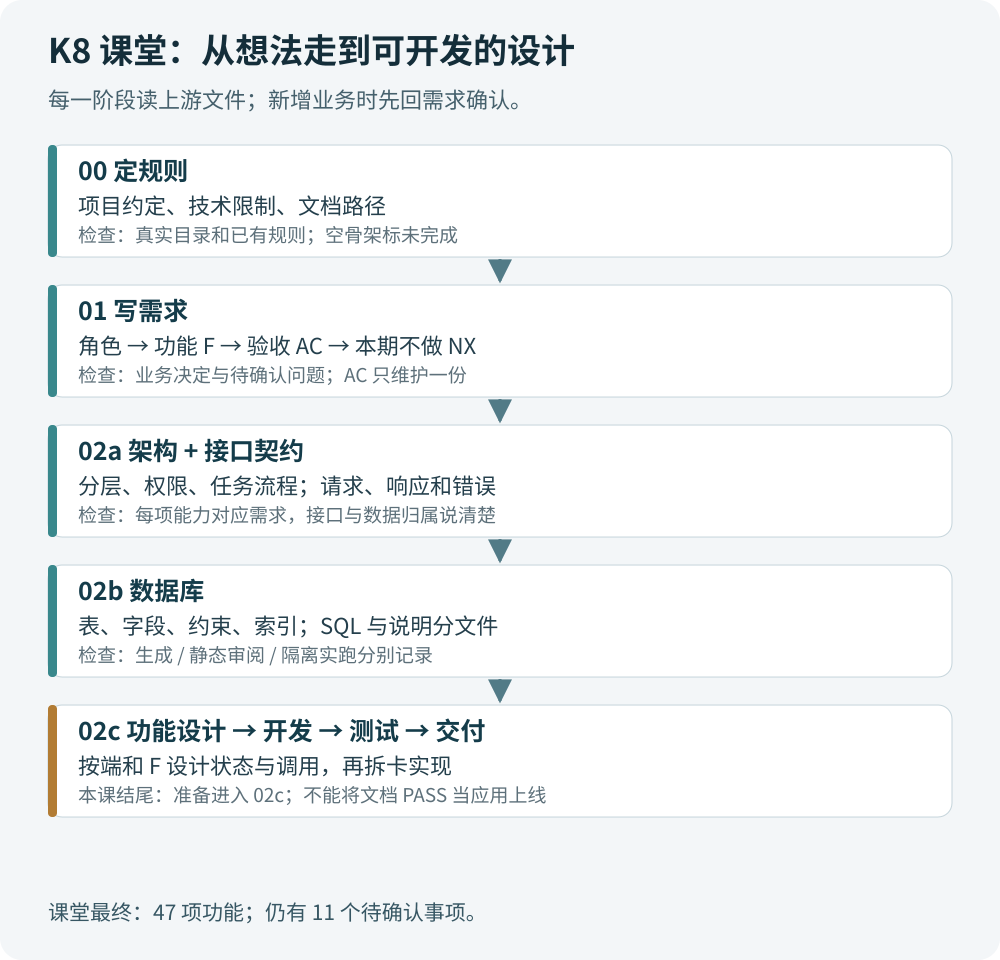

*整理图：本课做到需求、架构、接口和数据库设计，02c 及后续开发仍待推进。新增业务规则时，先回需求，再同步受影响的设计。*

| 阶段 | 开始前要读什么 | 这一阶段回答什么 | 完成后看什么 |
| --- | --- | --- | --- |
| 00 定规则 | 项目状态、已有文件、技术限制 | AI 在这个项目里按什么约定工作？ | CLAUDE.md、AGENTS.md 与文档目录索引 |
| 01 需求 | 原始想法、规则、已确认回答 | 谁要什么，怎样判定完成，本期不做什么？ | 功能 F、验收 AC、排除 NX、待确认 Q |
| 02a 架构 | 已确认需求、项目规则 | 前后端怎样分工，权限、任务、数据如何组织？ | 技术选型、分层、关键流程、决策与风险 |
| 接口契约 | 需求与架构 | 哪个调用收什么、返回什么、谁有权调用？ | api-spec.md；本课先补接口再建表 |
| 02b 数据库 | 需求、架构、接口契约 | 保存哪些数据，用什么约束保证一致？ | schema.sql 与表结构说明、验证记录 |
| 02c 功能设计 | 前面已对齐的文档 | 某个功能的页面、状态、调用和失败处理怎样落地？ | 按端、按 F 拆的设计与开发任务；本课尚未完成 |
| 开发、测试、交付 | 设计与任务 | 功能是否真的运行、符合 AC？ | 代码、测试结果、运行及部署证据 |

阶段编号是课堂项目的文件组织方式，不是所有团队都必须照搬的行业规范。接口设计和数据库设计可以相互迭代。本课在发现 API 文件为空后先补接口，这样建表时更容易检查登录状态、权限、分页和查询到底需要哪些字段。

每次交接时记下当前文档、依据的版本、本次改动和下一阶段输入。中断后从这份记录接着做。

<a id="k8-02"></a>

## 02 跟着操作：打开软件、选择目录、发送提示词

课堂用 **Hermes** 运行 AI 任务，用 **VS Code** 编辑提示词和文档，用 Windows 资源管理器确认文件。操作界面会随软件版本变化，下面保留录屏里的“项目管理”“新建会话”等名称；按钮位置不必完全一致。

1. 在资源管理器准备一个独立项目目录，例如 `D:\Projects\HkMs`。这是跟做示例路径，请换成自己的位置。
2. 打开 Hermes，建立或选中关联该目录的项目工作区。录屏约 00:01 从侧栏右键进入“分组 → 项目”，约 00:02 的“新建项目”可填写名称、添加文件夹和描述。已有项目就核对文件夹，不必重建；录屏目录名为 HkMs。
3. 打开 VS Code，选 `File → Open Folder`（文件 → 打开文件夹），打开同一个项目目录。把配套提示词放入项目的 `prompts` 文件夹，便于修改副本。
4. 打开本阶段 `.prompt`，填写项目情况，按 `Ctrl+S` 保存。文件扩展名 `.prompt` 只是文本材料的名字，不是双击后自动执行的程序。
5. 在 Hermes 的这个项目内“新建会话”，命名为“00 定规则”或“01 需求”。先确认当前目录，再粘贴填好的提示词全文；软件若支持文件引用，也可以引用文件，但要确认 AI 确实读到了内容。
6. AI 问问题时，保留编号回答，例如 `Q13：未作答计 0 分，显示未作答，本期不进入错题本。请回写需求和受影响的 AC。`
7. 回复显示完成后，回到 VS Code 查看真实文件、正文、修改差异。再检查阶段输出和待确认事项，决定能否交给下一阶段。

**编辑提示词、发送提示词、产生文档是三个动作。** 只在 VS Code 改字，AI 不会自动重新执行；只把文件名发过去，也不能保证它读到了全文；聊天回复里有一大段文字，也不能保证磁盘上的目标文件写好了。

录屏里还有另一个“新建项目”：约 00:03 从“项目管理”打开，填写项目名称、项目 ID、仓库路径和类型。要把**会话所在的工作区、磁盘目录、项目插件登记与看板**分开理解。约 00:53 工具仍提示项目尚未登记、看板不存在；约 02:18 老师选择先继续设计，暂不建看板。所以前面的两个弹窗不能照抄成“必须连续创建两遍项目”。跟做时先保证会话读写正确目录，推进到派卡时再检查所用插件的登记与看板状态。

课堂约 00:48 发现阶段会话还没切好。新开会话可以减少前一阶段无关对话的干扰，但新会话依然能读写同一个目录。交接时让它读实际文件，比把所有旧聊天重新粘贴一遍更可靠。

跟做时可以在 VS Code 的 `Terminal → New Terminal`（终端 → 新建终端）运行下面的只读命令：

```powershell
Get-Location
Get-ChildItem -LiteralPath .\docs -Recurse -File |
    Select-Object FullName, Length, LastWriteTime
Get-Content -LiteralPath .\docs\01-requirement\requirement.md -TotalCount 30
```

第一条确认目录，第二条看文件是否存在、是否为 0 字节，第三条看正文。文件不存在就先核对目录，不要让 AI 立刻重建一套。如果这是 Git 仓库，再运行 `git status` 和 `git diff` 看改动；尚未建 Git 的练习目录不适用这两条。

<a id="k8-03"></a>

## 03 00 定规则：先写约定，别把空骨架当成实现

00:07 左右，老师纠正顺序，先执行 00；00:09:43 发送定规则提示词，随后生成 CLAUDE.md、AGENTS.md 和 docs 骨架。画面回报 R01 至 R21 等规则，文档骨架中有 11 个空文件。

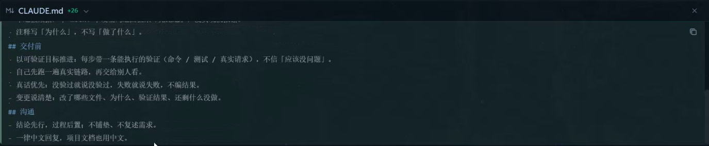

*00:11:35：正在写入项目规则。这里的真实执行、测试证据等是对以后工作的要求，不能算已经完成了业务测试。*

两个规则文件怎样分工，取决于所用代理及项目约定。课堂把沟通和交付习惯、技术栈和目录规则分开管理。对新项目来说，`routers/services/crud/models` 是准备采用的结构，不能写成“扫描现有业务代码得到的结果”。

00:20 左右出现从其他项目复制规则的操作。跟做建议是**比较后合并**：通用沟通习惯可复用，旧项目的语言、框架、目录和部署地址不能整段覆盖新项目已经确认的内容。空目录也不代表任何规则都能照抄。

课堂还讨论 Obsidian、MCP、Skill、Hook。可以这样分辨：MCP 等连接工具负责让代理访问某种能力；Skill 描述一类任务的工作方法；Hook 在特定事件触发动作。老师电脑已有相关配置，不等于新建项目后这些能力自动出现。想确认文件连接是否可用，就读一个明确存在的小文件；需要写入时在指定测试文件里写一句并读回，核对结果。

<a id="k8-04"></a>

## 04 为什么附件路径和录屏路径不同

附件的旧模板里能看到 `docs/01-requirement.md`，但录屏 00:52:45 实际打开的是 **`docs/01-requirement/requirement.md`**。后续文档采用目录式组织。直接照旧路径执行，可能得到两份名字相近、内容不同的“需求”。

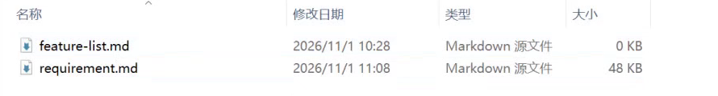

*00:52:45：requirement.md 已有内容，feature-list.md 此时还是 0 KB。要打开正文核对，不能只看文件名。截图裁掉了个人磁盘路径。*

本教程配套统一用下列路径。它们是跟做约定；接手已有项目时先找现存文件，再沿用或明确迁移，别静默创建第二套。

```text
HkMs/
  CLAUDE.md
  AGENTS.md
  prompts/                         你填写和发送的提示词副本
  docs/
    README.md                      文档入口、阶段状态、当前版本
    01-requirement/
      requirement.md               业务需求与 AC 的唯一事实来源
      feature-list.md              按 F 查看开发、测试进度的台账
    02a-architecture/
      architecture.md              架构决策与关键流程
      api-spec.md                  接口契约
    02b-database/
      schema.sql                   可交给数据库执行的 SQL
      schema.md                    表、字段、索引、F 映射与验证记录
    02c-feature-miniapp/            后续小程序端详细设计
```

`prompts` 是给 AI 的任务说明；`docs` 是项目的设计产物。改了前者，不代表后者已经更新。`feature-list.md` 的作用是查看进度，AC 明细只维护在 requirement.md，后面会解释课堂为什么撤掉 ac-index。

目录树也是整理后的目标结构，并非开场就有全部有效文件。03:07:55 的 README 修改画面显示，原来的 schema.md 已列为完整 DDL 与映射说明，这时才补列独立 schema.sql，要求它与说明中的 SQL 同源一致。不要把“早期没有独立 .sql”误判成此前完全没有做数据库设计；仍要打开当时文件查内容。

<a id="k8-05"></a>

## 05 01 需求：把“刷题系统”说到能判断对错

课堂原始场景是八年级生物、地理会考复习：学生用微信小程序测验，管理人员用网页维护教材、大纲、题目和出题规则；服务端保存答题、评分、错题与历史记录，主观题需要调用模型辅助评分。

“希望两科达到 90 分以上”是学习目标，软件不能保证每位学生的实际考试成绩。可验收的是软件行为：每科满分 100、按照规则组卷、正确计算得分、显示与 90 分目标的差距。目标和软件验收混在一起，会让验收永远说不清。

| 原始说法 | 还要追问什么 | 本课的明确化方向 |
| --- | --- | --- |
| 随机出题 | 按教材、科目、题型怎样抽？题量不足怎么办？ | 分开维护教材大纲、题库、组卷规则 |
| 多选题自动评分 | 漏选、错选、全对分别得几分？ | 课堂选择全部选对才得分 |
| 主观题交给 AI | 按什么要点给分？超时或错判怎么办？ | 评分要点、半分规则、复核/申诉、失败状态 |
| 限时测验 | 时间按哪一端为准？超时何时交卷？ | 需要确定计时、提交、未作答的行为 |
| 学生看成绩 | 看自己的还是所有人？历史是否随题库变化？ | 数据归属、历史记录和题目快照要进设计 |
| 系统显示与数据库一致 | 怎么证明一致？ | 用具体输入、页面、接口与记录逐项核对 |

老师约 00:32 统一叫“测验”，避免 AI 把“练习”和“测验”误建成两套业务。名词一旦确定，需求、接口、表说明和页面都沿用。

后台题库还涉及来源与质量。00:53 的 AI 初稿曾建议人工审核；老师随后选择免人工审核，01:01:55 回报改为入库即生效，并要求记录出处与抓取时间、支持题目失效。这是课堂方案的变化，不能把初稿的审核闸门写成最终已采用。**跟做建议**仍是确认可使用来源、教材适配、答案与解析质量以及生效条件；这些补充要经过自己的产品决定，不能冒充老师已经同意。

<a id="k8-student-flow"></a>

### 把分散的 F 串成一次完整测验

01:17 至 01:20 的 AC 摘要把业务细节集中展示了一遍。下面按使用顺序重排，并注明后来的变化，便于理解为何要有不同功能和数据记录。

| 顺序 | 课堂规定的行为 | 设计时需要一起检查什么 |
| --- | --- | --- |
| 后台准备题目 | 教材、大纲、题目、分值与组卷规则先就绪；主观题要有参考答案和评分要点 | 没有可用题目时不能生成一张表面正常的空卷 |
| 配置组卷规则 | 同教材、科目只启用一套规则；卷面合计应为 100 分，不符时拒绝保存 | 规则预览与实际组卷应一致；启用另一套要处理替换 |
| 学生开始测验 | 选择教材和科目；卷内不重复出同题，不出所选章节以外的题；题量不足有提示 | 不要为凑题数混进其他章节或静默重复同题 |
| 提交与评分 | 多选全对得分，少选或错选为 0；主观题按要点评分，可出现半分；结果总分应与逐题合计一致 | 未作答最终按 Q13：0 分、标未作答、不进错题本；主观任务失败走第 11 节 |
| 进入错题本 | 当时 F27 按判错的客观题登记；同题再次答错只增加错误次数，不重复增加条目 | 全对测验新增 0 条；学生不能读取他人的错题 |
| 做错题测验 | 只从自己的错题范围出题，记录标识为“错题本测验”；再答对不直接清空累计错误次数 | 连续答对次数与累计错误次数是两个计数 |
| 移出与重新进入 | 连续答对达到阈值后移出；中间答错则连续答对计数清零；移出后再错会重新进入，错误次数继续累计 | 03:29 的 F47 将移出阈值纳入配置，课堂默认 2 次，不写死成所有项目的固定规则 |
| 查看历史和趋势 | 历史题目顺序、答案和得分可回看，不能在回顾页修改答案；两科分开画图，满分各 100，差值为本次减上次 | 区分普通测验与错题测验；图表点数与记录列表一致，无记录时有空状态 |

例如同一道题先错、再对、又错，最后一次“错”会清零连续答对次数，但累计错误次数仍要增加。若把两种计数共用一个字段，就难以同时实现移出规则和历史统计。此例是对课堂规则的解释，不是本次实跑结果。

课堂还把“200 人同时作答、切题、交卷，成功率 100%，单次操作不超过 1 秒”写进需求验收。它是需要以后压测的目标，不是已经测出的性能。跟做还要明确设备、网络、请求构成、测试时长，以及同步请求耗时与后台评分等待时间分别怎样测。

<a id="k8-06"></a>

## 06 M、F、AC、Q、NX、TC：同一张表里各管什么

| 标记 | 含义 | 读法与作用 |
| --- | --- | --- |
| M1、M2 | Module，模块 | 把相关功能放在一起，比如题库、测验、系统管理 |
| F01、F35 | Feature，功能 | 项目内稳定编号；新增继续往后排，删掉的编号不拿来做别的功能 |
| AC-F04-1 | Acceptance Criterion，验收标准 | F04 的第 1 条验收，能给出通过或失败的判断 |
| Q13 | 待确认问题 | 还需要产品负责人选择的业务规则 |
| NX-01 | 本期明确不做 | 防止开发时把主动排除的内容当成遗漏 |
| TC-F04-1 | Test Case，测试用例 | 为验证 AC 设计的输入、步骤、预期结果；还要记录实际执行结果 |
| API-Fxx-n | 接口映射编号 | 帮助追踪功能需要的接口，不等于一项 F 只能有一个接口 |

`AC-F04-1～4` 是 F04 下的四条验收。它既不是四个模块，也不表示已经做了四次测试。AC 写得完整，只说明“知道该怎样检查”；TC 执行后有实际结果，才说明某项行为经过验证。

模块是分类，F 是稳定身份，因此一个模块不一定对应连续的一段 F。后补的 F34/F35 放入评分与结果模块，F36/F37 放入登录与个人信息模块，都不需要重排已有编号。

**NX 在本课有一个容易误读的例外。** 00:53:45 把“云端部署、本地测试”登记为 NX-10，文字明确说“移交架构阶段，不是取消”。跟做时应将“本期排除”“本阶段不展开，移交其他文档”“以后再决定”分开记录。部署约束即使不在业务功能列表里，也要保留出处并交给架构；不能只因看见 NX 就删掉。

<a id="k8-decisions"></a>

### Q 要按原编号回答，默认建议要保留状态

00:53 的阻塞问题只列出 Q01、Q02、Q04、Q05、Q07、Q08。它们是从完整清单中选出的子集，所以编号不连续；课堂输入过程中也发生过编号写错后改正。回答时用“编号＋问题短名＋决定”，例如 `Q04 多选计分：全部选对才给分，少选、错选均为 0。` 不要把屏幕上的第三个问题自行改成 Q03。

AI 曾写“其余按建议默认跑”，后续画面仍将这些项目列为待确认。推荐方案可以帮助继续非阻塞设计，但没有等同于已拍板。记录每个 Q 的建议、确认状态、影响及是否阻塞；明确回复后才同步业务正文与 AC。结尾 Q26 至 Q28 获得回答后，画面才把它们移入已拍板，最终仍有 11 项待确认。

下面是**整理补充示例**，用于理解形状，不冒充课堂原文件中的 AC 编号：

```text
功能：提交测验
谁用：已经登录且拥有这次测验的学生
AC 示例 1：交卷后，未作答题显示“未作答”，该题得 0 分。
AC 示例 2：按本期决定，未作答题不加入错题本。
AC 示例 3：网络重试不能创建第二份提交记录或重复计分。
TC 示例：准备含一道未作答题的测验，连续提交两次，
         检查结果页、错题本及提交记录是否符合上述预期。
执行结果：尚未执行，不能标 PASS。
```

Q13 是课堂一个容易遗漏的点：文档已经显示多项 PASS，老师仍在 01:42 追问未作答处理，最后选择“0 分、标未作答、不进错题本”。这个决定影响 F18、F20、F22、F23、F27。**检查器只能查它已编码的规则，不能替你决定遗漏的业务问题。**

反过来，FAIL 也要回到证据。01:41:25 的交叉核对回报修正了两处文档问题：把“计入总面积”纠正为“计入总分”，把 docs/README 的旧版本统计更新到当时版本。同时回报此前 7 条 FAIL 来自检查脚本对 AC 行缩进及章节切分的误判。遇到这种情况，先定位失败规则和原文，再决定改文档还是修解析器；不能直接删掉检查项让结果变绿。AI 同时写文档和检查器时，两边可能带着同一个误解。

<a id="k8-07"></a>

## 07 AC 索引为什么建了又删

01:15 左右，老师要求把验收单独汇总；01:19 出现 ac-index.md；01:22 又看到 requirement.md 的每个 F 下原本就有 AC。此时同一规则出现在两个地方，修改一份却忘了另一份就会冲突。

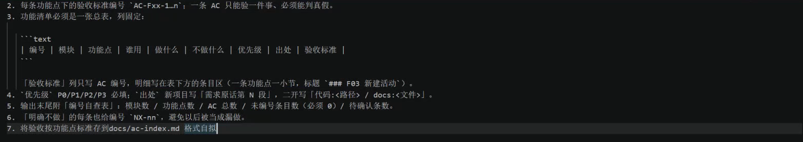

*01:22:25：这是正在编辑的需求提示词，不是生成后的需求正文。新增索引条款属于课堂中间版本。*

02:33 决定退役 AC 索引，02:34:50 回复称已移除索引及其生成器，检查器由 43 项调整为 39 项，requirement.md 成为 AC 的唯一来源，feature-list.md 继续承担进度台账。

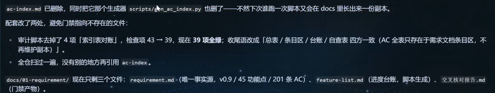

*02:34:50：课堂回报退役 ac-index。这里的 45 功能、201 AC 是当时统计，后面还会继续增长。*

跟做时先搜引用，再处理文件。需求文档、架构、README、脚本或其他提示词若还引用 ac-index，需要一并改到真实来源。若你已有独立维护的索引，先比较是否有只存在于索引的内容，保留备份或版本记录后再合并；不要把课堂的删除操作当成通用清理命令。

可以保留自动生成的只读视图，但要明确“来自哪份文档，如何重新生成”，并保证人工更改不会被下次生成覆盖。本配套默认不另建 AC 索引。

<a id="k8-08"></a>

## 08 功能为什么一直增加：把版本放回时间线上

下面数量来自课堂回复和文档画面，用来定位变化，不是整理者拿到完整项目后重新统计的结果。

| 视频时间 | 需求阶段结果 | 这次主要改变 |
| --- | --- | --- |
| 00:53 左右 | 初稿：33 F、127 AC | 8 个模块，仍有待确认事项 |
| 01:01:50 | v0.2：34 F、133 AC | F34 主观题复核/申诉 |
| 01:14 左右 | v0.3：35 F、141 AC | F35 成绩分享 |
| 01:26:40 | v0.4：35 F、144 AC | 继续细化分享行为 |
| 01:27 至 01:40 | v0.5/v0.6：37 F、156 AC | F36 学生反馈、F37 后台处理反馈 |
| 01:43:51 | v0.7：37 F、157 AC | Q13 未作答处理回写 |
| 02:16:50 | v0.8：38 F、165 AC | F38 模型接入配置 |
| 02:30:55 | v0.9：45 F、201 AC | F39 至 F45，后台账号、角色、权限等 |
| 02:42 左右 | v0.10 | 补充系统管理相关决定，架构同步 |
| 03:29:51 至结尾 | 最终 v0.12：47 F | 新增 F46 解绑、F47 运行参数，调整登录和用户管理 |

没有把最后的 AC 总数填上，是因为所核对画面没有可靠给出最终合计。不能把中途 201 条当终值，也不能仅凭新增条数推算。

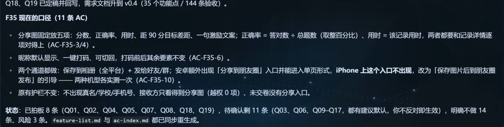

*01:26:40：F35 明确分享分数、正确率、用时、距 90 分目标差距及鼓励文案；昵称支持打码，排除真名、学校、手机号。*

课堂此时采用 Android 朋友圈入口、iPhone 保存图片引导的策略。**这是课堂当时的产品方案。** 分享能力会受微信版本、基础库及设备影响，落地前应查当前官方文档并真机验证，不能把录屏里的平台差异写成永久限制。本次未成功读取微信官方分享文档，未把该差异作为现行规则背书。

<a id="k8-feedback"></a>

### F36/F37 的“处理反馈”到底处理到哪一步

01:37:25 的 v0.6 回报已经接受 Q20/Q21：学生提交意见，管理员在后台查看并标记已处理；学生只看到“待处理 → 已处理”，看不到后台备注，也没有管理员回复入口。不要因为名字叫“反馈”就自动加聊天、回复提醒或客服会话。

当时还明确不收截图附件、不导出、不做统计报表，文本 10 至 500 字、同一学生每天最多 5 条。到 03:29，F47 把反馈字数、每日次数等阈值纳入后台配置；因此前面的数字应理解为课堂默认值，具体边界按当前配置校验。修改阈值后，要核对前端提示、服务端校验与配置读取是否同步，不能只有输入框提示变化。

版本号用于描述文档演进，功能数用于查遗漏，二者都不是成绩单。不要为了“补齐数量”凭空添加功能，也不要看到 v0.12 就认为它比别的项目 v1.0 更不完整。

<a id="k8-09"></a>

## 09 架构都写完了，又想加功能，该回哪一步

本课有两次典型往返。第一次是架构阶段提出“模型地址、协议、模型名应由后台配置”，这会增加一个管理员使用的功能，于是需求追加 F38。第二次是发现缺少后台改密、用户、角色、菜单、权限和日志；老师先发到架构会话，随后停下，回到需求会话补 F39 至 F45。

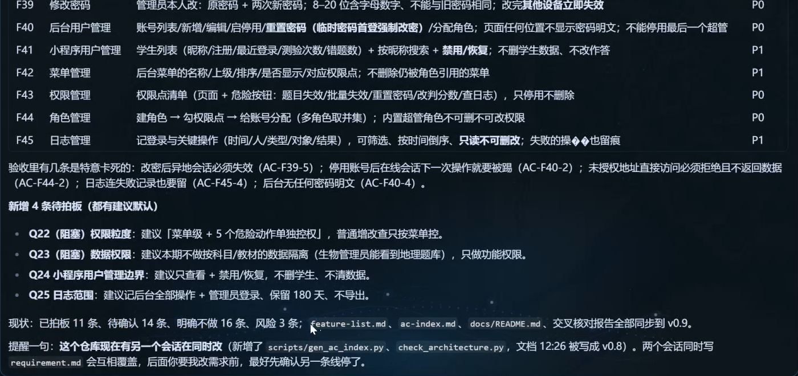

*02:30:55：需求增加 F39 至 F45。截图 F45 附近有局部替代字符，阅读时以明确的“日志管理”上下文核对，不把损坏字符照抄进模板。*

新增功能带来新的使用者、操作和验收规则，所以先写进需求。架构再决定如何实现它。否则你会遇到“架构里有菜单权限，但需求里找不到谁能管理菜单”的断层。

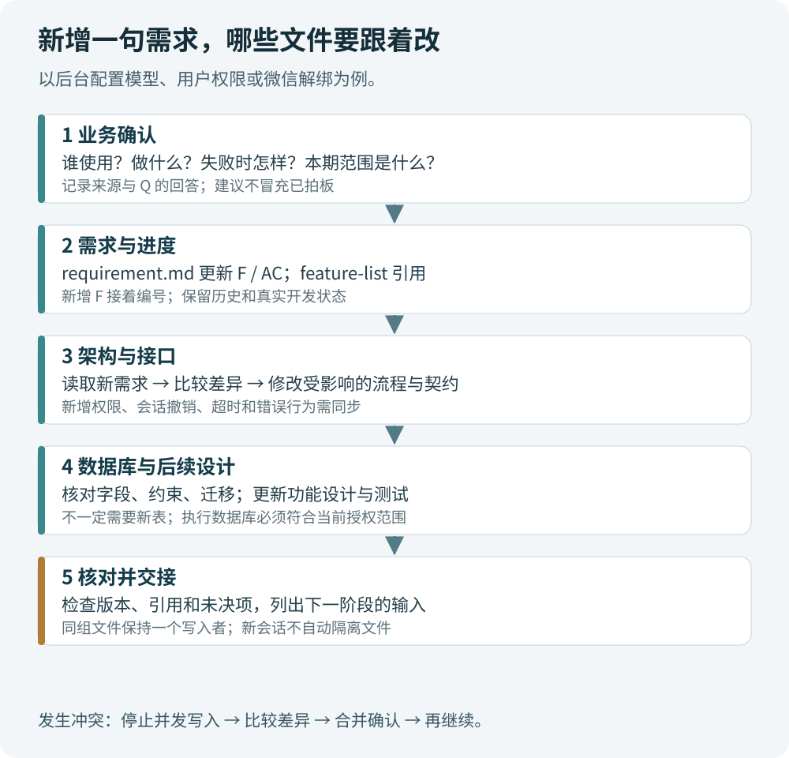

*整理图：先确定业务变更，再按影响同步架构、接口、数据库和后续设计；每一站都读上游更新后的文件。*

按本课 F38 的例子，跟做可以分成这些动作：

1. **在需求会话说明变化。** 管理员能够配置模型连接；确认谁能改、哪些参数、怎样测试连接、失败怎样提示、谁能看到密钥。
2. **写入 F 和 AC。** 保留旧编号，新增 F38；若是修改既有行为，则修改相应 AC 并留变更记录。同步 feature-list 的进度，不自动把开发标完成。
3. **让架构会话读取新版本。** 比较变化，补模型调用适配、超时、密钥存储和访问权限。课堂同时支持 OpenAI 兼容协议与 Anthropic 协议，这是拟实现的适配范围。
4. **同步接口。** 管理端如何保存配置、如何测试连接；普通查询是否只返回掩码；哪些失败需要错误码。
5. **同步数据库。** 配置存哪张表，字段上限与唯一约束是什么，审计信息如何关联。
6. **列出受影响的测试。** 无权限用户能否改配置、返回值是否泄露密钥、超时是否进入预定失败状态。

课堂约 02:27 至 02:33 还发生需求会话和架构会话同时写同一目录的情况。**会话不同，文件并没有隔离。** 实际跟做应停止其中一个写入者，检查已写入的差异和版本，然后让一个会话完成并交接，再启动另一个。不能根据“我刚点击取消”就假设它完全没有落盘。

可复制的交接语句：

```text
本次只做增量同步。先读取现有规则和文档，不重建目录，不重跑整套问卷。
已确认变化：……
需求来源：docs/01-requirement/requirement.md，版本：……
涉及功能：……
请先列出对架构、接口、数据库、功能设计和测试的影响。
本会话仅修改：……
其他会话已停止写入。保留已有编号和未受影响的决定。
完成后列出修改文件、验证证据、未完成项和下一阶段交接信息。
```

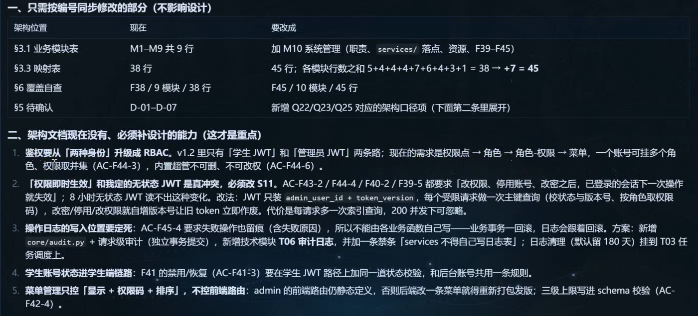

*02:37:33：架构会话先列 38 项增至 45 项功能的差异，再说明需要调整的模块、权限与流程。整套问卷不必从头重复。*

<a id="k8-generator"></a>

### 同步时还要找到生成源，不能只改成品文档

03:07:55 的目录索引注明：api-spec.md 对应 `scripts/gen_api_spec.py`，数据库文档对应 `scripts/gen_schema.py`，另有各自检查脚本。它们是课堂项目的产物，本资料包没有附上这些原始脚本。接手自己的项目时先看文件头和索引，确认哪些内容手写、哪些由脚本生成。

若直接改生成后的 Markdown 或 SQL，却没改生成源，下次运行脚本可能把修订覆盖。一次交接要写清“需求决定 → 生成源 → 生成文件 → 检查结果”的关系；涉及技术约定时还要同步 AGENTS 等规则与 README 版本索引。进度台账中的人工备注、开发状态和测试证据要保留。检查器只能随着已确认的规则调整，不能为了匹配一份错误产物而放宽标准。

<a id="k8-10"></a>

## 10 02a 架构：前台、后台、服务端各在哪里

课堂选定的方案是：学生端用原生微信小程序，管理端用 Vue 3、Element Plus、Vite；服务端用 Python 3.12、FastAPI、SQLAlchemy 2.0 同步 Session 和 Alembic；数据库用 MySQL 8.4 LTS。模型调用走云端 API。这里只是在讲本课选择，不要求每个练习项目都用相同技术。

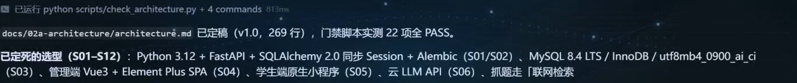

*02:05:05：架构 v1.0 回报 269 行、22 项检查 PASS，并列出技术选型。文件检查通过不代表这些服务已经部署。*

两个“后台”容易混：**管理后台**是管理员点击按钮的网页；**后端服务**是接收请求、校验权限、处理业务并访问数据库的程序。学生小程序和管理员网页都调用后端，用户浏览器不应拿到数据库账户直接查表。

课堂后端目录的依赖方向是：

```text
小程序 / 管理网页
        ↓ HTTP 请求
routers     接收请求、参数校验、组织响应
        ↓
services    执行业务规则，明确事务提交/回滚边界
        ↓
crud        查询、插入、更新数据
        ↓
models      ORM 数据模型，映射数据库表

schemas     请求与响应的数据形状
core        配置、数据库会话、鉴权等公共能力
```

比如“交卷”不能只在路由里写一句“保存分数”。Service 要检查测验属于当前学生、是否已经提交、是否超时，决定评分和状态变化；CRUD 负责具体数据访问；事务让应一起完成的更新保持一致。课堂目录叫 `crud`，它承担数据访问职责；不要因为别的教程叫 Repository，就在同一项目里又建第二套平行目录。

SQLAlchemy 的 Session 是代码访问数据库时管理操作状态的对象；Alembic 管理数据库结构的版本迁移。生成一个 schema.sql 解决的是“这版结构长什么样”，以后已有数据的数据库怎样安全升级，还需要迁移设计。

单机 Docker Compose 中 nginx、API、worker、MySQL 的安排及每日备份属于架构规划。`nginx` 接收外部请求并转发；Compose 组织多个服务。录屏说了部署方案，不等于已经完成云端部署或恢复演练。

部署方案也有后续修订。02:21 左右确认复用已有服务器，画面要求复用宿主机 nginx、项目只启动自己的 API、worker、MySQL 容器，并隔离备份目录；不能把早期“四个组件”的示意照抄成再起一套占用现有端口的 nginx。跟做部署前核对已有服务、域名指向、可用端口与 Docker 状态，只更新本项目服务。

日志的两个数字对应不同对象：02:03:35 的早期架构写容器 stdout/日志文件保留 30 天；02:57:25 的架构正文写操作审计保留 180 天、独立事务提交。这两个时间点的文字不构成直接冲突，但最终实施仍需分别确定容量和清理方式。备份同样要区分“安排每天备份”和“已经验证可以恢复”。

<a id="k8-11"></a>

## 11 主观题为何要 jobs 和 worker

客观题可以按确定规则快速评分。主观题调用模型会遇到等待、限流、超时和服务失败；让浏览器一直卡在一次请求里，会使重试、掉线和重复提交更难处理。课堂因此设计后台任务。

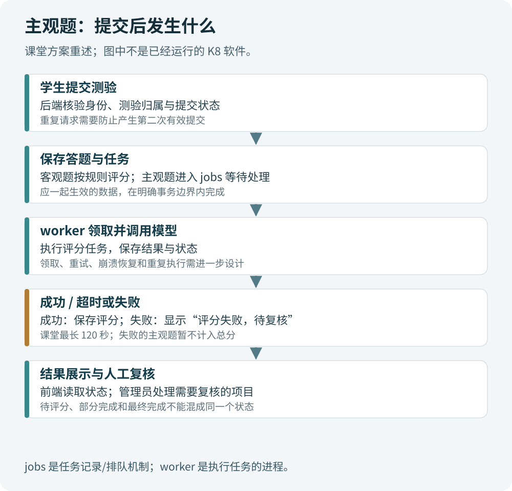

*整理图：根据课堂 jobs/worker 和超时复核方案画出流程；幂等领取、重试上限和结果冲突处理是实现时还需核实的事项。*

`jobs` 可以保存“哪个任务在等待、谁领取了、何时开始、失败原因”等状态；`worker` 是读取并执行任务的进程。它们不是同一种东西，也不能把 worker 直接理解成消息队列。课堂选择怎样存任务，应以架构为准，不能因为听到后台任务就自行加 Redis 或 Celery。

02:00 至 02:03 的图中，worker 还负责**自动抓题批次**，不只负责主观题判分。02:57:25 的架构正文写明 worker 轮询 MySQL 的 jobs 表，本期不引入 Redis；这是本课的选型，不是所有系统的限制。按这套设计，状态返回路线应是：学生或管理员提交请求 → API 记录任务 → worker 执行并写回结果 → 前端经 API 查询状态。前端不直接连接 worker 或 MySQL；工作进程没有面向用户的外部入口。

课堂 F38 的补充规定包括最长 120 秒，失败显示“评分失败，待复核”，暂不计入总分，进入管理员复核清单。整理补充：结果页需要区分“待评分”“已有部分结果”“全部完成”，不要把尚未评分的题悄悄按零分展示为最终成绩。

实现时还要确认：两个 worker 能否同时领取同一任务；重复提交是否生成重复任务；worker 中途退出后如何恢复；管理员已经复核后，迟到的模型结果是否还能覆盖。文档里只有“异步评分”四个字，解决不了这些问题。

<a id="k8-review-flow"></a>

### 自动评分失败与学生主动申请复核，要分别设计入口

F38 的“评分失败进入管理员清单”和 F34 的“学生对主观得分申请复核”来源不同，后续可以共用部分处理能力，但不能漏掉其中一种入口。01:01:55 与 01:19:55 的画面给出了 F34 的边界：本期客观题不开放复核；学生提交后显示“复核中”，不能重复提交；管理员改判要填写理由，学生可以看新分与理由；总分随改判更新，仍应等于逐题得分之和。维持原分时也要让学生看见结果，不能再对同一项重复申请第二次。

跟做时把“申请提交、受理中、改判或维持、结果可见”写成状态，再核对页面、接口、评分记录和历史总分。只增加一张 review_requests 表，不能自动完成这条流程。复核权限和改判留痕也不能只靠前端按钮控制。

FastAPI 自带 `BackgroundTasks`，也提供更重后台任务工具的说明，但这不自动等同于具备持久任务记录、崩溃恢复和重试的系统。这里是否需要独立 worker，应由本项目的可靠性要求决定。[FastAPI 官方后台任务文档](https://fastapi.tiangolo.com/tutorial/background-tasks/#caveat)

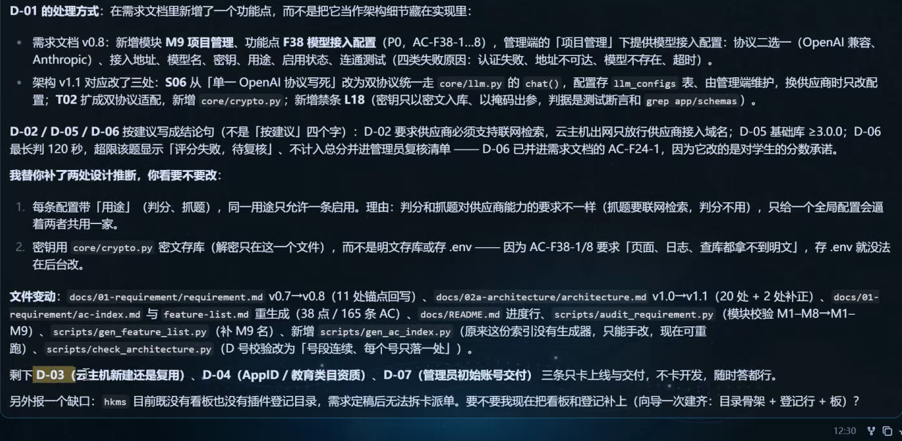

*02:16:50：F38 进入需求，架构随之更新；同一次变更还涉及评分超时、配置权限和密钥处理。*

<a id="k8-12"></a>

## 12 后台权限与接口：按钮藏起来还不够

F39 至 F45 分别补了管理员修改自己的密码、后台用户管理、小程序用户管理、菜单管理、权限点、角色管理和日志管理。课堂后来确定使用 **RBAC**，即按角色授予权限；同一个后台用户有多个角色时取权限并集。

可以用一个补充例子理解：题库编辑角色可以维护题目，账号管理员角色可以管理后台用户。某用户兼任两个角色，就得到两组权限。菜单可见性用于整理界面，危险按钮还需要操作权限，后端每次请求仍要检查；只隐藏按钮无法阻止别人直接发请求。

课堂进一步确认：权限控制到菜单和危险操作；后台数据本期不按科目隔离；内置超级管理员需要保护；操作日志保留 180 天。**学生端不套后台 RBAC，仍然要登录并校验数据归属。** 学生 A 不能只换一个成绩 ID 就读取学生 B 的成绩。

改密码、禁用账号或变更权限后，旧登录是否立即失效？课堂设计用会话/令牌版本与每次请求的状态检查处理。仅给 JWT 写一个未来过期时间，无法自然解决“现在就禁用”的问题。失败操作的日志还应有明确的独立记录策略，避免主业务回滚时把失败日志一起撤销。

02:42 左右，需求和架构已有内容，api-spec 与数据库文件却仍为空。老师决定先生成接口契约。02:46:35 的回复列出 77 个端点，覆盖当时 45 项功能，并列出权限码和错误码。

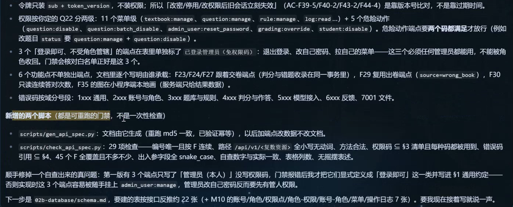

*02:46:35：接口文档已经生成。77 是当时的接口数量，不是必须凑到的标准，也不代表接口已经实现或可调用。*

读一个接口时至少找这些信息：方法与路径、调用者、所需权限、输入字段与范围、返回结构、失败码、重复请求的行为、数据归属。没有这些约定，前端和后端可能都“按自己的理解做完”，却接不起来。

**一个 F 可以使用多个接口，一张表也可以支持多个 F。** 例如查看测验结果、生成分享图、提交复核都可能读取同一次测验；不应为每个功能机械新建一张几乎相同的表。下载包中的贯穿示例把 F、AC、API、数据和 TC 放在一张表里，但接口路径标明为教学示例，未冒充老师的完整 API 文档。

<a id="k8-13"></a>

## 13 02b 数据库：表、索引、主键和外键怎么读

DDL 是 Data Definition Language，指建立或调整表结构的 SQL。生成 SQL 文件只是在磁盘上写下语句；数据库收到并执行后，才真正有那些表。

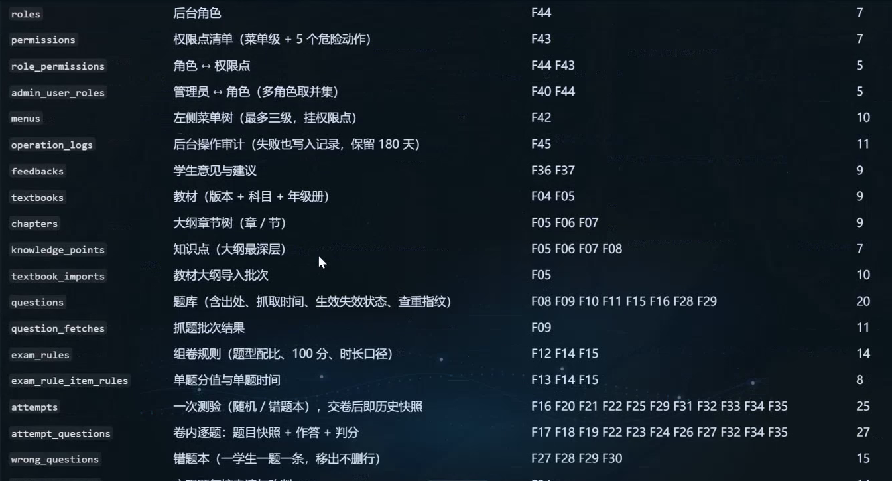

*03:11:33：画面把 roles、permissions、textbooks、questions、attempts 等表与职责、F 编号关联。一张 attempts 表服务多项测验功能。*

课堂数据库问题后来确认：一行教材代表版本、科目、年级册的组合；大纲按章、节、知识点组织；主观题答题上限为 1000 字；运行参数应能在后台修改。后面这一条最终成为 F47，说明“字段怎么存”的讨论也可能暴露尚未登记的功能。

<a id="k8-history"></a>

### 题目失效、错题移出、历史快照是三件事

01:17 至 01:20 的规则与 03:10:25 的数据库回报可以对起来看：题目失效后不再进入新卷，旧测验仍能完整回看；恢复生效后可重新选题，历史条数不变。错题移出则改变该学生的当前错题列表，不删除累计错误次数与历史作答。课堂明确回报这两类操作都只改状态，不删行。

题库题目后来改了答案，也不应把以前已判的卷子悄悄重写。教材停用后不再出现在新的选择中，旧记录仍应显示原教材名。由此才需要讨论当时题目、答案、评分及名称如何保存快照。若以后要批量纠正旧成绩，应另行规定更正流程与记录，不能把“查看历史”顺手做成重新判卷。

还有两项具体的数据库约束：同用途只能有一条启用的模型配置；同教材、科目只能有一条启用的组卷规则，停用记录可以并存。03:10:25 回报尝试插入第二条启用记录时被唯一约束拦住。它说明数据库验证可以直接检查业务规则，不能只数“创建了多少张表”。这是课堂回报，本次未独立执行该 SQL。

| 概念 | 保证什么 | 简化例子 |
| --- | --- | --- |
| 主键 PRIMARY KEY | 唯一标识一行，不能重复或为空 | student_id 标识某个学生档案 |
| 复合主键 | 多个字段共同唯一标识一行 | 一对 role_id、permission_id 不重复 |
| 唯一约束 UNIQUE | 某个业务组合不能重复 | 是否允许同一手机号对应多档案，由业务决定 |
| 外键 FOREIGN KEY | 引用的关联记录必须存在，并规定更新/删除关系 | role_permissions 的 role_id 引用 roles |
| 普通索引 | 帮助特定查询，不能代替业务正确性 | 按学生和时间查测验历史 |

**复合主键不能替代外键。** 假设角色表只有角色 1，关联表插入 `(role_id=999, permission_id=2)`，这个组合此前没出现过，复合主键检查可以通过；但角色 999 并不存在，外键处理的正是这种引用一致性。MySQL 8.4 仍支持外键，不能概括成“外键过时了”。[MySQL 8.4 外键约束文档](https://dev.mysql.com/doc/refman/8.4/en/create-table-foreign-keys.html)

课堂后期提示词有“禁止外键，必要时使用复合主键代替”的表述，需要修正。项目可以明确选择不加数据库外键，但应说明由哪层校验引用存在、怎样处理删除、怎样保护并发事务，并补对应测试。复合唯一约束仍可用于防重复，这与是否使用外键是两个决定。

另外几个容易混的细节：

- 索引要对应查询，比如“按学生、科目、提交时间查看历史”，不能为了看起来专业给所有字段都加索引。
- 用户密码保存带盐的专用密码哈希。模型 API 密钥需要在调用时使用，不能套用不可逆密码哈希的方案，应按密钥管理策略保存、限制访问和掩码展示。[FastAPI 密码哈希说明](https://fastapi.tiangolo.com/tutorial/security/oauth2-jwt/#password-hashing)
- 东八区是 UTC+8，UTC 本身不是东八区。约定存储、接口传输和页面显示的时间策略，避免把“UTC 时间”和“北京时间”写成同义词。
- `schema.sql` 只放可执行 SQL 及合法 SQL 注释；表清单、F 映射、设计解释和验证记录放 `schema.md`。不要把 Markdown 表格直接混入 `.sql`。
- 空库创建脚本不能直接代替线上升级脚本。已有数据时，要审查迁移、回滚与备份恢复，不能为了重跑建表随手删库。

<a id="k8-14"></a>

## 14 “生成 SQL”与“真的建表”：本课实际发生了什么

这一段必须按先后读。录屏不是始终只生成文本，也没有证据表明它直接改了正式业务库。

| 时间 | 课堂画面里的结果 | 能说明什么 |
| --- | --- | --- |
| 03:04 左右 | 仍在生成、检查 | 此时还不能记为最终完成 |
| 03:08:56 | MySQL 8.0.46 隔离容器空库执行；24 表、287 字段、89 索引，settings 11 行 | SQL 已在这个版本的测试环境运行；8.4 镜像当时下载较慢 |
| 03:20:33 | MySQL 8.4.13 隔离容器补跑，退出码 0；同样 24/287/89 | 按目标 8.4 环境补了验证，不能拿先前 8.0 结果冒充 |
| 03:26 至 03:28 | 老师向提示词补入“未经同意不落库，只生成 SQL” | 这是后补的执行约束，不能倒推此前没有执行 |
| 03:29 后 | 微信需求增量后再次回报 8.4.13 验证，24 表、290 字段、90 索引 | 结构随新需求变化；旧统计不再是最终结果 |

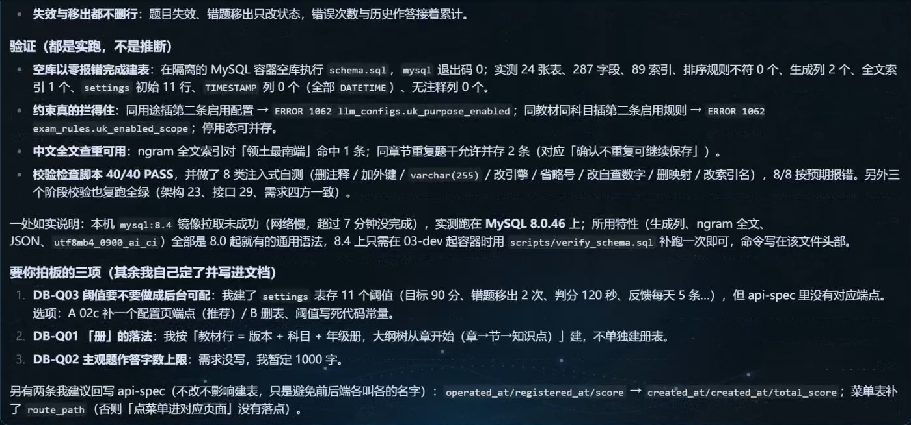

*03:08:56：课堂工具回报第一次用 MySQL 8.0.46 验证，列出结构统计与尚待拍板的问题。*

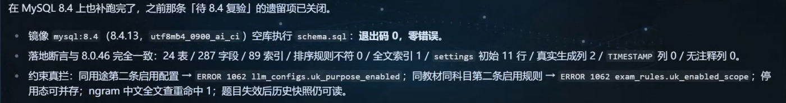

*03:20:33：在 MySQL 8.4.13 环境补跑并回报退出码 0。截图只保留结果区，裁掉了个人命令路径。*

这里还有一个统计口径修正：验证脚本原先用 `extra LIKE '%GENERATED%'` 统计生成列，把带 `DEFAULT_GENERATED` 标记的默认值字段也算进去，后来改按 `generation_expression` 统计，回报实际生成列为 2。排查数字变化时要检查统计条件，不能一见计数改变就认定表被错误修改。

03:10 左右提到的“8 类注入式自测”，指故意删除注释、修改引擎或索引名等，查看检查器能否报出预期错误；它是在验证检查脚本。不要把这句话理解为已经完成 SQL 注入安全测试，更不能据此判断整套应用的安全性。

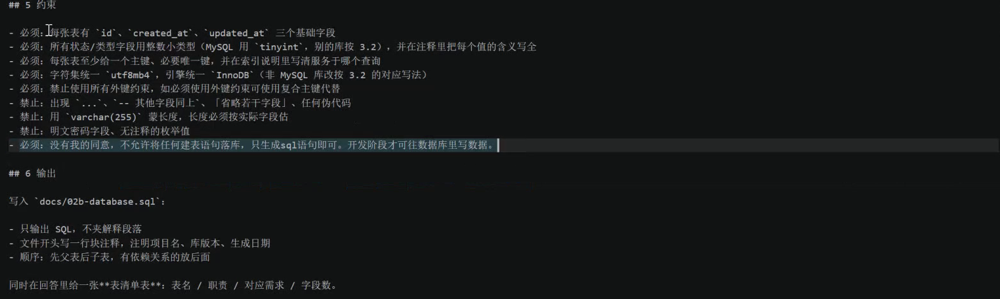

*03:28:09：模板新增“没有同意不落库”的限制。图中“复合主键代替外键”仍属原课件错误说法，按上一节的解释修正。*

跟做时，把四种状态写清楚：

1. **生成。** 只把 SQL 和结构说明写入指定文件。
2. **静态审阅。** 检查语法形状、命名、类型、约束、索引和需求覆盖；没有连接数据库就写“未执行”。
3. **隔离环境执行验证。** 明确数据库版本、容器/实例、空库名、允许动作和是否允许写测试数据，再执行并保留命令、退出码、错误和结构统计。
4. **正式环境变更。** 按独立的迁移、备份、回滚和发布流程处理。空库跑通只证明一部分结构可执行，不能证明旧数据升级无损。

课堂中老师提到本机已经有 MySQL，不能据此推断验证直接写入其现有业务库。高清画面明确回报的是隔离容器。本次整理也没有得到老师最终 SQL 源文件，因此上述版本和执行统计是**课堂证据回报**，不是整理者独立重跑后的测试结论。

配套 02b 提示词默认只生成与静态审阅；若要验证，应明确填写验证环境和动作范围。限制了不连接数据库，就不能同时要求 AI 必须交出“空库实跑 PASS”。

<a id="k8-15"></a>

## 15 微信登录、解绑、重绑：不要把手机号当密码

数据库设计接近完成时，老师继续补微信登录、手机号、最后登录时间和解绑。03:29:51 的回复新增 **F46 解除微信绑定** 与 **F47 运行参数配置**；已有 F01 登录和 F41 小程序用户管理的 AC 也增加了。

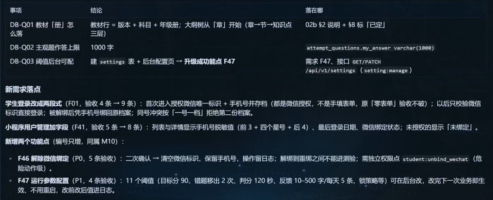

*03:29:51：新增 F46、F47；原来的登录、用户管理同步调整。此时应从 45 项更新为 47 项功能。*

随后老师确认了三个业务决定：本期一个手机号对应一个学生档案，不做多个孩子的家庭号；后台手机号一律脱敏，没有查看原文的入口；重绑不需要管理员人工确认。这些是本产品的范围选择，不能当作所有教育产品都适用的方案。

原始提示词写过“以后直接校验微信 ID”“用手机号作为唯一校验字段”。这里需要补全身份验证流程。**知道某个 openid 或手机号字符串，并不证明请求者拥有该微信身份或手机号。** 服务端必须验证可信凭证，不能接受前端随便传来的标识就登录或改绑。

下面是**实现前需要确认的安全流程示例**，不是本次已经开发完成的代码：

```text
首次登录
  小程序取得登录凭证 → 交给自己的服务端
  → 服务端按平台机制核验身份
  → 需要手机号时核验手机号授权凭证或等效证明
  → 查找/创建学生档案 → 建立绑定 → 签发本系统会话

解绑
  校验操作者及操作权限 → 解除微信身份与档案的绑定
  → 使旧会话失效 → 保留 student_id、成绩、错题和历史

重绑
  核验新微信身份 + 对手机号的实际控制权
  → 检查既有绑定和冲突 → 按已确认业务规则绑定原档案
  → 记录审计信息 → 签发新会话
```

“自动重绑”意味着通过系统规则完成核验，不等于跳过核验。还需要评估号码回收、号码变更、已有绑定冲突的处理；本课的一号一档选择不能替代这些边界设计。稳定的 `student_id` 才是保留成绩和错题历史的依据，手机号与微信身份是可变化的绑定信息。

开发时应查 [微信小程序登录文档](https://developers.weixin.qq.com/miniprogram/dev/framework/open-ability/login.html) 和 [获取手机号文档](https://developers.weixin.qq.com/miniprogram/dev/framework/open-ability/getPhoneNumber.html)，核对当时账号资格、授权方式和接口参数。本次自动检索未能成功读取这两个官方页面，所以上面只说明身份核验原则，不声称验证了现行微信接口细节。

<a id="k8-16"></a>

## 16 黄框、空白方框、乱码分别怎么处理

约 01:03，feature-list.md 中出现很多黄色框，乍看像乱码。高清画面显示中文主体可读，VS Code 当时启用了非 ASCII Unicode 字符突出显示。表格中的方框也可能是未勾选标记或字体没有对应字形。

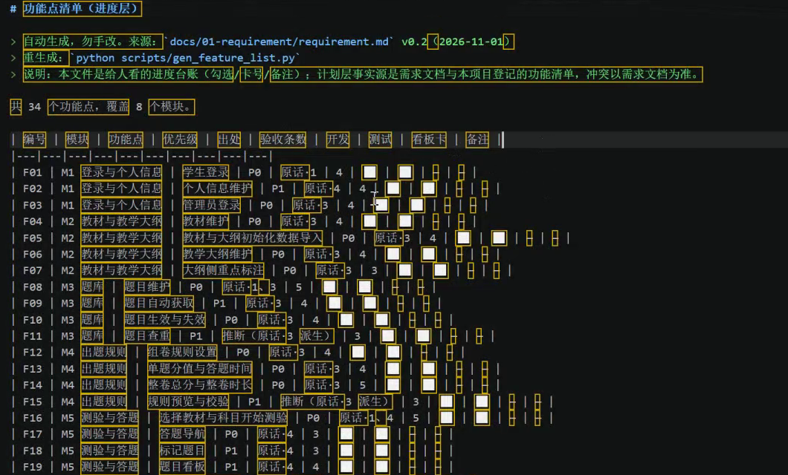

*01:02:57：中文主体能读，黄色边框本身不是编码损坏。开发、测试等进度列里的方框也不代表相关功能已经完成。*

| 现象 | 先判断什么 | 建议操作 |
| --- | --- | --- |
| 中文读得懂，只是黄框多 | Unicode 突出显示 | 看 VS Code 的提示条，按需调整高亮；不必改文件编码 |
| 个别符号是空方框 | 字体缺字或原本就是复选框 | 复制该符号查看原字符，换支持它的字体，或改用普通待办标记 |
| 大段中文变成奇怪字符 | 可能用了错误编码解码 | 先备份，点状态栏编码，选 `Reopen with Encoding`（通过编码重新打开）尝试正确编码 |
| 正文出现 `�`，重新打开也无法恢复 | 文件字节可能已经被错误转换并保存 | 从历史/备份恢复，或对照可靠来源重写受损段；仅“保存为 UTF-8”不会找回丢失文字 |

本课 02:30:55 的 F45 行能看到局部替代字符，确实需要修复。但这不能反过来证明此前所有黄色框都是乱码。**先判断显示问题还是文件内容问题，再决定操作。** 不要在错误解码状态下直接覆盖保存原文件。

<a id="k8-17"></a>

## 17 几处插话怎样理解，哪些不属于必做步骤

本课有模型切换、等待路由、看其他项目、查看 UI 参考网站等插话。它们帮助老师解决当时环境问题，但不都属于 K8 开发流程。

| 课堂话题 | 跟做时应怎样理解 |
| --- | --- |
| 换模型、调路由、重发任务 | 先读错误与已经写入的文件。模型中断不等于文件全没写；换模型也不保证需求一定正确 |
| 把开发卡片拆得很小 | 有助于限制范围和检查结果，不能保证零 bug；跨卡片的状态与接口仍需测试 |
| UI 网站和其他项目展示 | 是参考或插话，不能当成这套 K8 小程序已经做完界面 |
| 已产生管理员凭据文件 | 只是初始化安排；没有实际登录验证就不能说管理员已经能登录 |
| 根据答题分析薄弱章节、推荐强化练习 | 02:20 至 02:21 的后续设想；不能仅凭这段口述算进本期已确定的 47 项功能，更不能写成已经实现 |
| 宝塔、Serverless | 宝塔属于服务器管理工具；Serverless 描述另一类运行与资源管理方式，二者不是同义词 |

管理员初始化也要按步骤理解。02:21:25 的画面回报生成了随机初始凭据，并规定首次登录强制改密、入库仅保存密码哈希；当时还提示本地凭据文件需在建立 Git 后加入忽略列表。**生成交付文件、实际初始化账号、成功登录、首次改密**是不同动作。跟做时逐项核验，凭据文件不要随教程或源码包公开；已有提交记录里的敏感内容也不会因为后来加了忽略规则就自动消失。

备案讨论也需拆开。中国境内互联网信息服务的许可/备案要求依业务而定，非经营性备案制度涉及组织或个人，不能笼统说“个人一律不能备案”。教育等具体服务还需按适用要求核实，不能凭课堂几句话判断所有资质。[工信部《非经营性互联网信息服务备案管理办法》](https://www.miit.gov.cn/gyhxxhb/jgsj/cyzcyfgs/bmgz/xxtxl/art/2024/art_84a0cfa0ebd049bbbe751dca9a008e56.html)

TLS 证书解决加密与身份验证相关问题，ICP备案是另一套要求。例如 Let's Encrypt 的 DNS-01 通过 DNS 记录验证域名控制权，由此可知“必须先 ICP 备案才能在技术上签发任何证书”不成立。拿到证书也不代替服务所需备案。[Let's Encrypt 验证方式](https://letsencrypt.org/docs/challenge-types/)

<a id="k8-18"></a>

## 18 卡住时，先按现象找回正确阶段

| 你看到的情况 | 常见原因 | 下一步具体做什么 |
| --- | --- | --- |
| 提示词改了，文档没变 | 没保存、没发送或引用了旧文件 | `Ctrl+S`，确认会话收到当前文本，再检查目标文件时间和正文 |
| AI 说文件不存在 | 路径式与目录式混用，或打开错项目 | 看当前目录，列出 docs，选定唯一现存路径并改引用 |
| 文件名在，但打开空白 | 只是预建骨架或任务尚未写完 | 查看 Length 和任务状态；不要标阶段完成 |
| 新会话像失忆 | 没有读取上游文档 | 发路径、版本、阶段任务，让它先复述输入与范围 |
| 需求、架构互相覆盖 | 两个会话同时写目录 | 暂停并发写入，检查 diff，确定单一写入者和交接顺序 |
| 改一条需求后别处仍旧 | 只改了当前聊天或其中一份文件 | 按“需求→架构→接口→数据库→设计/测试”列影响并同步 |
| AC 有两套不一致 | 多处人工维护同一规则 | 对比、合并到需求，更新引用；进度表只引用编号 |
| 43 PASS 变成 39 PASS | 检查器范围变化 | 读删除了哪些检查；数字减少不自动等于质量下降 |
| 文档 PASS 但业务没回答 | 检查器只检查格式/覆盖 | 审阅 Q 清单，逐项确认并回写 AC |
| 检查 FAIL 却找不到正文问题 | 解析、缩进、章节范围或统计条件误判 | 对照失败规则与原始证据，确认改文档还是修检查器 |
| 文档改对后又变回旧值 | 修改了生成产物，却没改生成源 | 查文件头与生成脚本，同步源后重新生成并比较差异 |
| AI 已给默认值，状态仍待确认 | 建议被用于暂行设计，尚未获明确回答 | 保留建议和阻塞级别；按 Q 编号确认后才移入已拍板 |
| SQL 文件有了却查不到表 | 只生成，没有执行 | 先查验证记录；要实跑时明确隔离环境和权限 |
| 8.0 跑通，目标却是 8.4 | 临时替换了验证版本 | 记录局限，补目标版本验证，保留实际版本与退出码 |
| 登录设计只有 openid/手机号 | 标识和身份凭证混淆 | 补服务端凭证核验、数据归属与旧会话失效流程 |
| 后台隐藏按钮仍可操作 | 只做了前端权限显示 | 在服务端补权限校验并测试直接请求 |
| 页面一堆黄框或方框 | 高亮、字体或编码问题 | 按上一节分类处理，不要直接覆盖原文件 |

<a id="k8-19"></a>

## 19 下课时做到哪里，下一次怎样接上

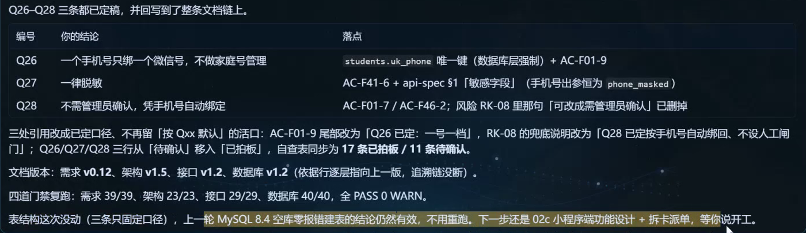

*03:35:22：需求 v0.12、架构 v1.5、接口 v1.2、数据库 v1.2；17 项已拍板、11 项待确认。画面继续建议推进 02c 小程序端功能设计。*

最终画面列出的检查是需求 39/39、架构 23/23、接口 29/29、数据库 40/40。它们说明课堂工具对当时文档执行了检查；数据库另有隔离空库验证。仍未展示完整小程序、管理网页及后端业务代码的端到端运行，也未展示正式上线。

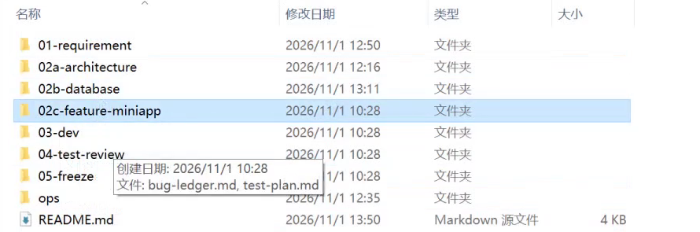

*03:34:39：已经有 02c-feature-miniapp、03-dev、04-test-review 等目录。存在目录不等于里面的阶段任务已经完成。*

下次继续时，先打开同一项目，不需要把 00、01、02a、02b 全部从头跑一遍。照下面的交接清单做：

1. 打开 `docs/README.md`，核对它列的版本与各文档正文一致。
2. 打开 requirement.md 的待确认清单。课堂结尾还有 11 项，判断哪些会阻塞当前功能，先解决会改变实现的决定。
3. 选一个可独立说明的 F，读它的 AC，再读相关接口和表说明；记录冲突，不让下一阶段自行猜。
4. 进入“02c 小程序端功能设计”会话，明确只做所选范围，输出页面、状态、输入校验、调用顺序、失败处理、权限及测试映射。
5. 设计核对后再拆开发卡片。卡片写清可改文件、前置条件、AC、测试方法和交付证据，完成一张再检查实际行为。

开场 00:00:13 曾展示 02c 模板的 web、miniapp、app、desktop 端映射，那只是预览。附件实际提供的是 00、01、02a、02b 四份提示词，不能据此声称已有完整 02c 课件或最终 K8 源码。

配套资料使用方法：下载 ZIP 并解压，用 VS Code 打开文件夹，先读 `README.md`；把 `prompts` 中本阶段文件复制到自己的项目里填写。四份提示词都是文本，不用安装依赖，也没有需要运行的应用命令。成功的结果是你自己的项目产生约定文档、正文非空、编号和引用一致；只看到聊天“完成”时，回到第 02 节检查磁盘文件。

<a id="k8-20"></a>

## 20 全程回看时间轴与核对边界

在原视频播放器中按时间定位。下表覆盖全片，某个问题的详细解释可按右栏返回正文。

| 时间段 | 课堂发生什么 | 对应阅读 |
| --- | --- | --- |
| 00:00 至 00:07 | 预览 02c、创建/切换 Hermes 项目，纠正先做 00 | 第 01、02、19 节 |
| 00:07 至 00:14 | 填写并发送 00，生成规则和 docs 骨架 | 第 03 节 |
| 00:14 至 00:21 | Obsidian、MCP、Skill、Hook 讨论及复制规则 | 第 03 节 |
| 00:21 至 00:33 | 写 K8 原始想法、教材题库、统一“测验”术语 | 第 05 节 |
| 00:33 至 00:48 | 细化学生端与管理端，准备发送需求 | 第 02、05 节 |
| 00:48 至 00:54 | 切会话、生成需求、查看真实路径，33 F/127 AC | 第 04、08 节 |
| 00:54 至 01:03 | 回答计分、题库、并发问题，新增 F34，打开进度表 | 第 06、16 节 |
| 01:03 至 01:15 | 成绩分享 F35、v0.3 | 第 08 节 |
| 01:15 至 01:27 | 新建 AC 索引、发现重复、细化分享 | 第 07、08 节 |
| 01:27 至 01:41 | 学生反馈与后台处理 F36/F37、模型切换与检查 | 第 08、17 节 |
| 01:41 至 01:46 | PASS 后仍追问 Q13，确认未作答规则，开架构会话 | 第 06 节 |
| 01:46 至 02:00 | 填架构栈、部署环境、讨论备案 | 第 10、17 节 |
| 02:00 至 02:09 | 分层、jobs/worker、架构首版，提出后台配模型 | 第 09 至 11 节 |
| 02:09 至 02:18 | 数据库类型/索引/时间讲解，F38 回需求并同步架构 | 第 11、13 节 |
| 02:18 至 02:27 | 目录骨架、发现漏后台管理、先发错会话再回需求 | 第 04、09 节 |
| 02:27 至 02:35 | F39 至 F45、并发写入风险、退役 AC 索引 | 第 07、09、12 节 |
| 02:35 至 02:42 | 增量同步架构，RBAC、菜单危险按钮、日志 180 天 | 第 09、12 节 |
| 02:42 至 02:49 | 发现接口/schema 空文件，先生成 API 契约 | 第 12 节 |
| 02:49 至 03:08 | 新建 DDL 会话，继续修微信需求模板，生成与验证 | 第 13 至 15 节 |
| 03:08 至 03:20 | 首次 MySQL 8.0 验证、表与 F 映射，穿插 UI 参考 | 第 13、14、17 节 |
| 03:20 至 03:26 | MySQL 8.4 补跑，确认教材结构、1000 字与后台参数 | 第 13、14 节 |
| 03:26 至 03:29 | 模板增加不经同意不落库条款 | 第 14 节 |
| 03:29 至 03:34 | F46/F47，一号一档、手机号脱敏、自动重绑 | 第 15 节 |
| 03:34 至 03:35:36 | 查看目录、最终版本/检查/未决事项，交接 02c | 第 19 节 |

分卷视频已合并解压并校验；收到的四份提示词已与画面交叉阅读。公开配图裁掉了私人侧栏与个人路径，完整视频、完整转写和私人聊天没有随资料包上传。截图是课堂证据，展示的中间版本和错误条款在正文中作了说明，不应脱离图注直接当成最终模板。

资料包对原始模板做了几项针对性修订：统一目录引用；需求内维护唯一 AC 来源；已有项目默认增量修改；不再要求凭空制造三个待确认问题；把 SQL 与结构说明分文件；纠正复合主键/外键关系；明确密码与模型密钥的不同处理；将生成、静态审阅、隔离执行和正式迁移分开。尚未拿到的完整功能正文、接口清单及 SQL 不补写成“老师原版”。

<a id="k8-second-review"></a>

### 二轮复核补充索引

本轮先回查 82 个关键时间点，再针对 AC 快速滚动和日志条款补看 11 个时间点，同时回读已有保留帧与对应转写。发现的是首版压缩过度的流程、容易混淆的状态，以及需要补齐的现场操作；没有据此改动已确认的最终 47 功能、11 待确认事项和文档版本。

| 回看位置 | 首版不足与本轮补充 | 正文位置 |
| --- | --- | --- |
| 00:01 至 00:03、00:53、02:18 | 工作区关联目录、项目插件登记、看板不是同一动作 | 第 02 节 |
| 00:53 至 01:01 | 技术约束移交不等于取消；Q 跳号与默认建议的确认状态 | [编号与决定](#k8-decisions) |
| 01:17 至 01:20 | 组卷、错题计数、移出重入、两科历史图表 | [完整测验流程](#k8-student-flow) |
| 01:01、01:19 | 主观复核的防重复、改判理由、总分同步与维持原分 | [复核流程](#k8-review-flow) |
| 01:37、03:29 | 反馈不做管理员回复；字数和次数后续纳入配置 | [反馈边界](#k8-feedback) |
| 01:41、03:10、03:20 | 检查脚本误判、检查器自测和生成列统计条件 | 第 06、14 节 |
| 02:00 至 02:03、02:57 | worker 还处理抓题；任务状态经 API 返回；运行日志与审计日志 | 第 10、11 节 |
| 02:21、03:07 至 03:08 | 复用主机的部署修订；初始凭据交付；生成源与成品同步 | 第 10、17 节及 [生成源交接](#k8-generator) |
| 03:10、前段对应 AC | 失效与移出保留记录；历史快照；只允许一条启用配置 | [历史与状态](#k8-history) |

这些补充仍受录屏可见范围限制。未展示完整的最终需求、所有接口与 SQL 源文件，无法逐行独立复验；短暂切屏、遮挡处也不能保证还原全部细字。因此保留时间码、阶段版本和“课堂回报/整理补充”的区分，不以本轮复核声称绝无遗漏。
