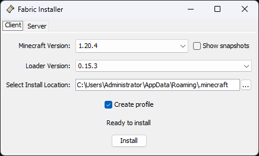
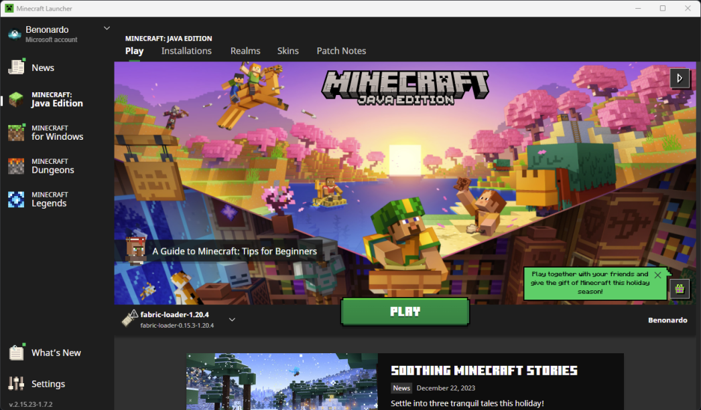
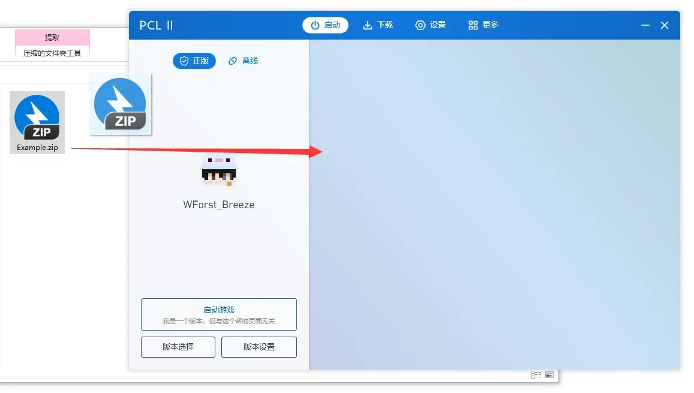
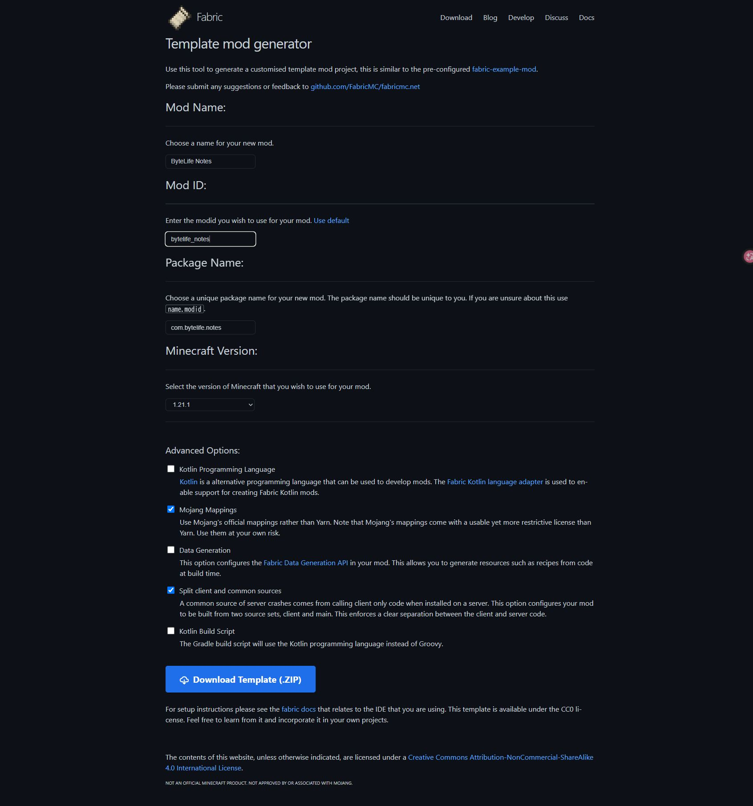

> 启动器与安装步骤更新：2026-10-22。操作按 Windows 10/11 编写。
> 开发示例固定为 **Minecraft Java 1.21.1、Fabric、JDK 21、Mojang 官方命名**。这是练习环境，不是“目前最新的游戏版本”。
> 原论坛的两楼已合并。旧版 PCL 图文保存在[原文存档](../archive/minecraft-pcl-2026-10-05.md)。开发代码按固定版本整理，尚未完成整套编译和游戏内验收；不要把本文当成已经测试通过的整合包。

刚开始折腾 Minecraft，最容易卡住的地方，是不知道眼前的问题该归谁管：启动器、游戏、Java、模组文件和开发工程，全挤在一起了。换一个启动器，不会顺带修好写错的 Java；把模组扔进一个叫 `mods` 的文件夹，也不代表正在玩的那个版本会读到它。

这篇沿着实际操作走：先放好游戏和文件，再用 VS Code 做出一个“学习笔记”物品，给它名称、贴图和配方，打包成 JAR，装进日常游玩的环境，最后讲清楚朋友怎么加入世界。

**先说明最近的变化。** PCL 作者在 2026-10-20 的 2.99.0.0 公告中宣布不再提供 MC 下载功能。准确说法是下载入口发生变化，不能据此断言所有旧版 PCL、已有游戏和整合包都失效了。[PCL 作者公告](https://github.com/Meloong-Git/PCL/discussions/9512)

| 你现在是什么情况 | 应该怎么做 |
| --- | --- |
| 旧版 PCL 已装好，原来的游戏能正常启动 | 可以继续用这套已有环境。先备份世界，不必仅为看教程就换工具；这不等于旧版本今后永远没有兼容性或服务变化 |
| 旧版 PCL，手里有本地整合包 | 可以尝试它原本支持的导入功能。完整离线包和需要联网补文件的清单包，要分开判断，见第 09 节 |
| 电脑上没有游戏，要从零安装或换版本 | 本文主线用官方启动器取得游戏，再安装 Fabric；不要照着旧截图找已经取消的 PCL 下载按钮 |
| 主要玩整合包，想找另一种管理方式 | 看第 09 节的 Prism 路线，以及第 10 节的 XMCL 和新项目说明 |
| 主要想写 Mod | 启动器负责日常游玩，VS Code＋Gradle 负责开发。先固定版本，不必追着启动器新闻重建源码工程 |

**章节直达：** [下载与 D 盘目录](#mc-section-03) · [文件放在哪里](#mc-section-06) · [整合包导入](#mc-section-09) · [启动器怎么选](#mc-section-10) · [创建工程](#mc-section-13) · [第一个物品](#mc-section-16) · [打包](#mc-section-19) · [联机](#mc-section-21)

<a name="mc-section-01"></a>

## 01｜先确定：你到底要改什么

如果只想改方块贴图，先做资源包就够了。只想调整配方、战利品或用命令做玩法，可以先考虑数据包。想增加全新的物品类型、界面、机器逻辑或修改游戏代码，才需要往 Java 模组走。

| 名称 | 管什么 | 这篇怎么用 |
| --- | --- | --- |
| Minecraft Java Edition | 游戏本体 | 固定 1.21.1 做开发练习 |
| PCL | 下载、登录、选择版本、管理游戏环境 | 日常游玩和检查发布后的模组 |
| Java / JVM | 运行 Java 程序 | 让游戏和构建工具运行 |
| JDK | Java 开发工具，包含编译器等 | 写模组用 JDK 21 |
| Fabric Loader | 把 Fabric 模组加载进游戏 | 通过 PCL 安装 |
| Fabric API | 提供很多模组共用的功能接口 | 作为依赖安装，和 Loader 是两样东西 |
| Mod / 模组 | 添加或修改游戏行为 | 通常是放在 `mods` 里的 `.jar` |
| 资源包 | 纹理、声音、语言等资源 | 放在 `resourcepacks`，游戏里启用 |
| 光影包 | 光照、阴影、水面等画面效果 | 放在 `shaderpacks`，通过 Iris 等加载 |
| 整合包 | 配好的一套版本、模组、配置和资源 | 让启动器导入成独立环境 |
| 数据包 | 配方、战利品、函数等数据驱动内容 | 通常属于某个世界，放在其 `datapacks` |

Fabric、Forge、NeoForge 是不同的模组生态。**先看你要用的模组支持什么，再决定加载器。** 文件上都写着 `.jar`，不代表能混装。就像文件都叫安装包，也不代表能在同一个系统里运行。

这篇选 Fabric，是为了把第一个小模组的路线固定下来。以后如果你要给某个 NeoForge 整合包写扩展，就按那个整合包的版本和接口重新建工程。已经学会的 Java、资源组织和调试方法仍然能用，具体注册方式需要换。

新版本也不等于最适合这篇练习。现在 Fabric 文档已经覆盖 26.x，Java 要求也有变化；本文的 **1.21.1 对应 JDK 21**，不要打开最新版文档后把代码直接拼进来。[Fabric 1.21.1 环境说明](https://docs.fabricmc.net/1.21.1/develop/getting-started/setting-up-a-development-environment)、[当前版本环境说明](https://docs.fabricmc.net/develop/getting-started/setting-up)、[NeoForge 开发入口](https://docs.neoforged.net/docs/gettingstarted/)。

<a name="mc-section-02"></a>

## 02｜账号、启动器和游戏文件是三件事

还没买账号，从 [Minecraft 官方 PC 商品页](https://www.minecraft.net/en-us/store/minecraft-java-bedrock-edition-pc) 核对 **Java & Bedrock Edition for PC**。本文写的是国际 Java 版模组，不是基岩版附加包，也不是中国版开发工具。已经买完，不需要为了换启动器再买一份。

购买记录在 Microsoft 账户下，启动器只是登录并启动游戏的工具。先确认自己记得购买时使用的账户；第一次使用 Java 版时，按官网或启动器要求设置 Java 角色名。Microsoft 账户名、Xbox 玩家代号和 Java 角色名不是同一个东西，白名单通常填 Java 角色名。

**已有旧版 PCL 的人**：原环境能登录、能玩，可以继续使用；直接检查第 05、06 节的文件位置。本文不会要求你先卸载它。

**从零开始的人**：按下面的官方启动器路线。若出现 **Buy / 购买**、**Play Demo / 试玩**，先核对购买账户和 PC Java 版资格，再看具体认证报错。此时反复换模组、重装 Java 没有用。

<a name="mc-section-03"></a>

## 03｜从哪里下载，文件放到哪个盘

### 3.1 先建自己能找到的目录

按 `Win+E` 打开**文件资源管理器**，点左侧**此电脑**，双击 **D 盘**。在空白处右键 **新建 → 文件夹**，输入 `Minecraft`，按回车。进入后分别新建 `Downloads`、`Instances`、`Backups`；在 `Instances` 里再建 `1.21.1-Fabric-Learn`。回到 D 盘根目录，另建 `MCDev`。

```text
D:\Minecraft\
├─ Downloads\                     浏览器下载的安装包、JAR、ZIP
├─ Instances\
│  └─ 1.21.1-Fabric-Learn\         本文的游玩实例
└─ Backups\                       世界和旧模组备份
D:\MCDev\                        自己的源码工程
```

没有 D 盘就换成有空间的盘，不用专门分区。要打开本文某个目录，在资源管理器按 `Ctrl+L`，粘贴路径并回车；不要粘到右侧搜索框。Windows 11 在 **查看 → 显示 → 文件扩展名**打勾；Windows 10 在**查看**选项卡勾选它，后面才不会把 `.java.txt` 看成 Java 文件。

### 3.2 下载官方 Minecraft Launcher

打开 [Minecraft 官方下载页](https://www.minecraft.net/en-us/download)。找 **Download Launcher / 下载启动器**；也可以往下到 **Other versions & platforms**，点 **Windows 10/11**。页面语言和主按钮会随地区调整，这两个入口指向官方 Windows 安装路线。

浏览器弹出保存窗口时，地址栏填 `D:\Minecraft\Downloads`，回车后点**保存**。如果跳到 Microsoft Store，就在商店页点 **Install / 安装**，安装完成点 **Open / 打开**。商店安装的位置由 Windows 管理，不要去手工拖 WindowsApps 文件夹。

如果下载已经自动存在 C 盘：按 `Ctrl+J` 打开浏览器下载记录，对该文件点**在文件夹中显示**。选中文件按 `Ctrl+X`，打开 `D:\Minecraft\Downloads` 后按 `Ctrl+V`。再双击安装程序，按向导完成安装。从 Windows **开始**菜单搜索 `Minecraft Launcher` 打开，用购买游戏的 Microsoft 账户登录，左侧选 **Minecraft: Java Edition**。[官方下载安装说明](https://help.minecraft.net/)

**移动安装包只改变这个文件的位置。** 官方启动器程序、公共运行库、游戏实例、Java 和 Gradle 缓存可能在不同目录。下面会把学习实例的模组、世界和配置放进 D 盘，但不能承诺 C 盘从此一字节都不增加。C 盘快满会影响系统；“放 D 盘一定更快”则不成立，两个盘符甚至可能属于同一块硬盘。

### 3.3 已经用 PCL 的人怎么保留原来的流程

如果你的旧版 PCL 仍能启动原游戏，程序和现有 `.minecraft` 目录保留原位，先备份 `saves`。不要只移动 EXE 就以为游戏、模组和世界都会跟着走。

需要对照原来的爱发电下载页、ZIP 解压到 D 盘、账号和目录操作，查看[旧版 PCL 图文存档第 03 节](../archive/minecraft-pcl-2026-10-05.md#mc-section-03)。作者入口仍是 [龙腾猫跃的正式版下载页](https://afdian.com/p/0164034c016c11ebafcb52540025c377)；里面下载的启动器能力以当前发布说明为准，不能拿 10 月初的截图保证今天还能在线安装 MC。

ZIP 版启动器应先解压到固定目录再运行。别在压缩包预览窗口里双击 EXE，那可能运行于临时解压目录。这条目录原则仍然有效，和下载功能是否保留是两回事。

<a name="mc-section-04"></a>

## 04｜先装原版，再用 Fabric 安装器建立模组环境

### 4.1 官方启动器先运行一次 1.21.1

打开 **Minecraft Launcher → Minecraft: Java Edition → Installations / 安装配置**。点 **New Installation / 新安装配置**，名称填 `1.21.1-Vanilla-Check`，**Version / 版本**选 `release 1.21.1`，**Game Directory / 游戏目录**填 `D:\Minecraft\Instances\1.21.1-Vanilla-Check`，点 **Create / 创建**。路径不存在时，可先在资源管理器的 `Instances` 内新建这个文件夹。

回 **Play / 开始游戏**页，在版本下拉框选刚建的配置，再点 **Play / 开始游戏**。第一次需要下载游戏与公共资源，等到主菜单出现再正常退出。到这里确认的是账号、游戏下载和基本运行；还没有安装 Fabric。

### 4.2 安装 Fabric Loader

1. 正常关闭游戏，也关闭 Minecraft Launcher。
2. 打开 [Fabric 安装器下载页](https://fabricmc.net/use/installer/)，点击 **Download for Windows**，将 EXE 存到 `D:\Minecraft\Downloads`。
3. 在资源管理器双击刚下载的 Fabric 安装器。选 **Client / 客户端**，**Minecraft Version**明确选 `1.21.1`，Loader 选择与之兼容的稳定版本。
4. 安装器里的 **Install Location** 指向官方启动器使用的 `.minecraft` 根目录；默认通常是 `%appdata%\.minecraft`。这里是安装启动配置的位置，**不是**下面保存模组与世界的独立游戏目录。先沿用自动识别的官方目录，别把它改成一个空的实例文件夹。
5. 保持 **Create Profile** 勾选，点击 **Install**。成功后重新打开官方启动器，在 **Installations / 安装配置** 找到生成的 `fabric-loader-…-1.21.1`。看不到时，检查页面有没有把 **Modded / 已修改**筛掉。
6. 点这条配置右侧的 **… → Edit / 编辑**，名称改为 `1.21.1-Fabric-Learn`，**Game Directory / 游戏目录**填 `D:\Minecraft\Instances\1.21.1-Fabric-Learn`，保存。
7. 从 **Play / 开始游戏**页选择它启动一次。能进入菜单和测试世界，再正常退出。



*Fabric 官方文档中的实际界面图。图里是 1.20.4，本文在 Minecraft Version 选择 1.21.1；不要照抄图中的 Loader 号和用户名路径。来源：[Fabric Windows 指南](https://docs.fabricmc.net/players/installing-fabric/windows)，按 [CC BY-NC-SA 4.0](https://creativecommons.org/licenses/by-nc-sa/4.0/) 转载，未修改。*



*同一指南的启动器示例：左侧 Java Edition，上方 Installations，左下配置下拉框，右边 PLAY。它展示的是旧版外观，本文选自己的 1.21.1 Fabric 配置。来源及许可同上，未修改。*

以上安装顺序对应 [Fabric 官方 Windows 安装指南](https://docs.fabricmc.net/players/installing-fabric/windows)。Windows EXE 安装器可使用官方启动器带的 Java；开发所需 JDK 21 后面另装。

### 4.3 Fabric API 还要单独安装

Loader 负责把模组载入游戏，Fabric API 是许多模组依赖的一组接口。装好前者，不等于自动有后者。

打开 [Fabric API 的官方 Modrinth 发布页](https://modrinth.com/mod/fabric-api)，点 **Versions**，筛选 **1.21.1**，选择对应条目下载 JAR。存到 `D:\Minecraft\Downloads`，再复制到 `D:\Minecraft\Instances\1.21.1-Fabric-Learn\mods`。没有 `mods` 就在这个实例目录内新建。完整退出并重新启动 Fabric 配置。[Fabric 官方安装模组说明](https://docs.fabricmc.net/players/installing-mods)

旧版 PCL 用户已经有同版本 Fabric 实例的话，不用重复做两套。检查它的 Loader、API 和实际游戏目录，后面共用同样的 Mod 安装与开发步骤。

<a name="mc-section-05"></a>

## 05｜先认当前实例，再找 mods 和存档

实例就是一套独立使用的游戏环境。1.20.1 的整合包和 1.21.1 的开发测试各有自己的模组、配置和世界，避免启动时互相混进去。官方启动器通过 **Game Directory / 游戏目录**指定；PCL 通常称为**版本隔离**；Prism 会按实例管理。名字不同，关键都是“这次启动实际读哪个目录”。

最稳的确认方式不依赖启动器布局：

1. 启动你准备使用的那个配置，进入游戏。
2. 点 **选项 → 资源包 → 打开资源包文件夹**。
3. 资源管理器打开 `resourcepacks` 后，按 `Alt+↑` 返回上一级。
4. 看地址栏。这一层就是当前实例根目录，后面的 `mods`、`saves`、`config` 都以它为起点。

按本文官方路线配置，它应该是 `D:\Minecraft\Instances\1.21.1-Fabric-Learn`。如果实际不同，回启动器检查这条配置的 **Game Directory**，不要全电脑搜出几个 `mods` 就每个塞一份。

PCL 用户在目标版本的**版本设置**里检查隔离选项。全局默认设置主要管新建版本，改完不代表旧文件自动迁走；常见目录可能是 `.minecraft\mods`，也可能是 `.minecraft\versions\版本名\mods`。以实际打开的位置为准。[PCL 版本隔离与旧界面示例](../archive/minecraft-pcl-2026-10-05.md#mc-section-05)

存档突然“不见了”，先查是不是换了游戏目录。要复制旧世界，先正常退出游戏，备份原 `saves`，再复制到目标实例；不要用新游戏版本直接试开唯一一份旧存档。

<a name="mc-section-06"></a>

## 06｜模组、光影、整合包，分别放在哪里

以下路径都相对于刚才找到的**实例根目录**。

| 内容 | 放在哪里 | 放进去之后还要做什么 |
| --- | --- | --- |
| 普通模组 `.jar` | `mods\` | 完整退出游戏后重新启动 |
| Fabric API `.jar` | `mods\` | 和普通模组一样加载 |
| Iris、Sodium `.jar` | `mods\` | 检查游戏版本、加载器及相互依赖 |
| 光影包，通常 `.zip` | `shaderpacks\` | 游戏内的光影菜单选中并应用 |
| 资源包，通常 `.zip` | `resourcepacks\` | 选项 → 资源包，移到“已选” |
| 单人世界 | `saves\世界文件夹\` | 世界文件夹内应能找到 `level.dat` |
| 数据包 | `saves\世界文件夹\datapacks\` | 进入对应世界，按作者说明启用或重载 |
| 模组配置 | 常见为 `config\` | 退出游戏后按模组说明修改 |
| 最新运行日志 | `logs\latest.log` | 崩溃或功能异常时用编辑器阅读 |
| 崩溃报告 | `crash-reports\` | 并非每种退出情况都会生成 |
| 整合包 `.mrpack` 或受支持的 `.zip` | 交给支持该格式的启动器导入 | 安装成一个独立实例，不能塞进 `mods` |

模组 `.jar` 不要解压。光影包和资源包通常也保留 `.zip`。世界压缩包则通常需要解压，检查有没有多套一层目录；`saves\地图名\地图名\level.dat` 这种结构，经常导致游戏找不到世界。

数据包归属于世界，和给所有世界生效的普通模组有区别。相同实例里开两个世界，只给其中一个放数据包，另一个不会自动拥有它。[PCL 世界安装说明](https://github.com/Meloong-Git/PCLHelp/blob/master/Minecraft/安装世界.xaml)、[数据包安装说明](https://github.com/Meloong-Git/PCLHelp/blob/master/Minecraft/数据包安装.xaml)。

如果 `mods` 等目录还没生成，先在资源管理器打开已确认的实例根目录，在空白处右键 **新建 → 文件夹**，输入准确的名字，例如 `mods`，按回车。不要在启动器 EXE 旁边凭感觉建一个同名目录。

复制文件时，先在 `D:\Minecraft\Downloads` 选中下载好的文件，按 `Ctrl+C`；再打开目标目录，按 `Ctrl+V`。最后看一眼目标目录里是否确实出现了这个文件。目录拼写不要建成 `mod`、`shaderpack`。

几个 ZIP 的处理方式刻意不同：PCL ZIP 要解压后运行；光影 ZIP 通常原样放进 `shaderpacks`；整合包 ZIP 按其格式导入实例。决定操作的是包里的内容和用途，不是“凡是 ZIP 就解压”。

<a name="mc-section-07"></a>

## 07｜装一个模组，先核对这几项

打开模组作者的 Modrinth、CurseForge 或项目仓库，按名称、游戏版本和加载器找文件。搜不到中文名时，用作者公布的英文名。官方启动器没有内置模组商店。

每次下载之前，看清：

- **游戏版本**：有没有明确支持 1.21.1。
- **加载器**：是不是 Fabric。
- **依赖**：需要哪些前置模组，版本范围是什么。
- **运行端**：只装客户端、只装服务端，还是两边都要装。

下载来源优先用作者的 [Modrinth](https://modrinth.com/mods)、[CurseForge](https://www.curseforge.com/minecraft) 或项目仓库。其他启动器的内置资源搜索也可能使用这些平台的数据，具体入口能否使用，以当前版本为准。

如果通过浏览器下载，在发布页先选 **Versions / Files（版本 / 文件）**，筛选 Minecraft `1.21.1` 和 `Fabric`，再下载该条目里的 `.jar`，存到 `D:\Minecraft\Downloads`。先不要下标着 Sources、源码或另一个加载器的文件。

下载完成后关闭游戏，把 JAR 复制进第 05 节确认的实例 `mods`，依赖文件也要放齐，再从启动器选择同一个 Fabric 配置启动。安装说明要求客户端和服务端都装的模组，联机时两边也要对齐。

别把所有模组都选成“最新”。作者最新发布的文件可能是给另一代 Minecraft 做的。你需要的是“适配当前环境的版本”，这和发布时间新不新是两回事。

也别第一次就加四十个。先装一两个，确认它们生效，再继续加。出现问题时，至少知道最近动了什么。

<a name="mc-section-08"></a>

## 08｜光影怎么装，为什么装完 ZIP 还没有效果

光影分两层：**Iris 这样的模组负责加载；光影包负责具体效果。** 只放一个光影 ZIP，原版游戏不会凭空多出加载能力。

本文这套 Fabric 环境采用 Iris 路线：

1. 打开 [Iris 的官方发布页](https://modrinth.com/mod/iris/versions)，筛选 1.21.1、Fabric，下载对应 JAR。
2. 按该文件的依赖说明安装兼容的 **Sodium**。不要拿一个任意版本的 Sodium 凑数。
3. 确认这两个模组位于本实例 `mods` 里。
4. 从光影作者的发布页下载支持 Iris 的文件。浏览器下载先存到 `D:\Minecraft\Downloads`，保持 ZIP 格式；打开当前实例根目录里的 `shaderpacks`，把 ZIP 复制进去，没有这个文件夹就按第 06 节的方法新建。
5. 启动游戏，打开 **选项 → 视频设置**，找到 **Shader Packs / 光影包**。
6. 选中光影，启用并点击 **Apply / 应用**。具体中文翻译随版本而变。

如果没有光影菜单，先查 Iris 是否加载；如果有菜单却没有包，查 ZIP 放的位置；如果包能选但画面报错，查光影的硬件要求和与 Iris 的兼容情况。

这套环境里不要再叠 OptiFine。Iris 官方列出了与 OptiFine 等渲染方案的不兼容情况，多个画面模组一起改同一套渲染流程，不会因为装得多就更稳。[Iris 官方说明](https://www.irisshaders.dev/)、[PCL 光影安装帮助](https://github.com/Meloong-Git/PCLHelp/blob/master/Minecraft/安装光影.xaml)。

帧率不够时，先关光影对比，再降低渲染距离、阴影距离和光影预设。给 Java 多分内存，解决不了显卡画不动画面的问题。

开发练习环境暂时保持干净。等自己的模组能正常运行，再在另一套带光影环境里做兼容性测试。

<a name="mc-section-09"></a>

## 09｜整合包导入：旧版 PCL、清单包和完整包分开看

整合包规定的是一整套环境：游戏版本、加载器、模组和配置。它不是“压缩成 ZIP 的东西都往 mods 里塞”。先看作者写的客户端安装方法，分清你下到的是**客户端包、服务端包、清单包，还是完整环境备份**。

### 9.1 已有旧版 PCL，能不能继续导入

**可以尝试旧版本原本支持的本地导入，不能承诺所有包都能装。** 你手里的旧版是否保留解析器、识别哪种格式、需要的游戏文件是否已经齐全，决定结果。PCL 官方旧帮助确实有“把整合包文件拖进窗口”的操作，这不是虚构的功能。[PCL 整合包帮助](https://github.com/Meloong-Git/PCLHelp/blob/master/Minecraft/整合包安装.xaml)

把作者发布的 `.mrpack` 或受支持的 ZIP 存到 `D:\Minecraft\Downloads`。打开原来能用的 PCL，将资源管理器和启动器并排，把整个包拖进 PCL，按提示创建**新实例**。这一步不要先解压，也不要覆盖你原来能玩的环境。



*这是旧版 PCL 官方帮助截图，只说明历史操作方式，不代表 2.99.0.0 及以后仍保留同样的安装能力。*

| 包里有什么 | 导入时实际会发生什么 |
| --- | --- |
| 已有完整游戏、依赖、模组和配置的受支持本地包 | 主要读取、校验和安排本地文件，但仍需合适的 Java、可用的登录方式等条件 |
| `modrinth.index.json` 等清单，或 CurseForge 的 `manifest.json`、`overrides` | 要按清单另外下载模组、游戏、加载器或库；有个 ZIP 在本地，并不等于能离线装完 |
| 只有 `mods`、`config` 等手工安装文件 | 按作者要求先准备正确基础环境，再复制内容；不一定能被启动器自动识别 |
| 服务端包 | 给独立服务端使用，不能当成普通客户端包直接游玩 |

旧版导入失败，先看任务日志卡在**读取格式、下载资源还是启动游戏**。没有游戏本体、清单链接失效、依赖没下载齐，处理方法都不一样。不要把这几类失败统称为“整合包被禁了”。

能玩的旧环境可以保留，下载服务或账号接口以后发生变化则需要重新核实。本文不把停留旧版写成永久解决方案，也不提供修改启动器恢复已取消功能的补丁教程。

### 9.2 想换一个成熟的整合包管理器：Prism

去 [Prism Launcher 官网](https://prismlauncher.org/) 点 **Download**，选 Windows 与自己电脑架构对应的安装版或便携版。浏览器下载到 `D:\Minecraft\Downloads`；便携压缩包先完整解压到例如 `D:\Minecraft\Prism` 再运行，安装版则按向导指定程序位置。首次设置语言、Java 和 Microsoft 账户时按向导完成；本文 1.21.1 对应 Java 21。

在主界面点 **Add Instance / 添加实例**，左侧选 **Import / 导入**，选择作者提供的 `.mrpack` 或支持的整合包 ZIP，填写实例名并确认。也可在添加实例窗口选择 Modrinth 或 CurseForge，搜索项目并选定**整合包的发布版本**。[Prism 官方导入指南](https://prismlauncher.org/wiki/getting-started/download-modpacks/)

等后台任务完成，再双击该实例启动。某些作者不允许启动器自动分发文件，启动器会提示你到作者页面手动下载，按提示放入指定位置后继续。把加载任务取消一半，就算出现实例图标，也不代表环境已经完整。

Prism 的实例和公共数据位置要在设置里核对。安装程序在 D 盘，不代表实例自动在 D 盘；在 **Settings / 设置 → Launcher / 启动器 → Features / 功能 → Folders / 文件夹**查看实例目录，再用**编辑实例 → 打开 Minecraft 文件夹**核实。不同译名以实际版本为准。[Prism 官方目录设置说明](https://prismlauncher.org/wiki/help-pages/launcher-settings/)

### 9.3 官方启动器怎么处理整合包

官方启动器可以运行配好的 Fabric 环境，但没有通用的 `.mrpack` 一键导入按钮。作者明确提供手工安装说明时，才按要求建立正确游戏与加载器版本、设置独立游戏目录、复制模组和配置。有清单的包不要只解压后照搬几个目录，清单里的依赖还没下载。

第一次启动整合包前，别自行把加载器和一半模组升到最新。朋友联机需要对齐的是**包名称、包版本和额外改动**，只说“都是 1.21.1”远远不够。

<a name="mc-section-10"></a>

## 10｜启动器怎么选，新项目值不值得换

先问自己缺的是哪一件事。已有环境能用，没必要为了热点新闻搬一次家；要从零安装、玩整合包和做开发，也不一定非得由同一个工具包办。

| 路线 | 适合谁 | 需要知道的边界 |
| --- | --- | --- |
| 官方 Minecraft Launcher＋Fabric 安装器 | 新装游戏，想跟着本文建立清楚的基础环境 | 模组主要手工管理，没有通用整合包商店与导入器 |
| 已有旧版 PCL | 熟悉原界面，已有游戏和存档 | 当前公告改变下载能力；旧实例和本地导入按实际版本、资源完整度判断 |
| Prism Launcher | 管多个整合包、多个实例 | 有独立的数据目录与 Java 设置；导入清单包也要联网补文件 |
| XMCL | 想试另一套带实例、资源与整合包管理的界面 | 按官方指南确认当前格式支持和任务状态，不假定它等于 PCL 的换皮版本 |
| 最近新建的小启动器 | 想参与体验、测试或开发 | 先确认核心流程完成，再决定是否承担日常存档；名字新、界面漂亮都不能代替验证 |

**XMCL 是已有的项目，不是这次事件后才突然出现的替代品。** 从 [XMCL 官网](https://xmcl.app/zh/) 的下载入口取 Windows 版本，先阅读 [官方使用指南](https://xmcl.app/zh/guide/)。它的整合包导入会建立实例，清单包仍有后台下载过程；导入后看起来空，要先看任务而不是反复创建。[XMCL 官方排障说明](https://xmcl.app/en/guide/troubleshooting)

新项目也值得关注，但要把“出现了”和“已经能替你稳定玩游戏”分开。截至 2026-10-22，近期新建的 [Aether Launcher](https://github.com/AetherLauncher-org/Aether-Launcher) 已公开代码，作者明确标注早期开发，游戏下载、微软登录、游戏启动还没完成；[CialloCraftLauncher](https://github.com/WinstonMeursault/CialloCraftLauncher) 当时公开仓库主要只有 README 和许可证。这里把它们列作观察对象，**没有实际安装测试，也不把它们作为本文的日常使用推荐**。项目以后补齐功能，判断当然可以更新。

看一个新启动器，至少看四件具体的事：**有无可运行的正式发布、购买账号的登录流程是否完整、目标版本和整合包格式是否支持、出错时能否导出日志**。换工具前复制一份测试实例，核对它实际读取哪个 `saves`，成功后再搬日常世界。仓库创建日期也不等于作者刚开始写代码，更不能单凭时间证明它“趁机发布”。

对写 Mod 的人，最有用的分工是：**Gradle 负责构建与开发运行，日常启动器负责验证交付给玩家的 JAR。** 启动器变化通常不要求你重写模组；Minecraft 版本、加载器和 API 变了，才会直接牵动代码。

PCL 用户保留原有功能表可查[旧文第 10 节](../archive/minecraft-pcl-2026-10-05.md#mc-section-10)，其中下载菜单属于当时界面。内存先按小型环境的实际需要设置，别把十几 GB 一股脑给 Java，系统、VS Code 和 Gradle 也要运行。

<a name="mc-section-11"></a>

## 11｜开始开发之前，Java 要学到哪里

不需要把 Java 全学完再碰模组。至少先能看懂这些东西：

| 你会在代码里看到什么 | 要理解到哪一步 |
| --- | --- |
| 变量、类型、`if`、循环 | 知道数据怎么保存、条件怎么决定行为 |
| 方法与参数 | 知道调用时传进去什么、返回什么 |
| `class`、对象、构造方法 | 知道一个物品对象是怎么被创建出来的 |
| `extends`、`implements`、`@Override` | 知道如何接入已有规则、重写某个行为 |
| `static`、`final` | 分清类共享的成员，以及不能重新赋值的引用 |
| `package`、`import` | 知道类叫什么、从哪里来，文件应该放哪儿 |
| JSON | 会检查双引号、逗号、括号和字段名 |
| 异常栈 | 能从错误里找到自己的类名和行号 |

后面添加物品时，Java 代码负责让游戏知道“存在这种物品”；JSON 决定它怎么显示、叫什么、怎么合成。你会同时写代码和数据，这就是为什么只会复制 Java 片段仍然会卡在紫黑贴图或失效配方上。

<a name="mc-section-12"></a>

## 12｜安装 JDK 21，让 VS Code 和 Gradle 用对 Java

打开 [Eclipse Temurin / Adoptium 的 Java 21 下载页](https://adoptium.net/temurin/releases/?version=21)。在筛选项里核对 **Version：21、Operating System：Windows、Package Type：JDK**。常见 Intel/AMD 电脑的 Architecture 选 **x64**；ARM 电脑另选对应架构。不确定时，按 `Win+I` 打开 Windows 设置，进入 **系统 → 系统信息 / 关于**，查看“系统类型”。

在匹配结果中点击 **.msi** 安装包，存到 `D:\Minecraft\Downloads`。下载完成，在资源管理器打开这个目录，双击 MSI，再进入安装向导。这里用安装包是为了顺便配置命令行，不选需要自己解压配置的 ZIP。

安装包的保存位置和 JDK 的安装位置是两回事。向导通常默认装在 `C:\Program Files\Eclipse Adoptium`；可以保留默认，也可以在目标目录页面换到自己的 D 盘位置。记住实际安装路径，后面排错要用。

使用 Windows MSI 安装时，在功能选项里启用添加到 `PATH`，并按需启用设置 `JAVA_HOME`。安装结束后，**把之前打开的 VS Code 和终端关掉重开**，旧进程不会自动拿到更新后的环境变量。[Adoptium Windows 安装说明](https://adoptium.net/installation/windows/)。

按 Windows 开始键，输入 `PowerShell`，打开 **Windows PowerShell**。在出现的命令提示符后输入第一行，按回车，等输出出现再执行第二行；不用管理员身份：

```powershell
java -version
javac -version
```

本文环境应看到主版本 `21`。输出的补丁号可以不同。

如果 `java` 能用，`javac` 找不到，先核对是不是装了只有运行功能的环境，或 PATH 仍指向旧目录。如果显示 17、8 或其他版本，继续查：

```powershell
where.exe java
where.exe javac
$env:JAVA_HOME
```

`where.exe` 会列出命令实际可能找到的路径。别只盯着“我电脑里已经装了 21”，要看命令究竟用了哪个。

暂时不想改整台电脑的默认 Java，也可以只在当前终端指定。下面路径需要换成你的实际 JDK 安装目录：

```powershell
$env:JAVA_HOME = 'C:\你的实际JDK21安装目录'
$env:Path = "$env:JAVA_HOME\bin;$env:Path"
java -version
```

这只影响当前终端及从它启动的程序。后面 `gradlew.bat --version` 也要检查，项目的 Gradle JVM、VS Code Java 工具使用的 JVM、PCL 启动游戏的 JVM，不能想当然地视为同一个设置。

<a name="mc-section-13"></a>

## 13｜装 VS Code 扩展，创建模组工程

本文用 VS Code，照样能写。也把差异讲清：Fabric 官方更推荐 IntelliJ IDEA，Java 项目导入、导航和 Minecraft 相关插件支持更集中。已经习惯 VS Code，就先把这条路线跑通，不必为了编辑器重新折腾一圈。[Fabric 对 VS Code 的说明](https://docs.fabricmc.net/develop/getting-started/vscode/setting-up)。

先从 [VS Code 官方下载页](https://code.visualstudio.com/Download) 选择 Windows 的 **User Installer**，架构与电脑一致，常见电脑选 **x64**。下载的 EXE 先存到 `D:\Minecraft\Downloads`，双击运行安装向导。已有 VS Code 可以跳过重装。

安装结束后，从开始菜单打开 **Visual Studio Code**。按 `Ctrl+Shift+X` 打开左侧扩展页面，在顶部搜索框输入 `Extension Pack for Java`，点击 **Microsoft** 发布的那一项，再点 **Install / 安装**。等按钮不再显示正在安装即可。它提供 Java 语言支持、调试和项目管理。不要只装一个 Code Runner，再对模组点“运行代码”。[VS Code Java 入门](https://code.visualstudio.com/docs/java/java-tutorial)。

接着在浏览器打开 [Fabric 模板生成器](https://fabricmc.net/develop/template/)，按下面填写：

| 页面字段 | 填写内容或操作 |
| --- | --- |
| Mod Name | 清掉示例名，填 `ByteLife Notes` |
| Use custom id | 点击这段链接，展开自定义 ID 输入框 |
| Mod ID | 填 `bytelife_notes` |
| Package Name | 填 `com.bytelife.notes` |
| Minecraft Version | 展开下拉框，选择 **1.21.1**，不要保留默认新版 |
| Advanced Options | 展开，检查下面几个复选框 |
| Kotlin Programming Language | 不勾选，本文用 Java |
| Mojang Mappings | **勾选**，使用 Mojang 官方命名 |
| Data Generation | 不勾选 |
| Split client and common sources | 保持勾选，分开客户端与通用源码 |
| Kotlin Build Script | 不勾选，本文保留 `build.gradle` |



*这是按本文参数填写的实际网页截图。底部按钮是 **Download Template (.ZIP)**，意思是下载工程模板压缩包。*

点击 **Download Template (.ZIP)**，把 ZIP 存到 `D:\Minecraft\Downloads`。然后到资源管理器找到它，右键 **全部解压缩**，目标填 `D:\MCDev\bytelife-notes`。这里才是在创建开发工程的位置，和 PCL 的游戏目录分开。

解压后打开 `D:\MCDev\bytelife-notes`，应该能看到 `build.gradle`、`gradlew.bat`、`gradle.properties`、`src`。如果只看到一个同名文件夹，就进入里面那层；**直接装着这些文件的那一层，才叫工程根目录**。后文的命令都要在这层运行。

回到 VS Code，点左上 **File → Open Folder（文件 → 打开文件夹）**。在选择窗口的地址栏输入工程根目录，按回车，再点 **Select Folder / 选择文件夹**。选的是文件夹，不是某个 Java 文件，也不是 ZIP。

打开后按 `Ctrl+Shift+E` 显示左侧 **Explorer / 资源管理器**。这里列出的是当前工程文件；Windows 的资源管理器管理整个电脑，VS Code 的资源管理器管理当前打开的工程。后文会明确说使用哪一个。

这是你从官方生成器得到的工程，可以确认信任工作区。等待 Java 扩展导入 Gradle，第一次会下载依赖，比以后慢。[Fabric 创建工程说明](https://docs.fabricmc.net/1.21.1/develop/getting-started/creating-a-project)、[在 VS Code 打开工程](https://docs.fabricmc.net/develop/getting-started/vscode/opening-a-project)。

**命名方式必须统一。** Yarn 教程里常见 `Identifier`、`Item.Settings`；本文用官方命名，对应代码会看到 `ResourceLocation`、`Item.Properties`。这不是装错了 Java，而是同一套游戏代码使用了不同名称。不要为了消掉红线，把两篇教程的 import 混在一起。

<a name="mc-section-14"></a>

## 14｜先运行空模板，确认工具链没问题

在 VS Code 顶部点 **Terminal → New Terminal（终端 → 新建终端）**。窗口底部会打开终端，本文使用 PowerShell；如果终端标题不是它，可点终端旁的下拉箭头新建 PowerShell。

输入位置前面一般有 `PS D:\MCDev\bytelife-notes>`。这串是提示符，不用跟着教程再输入一遍。如果路径不对，先执行下面这一行；工程实际套了一层时，把路径改成那一层：

```powershell
Set-Location -LiteralPath 'D:\MCDev\bytelife-notes'
```

想把 Gradle 下载的缓存也放到 D 盘，可在第一次构建前，在同一个终端执行：

```powershell
$env:GRADLE_USER_HOME = 'D:\MCDev\GradleCache'
```

这条设置只对当前终端和从它启动的 Gradle 生效，新开终端需要重新设置；不会自动搬走已有缓存，也不保证 VS Code Java 扩展的后台进程采用这个目录。没设置时，Gradle 用户缓存通常位于 Windows 用户目录下的 `.gradle`。源码放在 D 盘，不代表所有工具缓存都会跟过去。[Gradle 目录说明](https://docs.gradle.org/current/userguide/directory_layout.html)。

接着执行：

```powershell
.\gradlew.bat --version
```

确认 JVM 是本文要用的 Java 21。再执行：

```powershell
.\gradlew.bat build
```

第一次需要下载 Gradle、Minecraft 和开发依赖。成功时结尾能看到 `BUILD SUCCESSFUL`。

然后：

```powershell
.\gradlew.bat runClient
```

会启动一个开发用的 Minecraft 客户端。能进入主菜单、创建临时世界，空模板这一步就过了。游戏开着时，Gradle 任务一直没有结束是正常的；正常退出游戏以后再看终端结果。[Fabric 启动开发客户端说明](https://docs.fabricmc.net/1.21.1/develop/getting-started/launching-the-game)。

这次启动不经过 PCL。Gradle 和 Fabric Loom 会把你的源码接进开发环境，便于运行和调试。你在 PCL 里安装的光影和整合包，也不会自动出现在这里。

如果空模板都不能启动，先解决下载、Java 或 Gradle 问题。此时还没有写自己的逻辑，直接改游戏代码没有用。

<a name="mc-section-15"></a>

## 15｜工程里哪些文件真正要看

```text
bytelife-notes\
├─ build.gradle                  构建规则、开发插件、依赖
├─ gradle.properties             游戏版本、依赖版本、模组版本等
├─ gradlew.bat                   Windows 下的 Gradle 启动脚本
├─ gradle\wrapper\              项目指定的 Gradle 版本
├─ src\main\java\                通用 Java 代码
├─ src\main\resources\
│  ├─ fabric.mod.json            模组身份、入口、依赖声明
│  ├─ assets\bytelife_notes\      名称、模型、纹理等客户端资源
│  └─ data\bytelife_notes\        配方等游戏数据
├─ src\client\java\              模板启用分端时的客户端代码
├─ run\                         开发客户端使用的目录
└─ build\libs\                   构建后的 JAR
```

`src` 是要保留、修改和交给 Git 的东西。`build` 里的内容大多能重新生成。`run` 是开发测试环境，会产生测试存档、日志和配置，默认不会神奇地成为发布包的一部分。[Fabric 工程结构说明](https://docs.fabricmc.net/1.21.1/develop/getting-started/project-structure)。

Java 编译通过，说明程序能被构建；游戏能启动，说明加载过程暂时没失败；物品和配方实际可用，才说明这次功能完成。不要把这几个结果混为一谈。

<a name="mc-section-16"></a>

## 16｜第一个模组：添加“学习笔记”物品

先做最小版本：一个新物品，有名字和外观，能通过命令拿到。第一轮借用原版纸张纹理，省掉绘图软件这一层，之后再换自己的图。

### 16.1 先把模组身份和入口对齐

在 VS Code 按 `Ctrl+P`，输入 `fabric.mod.json`，按回车。也可以在左侧依次展开 `src → main → resources`，单击这个文件。它的工程内路径是：

```text
src/main/resources/fabric.mod.json
```

把 `id` 改成 `bytelife_notes`，`name` 改成 `ByteLife Notes`，`environment` 使用 `*`。在原有 `entrypoints` 对象里，将 **main 这一项**改为：

```json
"main": [
  "com.bytelife.notes.ByteLifeNotes"
]
```

上面是字段片段，别把它当整个 JSON 文件覆盖进去。模板已有的 `client` 入口、mixins、依赖等，先保持原样；它们指向的生成文件也保留。我们只是让主入口切到自己的类。

入口路径的含义是：包名 `com.bytelife.notes` 下的 `ByteLifeNotes` 类。JSON 写一个名字，Java 却用另一个名字，Loader 就找不到入口。

确认 `depends` 里仍有游戏、Java、Fabric Loader 和 Fabric API 的依赖。学习稿可以把 Minecraft 依赖限制为 `1.21.1`，避免打包后被误当作别的版本通用文件；Loader 和 API 的要求保留生成器给出的匹配值。

再看 `gradle.properties`。如果有 `mod_version`，第一次可以设为 `1.0.0`；如果有 `archives_base_name`，设为 `bytelife-notes`。这些决定发布版本和文件名，与物品在游戏里的 ID 不同。

### 16.2 创建 Java 文件

在 **VS Code** 按 `Ctrl+Shift+E`，在左侧展开 `src → main → java`。如果已有 `com → bytelife → notes`，直接展开使用；VS Code 有时把连续文件夹合并显示成 `com/bytelife/notes`，仍然是同一条路径。

缺少目录时，对 `java` 文件夹右键，点 **New Folder / 新建文件夹**，输入 `com`；再对 `com` 右键新建 `bytelife`，最后在 `bytelife` 下新建 `notes`。每次先点对父文件夹，别在工程最外层随手新建。

对最后的 `notes` 文件夹右键，点 **New File / 新建文件**，输入 `ByteLifeNotes.java` 并回车。右侧出现空白编辑页后，粘贴下面的完整代码，按 `Ctrl+S` 保存。文件应位于：

```text
src/main/java/com/bytelife/notes/ByteLifeNotes.java
```

完整内容如下。若同名文件已经由模板生成，编辑那个文件，不要重复创建第二个同包同名的类。

```java
package com.bytelife.notes;

import net.fabricmc.api.ModInitializer;
import net.fabricmc.fabric.api.itemgroup.v1.ItemGroupEvents;
import net.minecraft.core.Registry;
import net.minecraft.core.registries.BuiltInRegistries;
import net.minecraft.resources.ResourceLocation;
import net.minecraft.world.item.CreativeModeTabs;
import net.minecraft.world.item.Item;
import org.slf4j.Logger;
import org.slf4j.LoggerFactory;

public class ByteLifeNotes implements ModInitializer {
    public static final String MOD_ID = "bytelife_notes";
    public static final Logger LOGGER = LoggerFactory.getLogger(MOD_ID);

    // ID 会写进存档，发布后不要随意改名。
    public static final Item STUDY_NOTE = Registry.register(
            BuiltInRegistries.ITEM,
            ResourceLocation.fromNamespaceAndPath(MOD_ID, "study_note"),
            new Item(new Item.Properties().stacksTo(16))
    );

    @Override
    public void onInitialize() {
        // 把新物品加入创造模式的原材料栏，方便手动查找。
        ItemGroupEvents.modifyEntriesEvent(CreativeModeTabs.INGREDIENTS)
                .register(entries -> entries.accept(STUDY_NOTE));

        LOGGER.info("ByteLife Notes 已加载，学习笔记注册完成。");
    }
}
```

这段代码做了两件事：用 `bytelife_notes:study_note` 登记一个新物品，再把它放到创造模式分类里。`stacksTo(16)` 表示一格最多叠 16 个。

`minecraft:paper` 是原版纸张，`bytelife_notes:study_note` 是我们自己的物品。冒号前是命名空间，避免不同模组都取名 `study_note` 时撞车；冒号后是物品名。ID 用小写英文和下划线，中文显示名另放语言文件。注册和创造栏事件采用 1.21.1 的官方命名接口。[Fabric 物品注册说明](https://docs.fabricmc.net/1.21.1/develop/items/first-item)。

### 16.3 给它中英文名字

仍然在 VS Code 左侧操作。这次展开 `src → main → resources`，不是刚才的 `java`。对 `resources` 右键新建文件夹 `assets`，在 `assets` 下建 `bytelife_notes`，再在它下面建 `lang`。已有的目录直接复用。

对 `lang` 右键 **New File / 新建文件**，输入 `zh_cn.json`。粘贴下方 JSON，按 `Ctrl+S`。最后的文件路径是：

```text
src/main/resources/assets/bytelife_notes/lang/zh_cn.json
```

```json
{
  "item.bytelife_notes.study_note": "学习笔记"
}
```

再对同一个 `lang` 文件夹右键 **New File / 新建文件**，输入 `en_us.json`，粘贴下面的内容并保存：

```json
{
  "item.bytelife_notes.study_note": "Study Note"
}
```

以后只想把“学习笔记”改成“冒险笔记”，改显示名称就可以，没必要把物品 ID 也改掉。ID 负责让存档持续认出同一种物品，显示名负责给人看。

### 16.4 给物品一个模型

在 VS Code 左侧找到 `src/main/resources/assets/bytelife_notes`，对它右键新建 `models` 文件夹，再在 `models` 下新建 `item`。对 `item` 右键新建 `study_note.json`，粘贴下方内容并保存。完整路径是：

```text
src/main/resources/assets/bytelife_notes/models/item/study_note.json
```

```json
{
  "parent": "minecraft:item/generated",
  "textures": {
    "layer0": "minecraft:item/paper"
  }
}
```

这里引用游戏已有的纸张纹理，不需要把原版纹理复制到工程里。物品看起来像纸，ID 和名称却已经是自己的。

资源路径不写磁盘盘符。`minecraft:item/paper` 是游戏内部的资源地址，和 `C:\...\paper.png` 是两套东西。

本文固定 1.21.1，所以使用这套模型结构。其他版本的教程可能还会要求 `assets/模组ID/items/` 下的文件，不要没看版本就加进去。[Fabric 1.21.1 模型与纹理说明](https://docs.fabricmc.net/1.21.1/develop/items/first-item)。

### 16.5 运行并验证

保存所有文件，关闭上一轮开发客户端，再在工程终端执行：

```powershell
.\gradlew.bat runClient
```

在开发游戏的主菜单点 **单人游戏 → 创建新的世界**，世界名填 `ByteLife 模组测试`，把游戏模式切到 **创造模式**，将 **允许命令 / 允许作弊**设为开启，再点 **创建新的世界**。这是测试存档，不用拿正在认真玩的生存档做第一轮试验。进入世界后按 `T` 打开聊天框，输入：

```text
/give @s bytelife_notes:study_note 1
```

应该得到一个纸张外观的“学习笔记”。也可以打开创造模式背包，在原材料栏查找。检查一格的叠加上限是不是 16。

这时可以很具体地判断出错位置：

| 现象 | 优先查哪里 |
| --- | --- |
| 不认识 `bytelife_notes:study_note` | 主入口是否生效、Java 是否成功编译、是否启动了对的工程 |
| 能拿到但显示一长串英文键名 | 语言文件目录、文件名、翻译键是否一致 |
| 能拿到但出现紫黑色缺失模型 | `models/item/study_note.json` 路径、JSON 语法、纹理引用 |
| 创造栏看不到，但 `/give` 能拿到 | 创造栏事件是否执行，是否进入了正确分类 |

<a name="mc-section-17"></a>

## 17｜给它加配方，再换成自己的贴图

### 17.1 一张纸加一个墨囊，合成学习笔记

在 VS Code 左侧的 `src/main/resources` 下，用右键 **New Folder / 新建文件夹**依次建 `data → bytelife_notes → recipe`。已有目录继续使用。对 `recipe` 右键新建 `study_note.json`，粘贴下方配方并保存。完整路径是：

```text
src/main/resources/data/bytelife_notes/recipe/study_note.json
```

注意这里是 `data`，不是 `assets`；1.21.1 的目录名是单数 **recipe**。

```json
{
  "type": "minecraft:crafting_shapeless",
  "category": "misc",
  "ingredients": [
    { "item": "minecraft:paper" },
    { "item": "minecraft:ink_sac" }
  ],
  "result": {
    "id": "bytelife_notes:study_note",
    "count": 1
  }
}
```

这是无序配方：纸和墨囊放在合成格的什么位置都可以。`result.id` 指向已经注册的物品。

保存，重启开发客户端。在测试世界分别获取材料：

```text
/give @s minecraft:paper 1
/give @s minecraft:ink_sac 1
```

按 `E`，把它们放进背包的 2×2 合成格，应该能拿到学习笔记。配方书里暂时没出现，不等于配方失效；本例没有专门写用于解锁配方书的进度，先手工摆放验证。

Minecraft 1.21 对多个数据目录做过单数化调整，这也是老教程里的 `recipes` 直接照搬会踩坑的地方。[Minecraft 1.21 官方技术更新](https://www.minecraft.net/en-us/article/minecraft-java-edition-1-21)。

### 17.2 再自己画图

这一步先在 VS Code 的 `src/main/resources/assets/bytelife_notes` 下建 `textures` 文件夹，再在它下面建 `item`。这是图片最后要放的位置。

画图可以先用 Windows 自带的 **画图 / Paint**：按开始键搜索“画图”并打开，点 **文件 → 新建**；按 `Ctrl+E` 打开图像属性，把单位改为像素，宽和高都填 `16`。这是像素数量，不是把画布缩放比例调成 16%。

放大画布后画一个简单的笔记本图案。先能认出来就够了；需要透明背景或更精细的像素编辑，以后再换专门工具。点 **文件 → 另存为 → PNG 图片**，在保存窗口的地址栏输入 `D:\MCDev\bytelife-notes\src\main\resources\assets\bytelife_notes\textures\item`，文件名填 `study_note.png`，保存。若实际工程多套了一层，地址相应修改。

保存后回 VS Code，左侧应该能看到这个 PNG，点击可以预览。不要用“新建文本文件”再改后缀来冒充图片。工程内路径是：

```text
src/main/resources/assets/bytelife_notes/textures/item/study_note.png
```

然后把模型里的纹理值改为：

```json
"layer0": "bytelife_notes:item/study_note"
```

这一次命名空间改成了自己的，游戏就会到本模组资源里找 PNG。引用里不写 `textures/`，也不写 `.png`，它会按资源规则补上。

第一轮用原版纹理，是为了先验证代码和模型路径；第二轮再换图，出问题时就知道主要该查新增的图片和引用。把所有东西一次写完，反而更难确认是哪一步错了。

<a name="mc-section-18"></a>

## 18｜VS Code 里平时怎么改、怎么查

日常过程可以很短：改一个功能，保存，运行，验证，留下一个可用版本，再做下一个。

常用操作：

| 操作 | VS Code 入口或按键 |
| --- | --- |
| 按文件名查找 | `Ctrl+P` |
| 搜索整个工程中的文字 | `Ctrl+Shift+F` |
| 看变量或方法定义 | `F12`，或右键“转到定义” |
| 查看错误列表 | `Ctrl+Shift+M` |
| 代码补全 | `Ctrl+Space` |
| 修正常见 import 等问题 | 光标放到问题处，`Ctrl+.` |
| 命令面板 | `Ctrl+Shift+P` |
| 格式化文件 | `Shift+Alt+F` |

**不要对 `ByteLifeNotes.java` 单独点 Run Java。** 模组没有普通练习程序那种 `main` 入口，它要由 Minecraft 和 Loader 加载。运行整个 Gradle 工程的 `runClient`。

想下断点时，可以先尝试在终端运行：

```powershell
.\gradlew.bat vscode
```

这个任务用于生成 VS Code 运行配置。随后打开左侧 **Run and Debug（运行和调试）**，在生成的配置中选择 Minecraft Client，再按 `F5`。[Fabric 的 VS Code 启动说明](https://docs.fabricmc.net/develop/getting-started/vscode/launching-the-game)。如果提示没有 `vscode` 任务，先检查是不是打开了正确的 Fabric 工程、Gradle 是否成功加载了 Loom；基础运行仍可继续使用前面已跑通的 `runClient`，别随便写一个普通 Java `mainClass` 来顶替游戏启动流程。

在 `LOGGER.info(...)` 那一行左侧点一下，出现红点就是断点。用调试方式重启，入口执行到这里会暂停；按 `F10` 逐行执行，按 `F5` 继续。断点要在那段代码执行之前设好。[VS Code Java 调试说明](https://code.visualstudio.com/docs/java/java-debugging)。

改 Java 代码后，新手先重启测试。单纯保存文件不等于运行中的游戏自动更新。热替换有范围限制，涉及新增字段、方法或注册内容时尤其不要靠猜。[Fabric 开发运行与热替换说明](https://docs.fabricmc.net/1.21.1/develop/getting-started/launching-the-game)。

项目导入出问题时，先看终端能否构建。若构建成功但编辑器全红，再查 Java 扩展、项目导入和 JDK 设置；必要时在命令面板运行 **Java: Clean Java Language Server Workspace** 重新建立语言服务缓存。别一看到红线就开始改正确的代码。

<a name="mc-section-19"></a>

## 19｜打包成 JAR，装回日常游戏实例

开发客户端里能运行以后，退出游戏，在工程根目录执行：

```powershell
.\gradlew.bat build
```

看到 `BUILD SUCCESSFUL` 后，在 VS Code 左侧展开 `build → libs`，对 `libs` 右键点 **Reveal in File Explorer / 在文件资源管理器中显示**。也可以按 `Win+E`，在地址栏输入 `D:\MCDev\bytelife-notes\build\libs`。这个目录在工程内的位置是：

```text
build/libs/
```

会看到类似：

```text
bytelife-notes-1.0.0.jar
bytelife-notes-1.0.0-sources.jar
```

给玩家用的是正常构建出的模组 JAR，**不是 `-sources.jar`，也不是开发用 `-dev.jar`**。实际文件名前缀以项目配置为准。[Fabric 打包说明](https://docs.fabricmc.net/develop/getting-started/building-a-mod)。

然后：

1. 正常关闭正在运行的 Minecraft。
2. 在你使用的启动器中选中 `1.21.1-Fabric-Learn`，核对游戏目录。
3. 打开它的 `mods` 文件夹，确认有兼容的 Fabric API。
4. 在刚打开的 `build\libs` 窗口里选中正常 JAR，按 `Ctrl+C`；切换到该实例的 `mods` 窗口，按 `Ctrl+V`。若有这个模组的旧版，先移到 `D:\Minecraft\Backups` 中单独建的旧版备份文件夹，不要同放两个版本。
5. 从这条 Fabric 配置启动，用新测试世界检查 `/give`、名称、贴图和配方。

开发环境会替你提供依赖和运行设置，玩家环境则只认实际安装的文件。这就是为什么“编辑器里能跑”以后，还要从日常游戏实例再测一遍。

以后升级自己的模组，改好 `mod_version`，构建新 JAR，写清新增和修复内容。游戏版本不变，也不代表你的存档结构永远兼容；涉及物品 ID、方块 ID 或数据格式时，先备份世界再试。

<a name="mc-section-20"></a>

## 20｜想让物品有功能，下一步该学什么

第一个版本只是物品加配方。接下来可以给学习笔记添加右键行为：显示提示、打开界面，或者记录某个数据。再往后做可食用物品、方块、容器、机器。

先把“显示”和“决定结果”分清楚。玩家客户端负责画面和输入；服务端负责世界状态，例如真正扣掉一个物品、增加一个实体、判定一次伤害。**单人游戏也有内置服务端**，只是它和画面运行在同一个游戏进程里。

如果只在客户端改了背包显示，服务端下一次同步后可能又恢复；两边都重复执行生成实体的逻辑，又可能做两遍。这类问题在单人测试里不一定立刻暴露，到了朋友联机才更明显。[Fabric 物品交互示例中的服务端判断](https://docs.fabricmc.net/1.21.1/develop/items/custom-item-interactions)。

本文添加新物品的模组，联机时按客户端和服务端都安装来准备。纯画面模组则通常只需要客户端。长期做模组，要学会阅读作者标注的 Client / Server 支持，不能把自己整套 `mods` 不加检查地复制进服务器。

学习顺序可以围绕你想做的功能安排：

| 目标 | 下一步该补什么 |
| --- | --- |
| 做一套食谱和食物 | 配方、物品组件、食用效果 |
| 做新矿石 | 方块注册、掉落、标签、世界生成 |
| 做机器 | 方块实体、数据保存、容器、GUI、网络同步 |
| 做技能或交互道具 | 事件、冷却、服务端判定 |
| 做自定义界面 | 客户端渲染、输入、与服务端通信 |

会注册一个物品，离做出稳定的机器模组还有距离。接下来要补的是数据怎么保存、多人状态怎么一致、出错后怎么定位，继续堆一百个差不多的物品练不到这些。

---

**[继续阅读：樱花穿透联机、独立开服与排错 →](../content/minecraft-mod.md)**

接上文：[返回安装与模组开发主楼](../content/minecraft-mod.md)。


<a name="mc-section-21"></a>

## 21｜樱花穿透到底在干什么

先看普通家庭网络。你的电脑通常拿到一个 `192.168.x.x` 之类的内网地址，朋友在另一个地方，不能直接拿这个地址连接你的世界。家里的路由器和运营商网络，也不会自动知道该把外面来的连接转给你。

SakuraFrp，也就是常说的樱花穿透，提供一个外面能连接的入口，再通过房主电脑运行的客户端，把流量转发给本机游戏。

```text
朋友的 Minecraft
       │ 连接公开域名和端口
       ▼
SakuraFrp 的公网节点
       │ 通过已经建立的隧道转发
       ▼
房主电脑上的 SakuraFrp 客户端
       │ 转到本地游戏端口
       ▼
房主的 Minecraft 世界 / 独立服务端
```

因此它有几个很实际的边界：世界仍然由房主电脑计算，房主关机或游戏服务停止，朋友就进不去；节点位置和双方网络会影响延迟；它不会自动把 Fabric 模组变成 Forge 模组，也不会帮两个人补齐不同的整合包。

朋友通常只需要游戏地址，房主负责运行穿透客户端。这里说的是普通的转发隧道方式，不是把所有人电脑组成虚拟局域网的另一类工具。

<a name="mc-section-22"></a>

## 22｜先用“对局域网开放”试一次联机

这条路线适合今晚和朋友玩一会儿。先假设所有人都使用各自的正版 Microsoft 账户登录，游戏版本和必需模组已对齐。

### 房主先开世界

1. 用自己选择的启动器完成正版登录，进入要玩的单人世界。
2. 按 `Esc`，点击 **对局域网开放**。
3. 设置其他玩家的游戏模式、是否允许命令，确认开放。
4. 记下聊天栏显示的实际端口，例如 `51234`。

这里的 `51234` 只是例子，不要照抄。以后重新开放，端口可能变化；部分版本允许你在界面指定端口，也应以实际提示为准。全员正版登录的这种情况，SakuraFrp 的 Minecraft 指南提供了不额外安装联机辅助模组的路线。[SakuraFrp 帮助站：Minecraft 联机指南](https://doc.natfrp.com/game/mc/)。

### 房主再开穿透

1. 到 [SakuraFrp 官网](https://www.natfrp.com/) 注册并登录，按后台当前要求完成账户开通步骤。
2. 在官网点 **管理面板**，登录后在顶栏进入 **服务 → 软件下载**，找到 Windows 启动器的 **下载**按钮。普通下载安装包时先存到 `D:\Minecraft\Downloads`，完成后在资源管理器双击它，按向导安装，再从开始菜单打开 SakuraFrp。它是单独的联机软件，不放进 `mods`，也不用把安装程序拖进游戏启动器。安装被拦截时，先看官方安装说明和具体提示，不要直接把整套安全防护关掉。
3. 在网站的用户信息页找到**访问密钥**，填到自己的 SakuraFrp 启动器中登录。
4. 在隧道列表点击创建；也可以在网页管理面板的隧道列表创建。

访问密钥留在自己这边。朋友加入游戏要的是连接地址，拿不到也不需要你的密钥。[SakuraFrp 启动器使用说明](https://doc.natfrp.com/launcher/usage.html)。

填写隧道时，按这个例子理解：

| 字段 | 怎么填 |
| --- | --- |
| 名称 | 比如 `Minecraft-朋友联机` |
| 节点 | 选账户可用、允许相应游戏 TCP 转发、双方连接合适的节点 |
| 类型 | **TCP** |
| 本地地址 / 本地 IP | 穿透客户端和游戏在同一台电脑时填 `127.0.0.1` |
| 本地端口 | 刚才游戏显示的实际端口，比如 `51234` |
| 远程端口 | 按平台允许的范围选择或让其分配，以创建结果为准 |

本地端口和远程端口可以不同。一个是房主电脑上的游戏入口，一个是公网节点给朋友连接的入口。`127.0.0.1` 表示“这台电脑自己”，发给朋友的话，指的就变成朋友自己的电脑了。[Minecraft 隧道参数说明](https://doc.natfrp.com/game/mc/#创建隧道)。

创建后启用隧道，打开 **日志**，复制平台显示的连接地址。朋友进入游戏的 **多人游戏 → 直接连接**，粘贴这个地址；如果想长期保留，就用“添加服务器”。地址形如“节点域名:远程端口”，复制实际日志给出的值，不带 `http://`，也不要使用中文冒号。[SakuraFrp 启用隧道说明](https://doc.natfrp.com/launcher/usage.html#启动隧道)。

成功的标准是朋友进入同一个世界，能看见双方角色，能正常移动和交互。客户端显示“隧道已连接”，只说明穿透这一段建立了，还要确认它后面的游戏服务也正在运行。

玩完正常保存并退出世界，停用不再使用的隧道。下次联机重新确认游戏端口。

<a name="mc-section-23"></a>

## 23｜什么时候该换成独立服务端

如果希望你不进游戏，朋友也能玩，就用独立服务端。它可以运行在你一直开着的电脑、家里的另一台机器，或者租用的服务器上。

| 方式 | 谁在算世界 | 房主退出游戏后 |
| --- | --- | --- |
| 单人世界对局域网开放 | 房主游戏里的内置服务端 | 世界停止提供联机 |
| 独立服务端＋穿透 | 单独运行的服务器程序 | 客户端可以退出，服务器与穿透仍需运行 |
| 租用有公网入口的服务端 | 远程机器上的服务器程序 | 按远程服务器运行状态决定 |

以后给这篇模组开服，仍然用 **1.21.1 的 Fabric 服务端**。原版服务端和普通 Paper 插件服不会直接加载我们这个 Fabric 模组。

最短操作流程：

1. 在 [Fabric Server 下载页](https://fabricmc.net/use/server/) 选择对应 Minecraft、Loader 版本，获取服务端启动文件和页面给出的命令。
2. 在 Windows 资源管理器打开 `D:\Minecraft`，右键新建 `Server` 文件夹，再进入它新建 `bytelife-1.21.1`。把下载文件放进 `D:\Minecraft\Server\bytelife-1.21.1\`，不要和游玩实例或开发工程混在一起。
3. 在这个文件夹的空白处右键，选择 **在终端中打开**；Windows 10 可按住 `Shift` 再右键，选择 **在此处打开 PowerShell 窗口**。先执行 `java -version` 确认是 21，再粘贴 Fabric 下载页提供的启动命令，按回车。命令里的文件名必须与实际下载一致。
4. 第一次通常生成 `eula.txt` 后停止。在服务端文件夹找到它，右键 **打开方式 → 记事本**。阅读 [Minecraft EULA](https://www.minecraft.net/eula)，你同意之后再把其中的值改为 `eula=true`，重新运行。
5. 关闭服务器后，把兼容的 Fabric API 和自己的模组 JAR 放进服务器 `mods`。客户端的 Iris 等画面模组不要往服务端塞。
6. 在 `server.properties` 保留 `online-mode=true`。朋友小服建议开启白名单，并在服务端控制台用 `whitelist add 玩家Java名` 添加允许加入的人。
7. 启动，等到日志出现完成启动的 `Done` 信息，再在同机游戏里连接 `localhost:25565` 做本地验证；若修改过 `server-port`，使用修改后的端口。
8. 本地通过以后，再让 SakuraFrp 转发到这个服务端的实际端口，朋友使用隧道公布的地址加入。

默认游戏端口通常是 25565，但服务端配置才是依据。`server-ip` 通常留空，不要把樱花公网域名硬写进去。Java 版主游戏连接使用 TCP；语音等额外模组可能另需 UDP 隧道，按它自己的说明配。[Fabric 服务端安装](https://fabricmc.net/use/server/)、[SakuraFrp Java 服务端指南](https://doc.natfrp.com/offtopic/mc-java-server.html)。

需要关服时，在控制台输入 `stop`，等待保存完成。备份整个世界目录及必要配置，再做升级。穿透只解决连接入口，独立服务端的维护和备份仍然是你自己的事。

节点额度、流量、验证要求和价格会变化，直接看 SakuraFrp 当前后台。不要拿几年前视频里的“永久免费、无限流量”当作今天的条件。

<a name="mc-section-24"></a>

## 24｜出问题时，按哪一层查

先判断是启动不了、模组不生效，还是联机失败。别把它们都概括成“MC 炸了”。

| 现象 | 先查什么 |
| --- | --- |
| 启动器显示未购买 / 试玩 | 购买账户与登录账户是否一致，Java 版角色是否完成设置 |
| 进游戏后模组完全没出现 | 启动的是不是 Fabric 实例，JAR 是否在该实例 `mods` |
| 提示缺少某个依赖 | 读出依赖名称和要求的版本范围，安装匹配文件 |
| 加模组后崩溃 | 先移出最近新增的文件，保留日志，用测试世界重试 |
| `UnsupportedClassVersionError` | 编译所需 Java 与运行 Java 是否匹配 |
| 找不到 `gradlew.bat` | 是否解压完整，终端是否在工程根目录 |
| `Could not resolve` / 下载超时 | 依赖下载、仓库连接、代理或证书信息，不要先改 Java 逻辑 |
| `cannot find symbol` | 游戏版本、命名体系、import、教程 API 是否一致 |
| 资源紫黑 | 模型与纹理路径、大小写、JSON 格式 |
| 存档不见了 | 是否换了实例、切换了隔离设置或游戏目录 |
| 开启光影后帧率下降 | 先关光影对照，检查 GPU、预设和距离设置 |
| 联机 `Connection refused` | 目标端口是否真有服务在监听，世界有没有开放 |
| 联机超时 | 隧道状态、节点、地址、防火墙、网络连通性 |
| 无效会话 / 验证失败 | 重启游戏与启动器后重新微软登录，检查认证服务状态 |
| 联机提示模组或注册表不匹配 | 双方游戏、加载器、必需模组及版本是否对齐 |

穿透排查按这个顺序走：**游戏先在本机正常工作，再检查隧道是否指向正确本地端口，最后让外面的朋友连接。** 防火墙需要时允许对应 Java 或服务端程序，别为了试一下把整套防火墙关掉。

发帖求助时，提供游戏版本、加载器和版本、相关模组版本、刚做了什么改动，以及 `latest.log` 或崩溃报告中的相关部分。构建错误用下面这个命令多拿一点上下文：

```powershell
.\gradlew.bat build --stacktrace
```

日志里的最后一句经常只是“任务失败”，真正原因要沿着 `Caused by` 往里看。发日志前检查有没有令牌、私人服务器地址或自己的隐私路径。

<a name="mc-section-25"></a>

## 25｜把这篇流程接到自己的项目里

做到这里，你应该有两个分开的东西：一个能正常玩的 Fabric 实例，一个能构建出模组的源码工程。工程负责生产 JAR，实例负责像普通玩家那样使用它。

现在就可以给工程使用 Git。先检查模板的 `.gitignore`，通常不提交 `.gradle`、`build`、开发运行目录和测试存档；`src`、构建脚本以及 Gradle Wrapper 文件需要保留。每做成一个能验证的小功能，就记录一次变化，不要等到改坏了才想起来找昨天的代码。

下一篇可以继续做一个和自己兴趣有关的功能。例如把“学习笔记”扩成配方笔记，或者做一道有合成、烹饪和食用效果的菜。这样学到的每一块代码都有用处，也能直接接到你以后想写的内容上。

如果准备分享给别人，发布说明至少写清：**Minecraft 版本、加载器、前置依赖、模组版本、安装位置，以及这次具体做了什么。** 写“亲测能用”不如把测试环境写出来，别人才能判断能不能装进自己的游戏。

---

附：本文用到的主要入口都已放在对应步骤旁边。查 API 时始终检查文档左上角的 Minecraft 版本；查启动器操作时优先看其当前官方说明。文章里的代码属于 1.21.1 示例，不把它当成跨版本模板。

本次修订（2026-10-22）：把原论坛两楼合并；区分已有旧版 PCL、本地整合包导入和全新安装；补入官方安装路线、Prism、XMCL 与新项目观察。原文和配图保留在历史存档，后面的 1.21.1 开发示例不追改成另一代 API。
