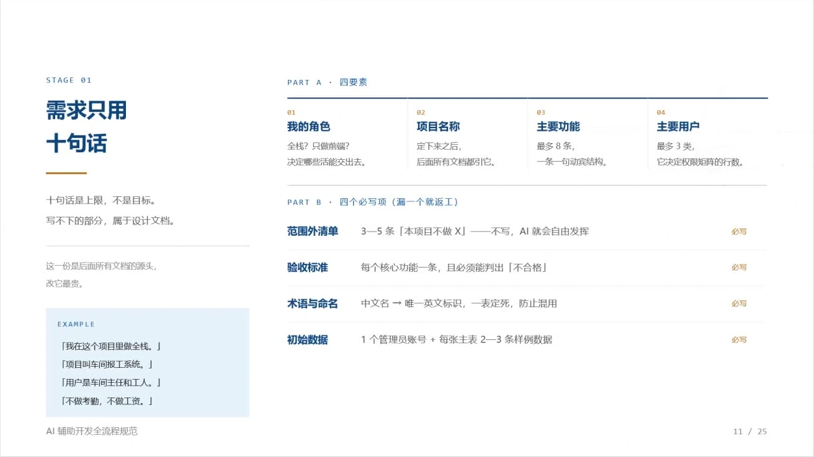
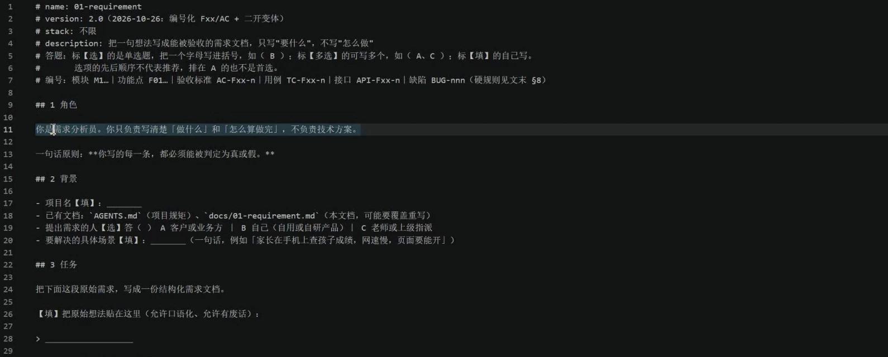
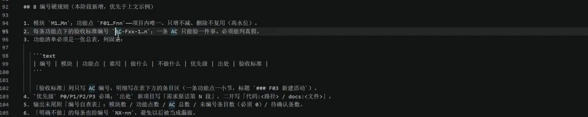
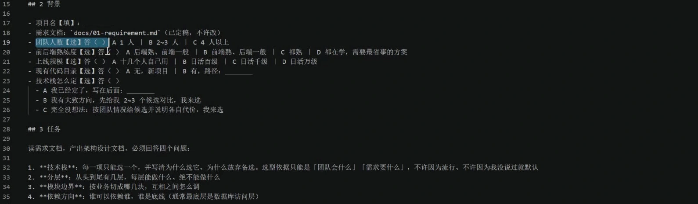
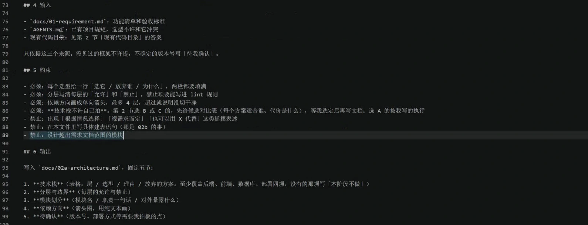
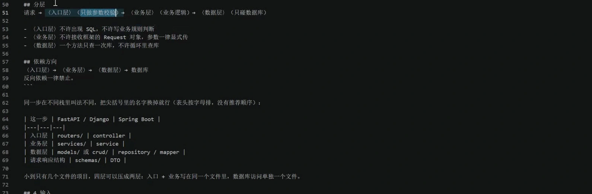
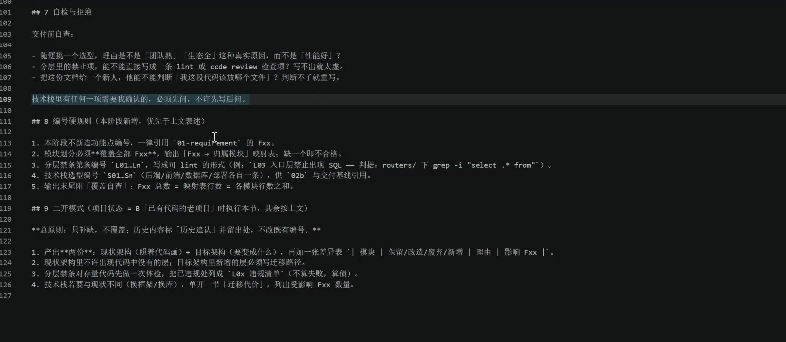

这篇整理 **10 月 28 日腾讯会议录课**，录屏长 **1 小时 10 分 37 秒**。它接着上一篇 [AI 开发先定规则](../content/ai-development-rules.md) 往下讲：规则准备好以后，怎样把一个想法写成需求，再把需求交给架构设计。

这节课最值得留下的做法是：**把“要做什么”“什么算完成”和“暂时不做什么”一起写清楚。** AI 可以帮忙整理、追问和提方案，产品范围仍要由提出需求的人确认。否则它写得越快，后面改起来可能越累。

本文依据完整音轨转写、全程定时画面和关键高清画面整理。正文会标明**课堂内容、整理者补充示例、依据官方资料作出的校正**。收到的压缩包只有一份视频，没有老师独立的 PPT、提示词或系统源码；下方配套文件是重新编写的练习材料。

- [需求与架构练习文件](https://github.com/Milo-Guo/bytelife/tree/main/examples/requirements-and-architecture)：提示词、完整小示例和审阅清单。
- [上一篇的规则模板](https://github.com/Milo-Guo/bytelife/tree/main/examples/ai-development-rules)：还没准备项目规则时，先从这里开始。

## 阅读导航

| 章节 | 读完能解决什么问题 |
| --- | --- |
| [01 需求、设计和规则](#req-01) | 这三种文档为什么要分开？ |
| [02 用十句话说清想法](#req-02) | 不懂产品设计，第一段应该怎么写？ |
| [03 用户、权限和范围](#req-03) | 角色、菜单、租户有什么区别？ |
| [04 可以打勾的验收标准](#req-04) | 怎样避免“页面看着能用，数据却没保存”？ |
| [05 把提示词真正用起来](#req-05) | 打开什么软件、选哪个目录、发给 AI 什么？ |
| [06 M、F、AC 和编号](#req-06) | 功能表怎样贯穿设计、开发和测试？ |
| [07 面试打分系统案例](#req-07) | 一段较具体的需求会怎样被继续追问？ |
| [08 审稿和需求变更](#req-08) | 文档生成后看什么，变更后改哪里？ |
| [09 进入架构设计](#req-09) | 下一阶段需要哪些输入，应该输出什么？ |
| [10 看懂代码分层](#req-10) | Router、Service、CRUD、Model、Schema 分别干什么？ |
| [11 规模、端口与 Nginx](#req-11) | 日活、并发、请求量和负载均衡怎样区分？ |
| [12 表单校验和登录安全](#req-12) | 为什么后端还要检查，401 和密码字段说明什么？ |
| [13 从个人记账本开始练](#req-13) | 如何交出两份能继续使用的文档？ |
| [14 全程回看与材料边界](#req-14) | 视频每段讲什么，哪些结果没有核实？ |

<a id="req-01"></a>

## 01 先分清需求、设计和规则

课堂一开始用电商平台举例：有买家、卖家、商品，有上架和下架。这样的描述已经是需求的起点，但还不足以直接开工。

“卖家能下架商品”至少还有这些问题：只能下架自己的商品吗？下架后买家还能看到吗？已下单的商品怎么办？操作失败怎样提示？这些答案不明确，AI 就得猜。

| 文档 | 回答的问题 | 用记账本理解 |
| --- | --- | --- |
| 项目规则 | 在这个项目里怎样工作？ | 沿用现有目录，不覆盖用户修改，改完运行检查 |
| 需求文档 | 给谁用、做什么、怎样判断完成？ | 本人记录支出，按月份查看分类合计 |
| 架构设计 | 用什么结构完成已经确认的需求？ | 页面、接口、业务处理、数据保存分别由哪里负责 |
| 数据库设计 | 数据怎样组织和约束？ | 一笔记录有哪些字段，金额如何表示，分类怎样关联 |
| 功能详细设计 | 某个功能具体怎样实现？ | 提交时校验什么，重复操作怎样处理，失败怎样返回 |

**课堂内容：**规则、需求、架构、数据库和功能设计应当先梳理，再进入业务代码开发。讲师强调“文档先行”，是为了避免刚想到一句话就让 AI 铺开整个系统。

**整理者补充：**文档的详细程度可以随项目规模调整。小练习可以用两三页说清核心范围；有重大未知项时，也可以先做限定范围的原型验证。原型的结论要回写文档，不能把未验证的猜想当成定案。

课堂提到需求调研可能耗时很久，原因也很实际：提需求的人熟悉业务，开发者熟悉技术，双方未必用同一种说法。把业务里的“正常情况”和“特殊情况”问出来，往往比写出第一版页面更费心。

<a id="req-02"></a>

## 02 用十句话说清原始想法

课堂课件写着“需求只用十句话”。它适合帮助人开始表达，不是说正式需求永远只能有十行，也不是每个系统只能有三类用户或八个功能。讲师在开头就说明：角色多时应按实际情况列清楚。



*录屏 05:00 的实际课件裁图。图中数量是简化填写的提示；正文按课堂补充说明和项目实际情况解释，不将其当成通用上限。*

下面是**整理者按课堂思路编写的问卷**，不照抄老师模板。先用自己的话填写，缺少的信息写“待确认”。

| 问题 | 个人记账本的示例回答 |
| --- | --- |
| 1. 项目叫什么？ | 个人记账本，与上一阶段项目名一致 |
| 2. 我是什么角色？ | 自用者，也是需求确认人 |
| 3. 谁提出这个需求？ | 我自己，作为学习项目 |
| 4. 要解决哪个场景？ | 月底不知道钱花在哪，想按类别回看 |
| 5. 谁会用？ | 首期只供本人使用 |
| 6. 最重要的功能是什么？ | 记录、查看、修改、删除支出，按月分类汇总 |
| 7. 这次不做什么？ | 不连接银行卡，不做多人共享，不自动同步云端 |
| 8. 怎样才算做好？ | 保存后重开仍能查到，汇总与明细一致，非法金额不能保存 |
| 9. 已有什么？受什么限制？ | 新练习目录；预算、数据备份位置和设备范围需要确认 |
| 10. 哪些事还没决定？ | 金额精度、日期口径、删除是否需要确认等逐项列出 |

不用一开始就把回答写成“专业产品语言”。例如：

> 我想做一个自用的记账本。每天花的钱能随手记录，月底看各类花了多少。现在先只管我一个人，不接银行卡，也不做家庭共享。我关掉再打开，记录还得在。具体怎样存数据，等需求确认后再讨论。

这一段比“帮我做个记账系统，功能完善一点”更容易继续追问。

课堂还举了孩子时间管理、日常记账等练习方向。挑一个自己熟悉的场景有好处：你知道真实操作是什么，也更容易判断 AI 有没有理解错。首次练习先控制范围，不必为了学习需求就同时申请小程序、买服务器和接支付。

课件还要求统一术语与命名。例如“候选人”和“面试人员”如果指同一种对象，就选定一个说法，并注明英文标识；“面试官”不要有时被写成“候选人”。这些词会延续到界面、表格、接口和数据库，先统一能减少后面张冠李戴。初始数据则在第 04 章单独区分。

### 有旧项目时，多补一组事实

课堂把“从零做”和“在已有系统上二开”分开。二开指在现有项目基础上新增或调整功能，不能当作空目录重建。

需要说明：现有项目的实际目录、已有功能、旧数据格式、必须沿用的登录权限、外部服务限制，以及这次允许修改的范围。AI 没读过的模块应标记“未检查”，不能凭常见项目结构编造文件名。

已有预算或技术栈也要带过来。例如上一阶段已经确认用 Python，就在这里引用那份规则。不要为了填新问卷，随手改成另一套语言，让两份文档互相冲突。

<a id="req-03"></a>

## 03 用户、权限和“不做什么”要一起写

### 角色不只是一个名字

“管理员、普通用户”写完后，要继续说每种人能做什么、不能做什么，以及能访问哪一部分数据。

以课堂的面试打分系统为例：

| 角色 | 课堂描述的职责 | 仍需明确的边界 |
| --- | --- | --- |
| 平台管理员 | 管理单位及其基础账号信息 | 是否可以查看各单位评分，哪些操作需要留记录 |
| 单位管理员 | 管理本单位活动、面试官、候选人和评分配置 | 只能访问本单位；活动间的数据范围也要写清 |
| 面试官 | 对被分配活动中的候选人打分 | 是否可看其他面试官评分，撤销需要谁审核 |

**菜单权限和数据权限是两件事。** 隐藏一个按钮，只能改变界面；后端仍要检查当前身份有没有操作资格。即使两个单位都能打开“面试人员管理”，也不能因此看到彼此的候选人。

### SaaS 和租户是什么意思

SaaS 可以理解为通过服务提供软件。同一平台服务多个单位时，通常会用“租户”表示各单位的独立业务空间。是否采用这种模式，要根据产品要求决定。

课堂强调不同单位、活动之间的数据不能互通，这是要保留的需求。实现时还应覆盖读取、修改、导入、导出、统计等路径，不能只检查列表页。

**官方资料校正：**身份认证和角色授权并不自动完成租户隔离；系统还需限制当前租户能访问的资源。平台管理员能否查看租户业务数据，也应明确设计，不能只靠“超级管理员”这个名字判断。[AWS：租户隔离](https://docs.aws.amazon.com/whitepapers/latest/saas-architecture-fundamentals/tenant-isolation.html)

课堂也提到 Java、Spring Boot、Spring Cloud 的权限方案。准确理解是：框架可以支持实现授权，项目仍要配置权限规则、用户角色和数据范围。Spring Security 的请求授权、方法授权机制，不等于自动带有一套完成的动态菜单管理后台。[Spring Security：授权](https://docs.spring.io/spring-security/reference/servlet/authorization/index.html)

### 范围外清单能省掉很多返工

AI 想到额外功能，可以先列为建议或待定项。确认之前，不应悄悄进入本期交付范围。

例如记账本首期不做银行卡同步。AI 如果顺手加入账户体系、支付接口、家庭成员邀请，项目就从一个小工具变成另一种规模了。把它写成 `NX-01：本期不连接银行或支付平台`，后续审阅时可以直接检查。

“可让 AI 发散”适合用在收集方案时；定稿时要把结果分成**已确认、本期不做、待确认**。建议不能自动变成已批准需求。

<a id="req-04"></a>

## 04 验收标准要能一条条打勾

课堂反复提醒：**没有“不做什么”和验收标准，需求就还没写完。** “功能正常”“体验良好”“数据库没问题”都太宽，测试的人不知道做到哪一步算通过。

一个便于初学者使用的写法是：**前提 → 操作 → 可观察结果**。它与 Given / When / Then 的思路一致；写成这种句式不会自动运行，仍需人工执行或编写测试步骤。[Gherkin 官方参考](https://cucumber.io/docs/gherkin/reference/)

| 模糊写法 | 可检查的写法 |
| --- | --- |
| 可以新增支出 | 在记录为空时，输入合法日期、餐饮类别和 12.50 元并保存；列表出现一条对应记录 |
| 数据持久化 | 保存该记录后关闭并重新打开程序；仍能查到相同金额、类别和日期 |
| 金额校验正确 | 输入 0、负数或非数字提交；提示具体原因，并且不新增记录 |
| 修改功能正常 | 把 12.50 元改为 15.00 元；重新打开后显示 15.00 元，记录条数不增加 |
| 月报正确 | 当月餐饮明细为 12.50 元和 7.50 元；餐饮合计为 20.00 元，不包含其他月份记录 |
| 数据隔离 | 使用单位 A 的授权测试账号，访问单位 B 的测试记录；请求被拒绝且不返回该记录 |

每条 AC 最好只检查一个结果。例如“新增、修改、删除和统计都成功”应该拆开。出问题时，才能定位到底是哪条没满足。

### 成功提示不代表真的保存

课堂用商品增删改查提醒大家检查数据库。对于初学者，可以按这条顺序验证：提交一条数据，看列表；重新刷新，看数据；退出重开，再查一次；最后使用项目已有的数据查询方式核对保存结果。

如果界面只是把新行临时加进内存，刷新后会消失。需求应把“下次打开仍然存在”写出来，测试也要实际执行。不要只凭一张成功截图勾选“持久化通过”。

### Mock、测试数据和初始化数据

课堂希望大家不要用假接口冒充真实功能。这一点可以保留，术语需要分清：

| 名称 | 在练习里怎样理解 |
| --- | --- |
| Mock | 测试替身或模拟行为，例如临时替代外部接口、记录函数调用 |
| 测试数据 | 用于验证的数据，可以在测试数据库、文件或内存中；不要求一定写进正式数据库 |
| 初始化数据 | 系统开始运行需要的基础内容，例如分类、角色或首个账号 |
| 演示数据 | 用来展示操作效果的数据，应与真实业务记录区分 |

**官方资料校正：**Mock 不只是一种“占位服务”。Python 的 `unittest.mock` 可以替换被测对象并检查调用，MSW 则可以模拟网络请求。合理的模拟测试有用；交付真实保存功能时，还需要验证真实接口和存储链路。[Python：unittest.mock](https://docs.python.org/3/library/unittest.mock.html)、[MSW 官方文档](https://mswjs.io/docs/)

也不是每个软件都需要超级管理员。单人本地记账工具可以不设账号；多用户后台则应说明首个账号如何建立、权限范围、首次使用和恢复方式。课堂案例中的初始化管理员是该案例的安排。

<a id="req-05"></a>

## 05 把需求提示词真正用起来

课堂约 13:40 开始逐段讲需求提示词，约 40:10 有一个很实用的问答：填写后是直接发给 AI 吗？会修改 `AGENTS.md` 吗？

答案是：填好输入信息，再交给具备项目文件读写能力的开发工具；**本阶段主要产物是需求文档**。不要把需求正文覆盖进项目规则文件。



*录屏 14:30。这里展示的是老师在解释的提示词文件，图片中的约束属于课程材料；配套练习模板另行编写，使用时填写自己的项目事实。*

### 5.1 先打开正确项目

以下是**整理者补充的通用操作**，适用于已有 AI 编程工具的读者；课堂具体界面会随软件版本变化。

1. 打开 VS Code，在 `File → Open Folder`（打开文件夹）选择实际项目根目录。首次练习请新建独立目录，例如 `Documents\requirements-practice`。
2. 在资源管理器中确认它确实是目标项目。已有项目先检查当前修改，不要把课上另一项目的文件整套覆盖进去。
3. 打开你平常使用的 AI 编程工具，选中同一个项目。新建一个会话，把名称记为“需求分析”。课堂采用按项目分组的方式组织会话。
4. 让 AI 先列出实际找到的项目规则和已有文档。读不到时提供文件或修正路径，不让它假装已经读取。
5. 打开配套的 [需求访谈提示词](https://github.com/Milo-Guo/bytelife/blob/main/examples/requirements-and-architecture/01需求访谈.prompt.md)，填写自己的项目事实和原始想法，再完整复制到该会话。
6. 审阅 AI 的追问。影响角色、数据范围、费用或核心流程的问题先确认；回答不知道时，可以要求它给少量方案和取舍。
7. 让 AI 把确认结果写入约定的需求文档。配套示例使用 `docs/01需求文档.md`；如果项目已经使用其他文件名，就沿用实际路径。

**成功时应看到：**目标文档真实出现在正确目录，里面有角色、功能、范围外、验收和待定项。聊天里仅显示一段正文，不能等同于已经保存文件。

**失败时先检查：**项目是否选错、工具是否只有聊天能力、文件权限是否允许写入、中文文件名是否一致、AI 是否引用了不存在的目录。不要反复开新项目，把不同版本分散在几个文件夹里。

### 5.2 新会话需要重新交代输入

课堂建议需求和架构分开会话，目的是减少无关聊天干扰。新开会话以后，不应假定它知道上一段讨论。要提供已确认需求的路径、项目规则和这一阶段的输出目标。

可以这样开头：

```text
当前阶段：只做需求分析。
先读取项目中实际存在的规则和已有文档，报告读取到的路径。
下面是我的原始想法，请整理成角色、功能、范围外、验收标准和待确认项。
本阶段不写业务代码，不擅自扩大范围。
影响产品范围、权限或费用的未知项请列出选择；普通措辞和排版可以直接整理。
```

“你是一名需求分析员”能帮助明确任务，但不会自动补齐业务知识，也不能保证回答正确。最终仍要检查文档内容。

### 5.3 哪些文件此时应该变化

| 文件 | 需求阶段通常怎样处理 |
| --- | --- |
| 需求文档 | 新建或更新本次确认内容 |
| 文档索引 | 需要时登记真实文件路径和状态 |
| `AGENTS.md`、`CLAUDE.md` | 读取并遵守；需求变化不自动等于需要重写规则 |
| 业务源码、数据库结构 | 此阶段通常不修改；另有验证任务时单独说明范围 |

如果架构设计最终改变了原先记录的技术事实，规则也可能需要同步。这应是明确的变更，不能机械理解为“规则文件从此永远不能动”。

<a id="req-06"></a>

## 06 用 M、F、AC 把功能与验收对应起来

课堂约 36:35 开始讲编号。编号的作用是让需求、设计、任务和测试能互相找到，并不是为了把文档写复杂。



*录屏 37:30。截图展示老师模板的编号要求；下面用练习包的一套固定格式说明对应关系。*

| 编号 | 含义 | 示例 |
| --- | --- | --- |
| `M01` | Module，功能模块 | 支出记录管理 |
| `F01` | Function / Feature，具体功能点 | 新增一笔支出 |
| `AC01` | Acceptance Criteria，验收标准 | 合法输入保存后重开仍有记录 |
| `NX01` | 本期范围外的事项 | 不接银行接口 |
| `D01` | 需要确认的决策 | 预算与是否接受付费依赖 |

这是本文采用的示例格式。课堂模板的分隔符、位数可以不同；项目里统一使用一种即可。**Module 是模块，Model 是模型，两者不要因为单词相似混为一谈。**

### 一张功能总表

| 模块 | 功能编号 | 功能 | 优先级 | 验收编号 |
| --- | --- | --- | --- | --- |
| M01 记录管理 | F01 | 新增支出 | P0 | AC01、AC02、AC03 |
| M01 记录管理 | F02 | 查看月流水 | P0 | AC04、AC05 |
| M01 记录管理 | F03 | 修改支出 | P0 | AC06、AC07 |
| M01 记录管理 | F04 | 删除支出 | P0 | AC08、AC09 |
| M02 月度统计 | F05 | 查看分类合计 | P0 | AC10、AC11 |
| M03 初次使用 | F06 | 查看空账本 | P1 | AC12 |

这是**配套练习包的小示例**，共 3 个模块、6 个功能、12 条 AC。优先级含义也要自己定清楚，例如这里 P0 是首期需要形成的完整记账流程，P1 是稍后补齐的辅助体验；后续版本可以另设 P2。不能只看数字，还要考虑依赖：月报需要先有记录。

需求进入设计后，可以写“本接口实现 F01，对应 AC01 至 AC03”；测试报告再记录每条 AC 的执行结果。这样发现保存有问题时，能追到具体功能和实现位置。

### 编号保持稳定，内容允许有记录地修改

课堂要求编号唯一、递增。实践中，已经被任务或测试引用的功能编号不要随便重排。删去功能时保留“取消”状态和原因，比让后面的编号整体挪位更容易追查。

交付文档前可以做一次计数：模块多少个、功能多少个、验收多少条、范围外多少条、仍有多少待定项。**数量对得上只表示结构完整，不能证明每条需求都合理。**

<a id="req-07"></a>

## 07 课堂案例：面试打分系统

约 24:20 起，讲师展示自己写的面试打分系统提示词。它把业务约束说得比“一句话做系统”细得多，也包含了一些已经选定的技术方案。

### 7.1 课堂实际讲到了哪些内容

| 方面 | 录屏讲解内容 |
| --- | --- |
| 产品场景 | 面对面面试打分，以面试官为主要使用者 |
| 技术选择 | Vue 3 管理前端、FastAPI 后端、SQLite 数据库；UI 组件版本需以真实项目核对 |
| 规模 | 提出最多约 10 人并发的预期，不是视频中的压测结论 |
| 角色 | 平台管理员、单位管理员、面试官 |
| 活动管理 | 设置面试活动、时间、地点，管理面试官与候选人 |
| 打分规则 | 平均分、去最高最低分；评分维度有名称和分数上下限 |
| 匿名展示 | 打分时显示候选人编号，不显示姓名 |
| 撤销流程 | 面试官提交撤销申请，单位管理员审核 |
| 数据边界 | 不同单位、活动的数据隔离 |
| 批量处理 | Excel 导入面试官、候选人；活动宣传材料可下载 |

这段示例已经混入了框架选择。自己的需求文档可以把技术信息放入“已知约束”，把业务条目留在功能部分。后续架构师据此设计，不必把每个技术名词写进每条需求。

### 7.2 去掉最高最低分，仍然有很多问法

课堂展示 AI 继续追问：按面试官总分去掉最高最低，还是每个评分维度分别去掉？由系统计算还是人工处理？

**整理者补充：**如果面试官只有两人怎么办？多个最高分并列去掉几个？缺席或未提交的评分算不算？保留几位小数、什么时候舍入？这些都会影响结果，不能只写“去掉最高最低后求平均”。

讲师选择把部分规则做成后台配置。配置是一种方案，但每种配置的含义、可选范围、默认值、变更生效时间仍要写清，不能用“都可配置”代替业务定义。

可以先写一条待确认项：

> D-01：评分结果按总分还是按维度去极值？请确认规则及参与人数不足时的处理。定稿前，不把其中任一种当成默认产品事实。

### 7.3 “并发”在这里有两种含义

讲师还提到用两三个并行工作单元开发系统。**开发任务并行数**和**用户同时使用系统的数量**没有直接等号。三个 AI 一起写代码，不代表应用可以承受三个、三百个或任何特定数量的在线用户。

### 7.4 录屏展示到什么程度

讲师口述该系统已经部署，并使用 Playwright 等方式测试。约 31:00 的结果统计画面是在 AI 会话里打开的图片，不是本次现场登录成功的证据；随后切到浏览器尝试登录，出现认证失败，讲师推测密码已被修改，没有在这段录屏里重新登录成功并逐项演示全部业务。

因此，本文将“已测试、零 Bug”等表述记为**讲师对其先前测试的描述**。我们没有拿到源码、测试报告或独立测试账号，不能替这套系统确认“完全无缺陷”，也不访问课堂出现的账号或服务来试验。测试用例通过，说明这些已执行检查符合预期，不能证明所有缺陷都不存在。[ASTQB：测试原则](https://astqb.org/1-3-testing-principles/)

课堂提到用 UI UX Pro Max 一类 Skill 美化页面。它属于辅助设计工具，与需求是否清楚、权限是否正确、评分计算是否正确是不同的检查项。

<a id="req-08"></a>

## 08 文档生成后要审，需求变更要留记录

课堂约 34:20 提醒：生成文档后要逐字看。需求理解错了，后面的设计和实现会跟着错。

审阅时可以先抓五处：

1. **有没有增项。** 原本只给本人用，是否被写成多人平台？建议是否混进了已确认范围？
2. **权限是否明确。** 谁能看、谁能改、能操作哪部分数据？不要只写“根据权限访问”。
3. **是否能验收。** 每个功能都能找到具体 AC，异常输入也有处理结果。
4. **事实是否一致。** 项目名、目录、技术栈、角色和统计口径是否前后相同？
5. **待定是否仍然可见。** 未确认项有没有被 AI 悄悄补成结论？核心待定项没有解决时，不能把文档标成已确认。

### 需求改变时，先改依据，再改实现

课堂约 42:00 讨论需求漂移和客户确认。可以保留的工程做法是：让相关人员看懂并确认版本；必要时用演示页、图片或演示文稿辅助沟通；新增内容写成变更项，评估影响。

“需求改动超过 10% 就一定失败”是课堂中的项目经验说法，本文不把它作为通用行业阈值。探索型产品、学习练习和明确范围的交付项目，变更方式本来就可能不同。

书面确认也不能简单理解为“此后永远不能修改”。本篇只讨论协作记录：明确确认了哪个版本、哪些内容、何时生效；有变化时，再说明工期、费用、数据和测试影响，按双方约定处理。

这也符合需求管理中对基线与变更控制的处理思路：可以提出变更，经过评估和批准后更新，而不是把基线理解为永远不变。[NASA：需求管理](https://www.nasa.gov/reference/6-2-requirements-management/)

一个可用的变更记录是：

```text
变更编号：CH-01
原因：首期需要补上记录导出，便于本人备份。
影响：拟新增 F07；确认后分配新的 AC 编号，并调整架构中的文件输出方式。
当前状态：待需求确认人确认，不计入已完成范围。
确认后：更新需求、设计、任务和测试，保留原版本记录。
```

这项变更未确认前，练习包仍保持原来的 3 模块、6 功能、12 条 AC；导出仍列在首期范围外。

### 分阶段会话，保留可交接文档

课堂最后说需求会话结束后可以关闭。实际使用时，关闭或归档即可，不必为了“清干扰”删除全部聊天。重要的是把已经确认的结论保存进项目，而不是只留在某条消息里。

下一阶段能读到确定的文档版本，才算交接成功。

<a id="req-09"></a>

## 09 架构设计从已确认需求开始

课堂约 39:35 初次引入架构，约 45:15 继续详细讲解。讲师建议把设计拆成**架构、数据库、功能设计**，分别处理，避免一份提示词同时承担所有细节。

架构设计可以理解为：决定系统由哪些部分组成，各部分负责什么，怎样依赖和协作。它需要服务于需求，不能凭空扩出另一套产品。



*录屏 47:30。先补足背景信息，技术方案才有选择依据；未知项可以先保留待确认。*

### 9.1 输入要实际存在

| 输入 | 为什么需要 |
| --- | --- |
| 已确认需求文档 | 知道角色、范围、功能及验收目标 |
| 项目规则与技术约束 | 沿用已确认框架、目录和开发规范 |
| 已有源码与数据库现状 | 二开时识别真实结构和兼容要求 |
| 团队人数与熟练程度 | 选择团队能维护的复杂度 |
| 使用规模、数据量、部署范围 | 讨论容量、存储和部署方案 |
| 未确定的问题 | 防止方案把未知条件当作事实 |

课堂强调需求文件的路径可以是中文，也可以是英文，关键是能找到正确文件。不要在提示词里写一个漂亮路径，目录里却是另一个名字。

技术栈输入可以分三种情况：已经定好的，引用实际规则并沿用；只有方向的，说明倾向与不能改变的条件；完全没想法的，让 AI 比较少量方案及维护成本，再确认。不能把“请给建议”默认为“任意框架都已经批准”。

### 9.2 输出应能约束后续实现

架构文档至少应讲清：前后端各做什么、模块边界、依赖方向、数据流、认证授权在哪里处理、存储方式、部署结构，以及仍待确认的设计决策。

例如，“前端调用后端接口，后端保存记录”只是一句话。继续写清接口入口负责参数与身份检查，业务服务负责规则，数据访问负责读写，失败怎样返回，后续代码才有依据。

不过，规定层次不等于层越多越好。小项目可以很简单；已有项目优先沿用实际架构。课堂中的分层方案是约定的一种，不是所有 FastAPI 项目必须采用的固定目录。



*录屏 69:00。输出包括技术栈、分层与边界、模块划分、依赖方向和待确认项。它是期望的文档结构，不是已经完成的架构结果。*

### 9.3 实际操作

1. 在原项目下新建“架构设计”会话，仍选择同一个项目目录。
2. 打开 [架构设计提示词](https://github.com/Milo-Guo/bytelife/blob/main/examples/requirements-and-architecture/02架构设计.prompt.md)，填写需求文档和规则文件的真实路径。
3. 先让 AI 报告读取到的文档、版本或当前状态；核心需求仍未确认时，先解决它。
4. 要求方案逐项对应功能和 AC。新增服务、付费依赖、重大技术更换需要说明原因和影响。
5. 审阅后写入架构文档。配套文件使用 `docs/02架构设计.md`，这是练习路径，已有项目沿用自身命名。

**成功时看到：**架构文档引用了正确需求，模块和数据流有明确职责，待定项仍列出，没有提前宣称代码已实现或部署已完成。

**出现问题时：**先比对输入路径、需求状态和规则冲突；让 AI 指出依据不足的位置。不要因为“架构师角色”听起来专业，就跳过审阅。

<a id="req-10"></a>

## 10 看懂 Router、Service、CRUD、Model 和 Schema

约 50:20 起，课堂结合规则文件讲分层。这段对初学者很有帮助，但口述中把 `models`、`schemas`、模块、ORM 的职责混在了一起，下面按常见 Python Web 项目语境重新说明。



*录屏 64:00。表中名称是课堂的简化映射，具体框架不强制采用这些目录；尤其不能把所有 models 都当成数据访问函数。约 51 至 58 分钟另一个 AGENTS.md 演示来自信息收集管理项目，并非面试系统的最终架构。*

| 名称 | 常见职责 | 不要混淆成什么 |
| --- | --- | --- |
| View / 页面 | 展示界面，接收用户操作 | 不应作为唯一的权限和业务检查位置 |
| Router / Controller | 接收请求、组合输入与授权检查、调用业务处理 | 不必把所有业务和 SQL 都塞进来 |
| Service | 执行业务规则，组织多个步骤和事务 | 不是另一台服务器的固定同义词 |
| CRUD / Repository | 封装数据读取、创建、修改和删除 | `CRUD` 不是框架名，也不是所有项目都必须有同名目录 |
| Model | 数据模型；在 ORM 语境中常映射表和关系 | 不是 Module（功能模块） |
| Schema / DTO | 描述请求与响应的数据结构、校验规则 | 在常见 FastAPI 命名中，不负责建立数据库连接 |
| Session / 数据库访问配置 | 管理与数据库的交互上下文等 | 不等同于浏览器登录会话 |
| ORM | 用程序中的模型与数据库记录交互的工具 | 不等于所有叫 `schemas` 的文件 |

CRUD 的全称是 **Create、Read、Update、Delete**，对应创建、读取、更新、删除。课堂口语里的“增删改查”就是这组基本操作；“查”的字母 R 来自 Read。

FastAPI 官方教程会区分请求/响应使用的数据模型，以及映射数据库表的模型。项目可能共用一套建模库，也可能分开定义，必须看具体代码。[FastAPI：SQL 数据库](https://fastapi.tiangolo.com/tutorial/sql-databases/)、[FastAPI：请求体](https://fastapi.tiangolo.com/tutorial/body/)

### 用“买五件打八折”理解各层

这是课堂后半段用到的业务例子。把它稍作整理：

1. 页面接收购买数量，给用户即时提示。
2. 后端入口校验数量是否是允许的整数、是否大于零，并检查当前请求身份。
3. 业务层判断适用哪个优惠规则，检查活动、商品状态、库存等业务条件。
4. 数据访问部分读写所需数据；关联操作按项目约定管理事务。
5. 后端返回明确结果，页面显示；失败时不冒充成功。

例如传入 `X`，首先是数量结构不符合要求；传入合法数字 `5` 但库存只有 `3`，属于业务条件不满足。这两种情况的职责和错误信息可以分开。

`Schema` 在这里帮助描述“数量必须是整数”等结构，不是在请求经过所有 Model 后，才去连接数据库的末端层。画调用关系时也不应把所有名词硬排成一条串行链。

### 分层是维护约定，不是强行加目录

课堂希望入口不要直接堆业务逻辑。这是适合其多模块项目的约束；小型示例可以先少分文件，复杂后再合理拆分。更重要的是业务规则不要散落、依赖方向清楚、测试能找到负责的代码。

松耦合与紧耦合也不只存在于微服务。单体内部的模块、类和函数同样会相互依赖；把系统拆成多个服务，并不会自动使依赖更松。[Microsoft：应用架构原则](https://learn.microsoft.com/en-us/dotnet/architecture/modern-web-apps-azure/architectural-principles)

<a id="req-11"></a>

## 11 日活、并发、端口和 Nginx

### 11.1 “一天一百人用”不等于一百并发

课堂约 48:10 围绕日活、UV、PV 和请求量展开问答。填架构输入时，最好分别写，缺少数据就标记估算。

| 指标 | 简单解释 | 为什么不能互相直接代替 |
| --- | --- | --- |
| DAU / 日活 | 一天内满足产品活跃定义的去重用户数 | 一百人可能分散使用，也可能同时到场 |
| UV | 在统计周期、识别方式下的独立访客 | 不一定与已登录用户一一对应 |
| PV | 页面浏览或页面查看事件次数 | 一个页面可能调用多个接口 |
| QPS / RPS | 每秒查询或请求数量，需说明统计对象 | 相同人数的操作频率可能相差很大 |
| 并发 | 同时进行的请求、任务、连接或操作数 | 必须说明是哪一种并发 |

不能只输入“日活百级”，就认为 AI 可以准确推导出服务节点数量。还需要高峰时段、操作频率、响应时长、请求成本、数据库能力和性能目标，最终通过测试与监控修正。

如果讨论的是同时在途请求，稳定条件下可以用“平均每秒请求数 × 平均请求耗时（秒）”估算平均并发；这与一天多少用户是不同指标。[AWS：并发计算](https://docs.aws.amazon.com/lambda/latest/dg/lambda-concurrency.html#calculating-concurrency)

**整理者算例：**假设 100 人集中在 10 分钟内各发起 12 次请求，平均约为 `100 × 12 ÷ 600 = 2 RPS`。这只是按假设得到的平均值，瞬时峰值可能更高，也没有说明单次请求多慢。不能拿它直接作为采购服务器或保证容量的依据。

### 11.2 前后端怎样接起来

课堂约 57:20 讲到部署：前端构建结果通常是一组 HTML、CSS、JavaScript 等静态文件，后端则运行提供接口服务的程序。前端不一定是 Java 的 JAR 包；后端也要按真实框架的启动方式运行。

浏览器访问前端，用户操作后发出 HTTP 请求；Nginx 可以按路径把接口请求转给后端，同时提供静态文件。HTTPS 是加上 TLS 保护的 HTTP 传输。

课堂把“运行进程”和“端口”联系起来，准确地说：**提供网络监听服务的进程需要配置监听入口，普通进程并不一定占用网络端口。** 多个 worker 也可能共享同一监听入口，不能通过端口数量直接数出所有进程。

### 11.3 反向代理和负载均衡

Nginx 的反向代理是接收请求后转发给上游服务；负载均衡则可以在多个上游之间分配请求。两者经常一起使用。[Nginx：HTTP 负载均衡](https://nginx.org/en/docs/http/load_balancing.html)

下面是**整理者编写的结构示意**，使用本机回环地址，不是课堂服务器配置：

```nginx
upstream app_pool {
    server 127.0.0.1:8001;
    server 127.0.0.1:8002;
}

server {
    listen 8080;

    location /api/ {
        proxy_pass http://app_pool;
    }
}
```

它表达“请求 `/api/` 时，转给上游池中的后端”。要让它运行，还需要完整 Nginx 环境、后端服务、正确路由和部署配置；仅复制这段不会启动后端。

其中 `proxy_pass` 带不带末尾路径，会影响转发 URI 的处理，应该根据真实后端路由配置。[Nginx：proxy_pass](https://nginx.org/en/docs/http/ngx_http_proxy_module.html#proxy_pass)

课堂用“一个服务 150 并发，三个就是 450”帮助理解横向扩展。实际扩容可能受共享数据库、CPU、锁、网络和状态同步限制，**容量不会保证按实例数等比例增长**。增加多个实例也不等于采用了微服务：同一个单体应用可以运行多份副本。

本篇不要求你去改服务器配置。理解请求经过哪里，再在后续部署阶段按项目环境落地即可。

<a id="req-12"></a>

## 12 表单校验、401 和密码传输

课堂约 63:20 用购买数量说明校验，约 65:00 打开浏览器开发者工具查看登录请求。这里有几个基础概念需要一起说清。

### 12.1 前端提示方便使用，后端检查负责执行约束

页面可以限制输入、隐藏按钮、弹出提示，但客户端请求可能被修改，也可能直接由其他程序发送。因此后端仍要检查输入、身份、权限及数据归属。数据库再用类型、约束和事务等机制维护一致性。

“后端校验可信”应理解为校验必须在服务端执行，不代表后端写了几个判断就不会出现漏洞。具体规则和实现仍要验证。

### 12.2 在自己的练习里查看 Network

1. 用 Chrome 打开自己的本地练习页面，按 `F12` 打开 `DevTools`（开发者工具）。
2. 选择 `Network`（网络）标签，清空旧记录，再提交一次测试表单。
3. 在请求列表选中对应接口，查看 `Headers`（请求头信息）里的地址、方法和状态码。
4. 查看 `Payload`（发送数据）和 `Response`（返回内容），比对输入与结果。
5. 记录问题时删去密码、令牌、Cookie 和个人数据，只保留排错所需字段。

成功时能把“页面点了什么”和“实际调用哪个接口、返回什么”对应起来。如果没有看到请求，先看页面有没有在提交前报错，以及是否选中了正确请求类型和页面。

这是观察自己项目的排错方法，本文没有用课堂账号登录或测试外部系统。

### 12.3 401 不等于后端程序崩溃

课堂登录请求出现 `401`。它通常表示请求没有满足有效的身份认证要求，例如凭据不正确或缺失；`403` 则表示服务端拒绝该操作，常与权限有关。实际原因还需看响应和服务端日志，不能只根据一个状态码猜测密码一定被谁改过。[MDN：401 Unauthorized](https://developer.mozilla.org/en-US/docs/Web/HTTP/Reference/Status/401)

### 12.4 浏览器看到密码字段，不能单独证明网络泄露

开发者工具能显示浏览器构造的请求内容。**即使用了 HTTPS，浏览器自己也知道提交的原始字段。** 看到 `password` 的值，并不能单独证明网络上的旁观者能看到同样的内容。

Chrome 的 Network 文档明确区分请求数据等查看位置；排错时应结合实际传输协议判断。[Chrome：查看请求 Payload](https://developer.chrome.com/docs/devtools/network/reference#payload)

应该分别检查：

- **传输层：**实际地址是否使用 HTTPS，TLS 配置是否正确；HTTP 明文传输和浏览器本地展示不是同一件事。
- **保存层：**服务端不应直接明文保存密码，应使用适合密码的哈希方案。
- **运行过程：**密码、会话凭据等不应进入公开截图、日志或网址。
- **登录防护：**按实际需求设置失败尝试限制、节流、异常监测等。验证码只是辅助措施。

这些分别对应不同问题。给前端套一层自行设计的“加密”，不能替代 HTTPS 和服务端认证设计。[OWASP：传输层保护](https://cheatsheetseries.owasp.org/cheatsheets/Transport_Layer_Security_Cheat_Sheet.html)、[OWASP：密码存储](https://cheatsheetseries.owasp.org/cheatsheets/Password_Storage_Cheat_Sheet.html)

课堂出现过初始化密码相关描述。练习材料不沿用电话号码片段或公开固定口令；有账号的系统应另行设计安全的初始化和首次使用流程。

<a id="req-13"></a>

## 13 实际练一次：个人记账本的两份文档

本节是**整理者补充练习**，不要求本次就把软件全部开发出来。目标是拿到能交给下一阶段的需求和架构文档。

### 第一步：准备独立目录

打开文件资源管理器，在“文档”里新建 `requirements-practice`，再用 VS Code 的 `File → Open Folder` 打开它。

打开 [配套目录](https://github.com/Milo-Guo/bytelife/tree/main/examples/requirements-and-architecture)，先读 `README.md`。如果下载整个仓库压缩包，只把该配套目录中需要的文件复制到练习目录，不要把整个网站当成记账项目。

初次没有规则时，参考 [上一课](../content/ai-development-rules.md) 为练习建立约定。已有项目保留原规则，别把模板覆盖进去。

### 第二步：先写自己的需求，再看示例

打开 `01需求访谈.prompt.md`，把原始想法改成自己的生活场景。给 AI 后先处理待确认问题，再审阅生成的需求。

配套的 `docs/01需求文档.md` 是完整小示例，可用来检查自己遗漏了什么。它不是你真实项目已经获批的需求，更不代表记账程序已经实现。

对照 [需求审阅清单](https://github.com/Milo-Guo/bytelife/blob/main/examples/requirements-and-architecture/需求审阅清单.md)，至少能回答：每条功能谁用、在什么情况下做什么、输入失败怎么办、怎样观察结果，以及本期哪些内容不做。

### 第三步：架构会话读取确认后的需求

打开 `02架构设计.prompt.md`，填入实际路径。让 AI 依据需求和规则设计，不直接重做需求。参考 `docs/02架构设计.md` 的结构，但不要把示例中待定的技术选择当作已确认。

如果只做本地单人小工具，没有需求依据就不必加入多租户、消息队列、负载均衡等系统。课堂讲到这些概念，是为了认识规模变化，不是要求每个练习都安装一遍。

### 第四步：做跨文档复查

课堂结尾要求把需求、架构、数据库、功能设计放在一起检查。现在已有两份文档，就先做两份的检查：



*录屏 69:30。功能编号应延续到后续设计；旧项目要分清现状、目标和差异，保留既有内容及改造代价。*

```text
请只审阅当前文档，不修改业务代码。
检查需求中的每个功能及 AC 是否有架构安排，是否出现范围外功能。
检查项目名称、角色、权限、存储与运行假设是否一致。
逐项报告：问题位置、冲突依据、影响、建议修改。
未读取的文件和未运行的验证必须明确写出。
```

**本次练习的完成标志：**两份文件保存在正确目录；核心待定项有处理结果；功能与验收能对应；架构没有擅自增项；你能用自己的话解释一次数据从输入到保存的过程。

此时能说“文档已审阅”。要说“功能通过验收”，还要在后续开发完成后，真正执行那些 AC。

<a id="req-14"></a>

## 14 全程回看索引与材料边界

以下时间为原视频进度，便于在播放器里拖动。录屏结束前，讲师准备停止录制、转入讨论；压缩包没有后续讨论内容。

| 视频时间 | 内容 | 阅读时注意 |
| --- | --- | --- |
| 00:00 至 04:20 | 需求是什么，项目目标、提出者、需求调研 | 先把业务场景讲明白 |
| 04:20 至 09:45 | 用户与权限、范围外、验收、初始化数据 | 角色数量按实际；区分 Mock 与持久化验收 |
| 09:45 至 13:40 | 时间管理、记账等练习方向，后续阶段概览 | 练习不必一上来公开发布小程序 |
| 13:40 至 20:55 | 需求提示词：新会话、角色、背景、原始想法、旧项目 | 问卷与生成约束分开看 |
| 20:55 至 24:20 | 每条需求要素、追问、避免擅自扩展 | 建议先确认，再进入范围 |
| 24:20 至 30:50 | 面试打分系统需求与决策项 | 技术约束与业务需求要分清 |
| 30:50 至 34:10 | 已部署系统、页面美化、现场登录尝试 | 现场未重新登录成功；先前测试为讲师口述 |
| 34:10 至 39:35 | 文档输出、自查、M/F/AC、优先级和范围外编号 | 每条 AC 检查一个结果 |
| 39:35 至 45:15 | 架构引入、规则与 docs 区别、客户确认、需求变更 | 10% 是课堂经验说法，不作通用标准 |
| 45:15 至 50:20 | 架构会话、需求路径、团队、规模、技术栈 | 日活不能直接等同并发或请求量 |
| 50:20 至 56:35 | 分层、依赖方向、CRUD、Models、Schemas | 按第 10 章区分术语和实际职责 |
| 56:35 至 61:20 | 浏览器到后端、前后端部署、端口、Nginx 转发 | 多副本不必然是微服务，扩容不保证线性 |
| 61:20 至 64:55 | 模块边界、入口校验、业务规则、购买数量例子 | 单体也有耦合；后端必须检查输入 |
| 64:55 至 67:20 | DevTools、Network、401、密码与登录防护 | 本地看到请求体不等于证明 TLS 失效 |
| 67:20 至 70:37 | 各框架分层命名、架构输出、跨文档一致性审查、结束 | DDL 是数据定义相关语句，数据库详细设计尚未完整展开 |

### 本篇覆盖到哪里

本次音轨长约 4237.15 秒，机器转写 2718 段。转写中的“虚似文档”“Skyma”“Code”等词，根据上下文和画面核为需求文档、Schema、CRUD 等；正文没有把识别错字当成正式术语。

画面核对覆盖全程每 30 秒加结尾，共 143 张定时帧、9 张联系表，另核对 18 张高清关键帧；这属于全程抽样和重点复核，不是逐帧检查所有运动画面。文中 7 张实机图从课堂画面裁剪、压缩而来，没有重绘截图文字。

约 41 至 45 分钟展示的 `docs` 目录中，多份文件仍为 0KB。它说明目录骨架存在，不能据此认定需求、测试计划和部署手册已经写好。

文章完整覆盖本次录课的需求与架构讲解。数据库建表与功能详细设计只作后续阶段提示，没有凭空补成“老师已讲完的课程”。DDL（Data Definition Language）是创建、修改数据库结构等的数据定义语言内容，也不等于全部 SQL。

课堂里出现的项目提示词、规则、网址和命令都作为学习材料处理。文中配套提示词与记账示例是另行整理的材料；课堂录屏、私人聊天、账号、请求凭据和原始转写不随文章公开。

后续有实际项目时，可按同一顺序继续：确认需求版本，审阅架构，再补数据库与功能详细设计；开发完成后，用原来的 AC 真正验收。
