这节课接着 [02c 功能设计](../content/feature-design-security.md)，开始把设计文档交给 Agent 执行：先明确这一批做什么，再拆任务卡，写测试、写实现，最后检查前后端是否真正接通。课堂还花了不少时间排查文档路径、数据库初始化、工作流工具和看板状态。这些问题会影响后面的派单，跟做时也需要逐项核对。

材料是 `meeting_01(1).zip` 中唯一的 `meeting_01.mp4`，全长约 **2 小时 21 分 32 秒**。开场封面显示录制时间为 2026 年 11 月 6 日。本文时间码从这段视频的开头计算。

- [下载配套资料包](https://raw.githubusercontent.com/Milo-Guo/bytelife/main/downloads/tdd-agent-delivery.zip)：项目检查表、开发流程规则补充、TDD 任务卡、三层验收、冻结交接、文档变更核对表和指挥 Agent 操作手册。
- [在线查看配套文件](https://github.com/Milo-Guo/bytelife/tree/main/examples/tdd-agent-delivery)。这些文件是根据课堂重写的学习模板，不是老师的原始源码、PM 插件或 skill 安装包。
- 第一次跟做，先读 [文件准备](#td-02)、[一张卡怎么填](#td-05) 和 [换成自己的项目](#td-23)。找录屏位置可用文末 [时间轴](#td-26)。

整理时完整扫描视频流，按最长约 5 秒间隔及明显场景变化保留 2,221 张画面，逐张查看 186 张联系表，并对关键文字回到高清画面复核；同时读取全程本地机器转写。自动逐帧解码不等于人工逐一阅读全部 127,571 张原始帧。正文配有 18 幅裁剪实机图和 2 张整理图；原视频、完整转写和含私人聊天的画面只在本地保留。

“课堂记录”指录屏中能看到或听到的内容；“跟做建议”和“技术校正”是整理时补充的操作方法。课堂末尾仍有任务阻塞，本文没有把工程骨架、业务开发或上线写成已完成，也没有取得老师的完整项目独立重跑测试。

<a id="td-01"></a>

## 01 这一课把哪几步连起来

开场老师调整了之前的做法：不再一口气把所有功能派出去，改为一块一块开发、一块一块验收。每一批完成后，再决定交付范围和版本。

| 阶段 | 主要输入 | 这一阶段应留下什么 |
| --- | --- | --- |
| 开发前检查 | 已确认的需求、架构、接口、数据库和功能设计 | 本批范围、缺口、项目常量、角色映射 |
| 03 TDD | 一张任务卡及其 AC | 测试文件、失败输出、实现、通过输出、用例台账 |
| 模块验收 | 已完成的开发卡、代码、接口、台账 | 独立验收报告，列清已验证和未验证 |
| 05 交付冻结 | 本次验收报告、版本与环境信息 | 交付清单、运行步骤、回退方案和未解决问题 |

AC 是 Acceptance Criteria，也就是验收标准；TC 是 Test Case，即测试用例。需求阶段已经有的 AC 要继续沿用，开发阶段把它变成可执行测试，不能为了让当前代码通过而改写原来的要求。

课堂用 PowerPoint 画了“初始化、测试失败、开发、测试通过”的过程。实际执行时，“未测试”和“测试失败”必须分开记录。只有真的运行过、并观察到预期失败，才有 Red 阶段的证据。

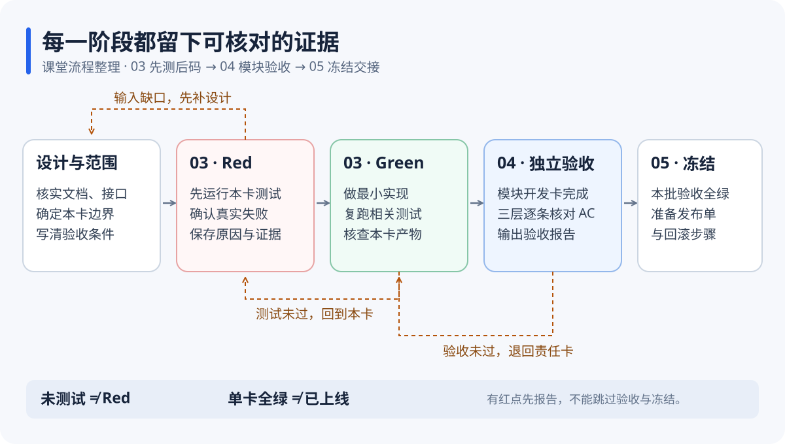

*整理示意：每一步都有对应产物和验证条件。图中是本文归纳的工作流程。*

<a id="td-02"></a>

## 02 三份规范放进项目，开发流程追加到 AGENTS.md

课堂约 03:00 和 18:39 解释了文件的用法：把 `03-tdd（先测后码）.prompt`、`04-test-review（三层验收）.prompt`、`05-freeze（交付冻结）.prompt` 放进项目的 `prompts` 目录，再让项目规则说明什么时候引用它们。

这里的 `.prompt` 是文本文件扩展名。文件存在于目录中，不会自动证明当前 Agent 已经读取并遵守它。派任务时要说明入口，并让 Agent 回报实际读取的文件。

13:13 左右有人问，新发的 `AGENTS.md` 和前面“定规矩”阶段生成的文件怎么合并。老师的回答是追加开发流程，不覆盖原文件。自己的项目也应保留已有技术栈、目录、编码规范和用户约束；遇到冲突先列出来处理。

下面是整理后的目录示意，实际路径以你现有项目为准：

```text
你的项目/
├─ AGENTS.md                  项目规则及开发流程
├─ prompts/
│  ├─ 03-tdd.prompt           单卡先测后码
│  ├─ 04-test-review.prompt   模块验收
│  └─ 05-freeze.prompt        发布前交接
├─ docs/                     已有设计、用例台账、验收报告
├─ 后端实际目录/
├─ 前端实际目录/
└─ 测试实际目录/
```

不要为了和截图一致，另建第二份需求或接口文档。课堂里已经出现了平铺路径、分层目录和 `03-api` 目录混用的情况，后文会继续讲怎样核对。

<a id="td-03"></a>

## 03 项目常量先固定，任务卡只填写本次变化

11:32 的 `03-tdd` 文件把背景分成项目级与卡级。项目级内容不应由每个子 Agent 重新选择，否则同一个项目可能出现两套测试工具、几种目录写法和互相冲突的分层。画面中的四项常量是测试框架、测试目录、分层规则和禁 mock 范围；下表再结合本课的验收与 PM 规则，补上工程命令和角色映射。

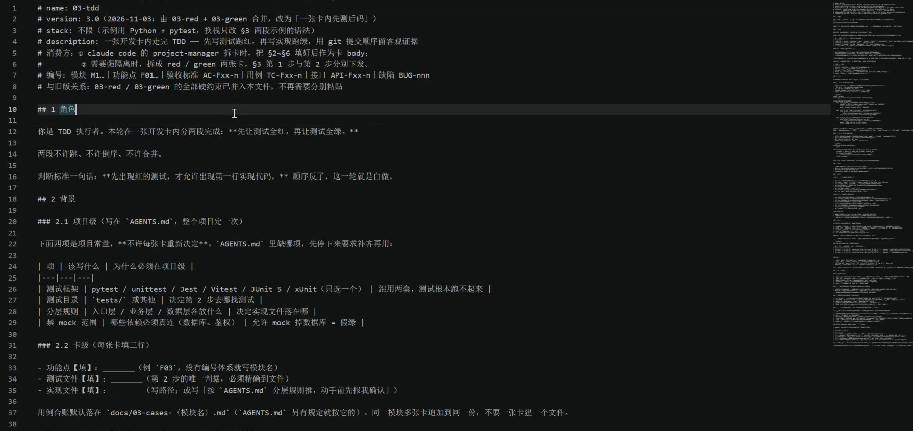

*11:32。画面展示 v3.0 的单卡 TDD 规范；Python 与 pytest 是示例，并非要求所有语言都采用同一套测试代码。*

| 项目常量 | 要写清楚的内容 |
| --- | --- |
| 测试框架 | 当前项目实际采用什么，怎样运行；不同技术部分可各有适合的框架，但不要在同一测试层随意重复引入 |
| 测试目录 | 真实路径与发现规则，区分单元、集成和端到端测试 |
| 分层规则 | 入口、业务、数据访问等代码分别放哪里 |
| 真实依赖范围 | 哪些验收必须连接测试数据库或鉴权服务，哪些外部依赖允许模拟 |
| 工程命令 | 安装、启动、构建、测试命令，以及命令应在哪个目录运行 |
| Agent 映射 | 负责调度、后端、前端、小程序和验收的真实角色名 |

技术校正：课堂口头把测试说成“都会写 Python 脚本验收”，但提示词画面同时列了 pytest、Jest、Vitest、JUnit、xUnit 等框架。Java 项目可以继续使用 JUnit，JavaScript 项目继续使用已有测试框架；外部 Python 脚本可以测 HTTP 接口，却不能自动替代语言内部的单元测试。

<a id="td-04"></a>

## 04 PM 是谁，先查清楚再派单

15:35 起，老师打开 `cc-project-manager.md`，讨论为什么有的环境能用 PM 找到项目经理，有的环境找不到。这个例子说明：角色名、描述和调用方式需要对齐，不能只因为文案里写了“PM”就认为工具已经配置好了。

课堂使用的 `cc-project-manager`、`cc-python-developer`、`cc-frontend-developer`、`cc-mini-program-developer`、`cc-e2e-runner` 是该环境的配置名。它们不是每台电脑都会自带的通用命令，也不能把 `@PM` 当成所有软件都支持的调用语法。

跟做时先发这一段：

```text
先检查当前项目可用的 Agent 和工具，不开始开发。
列出项目经理、后端、前端、其他客户端、独立验收的真实名称，
说明它们来自哪个配置文件，以及当前工具中怎样调用。
把我的“PM”明确映射到现有项目经理角色；不要为了别名重复创建同职责角色。
若缺少某个角色，先报告缺口，可由主 Agent 按同样职责顺序执行。
```

Claude Code 的自定义子 Agent 文件可以放在项目的 `.claude/agents/` 或用户的 `~/.claude/agents/`，具体加载和调用方式以当前版本为准。这里的目录说明依据 [Claude Code 官方子 Agent 文档](https://code.claude.com/docs/en/sub-agents)，不把课堂私有 PM 配置当作官方内置功能。

<a id="td-05"></a>

## 05 一张开发卡要小到能独立验收

课堂提示词要求每张卡带约 3 至 5 条验收点，过多就继续拆分。这个数字是课堂的拆卡约定，目的在于让一张卡的范围、测试和文件改动可以被人检查。

最少需要这些信息：

| 字段 | 具体写法 |
| --- | --- |
| 功能与编号 | 沿用现有 F、M、AC，不临时重排编号 |
| 本卡目标 | 哪个行为完成后，这张卡可以关闭 |
| 本卡不处理的范围 | 相邻业务、完整产品、上线等留到对应任务 |
| 输入文件 | 功能设计、接口、表结构的真实路径和版本 |
| 验收点 | 每条给出输入、操作、预期结果和失败分支 |
| 测试与实现位置 | 精确到测试文件；实现位置有疑问先报告 |
| 依赖与责任人 | 哪张卡完成后才能开工，谁开发，谁验收 |
| 完成证据 | 实际命令、退出码、结果、相关提交或文件差异 |

例如“把借用管理系统做完”太大；“实现设备借用申请的日期校验，并验证三种已确认边界”更容易检查。这里的边界必须来自需求，不能由测试代码临时发明。

并发卡还要写清允许修改的文件范围。两名 Agent 同时编辑同一个迁移文件或公共配置，常会互相覆盖；需要依赖的任务应等待，或者明确由一个负责人统一修改。

<a id="td-06"></a>

## 06 Red：运行测试，确认它为什么失败

课堂的第一步是先写测试，再运行，让新增行为的测试失败。需要保留真实输出，不能只在台账里填一个“红”。

技术校正：“这次新增行为的测试应按预期失败”，不等于“把整个项目原本通过的测试弄成全红”。旧测试基线应保留。若新测试一开始就通过，先检查功能是否已经存在、测试是否真正执行、断言是否有鉴别力。

一个合格的 Red 记录至少说明：运行了哪条命令，发现了几个用例，哪个 AC 对应的测试失败，实际结果与预期差在哪里。拼错测试路径、缺少解释器、依赖没装好、连错数据库，都应先作为环境或配置问题处理。

以已有 pytest 的项目为例，命令可以指向本卡实际测试文件：

```powershell
python -m pytest tests/test_borrow_rules.py -q
$LASTEXITCODE
```

这里的路径只是整理示例，执行前换成自己项目的真实文件。`python -m pytest` 和指定文件的运行方式见 [pytest 官方使用说明](https://docs.pytest.org/en/stable/how-to/usage.html)。

pytest 的退出码 `1` 表示测试失败，`5` 表示未收集到测试；后者不能充当本卡成功跑过的证据。`0` 表示收集到的测试通过，仍要结合用例数量和本次覆盖范围判断。其他退出码应查 [pytest 官方退出码说明](https://docs.pytest.org/en/stable/reference/exit-codes.html)，不要统统归为业务失败。

<a id="td-07"></a>

## 07 Green：实现功能，不放松测试

24:20 的画面要求只改实现文件，用最小实现让同一组测试通过，不改期望值、不放宽断言、不加 `skip`，也不顺手增加缓存、日志框架或新的抽象。

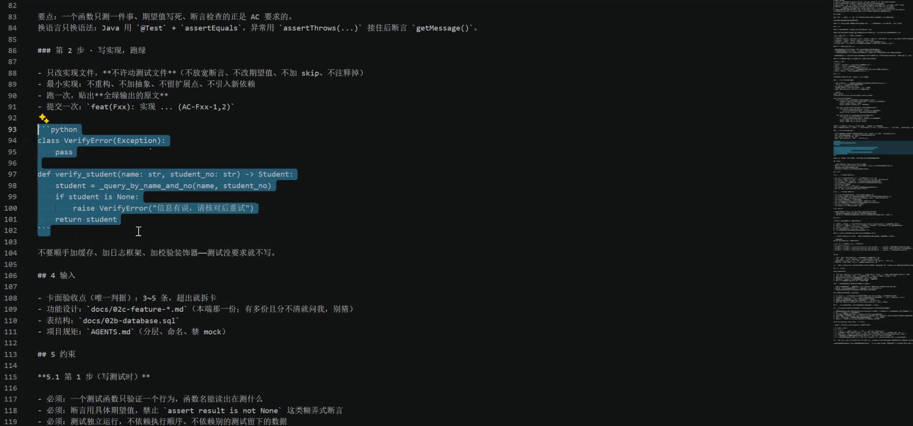

*24:20。这里展示的是提示词中的 Python 示例，包含未展示定义的项目函数和类型；不能把截图当作可直接运行的完整程序。*

跟做顺序是：确认 Red 记录，完成本卡实现，再跑原测试文件，并运行受影响的既有测试。若必须改变测试，因为需求本身有错或口径变了，应先记录变更理由、更新需求和验收依据，再重建基线。不能把“改到全绿”当作无条件目标。

通过之后可以安排必要的重构，并持续跑回归；这是整理补充。课堂这一轮强调的是最小实现，不要把重构混进当前卡而扩大范围。

<a id="td-08"></a>

## 08 用例台账和 Git 记录怎样一起检查

课堂默认把同一模块的用例台账放进 `docs/03-cases-〈模块名〉.md`，多张卡在同一份文件追加。实际项目若已经有 `docs/03-cases/` 这样的目录，就沿用已有位置，并把引用统一起来。

台账里应能从 AC 找到 TC、测试文件和结果。只写“全部通过”无法看出漏了哪一条。

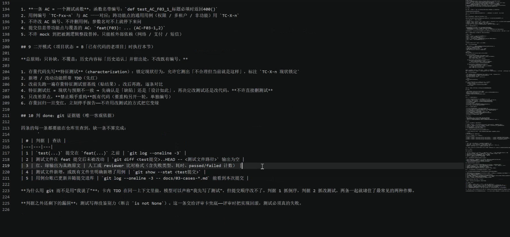

*27:30。画面列出测试提交在前、实现提交在后、测试文件差异、真实输出、新增用例与台账更新。标题下仍写“四条”，表格实际有五项，整理时按五项检查。*

课堂用 `test(...)` 和 `feat(...)` 两次提交留痕。下面都是只读检查命令；尖括号内容要换成真实值：

```text
git log --oneline -3
git show --stat <测试提交>
git diff <测试提交>..<实现提交> -- <测试文件路径>
git log --oneline -3 -- <实际用例台账路径>
```

`git log` 通常最新提交在上，要从先后关系判断，不能只看屏幕第一行。`-3` 只显示最近三条，是课堂示例的简写；相关提交较多时，应去掉这个限制，按目标提交号核对完整的相关记录。课堂要求实现阶段不改测试时，第三条命令应没有相关测试改动；出现差异就逐项查原因。

技术校正：提交顺序是审查线索，不能单独证明测试真的运行过，更不能证明功能正确。要一起看真实输出、测试内容、AC 覆盖，并按需复跑。是否自动提交、何时推送，应遵守当前项目和用户授权，不因复制了一份模板就更改原有 Git 规则。

<a id="td-09"></a>

## 09 已有项目先锁定现状，再做新行为

27:30 附近的提示词还包含“二开模式”：历史内容保留来源和编号，已有代码先写特征测试，新增或修改行为再走 TDD。

特征测试记录系统当前实际行为，有时会把暂时不理想的行为也记录下来。发现它与需求不符时，应确认是缺陷还是有意设计，再决定改哪一边。直接删除测试，只会丢掉原来的证据。

跟做时先运行旧测试并保存基线；改动后重新运行，逐项比较新增失败。当前任务只处理差异范围，已有行为突然变化就停下来定位。需要的大规模重构另开任务，避免把功能开发和结构调整搅在一起。

<a id="td-10"></a>

## 10 开发卡完成后，换独立验收角色

20:15 展示的开发流程把工作交给 PM 调度：模块内开发卡完成后，自动建立模块 REVIEW 卡，交给 `cc-e2e-runner`，并带上用例台账逐条对 AC。发布前再准备 FREEZE 卡。

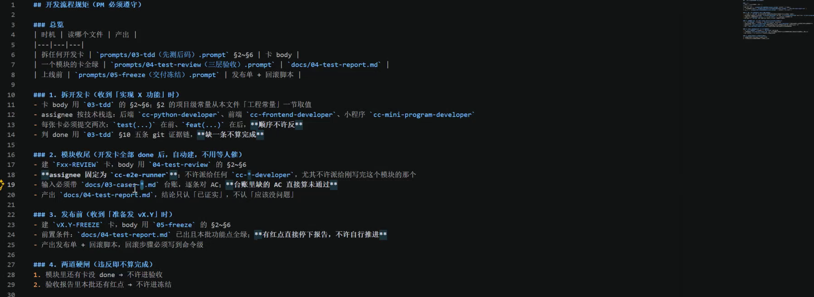

*20:15。开发角色与独立验收角色分开；模块有未完成卡，不进入模块验收，验收报告还有未通过项，不进入冻结。*

这里“换人”的作用是让审查者从需求和结果重新检查，减少开发者只确认自己刚写过的路径。独立角色仍需要足够上下文：本次范围、运行方式、测试账号或测试数据入口、接口契约、用例台账和已知限制。

第一次没有多 Agent 环境，也可以先完成开发，再开一个独立审查会话，给它同样的材料和只读审查范围。工具形式可以变化，验收依据不能只剩开发者一句“做好了”。

<a id="td-11"></a>

## 11 三层验收第一层：找假数据线索，再读上下文

31:40 的 `04-test-review` 先做静态搜索，查 `mock`、`fake`、`dummy`、`stub`、`hardcode`、`TODO`、示例数据和被注释的真实请求。后面又提醒，不要只查一个词，也要看 `tmpData`、`exampleData`、`demoList`、`fallbackData` 这些可能的替代写法。

这些词只是线索。测试夹具里使用 mock 可能合理，注释里出现 TODO 也不等于线上功能在造假。应结合文件用途、运行环境、分支条件和调用链判断，尤其检查开发模式的演示数据是否进入实际产品路径。

报告要写出文件、行号、代码片段、触发条件和影响。例如“真实请求失败后，列表仍返回三条固定数据”，比“发现 mock，因此不通过”更有用。

本轮若按课堂模板只做验收，就先交报告；修复另发明确任务。这样可以分清审查时看到的状态和修复后的状态。

<a id="td-12"></a>

## 12 第二层：比较前端调用与后端真实路由

课堂举了 `/api/score/query` 和 `/api/scores/query` 的差别：一个少了 `s`，前端可能调用不到对应后端接口。如果页面仍显示数据，就应继续检查有没有本地兜底。

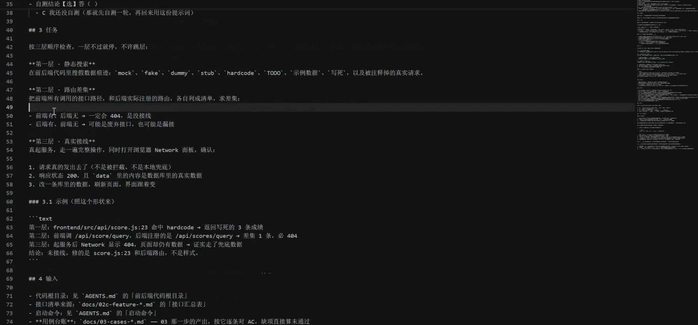

*31:40。这是模板中的说明案例，录屏并没有在这里实际启动该成绩接口并复现 404。*

跟做时把双方接口分别列成表，至少包含方法、完整路径、基础前缀、鉴权和调用位置。路由比较应使用“HTTP 方法 + 规范化路径”，同时考虑代理重写、路径参数和版本前缀。

前端有、后端没有，通常需要排查未注册、路径错误或代理配置；后端有、前端没有，也可能是其他客户端、内部调用或暂未使用的接口，不能自动判为废弃。课堂用“必 404”便于解释，实际响应还可能受网关、鉴权和路由规则影响，最终要用请求验证。

<a id="td-13"></a>

## 13 第三层：启动系统，用 Network 核实数据从哪来

课堂要求真启动服务，走一遍完整操作，同时看浏览器 `Network`（网络）面板，确认请求发出去、响应内容来自测试数据库，再修改一条测试数据核对页面变化。

具体操作可以这样做：

1. 用 VS Code 打开项目，在终端按项目实际命令启动后端、前端和必要依赖，记下地址与端口。
2. 用 Chrome 或 Edge 打开测试页面，按 `F12` 打开开发者工具，再点 `Network`。
3. 清空旧请求，选择 `Fetch/XHR`，重新执行一次需要验收的操作。
4. 点开目标请求，检查 `Headers` 中的方法、URL 和状态，检查 `Payload` 中的入参，再看 `Response` 中的返回值。
5. 在隔离测试数据上通过应用正常操作修改一条记录，或按项目测试方案修改；重新读取，核对响应和页面是否同时变化。
6. 记录与 AC 对应的成功和失败分支；无法执行的项写“未验证”，同时说明缺什么环境或数据。

面板会在开发者工具打开时记录请求，单条请求可以查看 Headers、Payload、Response 等信息，操作依据见 [Chrome 官方 Network 文档](https://developer.chrome.com/docs/devtools/network/overview/)。

技术校正：成功响应不一定都是 `200`，例如创建和无正文响应可能使用其他正确状态；应按接口契约检查。即使返回 200，也要看业务状态、内容和数据是否真实变化。测试数据库与生产数据库必须分清，不要为了截图随意改正式数据。

<a id="td-14"></a>

## 14 验收报告与冻结交接分别写什么

34:00 的模板强调，报告要区分“已证实”和“未验证”，不能从代码结构推断服务一定接通。纯接口项目可以没有前端，但要明确本次不做页面验收，并保留后端接口验证依据。

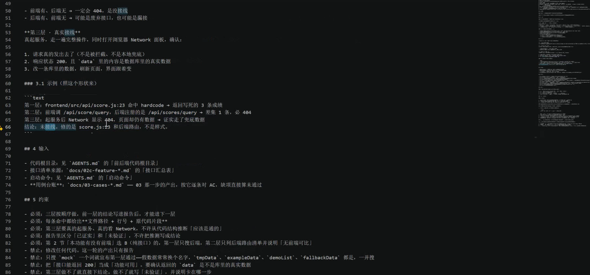

*34:00。模板要求每条发现带路径、行号和原代码，第三层真跑服务；做不到就说明卡在哪一步。*

一份可交接报告应列本次版本与范围、各 AC 结果、真实命令及输出位置、路由差异、接口或页面证据、未通过项和未验证原因。验收报告的“全绿”只对这份报告的范围和环境负责，不能自动扩展成整个产品上线合格。

36:26 起，课堂确实打开了 `05-freeze`：先填写上版、本版、本批功能、DDL 变化与负责人，再产出变更清单、回滚步骤、部署验证表和已知问题。画面要求回滚写到命令级，还提到前向及回滚 SQL、没有上一版时怎样停机并恢复备份。本课没有完整展开模板后续内容，也没有实际完成一次冻结与上线。

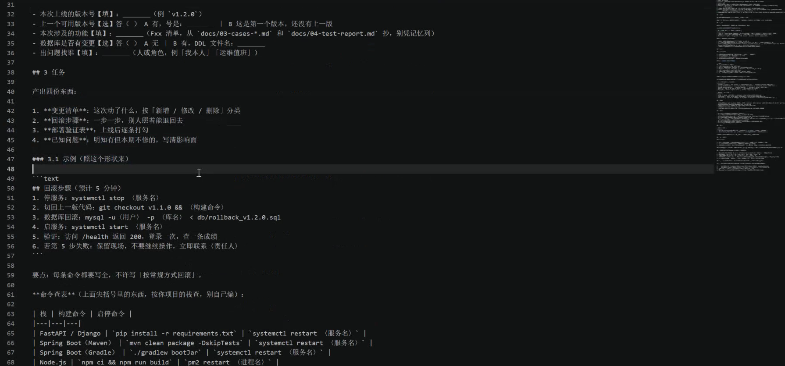

*36:50。这里在讲解模板，不能据此认定本次项目已经进入发布状态。截图里的命令含占位符，并依赖具体平台和项目配置，不能直接复制运行。*

跟做时还应写清环境依赖、配置项名称、启动与检查步骤、回退条件、旧版本位置和数据恢复方案。涉及数据结构变化时，回退代码不等于数据库也能安全回退，应单独验证。

上线或正式数据变更仍按自己项目的授权执行。冻结模板准备好，也要等这一批实际验收通过。

<a id="td-15"></a>

## 15 先搭骨架时，把本批范围写成一句清楚的话

43:36 起，老师新开会话，填写这次开发任务：先搭小程序端、管理 UI 端和后端框架，补系统基础信息模块与 SQL 初始化，不做题库、出题、判卷等整套业务。随后补充 PM 拆卡、三种粒度选项、子 Agent 两个并发、看板进度，以及引用 `AGENTS.md` 开发流程。此时粒度选项还没删，后面真正派单时才改成“最小颗粒度”。


*00:50:20。这里把范围、执行角色、拆分方式、并发和看板要求放在同一条任务里；是否具备对应 PM 与看板工具仍须先检查。*

“不含任何业务代码”和“包含系统基础信息模块”之间仍可能有歧义。基础信息究竟只建表，还是同时做用户、角色、权限、字典、菜单、配置接口和页面，Agent 不能靠猜。后面执行前的提问，正是在补这个缺口。

换成自己的项目，建议把目标分成两层：本批交付什么可运行骨架，哪些模块只预留接口或任务，哪些具体功能需要在后续批次实现。系统管理也是产品的一部分，不能因为叫“基础”就默认全部做完。

<a id="td-16"></a>

## 16 数据库安装、空库、建表与初始化数据是四件事

37:14 至 43:08 讨论开发数据库；01:11:30 左右，老师根据 Agent 的检查汇报确认本机还没有该项目数据库，于是另开会话，明确“本次任务只建库，别干别的”。这句话把导入表结构和测试数据留给后续任务。

| 层次 | 做完后应该看到什么 | 还不能据此认定什么 |
| --- | --- | --- |
| 数据库服务可用 | 服务运行、版本和连接检查正常 | 不代表已有项目数据库 |
| 空数据库与专用账号 | 账号能访问指定开发库，权限符合用途 | 不代表业务表已经建立 |
| 表结构迁移 | 迁移记录、实际表字段与当前设计一致 | 不代表初始配置或测试数据完整 |
| 初始化数据 | 必要字典、角色或测试数据按本批范围建立 | 不代表业务接口和页面已验收 |

40:45 附近，老师指出现有 SQL 是 `CREATE TABLE`，没有 `CREATE DATABASE`。因此，不能只看到一个 `schema.sql` 就认为空库已经创建，或者断定运行该文件能完成全部初始化。

课堂先口述并填写本地 MySQL 安装与 MCP 连接任务，随后补入该库专属用户；这一段没有展示实际安装或连接成功。跟做时应给应用使用专用账号，限定数据库和权限，管理员账号用于必要管理操作；账号和授权是分开的概念，见 [MySQL 官方账号与权限说明](https://dev.mysql.com/doc/refman/8.0/en/creating-accounts.html)。

课堂还提到把凭据放桌面文本。整理模板改成由本机环境变量、受控配置或凭据存储读取，仓库只保留无真实密码的配置样例；日志和截图不输出密码。MCP 只是工具连接方式，已安装客户端或项目现有数据库工具也可以完成操作，不必为每个项目重复搭一套。

<a id="td-17"></a>

## 17 API 文档为空，先找实际契约来源

54:04 起，同学发现 API 目录是空的。大家来回检查 `02a` 架构目录、`02c` 功能设计和接口汇总，才发现生成习惯不同：有人有单独的 `api-spec.md`，有人把接口契约写在各端功能设计里。

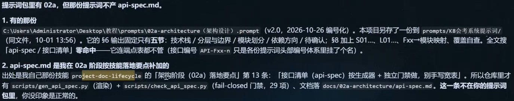

*01:04:00。老师环境中的补充技能也参与了文档生成，不能假设其他人用同一份提示词就一定得到同样的文件。*

约 01:03:34 至 01:07:21，Agent 回查了真实提示词和技能，指出旧 `02a-architecture` v2.0 只规定五节输出，没有要求独立的 `api-spec.md`；单独接口清单来自老师环境中的 `project-doc-lifecycle` 技能。各端功能设计和验收模板仍沿用接口汇总表的约定，所以输出差异不能只归因于模型不同。

这次回查还提到 12 条“待回写 api-spec”的缺口，并建议更新上游提示词。录屏后面转去打包技能，本文没有找到这 12 条缺口已逐项关闭的证据。补齐文档时，需要同时核对内容和引用约定。

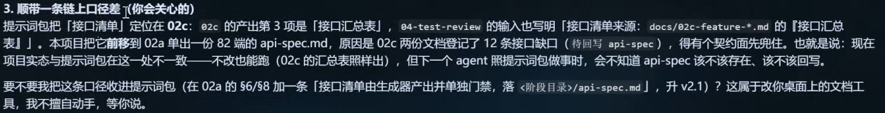

*01:07:00 附近。检查的重点是哪些文档引用哪个契约，不能只数 Markdown 文件是否存在。*

自己的项目可按以下顺序处理：

1. 用 VS Code 全局搜索接口路径、API 编号和 `api-spec`，列出真实存在的契约位置。
2. 比较方法、路径、字段、鉴权、错误码和版本，标出冲突，不把内容简单复制成第三份。
3. 明确主契约放哪里，各端功能设计引用哪里；保留现有 F、AC、API 编号。
4. 若要从分散设计汇总新文档，说明它是索引、派生汇总还是主契约，并同步架构、README 和验收模板的引用。
5. 重新跑已有文档检查，并人工抽查几条接口的正向、反向引用。

看到空文件，先检查接口设计是否放在其他文档里；找到描述之后，还要核对它是否与实际主契约一致。把现有内容查清，再决定缺什么、补到哪里，可以避免重复生成互相冲突的 API 文档。

<a id="td-18"></a>

## 18 把项目经验整理成 skill，要去掉项目耦合

01:05:40 后，老师要求把文档相关技能整理成可分享包；01:40 左右回到这一任务，画面汇报一个通用的 `project-doc-lifecycle` 包，包含 references、scripts 等资源，并说明在副本上处理项目相关内容。

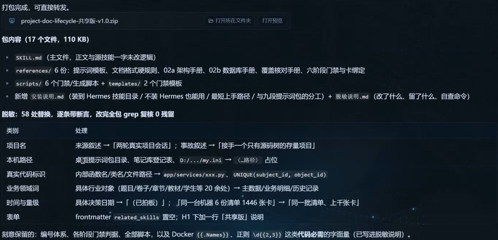

*01:40:51。画面汇报包内 17 个文件、约 110 KB；本次用户提供的压缩包只有会议视频，没有这个 skill 原包，本文未取得或执行它。*

可复用的是做法：先保留原项目，再把项目名、绝对路径、账号信息和特定编号改为可填写参数；说明输入、输出、调用时机、适用条件和验证方法。不能只把文件压成 ZIP，就认为换个项目也能直接运行。

01:47:38 至 01:49:02 再次提醒，后补 API 文档要指定路径，并回写架构里的引用。新增文件若没人引用，流程还是不会用到它。配套资料包提供的是这一步的核对清单，不冒充视频里分享的原始 skill。

<a id="td-19"></a>

## 19 课堂旁支：数字人、TTS、转写和工具体验

约 01:13:35 至 01:40:10，话题离开软件开发，转向数字人、首尾帧、声音生成、视频素材和工具体验。后面等待任务时，也夹杂账号、订阅、模型消息与直播经历。回看时可以按文末时间轴跳转，不需要把这些闲谈当成本项目的依赖。

这段能迁移到日常工作的概念有几个：首帧和尾帧为视频变化提供起止画面；TTS 把文本变成语音；口型同步把音频与嘴部动作对齐；ASR 把音频转成文字。这些是不同步骤，完成其中一步不能当作整条流程完成。

01:19:45 后，播放音频时其他参会者最初听不到；约 01:23:29 才听到一小段语音。01:22:17 还明确区分“切片已完成”和“训练还没开始”。因此这段可以用来理解工作流状态，不适合据截图断定整套训练与生成已经验收。

01:30:22 左右，老师讲到把视频音频提取出来再转写，并强调文字仍需校对。这与本篇整理实际遇到的问题一致：口头的 Git、API、TDD、TC 等词会被转错，必须回看屏幕上的拼写。

若把这段方法用于自己的学习材料，直接准备本人或已获授权的本地音视频，转写后按时间回查术语与画面，再整理成知识笔记或可复用步骤即可。课堂展示的私人聊天、他人声音样本、账号购买渠道和请求信息没有随本文公开；模型价格、性能、限额与新版本传闻也不作为选型依据。

01:42:27 左右还讨论了 RTK，现场安装或检测出现报错，未展示完整验证结果。本文只记录这一插曲，不把它列为 TDD 或看板运行的必装组件。

<a id="td-20"></a>

## 20 真正发任务前，先回答三类范围问题

01:46:06，同学提醒派单提示里还留着三个粒度选项。老师中断第一条任务，删成“最小颗粒度”后重发。这是填写模板时很实际的错误：列出几个备选项，不等于已经选择了其中一个。

01:52:20 后，Agent 继续提问，确认本批功能范围、SQL 初始化形态和这次交付深度。

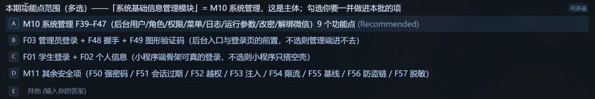

*01:52:27。画面按实际需求编号询问基础信息、账号和安全等范围。这里是确认后续拆分依据，还不是这些功能已实现。*

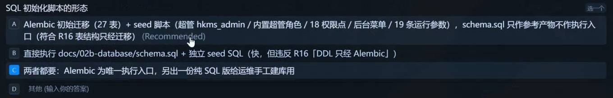

*01:53:39 附近。课堂选择 Alembic 作为唯一执行入口，同时导出纯 SQL 供查看或受控使用。*

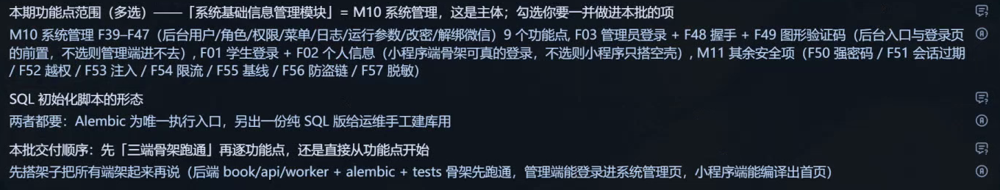

*01:54:22 附近。完整功能范围与本次“先搭骨架”的执行阶段需要一起读，不能把全部勾选项解释成这一次马上全部开发。*

只保留一个实际修改数据库的入口，是为了避免一边跑迁移、一边又手工执行同一组 DDL。导出的 SQL 可以用于审查或明确的离线部署流程，执行前仍需确认起始版本和目标状态。

使用 Alembic 的项目，要核对当前 revision、迁移链、数据库连接和实际表结构，不能仅看 `schema.sql` 文件更新时间。迁移环境和升级的概念见 [Alembic 官方教程](https://alembic.sqlalchemy.org/en/latest/tutorial.html)。如果现有项目用其他迁移工具，继续沿用，不为模仿课堂换工具。

<a id="td-21"></a>

## 21 看板启动慢或中断，先看具体卡在哪一步

01:49 至 01:51，课堂出现 gateway 断连，随后进行恢复。02:06:37 附近，配置中的后端端口从 8010 调整为 8030；02:07 起又把测试框架、目录、启动命令和看板规则写入项目说明。

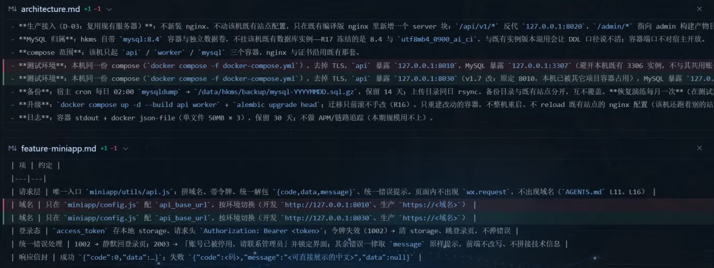

*02:06:37 附近。端口来自当时本机配置；读者应检查自己端口占用和前后端连接配置，不要统一照抄 8030。*

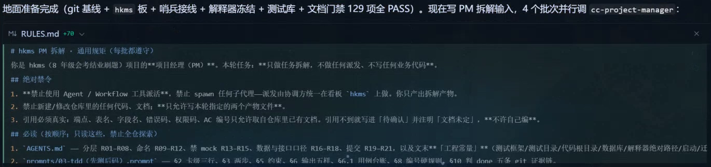

*02:08:40。画面准备四批 PM 拆解任务，规则要求只拆任务、不派开发任务、不写业务代码。这里展示的是规划安排，尚无开发验收结果。*

排查时先分清问题属于哪里：模型请求是否返回错误，网关是否断开，必要工具是否存在，测试库是否连通，当前任务是否只要求规划，是否还有前置卡未完成。保存原始错误和失败步骤，再决定重试、补配置或改任务。

这里要分清两种并发：约 02:08 的画面把四个批次分别交给 PM 拆解，PM 只生成计划，不派发开发任务、不写业务代码；前面约定的“两个并发”限制的是后续开发执行。四批同时规划，不等于四张开发卡同时开工。

开发并发上限为二，也不代表任意两张卡都能一起运行。存在依赖、同写一个文件、数据库迁移冲突或服务限流时，应减少并发或顺序执行。等待依赖的卡要按放行条件推进，不能直接改成完成。

关于 Git，02:08 后的口头讨论容易让初学者误以为必须有 GitHub、GitLab 或 MCP 才能本地管理版本。技术校正：本地 Git 仓库本身就能记录提交、查看差异和历史；远程仓库用于协作和备份，推送是另一步。依据见 [git init 官方说明](https://git-scm.com/docs/git-init) 和 [Git 远程仓库章节](https://git-scm.com/book/en/v2/Git-Basics-Working-with-Remotes)。入门也可接着看站内 [Git 完整教程](../content/git-basics.md)。

<a id="td-22"></a>

## 22 片尾实际停在哪里

02:08:51 左右，老师本机开始形成 B01 等批次的任务拆分；02:17 后还能看到 B02、B03、B04 文档继续生成。看板和任务文件是过程产物，需要与代码及验证结果一起检查。

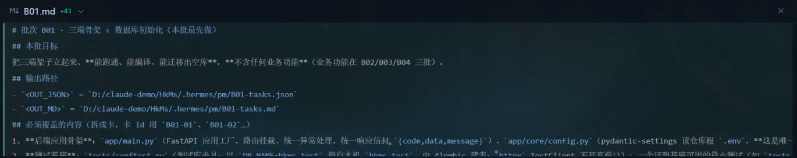

*02:08:51。这是当前批次规划相关画面，不能把任务列表当作已经完成的功能。*

02:12:40 至 02:16:35 之间，录屏打开了群里其他人的截图，能看到“完成一项”和不同开发角色。图中的项目目录与模块编号，与老师本机不同。那是他人进度展示，不是老师本机工程跑通的证据，本文也没有独立验证截图背后的代码。

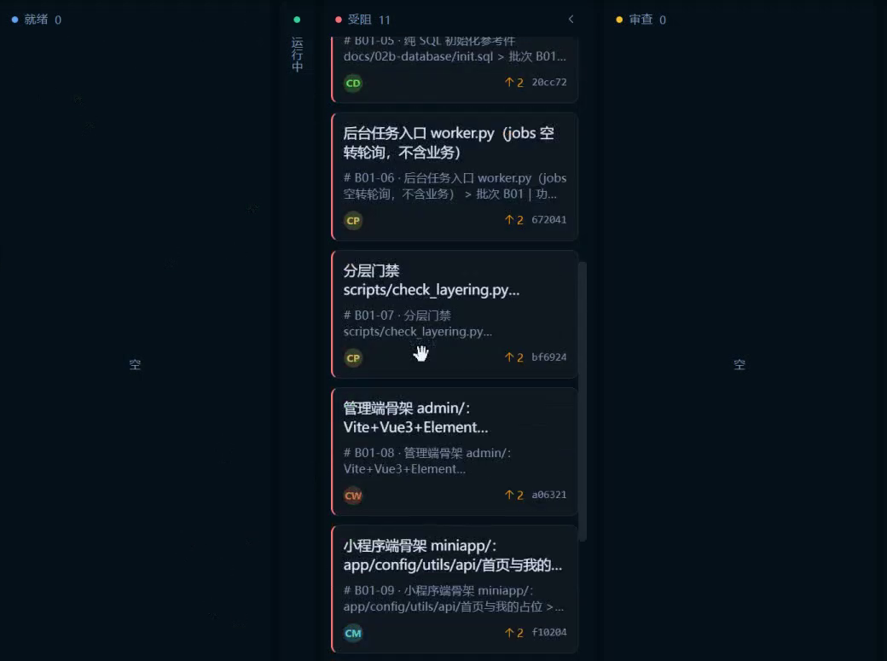

*02:20:57。看板显示 11 张卡处于“受阻”，就绪与审查均为 0；最后仍在处理建卡与放行。这里不能写成整个项目已经完成。*

音轨在 02:20:47 至 02:21:04 给出了更具体的解释：先把卡放进看板、先保持受阻，之后再派发，优先级第一批还没过来。因此，“受阻”在这里至少包含等待放行的流程状态，不能直接推断 11 张卡开发失败，或认定都是模型故障。

本片可以确认任务进入了拆分和建卡过程；没有展示老师本机三端完整运行、全部业务测试通过、独立模块验收和正式上线。后续继续时，应从已有批次、卡片状态和实际文件接着查，避免重复建卡。

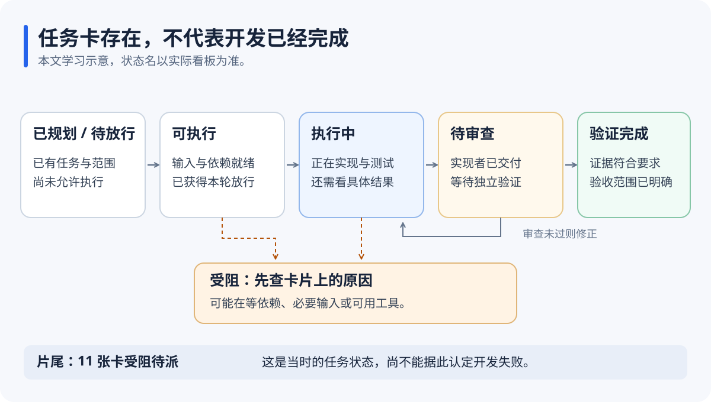

*整理示意：卡已创建、PM 已完成拆分、开发已完成、验收通过分别代表不同进度。具体状态名以自己的看板为准。*

<a id="td-23"></a>

## 23 换成自己的项目，按这个顺序指挥 Agent

下面以“设备借用管理系统”为整理示例，说明怎样填写任务。课堂使用的是 HkMs 项目；已有项目保持原技术栈和编号。

**第一步，打开项目并检查现状。** 用 VS Code 的 `File → Open Folder` 打开正确目录，终端先运行 `git status`；如果还不是 Git 仓库，先说明现状，不自动把其他目录当项目根。已有修改先保留。把配套 `01-开发前检查表.md` 放在自己的工作记录位置。

```text
当前项目：设备借用管理系统。
先只读检查当前目录和已有文件，不创建新系统、不覆盖现有修改。
列出需求、架构、接口契约、数据库设计、功能设计、项目规则、测试与启动命令。
给出每份文档的实际路径、版本或修改状态，以及阻塞开发的缺口。
核对可用的项目经理、开发、验收角色和看板工具；缺少的明确写没有。
```

预期结果是一份能点开核对的文件清单。若只得到“都齐了”，继续要求实际路径和缺口证据。

**第二步，合并开发规则。** 打开配套 `02-开发流程规则补充.md`，把角色、目录和命令改成自己的实际值，再让 Agent 检查冲突并追加到原规则。三个 `.prompt` 文件放进 `prompts`。核对保存后的文件，不只看聊天答复。

**第三步，确定本批任务。** 新项目先选择一批骨架范围；已有项目选择一个具体模块或新增行为。把范围、AC、输入版本、依赖和交付条件填入任务卡。粒度选一个，并发填实际允许值。

```text
本批先准备现有技术栈的工程骨架和隔离测试环境。
请先列出本批会交付的文件、可运行入口、验证命令与依赖卡。
借用申请、审批、归还等业务不在本批执行，除非我在范围表明确列入。
数据库只按已确认阶段处理：空库、迁移、初始数据分别报告。
按现有 PM 流程拆卡，最多两个无冲突任务并行，并把计划与实际状态写入看板。
```

**第四步，执行一张卡。** 卡片范围确定后，让开发 Agent 读取 `03-tdd任务卡.prompt`，先给出真实 Red，再完成最小实现和 Green，更新台账。没有真实测试输出，就不能跳到“已完成”。

**第五步，检查模块。** 模块相关开发卡完成后，交给独立审查角色，引用 `04-三层验收.prompt`。打开实际运行页面和浏览器 Network，核对接口与测试数据；未验证项单列。

**第六步，处理缺口并交接。** 有问题，按缺陷编号回到对应开发卡；通过后再填 `05-冻结交接.prompt`。是否提交、推送、发布、迁移正式数据，按项目已有授权执行。看到正确的运行页面、测试结果和部署检查都通过，才算该批对应范围完成。

<a id="td-24"></a>

## 24 四段可以直接改字使用的话术

下面的文本属于整理补充。使用前替换方括号内容，删掉不适用选项；不要把整段占位符原样发送。

补 API 契约与引用：

```text
我先完成了架构和功能设计，后来才增加文档工具。
请读取 [实际架构路径]、[各端功能设计路径]、[数据库设计路径]。
先找出现有接口契约的实际位置，列出方法、路径、字段、鉴权、错误码和版本冲突。
把 [目标路径] 作为本次确认的接口契约位置，说明哪些内容是主契约、哪些是汇总引用。
补齐已确认的内容，并同步架构、各端设计、README 和验收模板的引用。
保留现有编号；不能凭空发明接口或字段。最后给出改动清单和一致性检查结果。
```

处理任务受阻：

```text
请先读取 [看板/任务记录路径]，不要重复建卡，也不要把卡直接改成完成。
针对 [任务编号] 说明：当前状态、最后成功步骤、原始错误或等待条件、已修改文件。
区分等待依赖/等待放行、环境配置问题、工具错误和模型请求错误。
若前置条件已经满足，按现有工作流从最后成功步骤恢复；
如果需要我选择范围或提供信息，一次列清具体缺口。
恢复后回报真实执行与验证结果。
```

换会话继续：

```text
继续 [项目/批次编号]。请先读取 [项目规则]、[批次计划]、[用例台账]、[最新验收报告]。
核对当前 Git 状态、已完成卡、进行中卡和未验证项。
先报告你从磁盘确认的状态，不把上个会话的完成描述当作测试证据。
从 [下一张任务卡] 继续，保留原编号和用户已有修改；
需要改动需求或接口时，先列影响，再同步相关文档。
```

独立验收：

```text
请验收 [模块/批次]，本轮只读检查并运行已有验证，不修实现。
依据 [AC清单] 和 [用例台账]，依次检查假数据线索、前后端路由对应、真实操作链。
每个结论给出文件/行号、命令输出或请求证据。
不能运行的项目写“未验证”及原因，不能按“应该没问题”判通过。
输出到 [报告路径]，列出通过、失败、未验证和建议修复顺序。
```

<a id="td-25"></a>

## 25 跟做时最容易误判的地方

| 看起来像完成了 | 还需要查什么 |
| --- | --- |
| Agent 说已读规则 | 它是否找到了正确目录和当前规则，实际输出是否遵守 |
| 目录里有 API 文档 | 是否有内容、主契约是否唯一、架构与各端是否引用 |
| 台账写 Red | 是否真正运行测试、失败是否针对预期行为 |
| 日志写全绿 | 是否收集到目标用例、有无 skip 或放宽断言、是否只测了部分范围 |
| Git 有两条提交 | 先后、文件差异、原始测试输出与复跑结果是否对应 |
| 数据库能连接 | 当前是空库、迁移完成还是已初始化数据，是否连对测试环境 |
| 接口返回 200 | 业务结果、数据来源、权限和页面行为是否符合契约 |
| 有看板卡片 | 是规划、待放行、执行中、待审查，还是经过验证的完成 |
| 别人的截图完成了 | 是否是同一个项目、同一批次、同一套本机环境 |
| 代码提交到了仓库 | 提交不保证无 bug，仍需按范围测试、审查与部署验证 |

课堂中 403、404 的口头说明有即时纠正，503 也不能直接等同数据库故障。按 HTTP 语义，403 表示服务器拒绝执行，404 表示未找到当前表示或不愿透露其存在，503 表示服务暂时不可用；定位原因还要查服务日志和依赖状态。可对照 [HTTP 语义标准 RFC 9110](https://www.rfc-editor.org/rfc/rfc9110.html#name-status-codes)。

这节课后段还讨论了 UI 改进：先依据现有功能和参考画面确定布局、颜色与设计稿，再实现页面。它是后续计划，没有在本片完成一套 UI 设计或验收。实际使用时，把视觉目标和功能验收分别写清楚即可。

<a id="td-26"></a>

## 26 全片回看时间轴

| 原片时间 | 内容与回看重点 |
| --- | --- |
| 00:00:00 至 00:03:50 | 接续设计阶段，改为分块开发；分发规范、准备 prompts 目录 |
| 00:03:50 至 00:11:13 | PowerPoint 画 TDD 红绿流程，区分初始化、测试、开发与回测 |
| 00:11:13 至 00:13:28 | 03-tdd 的角色、项目级常量与卡级输入 |
| 00:13:28 至 00:18:39 | AGENTS.md 追加流程，PM 名称和角色映射，实际目录差异 |
| 00:18:39 至 00:21:12 | PM 派开发卡、独立验收卡、冻结卡的规则 |
| 00:21:12 至 00:27:30 | 测试与实现、AC/TC、用例台账、二开与 Git 证据 |
| 00:27:30 至 00:30:13 | 单功能通过之后仍需前后端与模块联调 |
| 00:30:13 至 00:36:20 | 04 三层验收、真实请求、报告、证据和缺陷登记 |
| 00:36:20 至 00:37:14 | 05 冻结交付的背景、变更、回滚和验证产物 |
| 00:37:14 至 00:43:08 | 开发数据库、空库与表结构；MCP、应用专用账号和配置 |
| 00:43:08 至 00:53:34 | 填写骨架任务，粒度、并发、角色、看板和 AGENTS 引用 |
| 00:53:34 至 01:07:51 | API 文档在哪里，架构与功能设计口径，文档技能参与生成 |
| 01:07:51 至 01:13:35 | 技能讨论；确认未初始化项目库，另发“只建空库”任务 |
| 01:13:35 至 01:25:30 | 数字人、首尾帧、TTS、切片与训练进度、音频播放 |
| 01:25:30 至 01:31:48 | 视频素材获取与转写讨论，强调文字还要人工校对 |
| 01:31:48 至 01:40:10 | 数字人效果、工具及账号相关闲谈，非主线开发步骤 |
| 01:40:10 至 01:44:00 | 文档 skill 打包结果，跨工具使用讨论，RTK 报错插曲 |
| 01:44:00 至 01:49:17 | 开始试跑，删掉未选择的粒度选项，API 文档回写架构引用 |
| 01:49:17 至 01:54:37 | 网关恢复，确认本批范围、SQL 策略和骨架阶段 |
| 01:54:37 至 02:06:58 | 环境准备继续；夹杂模型、订阅和直播话题，端口等配置调整 |
| 02:06:58 至 02:12:40 | 工程常量、Git 与工具连接、PM 拆分；Git 相关说法需结合技术校正 |
| 02:12:40 至 02:17:01 | 查看其他人的进度截图，讨论依赖、角色和优先级，再切回本机 |
| 02:17:01 至 02:20:37 | 本机继续生成批次文档，讨论二开与后续 UI 计划 |
| 02:20:37 至 02:21:32 | 本机 11 张卡受阻待放行，老师说明后续派发，录像结束 |

后续实践从配套 `README.md` 开始：先填开发前检查表，再合并流程规则，最后只派一张范围清楚的任务卡。完成后，用真实测试输出和独立验收报告决定下一步。
