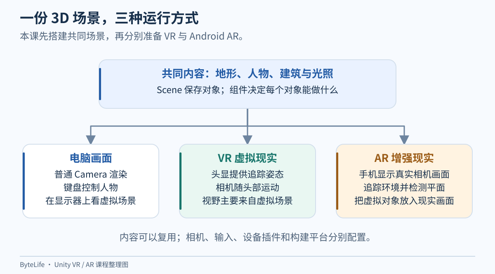
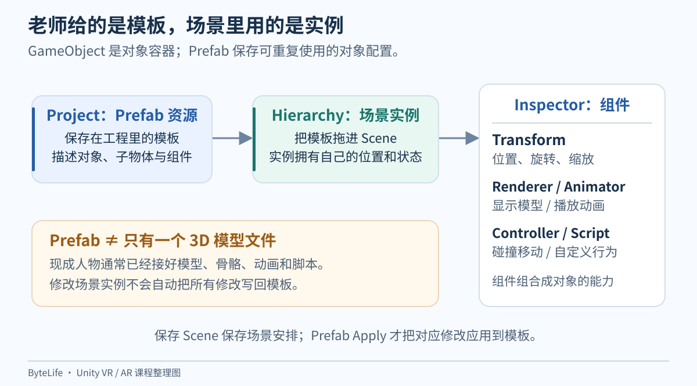
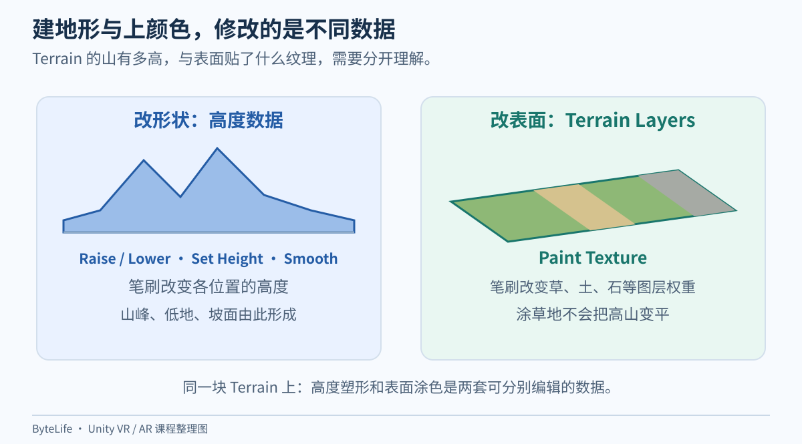
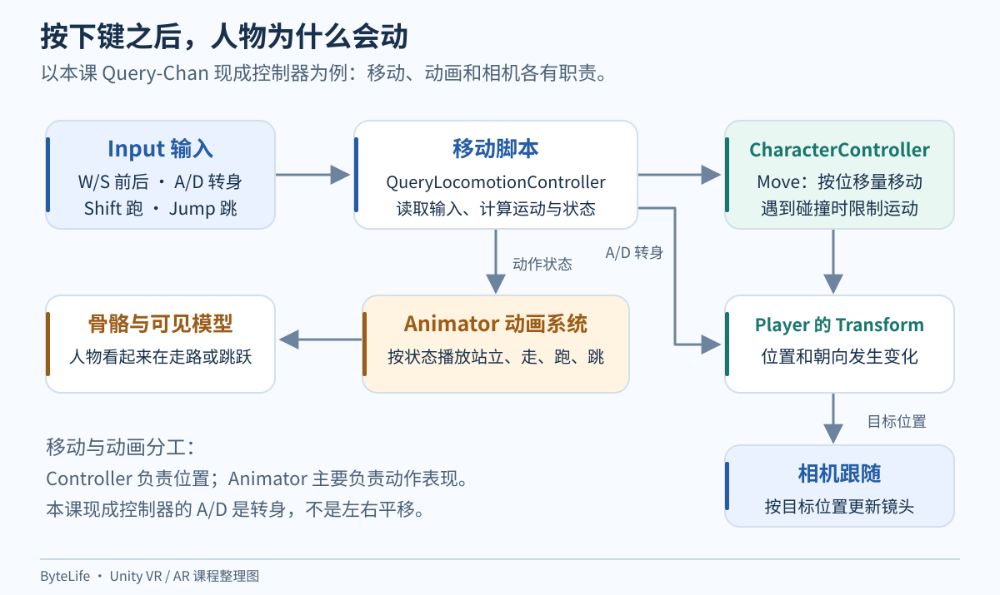
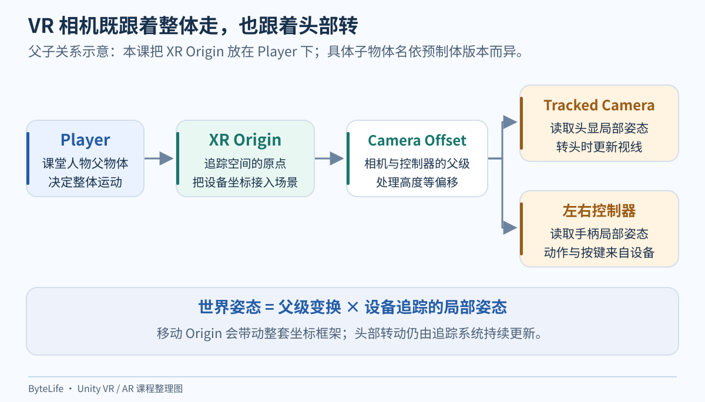
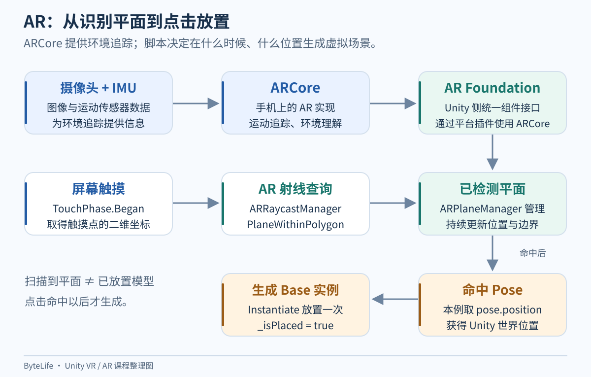
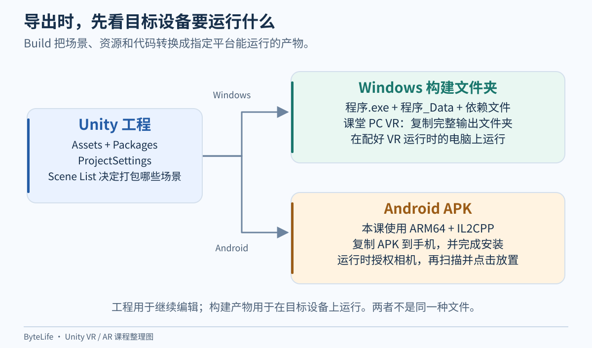

这篇复盘 **2026 年 11 月 6 日《情報学実習B》Unity VR／AR 实习**，于 11 月 13 日整理。材料来自课堂 80 页操作手册、实际的 `HS2022`／`VR_B2026`／`AR_B2026` 工程，以及当天从地形制作到 APK 安装的排错记录。

当时跟着老师点按钮，可以把程序跑起来，但容易留下很多疑问：为什么拖进去一个人就能走？为什么自己看得见人物，Camera 却拍不到？下载一个 XR 插件之后，到底是谁在追踪头显？那个只有几十行的脚本，难道就能认出桌子？

下面把这些过程拆开。先看对象和坐标，再看人物与相机，最后把同一个三维场景接到 VR 和 AR。菜单保留英文，说明用中文；代码里的每个关键变量都会解释。

**[下载配套脚本与复习练习 ZIP](https://raw.githubusercontent.com/Milo-Guo/bytelife/main/downloads/unity-vr-ar-lab.zip)** · **[浏览配套材料](https://github.com/Milo-Guo/bytelife/tree/main/examples/unity-vr-ar-lab)** · **[先看使用说明](https://github.com/Milo-Guo/bytelife/blob/main/examples/unity-vr-ar-lab/README.md)**

配套包包含修正后的 `PlaceOnPlane.cs`、练习步骤、对象接线表和排错清单。需要配合自己的 Unity 工程使用，不包含课堂模型、完整工程或教师课件。

## 1. 这节课究竟在做什么

整节课可以看成：**先搭一个三维场景，再让不同设备从不同方式进入这个场景。**



*整理图：地形、模型等内容可以复用，输入、相机和运行平台需要分别配置。*

| 部分 | 屏幕上看到什么 | 谁决定观察位置 | 最终运行在哪里 |
| --- | --- | --- | --- |
| 普通电脑场景 | Unity 渲染出的地形、人物、房屋 | 普通 Camera 和跟随逻辑 | 电脑 |
| 本课 VR | 头显里的同一个虚拟世界 | 角色整体位置，加上头显追踪的局部位姿 | 老师连接头显的 Windows 电脑 |
| 本课 AR | 手机实时拍摄的现实画面，加上虚拟场景 | 手机追踪位姿 | 支持 ARCore 的 Android 手机 |

因此，本课 VR 构建成 Windows 程序很正常：它走的是电脑连接头显的路线。并不是所有 VR 都应该导出 Android APK；独立式头显又是另一套部署目标。

### 老师给了什么，你又做了什么

| 已有材料或功能 | 它已经替我们完成的工作 | 课堂上还要做的事情 |
| --- | --- | --- |
| `HS2022.zip` | 准备 Unity 工程和素材 | 解压、打开正确版本、搭场景、保存 |
| 人物模型、骨骼与动画 | 提供人物外观、骨架和动作片段 | 把合适的 Player 预制体放入场景，检查位置与组件 |
| 人物控制和相机脚本 | 提供读输入、移动、切动画等逻辑 | 理解并检查挂载位置、参数和引用 |
| 房屋、车辆、石头、树木素材 | 提供模型与材质 | 选择、摆放、缩放、调整朝向 |
| Unity Terrain 系统 | 提供地形数据、雕刻和涂层工具 | 制作高低起伏、选择纹理、画不同地表 |
| XR Interaction Toolkit 的 Starter Assets | 提供 XR 预制体、输入动作和预设 | 导入 Samples、放入 XR Origin、接入对应设备 |
| AR Foundation 与 ARCore | 提供追踪、相机背景、平面检测等能力 | 开启 Android 提供程序、配置管理组件与相机 |
| `PlaceOnPlane.cs` | 提供点击放置的应用逻辑 | 挂到正确对象，把 Base Prefab 拖进字段 |

这次并没有从零编写一个游戏引擎，也没有训练一个识别桌面的 AI。学习重点是理解这些现成部件怎么合作，以及一处设置不对时该检查哪一层。

## 2. 先认清工程、场景、预制体和安装包

### 工程文件夹装的是整套开发材料

一个典型 Unity 工程包括：

```text
AR_B2026/
├─ Assets/             场景、脚本、模型、材质、预制体等
├─ Packages/           这个工程用哪些 Unity 包，以及依赖版本
├─ ProjectSettings/    输入、平台、画质、XR 等工程设置
├─ Library/            Unity 根据工程生成的导入缓存
├─ Logs/               日志
└─ UserSettings/       部分本机编辑器使用设置
```

`Assets` 只占工程的一部分。单独拷贝它，可能丢掉包依赖、构建平台和输入设置。需要继续编辑时，至少要保留 `Assets`、`Packages`、`ProjectSettings` 及资源对应的 `.meta` 文件；完整复制工程也可以，但缓存会让体积和复制时间增加。

`.meta` 里有资源身份标识 GUID。场景对脚本、材质和 Prefab 的引用大量依赖这些标识。随手删除 `.meta` 后让 Unity 重建，文件名虽然一样，引用也可能断掉。

### 几种容易混淆的文件

| 类型 | 作用 | 类比 |
| --- | --- | --- |
| `.unity` 场景 | 保存场景对象、层级和组件配置 | 一张已布置好的舞台 |
| `.prefab` 预制体 | 保存可复用的对象模板及其子层级、组件 | 可以重复使用的布景模板 |
| `.cs` | C# 脚本源代码 | 规定对象怎样行动的规则 |
| `.mat` | 材质，连接着色器和表面参数 | 物体表面的表现配方 |
| `.png`、`.jpg` 等纹理 | 供材质或地形层读取的图像数据 | 草、沙、石头的图案 |
| TerrainData `.asset` | 高度、图层权重、细节等地形数据 | 地形的实际数据 |
| `.terrainlayer` | 地形的一层表面配置 | 一种可刷到地上的材料 |
| `.apk` | Android 应用安装包 | 手机安装用的成品 |
| `.exe` 与同目录文件 | Windows 构建结果 | 电脑运行用的成品及依赖 |

`main` 只是本工程给场景起的名字。它不是因为叫 main 就自动成为启动场景；构建使用哪些场景、先打开哪个，要看构建配置中的 Scene List。

本文的 `B2026` 是实际工程示例名。课件里的 `Bxxxx` 是要求按课程编号规则替换的占位写法；自己提交时沿用老师要求的命名，不必照抄本文编号。

### 为什么复制出 VR 和 AR 两份工程

基础工程完成后，复制成 `VR_B2026` 和 `AR_B2026`，可以让两份分别保留不同相机、插件和构建平台。

**复制只是当时的一次快照，不是自动同步。** 之后在 HS2022 加一间房，另外两份不会凭空出现这间房。反过来，把整个 VR 文件夹覆盖到 AR 上，也会把 AR 专用设置覆盖掉。

理解这个区别，比反复复制更有用：先完成公共场景，再分出设备版本；后续要共享变化，就有选择地转移相关资源，并保留 `.meta` 和依赖关系。

## 3. Unity 的几个窗口，到底各看什么

| 窗口 | 看什么 | 本课的典型操作 |
| --- | --- | --- |
| Hierarchy | 当前打开场景里有哪些对象 | 选 Player、展开子对象、放入 XR Origin |
| Scene | 编辑场景时的自由观察视角 | 雕地形、摆房子、查看相机方向 |
| Game | 实际游戏相机输出的画面 | 检查玩家最后能看见什么 |
| Inspector | 当前选中对象或资源的属性和组件 | 改坐标、调整 Camera、把 Base 拖进字段 |
| Project | 工程资源文件 | 找脚本、材质、场景、Prefab |
| Console | 日志、警告和错误 | 看脚本编译失败、引用为空等信息 |

**Scene 和 Game 是两台不同的“观察相机”。** 你在 Scene 里把画面拖到人物面前，不代表游戏 Camera 跟着去了。当天“Scene 有人，Camera 只有天空”，首先就是从这里排查。

常用操作：

- 在 Hierarchy 选对象，鼠标放到 Scene，按 `F`：把编辑视角聚焦到这个对象。
- `W`：移动工具；`E`：旋转工具；`R`：缩放工具。
- 点击顶部 Play：进入运行模式；再次点击退出。
- 改对象前确认是不是仍在 Play。普通场景对象在运行时的很多修改，退出运行后会恢复。
- `Ctrl+S` 保存当前场景；课件还要求 `File → Save Project` 保存工程资产修改。

### 只看见 Player 和一大串骨骼是怎么回事

双击 Project 里的 Player Prefab，可能进入 **Prefab Mode**，只编辑这个预制体，而不是整个 main 场景。顶部会出现预制体名称和返回入口。

此时看不到 Terrain、Directional Light 或场景中的 XR Origin，不等于东西丢了。先通过返回箭头回到场景，再看 Hierarchy。也要区分：Project 里选中的是模板，Hierarchy 里选中的是模板生成的实例。

## 4. GameObject、Component 和 Transform：Unity 的基本搭法

把 GameObject 想成一个对象容器，把 Component 想成给它装上的能力。

```text
Player：一个 GameObject
├─ Transform                 位置、旋转、缩放
├─ CharacterController       带碰撞约束的角色移动
├─ 人物控制脚本               读按键、决定如何走
└─ BodyParts 等子对象
   ├─ 骨骼与可渲染模型        长什么样
   └─ Animator 等组件         播什么动作
```

空 GameObject 默认有 Transform，但没有模型，所以看不见。Camera 组件让一个对象承担拍摄；Light 组件让一个对象提供光照；脚本组件让它按代码行动。



*整理图：Prefab 是资源模板，场景实例有自己的位置和可覆盖属性；组件决定对象的具体能力。*

### 坐标的三个数不是摆设

Unity 常用约定中，`X` 是左右方向，`Y` 是上下方向，`Z` 是前后方向。模型真正“脸朝哪里”还取决于导入和自身旋转。

- Position：在哪里。
- Rotation：朝哪里。
- Scale：尺寸变为原来的多少倍。

没有父对象时，位置可以直接按世界坐标理解。有父对象后，Inspector 显示的 Transform Position 通常是**相对父对象的局部坐标**。

在没有旋转、缩放的简化例子里：父对象在 `(10, 0, 0)`，子对象 localPosition 是 `(0, 2, -4)`，子对象世界位置就是 `(10, 2, -4)`。父对象转动后，子对象的局部方向也跟着转，所以一般情况不能只把三个数字相加。

### 把 Camera 拖到 Player 下面，会发生什么

相机变成 Player 的子对象。Player 整体移动或旋转，子相机的位置关系也随之变化。这是最基础的跟随机制，不必一定有跟随脚本。

但层级变成父子，不保证观察角度就合适。还要调整相机的局部位置和朝向。把相机放在人物脚底、模型内部或地面以下，照样看不见人。

### Prefab 实例修改与 Apply

从 Project 把 Prefab 拖到 Hierarchy，是创建一个实例。改实例的 Position，通常只是修改这一份实例。`Overrides / Apply` 会把所选覆盖修改写回模板；不要为了“保存场景”就把所有覆盖一股脑 Apply。

删除 Hierarchy 中的实例，和删除 Project 中的 Prefab 资源是两回事。AR 步骤里会用到这一点：先把 Base 存成模板，再删除场景里那一份，运行时仍然可以根据模板生成新的 Base。

## 5. 地形、纹理、模型和碰撞是四件不同的事

### 地形是在修改高度

Terrain 可以先粗略理解为一个高度表：在地面的一组 `(x, z)` 位置记录对应高度 `y`。雕山时，笔刷改变的是这个高度数据。

标准高度地形适合山坡、盆地和起伏地面，但不能单靠同一张高度表，在同一个 `(x, z)` 位置同时描述洞顶与洞底。洞穴顶棚、悬挑等形状通常需要额外网格模型。

| 工具 | 改什么 | 怎么理解 |
| --- | --- | --- |
| Raise or Lower Terrain | 提高或压低局部高度 | 揉泥土做高低起伏；常见默认操作是 Shift 配合笔刷降低 |
| Set Height | 向设定高度调整 | 把某一片改到统一高度 |
| Smooth Height | 平滑相邻高度差 | 把特别尖的山刺揉缓 |
| Paint Texture | 地表纹理层的混合比例 | 决定哪里看起来是草、沙、石头 |
| Brush Size | 笔刷覆盖范围 | 一次影响多大一片 |
| Opacity / Strength | 每次作用的强度 | 一笔改得轻还是重 |

工具名称和入口随 Terrain 工具版本可能略有差异，先看当前下拉框的文字，不要只认图标位置。

### 正在上色，怎么回到建地形

1. 在 Hierarchy 选择 Terrain。
2. 在 Inspector 的地形绘制工具中找到目前显示 `Paint Texture` 的下拉框。
3. 切到 `Raise or Lower Terrain`，继续抬高或降低。
4. 想去掉尖刺用 `Smooth Height`；刚刚刷错可以 `Ctrl+Z` 撤销。

如果要整块恢复平面，先保存备份，再用 Set Height 的整地功能把全地形设到目标高度。它会改变整张高度数据，和撤销最近一笔的范围完全不同。



*整理图：刷草地不会把山压平，压低地形也不等于清除了草地纹理。*

### 为什么老师的是白色，我的是棋盘格

新版 Unity 在 Terrain 尚未分配 Terrain Layer 时，可以显示默认棋盘纹理。它不表示地形坏了，也不是所有情况下都代表“贴图丢失”。老师截图的版本、材质或初始层设置不同，外观就可能不同。

给 Terrain 添加第一层纹理后，这层会成为覆盖地形的底层；之后再加沙地、石头层，选中相应层刷局部区域。这个默认棋盘行为和首层覆盖规则见 [Unity 6.3 Terrain Layers 文档](https://docs.unity3d.com/6000.3/Documentation/Manual/class-TerrainLayer.html)。

### Texture、Material、Shader 分别是什么

- Texture（纹理）：图像数据，比如草地图片。
- Shader（着色器）：告诉显卡如何计算物体最终颜色、光照等。
- Material（材质）：选择 Shader，并给它具体纹理、颜色和其他参数。
- Terrain Layer（地形层）：把某种地表纹理和属性交给 Terrain 材质使用。

草地图片会平铺重复，并不需要一张巨大的图片铺满整个地图。Tile Size 决定一块纹理对应多大地面，数值不同，视觉上草纹的大小也不同。

Normal Map（法线贴图）主要改变表面的光照细节，让表面看起来凹凸。它不会自动把平地变成能走上去的真实山丘；地形轮廓和碰撞仍需要对应的几何数据。

### 看得到一栋房子，不代表撞得上它

网格和 Renderer 负责画出房屋，Collider 负责碰撞。只有外观没有碰撞器，角色就可能直接穿过。

同理，地形的碰撞通常由 Terrain Collider 提供。人物的 CharacterController 与环境碰撞体配合，才形成站在地面、碰到墙停止等效果。

Directional Light 是方向光，用一个整体方向模拟太阳式照明。在本课 AR 里保留它，是为了让虚拟物体有光照；它不等于现实房间光线已经自动、完整地同步到 Unity。

## 6. 人物为什么能动：先把“移动”和“动画”分开

一个看起来会走路的人物，至少包含两层事情：

1. 人物根对象的位置真的改变了。
2. 骨骼在播放迈腿、摆手等动作。

只做第 1 项，人物可能像木板一样滑走；只做第 2 项，人物可能在原地踏步。控制脚本通常同时安排这两件事。



*整理图：改变 Player 的位置、改变身体的姿势、改变 Camera 的位置，各有负责者。*

### 这次实际读的是哪个脚本

工程中的人物移动逻辑来自：

```text
Assets/PQAssets/Query-Chan/Scripts/1.Locomotion/QueryLocomotionController.cs
```

它继承 `MonoBehaviour`。这是 Unity 脚本组件的常见基类，Unity 会在适当时机调用 `Start()`、`Update()` 等方法；不需要自己写一个无限循环来不停调用 Update。

`Start()` 在组件启用并开始运行后、第一次 Update 前进行初始化。这个脚本会用 `GetComponent` 获取同一对象上的 CharacterController、声音和动画辅助组件，用 `GetComponentInChildren<Animator>()` 找子层级中的 Animator。

`GetComponent` 的意思是**找已经装好的组件**，不是自动制造一个。如果根对象没有 CharacterController，获取结果就可能是 `null`，继续访问便会报空引用错误。因此只拖人物外观模型、没拖完整 Player 预制体，通常不能得到老师那套移动行为。

### 第一步：把按键读成数值

下面是原脚本的关键几行：

```csharp
float inputX = Input.GetAxis("Horizontal");
float inputY = Input.GetAxis("Vertical");
bool dash = Input.GetKey(KeyCode.LeftShift) || Input.GetKey(KeyCode.RightShift);
bool inputJump = Input.GetButton("Jump");
```

| 写法 | 含义 |
| --- | --- |
| `float` | 能保存小数的数值类型 |
| `bool` | 只有 true／false 两种状态 |
| `GetAxis("Horizontal")` | 读取名为 Horizontal 的旧输入轴，常见绑定为 A/D 或左右键 |
| `GetAxis("Vertical")` | 读取名为 Vertical 的轴，常见绑定为 W/S 或上下键 |
| `GetKey(...)` | 判断对应按键是否按住 |
| `\|\|` | 逻辑“或者”：左 Shift、右 Shift 任意一个按住就成立 |
| `GetButton("Jump")` | 读取输入设置中 Jump 的绑定，常见是空格 |

轴值通常在 `-1` 到 `1` 间变化，并可能经过平滑。这里的 inputY 是“前后输入”，不是人物世界坐标的 Y 高度。变量叫 Y，并不代表它一定控制上下移动。

### 第二步：决定往哪里走

```csharp
moveDirection = new Vector3(0, 0, inputY);
moveDirection = transform.TransformDirection(moveDirection);
```

`Vector3` 存三个数。`(0, 0, inputY)` 表示先沿**人物自己的前后方向**走。

`TransformDirection` 将局部方向转换到世界方向。人物朝北时，向前就是北；人物转向东后，再按向前就是东。否则，角色转身后仍可能沿地图固定方向走，和我们期待的操作不一致。

原脚本随后乘速度：普通移动用 `1.3f`，向前且按住 Shift 时用 `4f`。`f` 表示这是 float 类型的常量。它们是脚本内部字段，并不等于 Inspector 默认就会显示可调输入框。

### A/D 在这套控制器里是转身

```csharp
transform.Rotate(new Vector3(0, inputX * rotationSpeed * Time.deltaTime, 0));
```

这行绕 Y 轴旋转人物，所以本例 A/D 的主要作用是转向，W/S 才是前后走。不要拿另一套第三人称控制器里“A/D 横移”的经验，直接判断这里坏了。

### 第三步：用 CharacterController 移动

```csharp
controller.Move(moveDirection * Time.deltaTime);
```

`moveDirection` 在这里承担每秒移动量的角色，`Time.deltaTime` 是上一帧经过的秒数。两者相乘，得到**这一帧应该移动多远**。

比如每秒走 3 个单位：60 FPS 时一帧约走 `3 × 1/60 = 0.05`；30 FPS 时一帧约走 `3 × 1/30 = 0.1`。帧数不同，但一秒的总距离接近。

CharacterController.Move 会受碰撞限制，但**不会自己施加重力**。这个脚本会检查 `isGrounded`，在空中时调整竖直分量，再调用 Move。该 API 的职责见 [Unity CharacterController.Move 文档](https://docs.unity3d.com/6000.3/Documentation/ScriptReference/CharacterController.Move.html)。

原示例有一个值得知道的旧写法：空中直接每帧 `moveDirection.y -= gravity`，这一减法没有乘 deltaTime，因此重力累计仍可能受帧率影响。讲解时要看清它的局限，不能因为最后 Move 乘了 deltaTime，就说整段逻辑完全与帧率无关。本次复习没有替换原人物控制器。

### 第四步：通知 Animator 播动作

```csharp
animator.SetBool("Jump", jumped);
animator.SetFloat("Speed", inputY * (dash ? 2 : 1));
```

这里设置 Animator Controller 中名为 `Jump`、`Speed` 的参数。动画状态机根据参数决定待机、行走、跑步和跳跃之间如何切换。

`dash ? 2 : 1` 是三元表达式：dash 为 true 取 2，否则取 1。它在这一行影响传给动画的数值，实际移动速度已经在前面的逻辑里决定了。

骨骼层级中的 `Chr_Hips`、`Chr_Spine`、`Chr_LeftLeg` 等节点，描述身体各部分的连接关系。Animator 驱动骨骼变换，Skinned Mesh Renderer 根据骨骼与顶点权重让皮肤网格随之变形。只把这些骨骼节点展开，并不会找到场景外的 XR 设置。

### 跳跃为什么还有时间条件

原脚本会记录 `nextAllowedJumpTime`，并判断当前 `Time.time` 是否已经到达下一次允许跳跃的时刻，还会检查动画是否正在切换。这是在限制连续跳跃触发。声音组件则在触发跳跃时播放对应声音，它不负责让角色离地。

所以排查“人不动”时，顺序应该是：输入有没有到达 → 移动脚本是否启用 → CharacterController 是否存在 → 地面碰撞是否正确 → 动画是否只是没有切换。先看 Game 窗口是否获得输入焦点，也别忘记必须处于 Play。

## 7. 相机为什么看不到人物，怎样才能跟随

### 一台 Camera 拍摄取决于四件事

| 设置 | 决定什么 | 错误时常见现象 |
| --- | --- | --- |
| Position、Rotation | 从哪里向哪里看 | 拍到天空、背对人物、埋在地里 |
| Field of View / FOV | 透视相机张开的视野角度 | 人很小、画面夸张变形、视角过窄 |
| Near / Far Clipping Planes | 太近和太远的内容不渲染 | 物体靠近突然被切开，远处山体消失 |
| Culling Mask、Layer | 相机允许画哪些层 | 某类对象消失，但别的对象仍可见 |

当天截图里普通 MainCamera 的位置已经偏到了很大的数值，FOV 也被拉得很大。此时应该先把相机放回人物附近并调整朝向，而不是继续放大 FOV 试图找人。

### 先让静态画面正确，再谈跟随

1. 选中 Player，在 Scene 按 `F` 找到人物。
2. 调整 Scene 视角到希望的观察位置。
3. 选中普通 Camera，使用 `GameObject → Align With View`，或对应快捷键 `Ctrl+Shift+F`，让它对齐当前编辑视角。
4. 看 Camera 预览和 Game，确认人物真的进了画面。
5. 再选择父子关系或跟随脚本，不要同时叠加多套相互抢位置的逻辑。

这一步只用于普通相机。已经交给 XR 追踪控制的 Camera，不宜再靠普通跟随脚本每帧强行覆盖 Transform。

### 三种跟随办法分别在做什么

**办法一：相机做 Player 的子对象。** 简单直接，保持局部位置；Player 转身时相机也绕着它转，可能显得比较硬。

本次只读核对实际场景后，HS2022 的 MainCamera 用的就是这一种：它在 Player 下，局部位置 `(0, 2, -4.5)`、俯角约 15°、FOV 为 60，没有挂普通跟随脚本。这些数值是本场景的观察位置示例，不是所有人物通用的固定答案。

**办法二：脚本保持世界空间偏移。** 工程的 `QueryLocomotionCamera` 在启动时记录相机与 Player 的差值，再用 `Vector3.Lerp` 向目标位置靠近。它主要是平滑位置，不会因为名字带 Camera 就自动把相机转向人物。

**办法三：距离、高度、朝向一起跟随。** 工程 Standard Assets 中的 `SmoothFollow` 在 `LateUpdate()` 根据目标位置、Y 轴朝向和高度求相机位置，最后用 `LookAt` 朝向目标。LateUpdate 在该帧的 Update 后执行，适合在人物更新位置之后再更新普通跟随相机。

这几类脚本在资源里存在，不代表全部挂在当前相机上。判断正在运行哪套逻辑，要看场景实例的 Inspector，而不是只在 Project 搜到同名文件。

### 为什么取消 BodyParts 的勾，不取消 Player 的勾

VR 步骤会隐藏人物外观，避免头显视角被自己身体模型挡住。关闭 BodyParts 子对象，可以隐藏身体和其中的组件；Player 根对象上的控制逻辑仍保留。

若把 Player 整个关闭，下面的 XR Origin 也会一起失活，相机和追踪自然可能一起停掉。**隐藏模型**和**禁用整个玩家对象**，范围不同。

还要检查脚本依赖：本项目 Animator 在 BodyParts 上，而旧控制器使用的 `GetComponentInChildren<Animator>()` 默认不查找 inactive 子对象。若 BodyParts 在启动前已关闭，就有找不到 Animator 的风险。这是本次静态审计发现的潜在问题，没有重新运行头显验证，不能写成已确认的设备故障。进一步完善时，可以只关闭身体的 Renderer 来隐藏外观，保留 Animator 运行，或明确处理 inactive 搜索和空引用；改动后再测试角色控制。

## 8. 那些名字都带 XR 的包，分别管哪一层

XR 是扩展现实的总称，本课主要涉及 VR 和 AR。包名称相似，但不能互相代替。

| 工具或包 | 本课职责 | 装好后还需要什么 |
| --- | --- | --- |
| Unity Hub | 管理项目、Editor 版本和构建模块 | 用指定 Editor 打开正确工程 |
| Unity Editor | 编辑、运行预览和构建 | 场景、脚本、资源与项目配置 |
| XR Plug-in Management | 按平台配置 XR 提供程序与启动 | 在目标平台标签启用 OpenXR 或 ARCore |
| OpenXR Plugin | Unity 对接 OpenXR 接口的实现 | 目标电脑的 OpenXR runtime 和设备连接 |
| XR Interaction Toolkit | XR 交互组件、输入与移动等基础能力 | 场景对象、Input Actions 和具体配置 |
| Toolkit 的 Starter Assets | 示例输入动作、预设与预制体 | 在 Samples 里 Import，放入所需 Prefab |
| Input System | 新输入系统，提供设备与动作绑定 | 输入后端、动作启用与引用正确 |
| AR Foundation | Unity 层的跨平台 AR 组件接口 | 平台插件，如 Android 的 ARCore |
| ARCore XR Plugin | 将 Android ARCore 能力提供给 Unity | 支持的设备、服务、相机权限 |

### 安装包、导入 Samples、启用提供程序是三个动作

Package Manager 显示某个包已经安装，只说明工程能使用它的代码和资源。

Starter Assets 需要在该包的 `Samples` 标签中点 `Import`，才会把示例内容导入 `Assets/Samples/...`。已经显示 `Reimport`，一般说明这份 Samples 已经导入过。

XR Plug-in Management 里还需要选平台并启用提供程序。Windows 页勾 OpenXR，不等于 Android 页的 ARCore 也启用了。

### 两种叫 Starter Assets 的东西不要混在一起

这节 VR 用的是 **XR Interaction Toolkit 包的 Samples → Starter Assets**。它与另外发布的 First Person／Third Person 人物控制 Starter Assets，不是同一份东西。

课件第 20 页写的路径包含 `3.3.2`，因为那是本课使用的 Toolkit 版本。将来版本不同，目录中间的数字也会不同，不能认为找不到同一个数字就是没有安装。

### 新旧输入系统为什么会弹重启提醒

旧代码经常写 `UnityEngine.Input.GetAxis`、`Input.GetTouch`；新输入系统使用 Input Actions、`Touchscreen` 等 API。新包需要启用后端时，Unity 会提示重启编辑器。

本课旧人物和触摸脚本仍依赖旧输入，同时 XR 示例又涉及新输入，所以课件安排了 `Active Input Handling = Both`。**这是本次旧工程的兼容记录，不是新 Android 项目的通用推荐。** 当前 Unity Android 文档标注 Both 不受支持；本次确实在警告下构建成功，但不能据此推断所有设备和输入组合都可靠。长期维护时，应把相关旧输入调用统一迁移到支持的输入系统，再逐项测试。[Android Player Settings 官方说明](https://docs.unity3d.com/cn/current/Manual/class-PlayerSettingsAndroid.html)

## 9. VR：玩家整体移动与头显追踪怎样叠加

普通相机只需要知道位置和朝向。VR 相机还需要不断接收头显报告的真实运动：你转头、抬头、向旁边探身，虚拟视角也要随之变化。

XR Origin 提供一个参考坐标系，把设备追踪坐标转换成 Unity 世界坐标。它不是“自动会走路的人物”，也不是一张普通 Camera 的别名。[Unity 6.3 XR Origin 官方说明](https://docs.unity3d.com/6000.3/Documentation/Manual/xr-origin.html)



*整理图：本课把 XR Origin 放在 Player 下；Camera 的追踪位姿与 Player 的整体移动属于不同层级。实际子对象名称以导入的 Prefab 为准。*

可以粗略理解为：

```text
最终相机世界位姿
  = Player 的整体变换
  × XR Origin 的变换
  × Camera Offset 的变换
  × 设备追踪产生的相机局部变换
```

这里的 `×` 表示组合变换，不是把坐标逐项相乘。旋转、平移和缩放会共同参与。

因此，键盘控制 Player 在场景中前进，与头显控制相机局部转头可以同时成立。但若另一个脚本也每帧把同一台 XR Camera 的位置强行写死，追踪和跟随就会相互覆盖。

### OpenXR、SteamVR 和手柄配置

OpenXR 是一套 XR 应用接口标准，Unity 的 OpenXR Plugin 通过它与实际运行环境沟通。SteamVR 可以承担 OpenXR runtime，也就是实际连接设备、处理运行时工作的那一层。不能把它们简单理解成“装了 OpenXR 就必须删 SteamVR”。

课件使用的是 **HTC Vive Pro**，因此配置 `HTC Vive Controller Profile`。Interaction Profile 描述某一类控制器的输入布局；它不会自动证明手柄已经连接，也不代表应用会凭空多出抓取功能。

这些关系以及 runtime 选择见 [Unity OpenXR 项目配置](https://docs.unity.cn/Packages/com.unity.xr.openxr%401.15/manual/project-configuration.html)。目标设备换了，要按实际设备配置，而不是永远照抄 Vive。

### 按课件重新做一遍 VR

1. Unity Hub 打开 VR 工程，确认是课程指定的 Editor。
2. `Window → Package Management → Package Manager`，在 Unity Registry 安装 XR Plug-in Management、XR Interaction Toolkit。
3. 按需要启用输入后端，等待 Unity 重启和编译完成。
4. 在 Toolkit 的 `Samples` 导入 Starter Assets。
5. 回到 main 场景，删除或禁用原来普通相机的 Camera、AudioListener，避免与 XR 相机重复工作。
6. 从导入的 Starter Assets 找到 `XR Origin (XR Rig)`，拖入 Hierarchy，再放到 Player 下。
7. 调整 XR Origin 的局部位置，使其中相机处在课程希望的初始位置。隐藏身体时，建议只禁用身体的 Renderer／Skinned Mesh Renderer，保留 BodyParts、Animator 和 Player 启用；若严格复现讲义停用 BodyParts 对象，须先处理上一节所述的 Animator 引用风险。
8. `Edit → Project Settings → XR Plug-in Management`，在电脑平台启用 OpenXR。
9. 在 `Project Validation` 修复与当前配置相关的问题；按课件加入 Vive Controller Profile。
10. 课件第 28–29 页将电脑窗口设为 `Windowed`，使用 `1024×768` 的窗口尺寸。这是在设置电脑镜像窗口，不是头显分辨率。保存场景和工程，准备构建。

`Issues = 0` 只表示这套检查规则没发现问题，不表示已经测试过头显、追踪、画面和操作。最终仍要在老师连接设备的电脑运行并检查。

## 10. AR：手机看到桌子时，幕后发生了什么

手机 AR 大致同时做三件事：

1. 获得真实摄像头画面。
2. 结合视觉信息与惯性传感器，估计手机在空间中的运动。
3. 提供检测到的平面等环境信息，把虚拟物体按对应坐标渲染进画面。

本课的这些底层能力主要来自 ARCore，AR Foundation 把它们变成 Unity 可使用的组件。`PlaceOnPlane.cs` 不是一个重新实现这些算法的程序。



*整理图：检测、可视化、点击命中和模型生成依次衔接。绿色平面是检测结果的可视化，不是手机在给真实桌子涂色。*

### AR 场景中的组件分工

| 对象或组件 | 职责 | 不负责什么 |
| --- | --- | --- |
| AR Session | 管理 AR 会话生命周期和状态 | 不负责把 Base 摆出来 |
| AR Input Manager | 启用 AR 跟踪所需的输入子系统 | 不等于角色移动脚本 |
| XR Origin | 组织追踪空间与 Unity 世界坐标的关系 | 不会自动替你创建业务模型 |
| Camera | 渲染虚拟内容 | 本身不实现平面识别 |
| Tracked Pose Driver | 把追踪到的位置、旋转应用到对象 | 不应再被普通跟随脚本抢同一份位姿 |
| AR Camera Manager | 连接 AR 摄像头数据与相关配置 | 不替代全部背景渲染 |
| AR Camera Background | 在相机背景绘制真实摄像头画面 | 不会把桌面变成 Unity Terrain |
| AR Plane Manager | 管理识别出的平面及对应对象 | 不决定你的场景只放一次还是放多次 |
| AR Plane Mesh Visualizer | 根据平面边界更新可视化网格 | 不是底层平面检测算法 |
| AR Raycast Manager | 查询屏幕点或射线是否命中 AR 可跟踪内容 | 不等于普通 Physics.Raycast |
| PlaceOnPlane | 读触摸、选择命中位置、实例化 Base | 不保存跨次启动的位置 |

### 这课里的“marker”不是必须打印的识别图

手机画面中出现一块检测区域，课件称它为平面标记。这里是**检测出的平面可视化**，并不是必须先打印一张二维码或特定图片的图像识别 AR。

为了更容易建立追踪，演示时可以对着纹理明显、光线适中的桌面或地面，缓慢移动手机。极暗、反光、透明或缺少纹理的表面往往更难稳定识别。摄像头画面正常，也不保证已经检测到可点击的平面。

## 11. 为什么先做 Base Prefab，再删掉场景里的 Base

本课要把自己搭的整片场景当作一个整体，点击后再放到现实环境中。

```text
放置前的场景
├─ Directional Light
├─ AR Session
└─ XR Origin
   ├─ AR Plane Manager
   ├─ AR Raycast Manager
   ├─ PlaceOnPlane：Spawn Object → Base.prefab
   └─ Camera Offset
      └─ Main Camera：追踪、AR 背景等组件

Project 中保存的模板
├─ Base.prefab
│  ├─ Terrain
│  ├─ Player
│  ├─ 房屋
│  └─ 其他场景物体
└─ AR Default Plane.prefab
```

运行中点中平面后，场景里再出现 `Base(Clone)`。这份实例才是最终摆在命中点上的内容。

### 按正确顺序操作

1. 在 AR 工程中处理原来的普通相机，避免它继续渲染。本次完成版保留原对象，但禁用了旧 Camera 和 AudioListener 组件；课件直接删除普通相机。
2. 创建空对象 Base，初始 Position 设为 `(0, 0, 0)`，保持默认 Rotation 与 Scale。
3. 把需要整体放置的场景根对象归到 Base 下，Directional Light 留在外面。不要把 Base 自己或一对父子同时选来乱拖。
4. 把 Base 从 Hierarchy 拖到 Project，生成 Base Prefab。
5. 确认 Prefab 生成后，删除 Hierarchy 中 Base 的那份实例。
6. 创建 AR Session、XR Origin 和 AR 相机配置。
7. 给 XR Origin 添加 AR Plane Manager，Detection Mode 设为 `Horizontal`。创建 AR Default Plane，将其保存为 Prefab 后删除场景中的原实例；把这份 Prefab 赋给 Plane Manager 的 Plane Prefab。
8. 把 PlaceOnPlane 挂在 XR Origin，同一对象具备 AR Raycast Manager。
9. 把 Project 中的 Base Prefab 拖到 PlaceOnPlane 的 Spawn Object 字段。

**Project 里有脚本，不等于场景已经使用脚本；Inspector 上有脚本，也不等于字段引用已经填好。** “把 Base 拖进去”就是给脚本的 `_spawnObject` 变量指定一个具体资源。

### Plane Manager 应挂哪里

课件第 54 页把 AR Plane Manager 加在 AR Session，但本次 **AR Foundation 6.3** 的正确组件关系是把它挂在 **XR Origin**。实际完成版已经按该版本组件要求接好，不能把课件截图机械复制成所有版本的通用做法。[AR Plane Manager 官方说明](https://docs.unity3d.com/Packages/com.unity.xr.arfoundation@6.3/manual/features/plane-detection/arplanemanager.html)

Plane Prefab 是平面的可视化模板，Spawn Object 是要放置的整片场景模板。这两个字段名字相近、都收 Prefab，但内容不能拖反。

### 课件的 Y = 10、Far = 50 怎么理解

本次按课程保留 XR Origin 位置 `(0, 10, 0)`、Camera Far `50` 和原场景尺度。这是这一套场景的参数，不是 AR 的固定标准。

- Unity 通常 Y 向上，所以 Y 设为 10 是增加该坐标系中的高度，不是降低。
- 移动 XR Origin 会一起变换追踪相机与其管理的跟踪内容，不能把它当成只升高一台独立普通相机。
- Far 是远裁剪距离，和决定张角的 FOV 不同。
- 本课 Terrain 的数据尺寸为 `(100, 100, 100)`、原 Position Y 为 `-10`，因此模型内部高度和整体放置位置也会影响最后观感。

想做真正的桌面微缩模型，需要统一考虑资源尺寸、子对象位置、Terrain 数据与碰撞。只随便缩 Base 父对象，不能保证地形与其他模型都得到期望结果。

## 12. PlaceOnPlane.cs：先读完整代码

下面是本次实际用于 APK 的修正版。它保留老师脚本“点击已检测平面，放置一次”的任务，补上触摸检查和引用检查。文件名与类名都是 **PlaceOnPlane**；课件中的 PlaceOnPlate 是拼写问题。

```csharp
using System.Collections.Generic;
using UnityEngine;
using UnityEngine.XR.ARFoundation;
using UnityEngine.XR.ARSubsystems;

[RequireComponent(typeof(ARRaycastManager))]
public class PlaceOnPlane : MonoBehaviour
{
    [SerializeField]
    private GameObject _spawnObject;

    private ARRaycastManager _raycastManager;
    private readonly List<ARRaycastHit> _hitResults = new List<ARRaycastHit>();
    private bool _isPlaced;

    private void Awake()
    {
        _raycastManager = GetComponent<ARRaycastManager>();
        if (_spawnObject == null)
        {
            Debug.LogError("请在 PlaceOnPlane 的 Spawn Object 中指定 Base 预制体。", this);
            enabled = false;
        }
    }

    private void Update()
    {
        if (_isPlaced)
            return;

        Vector2 screenPosition;
        if (Input.touchCount > 0)
        {
            Touch touch = Input.GetTouch(0);
            if (touch.phase != TouchPhase.Began)
                return;
            screenPosition = touch.position;
        }
        else
        {
#if UNITY_EDITOR
            // 编辑器允许鼠标点击，避免没有触摸时直接访问 GetTouch(0)。
            if (!Input.GetMouseButtonDown(0))
                return;
            screenPosition = Input.mousePosition;
#else
            return;
#endif
        }

        // 只有点击已识别平面的边界内，才放置一次完整场景。
        if (_raycastManager.Raycast(screenPosition, _hitResults, TrackableType.PlaneWithinPolygon))
        {
            Instantiate(_spawnObject, _hitResults[0].pose.position, Quaternion.identity);
            _isPlaced = true;
        }
    }
}
```

完整文件可在 [配套 PlaceOnPlane.cs](https://github.com/Milo-Guo/bytelife/blob/main/examples/unity-vr-ar-lab/PlaceOnPlane.cs) 查看。它依赖 AR Foundation 和课程的输入安排，不是双击 `.cs` 文件就能单独运行的程序。

## 13. 逐段拆开：几十行代码如何完成点击放置

### 13.1 using 与继承

`using` 让代码能直接使用某个命名空间里的类型。例如 `List` 来自 `System.Collections.Generic`，`GameObject` 来自 `UnityEngine`，AR 相关类型来自后两项。

`public class PlaceOnPlane : MonoBehaviour` 定义一个名为 PlaceOnPlane 的组件类。冒号表示继承。`Awake` 和 `Update` 是 Unity 生命周期函数，不是自己随便取名字就会被引擎定时调用。

### 13.2 两个方括号写法是属性标记

`[RequireComponent(typeof(ARRaycastManager))]` 声明脚本需要同对象上的 ARRaycastManager。正常添加此脚本组件时，Unity 会处理所需组件的添加。这不是“自动给整个场景配置好了 AR”；XR Origin、Session、提供程序和 Prefab 仍须接好。

`[SerializeField] private GameObject _spawnObject;` 表示字段对外部 C# 代码仍是 private，但 Unity 可以序列化它，并在 Inspector 中编辑它的值。字段里保存的是 Base Prefab 的**引用**，不是把整个模型复制进一段代码。

### 13.3 三个运行状态变量

| 变量 | 保存什么 | 什么时候改变 |
| --- | --- | --- |
| `_raycastManager` | 同一 XR Origin 上的射线管理组件引用 | Awake 初始化时获取 |
| `_hitResults` | 本次射线命中的结果列表 | 成功射线查询写入结果 |
| `_isPlaced` | 是否已经生成过场景 | 初始 false，成功生成后 true |

`List<ARRaycastHit>` 表示“可以放多个 ARRaycastHit 的列表”。`readonly` 表示这个字段不能随意被换成另一个列表引用，不表示列表内容不能更新。把它作为字段复用，也避免每一帧都创建一个新 List。

### 13.4 Awake 为什么先检查引用

`Awake()` 在组件实例初始化时运行。脚本先获取 ARRaycastManager，然后检查 `_spawnObject == null`。

如果 Inspector 忘记拖 Base，直接报出明确错误，并把本组件 `enabled = false`。这样就不会每帧继续尝试生成一个根本没有指定的模板。禁用的是这个脚本组件，不是整个 XR Origin。

### 13.5 return 是“这一帧到这里结束”

```csharp
if (_isPlaced)
    return;
```

成功放置后，每帧仍可能调用 Update，但进入函数立刻返回，后面不再读触摸和生成对象。它不会关闭整个应用，也不会结束其他组件的更新。

### 13.6 为什么必须先看 touchCount

`Input.touchCount` 是当前触摸数量，`GetTouch(0)` 取第一根手指。编号从 0 开始；没有任何手指时，就没有“第 0 个触摸”可以读取。

老师给的版本在鼠标点击判断中直接读取 `GetTouch(0)`，混合了两种输入来源，在只有鼠标、没有触摸的环境可能越界。本次先确认 touchCount 大于 0，再读取 Touch。

`TouchPhase.Began` 只接受手指刚按下的阶段。手指按住不放会持续存在，但不会因此重复处理同一次点击。

### 13.7 编辑器鼠标分支到底有什么用

`#if UNITY_EDITOR` 是条件编译。这个分支只在编辑器编译环境中存在，正式 Android 构建走 `#else`。

鼠标分支允许编辑器用鼠标位置发起同样的射线查询，**但不等于编辑器自动拥有真实手机的平面数据**。没有配置 XR Simulation 或真实运行环境时，点了也可能没有命中。

`GetMouseButtonDown(0)` 中的 0 是左键；它返回这一帧是否刚按下。`!` 表示取反，所以 `if (!...) return;` 的意思是“这帧没点，就不做后续工作”。

### 13.8 屏幕上的一个点怎样变成三维位置

触摸得到的是 `Vector2`，例如 `(540, 900)`，单位是屏幕像素；它不是桌子的世界坐标。

`ARRaycastManager.Raycast` 根据这个屏幕点、AR 相机和追踪信息，向三维场景查询命中。传入 `TrackableType.PlaneWithinPolygon`，表示只接受**已检测平面边界内部**的命中。

普通 `Physics.Raycast` 查询 Unity 碰撞体；这里查询 AR 可跟踪内容。给场景随便放一个 Cube，并不意味着本脚本的 AR Raycast 就会把它当作现实桌面。

返回 true 时，列表包含命中结果，按距离从近到远排列，因此 `[0]` 是最近结果。`pose.position` 是命中位置；Pose 还包含旋转信息。这个查询与排序规则见 [AR Foundation Single ray casts](https://docs.unity3d.com/Packages/com.unity.xr.arfoundation@6.3/manual/features/raycasts/single-raycasts.html)。

### 13.9 Instantiate 才是真正生成模型

```csharp
Instantiate(_spawnObject, _hitResults[0].pose.position, Quaternion.identity);
```

三个参数依次是：**根据哪个模板生成、生成到哪里、生成时用什么旋转**。

`Quaternion.identity` 是无旋转的单位四元数，效果可以理解为沿用世界坐标基准朝向。它不是零位置，也不表示“自动面向手机”。这份脚本没有采用命中 Pose 的旋转；本课只检测水平面、希望场景保持原始朝向，所以按课程方案保留。

若以后要把画挂到墙上，就必须重新考虑检测模式、命中面的法线、模型自身轴向以及放置旋转，不能只换一个模型就期待相同代码全都正确。

### 13.10 一次点击的变量变化

| 时刻 | 触摸和检测情况 | `_isPlaced` | 结果 |
| --- | --- | --- | --- |
| 应用刚开 | 没点屏幕 | false | 不生成 Base |
| 点到空白处 | 有点击，但没命中已检测平面 | false | 继续等待下一次点击 |
| 点到平面内 | Raycast 成功，列表有命中位置 | 从 false 变 true | 生成一份 Base |
| 再点别处 | Update 开头就返回 | true | 原场景继续显示，不生成第二份 |

**“只放一次”是这份脚本定的规则，不是 AR 的限制。** 想再次点击移动，需要保存已生成实例的引用，再改它的位置；想放多个，需要重新设计管理方式。直接删掉 `_isPlaced` 检查，每次有效的新点击都会再复制一整片场景，而不是移动旧实例；当前仍有 `TouchPhase.Began` 限制，并不会按住后每帧不停复制。副本增多也会增加资源占用。

### 这一版没有实现哪些能力

这份程序没有把位置保存到文件，没有建立持久化或云锚点，也没有保证应用重启后还能回到现实中的同一个位置。普通 Instantiate 出来的世界坐标对象仍会受到追踪稳定性和重定位的影响。

“这次打开应用能看到模型”与“明天打开还能准确留在同一张桌子上”，是两个不同的开发任务。

## 14. Android 那堆设置为什么一个也绕不开

### SDK、NDK、JDK 不是什么重复安装

| 工具 | 做什么 | 本课为什么需要 |
| --- | --- | --- |
| Android Build Support | Unity 的 Android 构建模块 | 让这个 Editor 能输出 Android 应用 |
| Android SDK | 平台 API、打包和设备工具等 | 生成 Android 应用，与设备通信 |
| Android NDK | 原生 C/C++ 编译工具链 | 编译 IL2CPP 转出的原生代码 |
| OpenJDK | Java 开发运行工具 | 运行 Gradle 等 Android 构建环节 |
| Gradle | 按构建任务组织编译、依赖和打包 | 整合 Android 工程并产出 APK |
| Visual Studio | C# 等代码编辑与开发工具 | 方便写代码、调试；弹出的更新不等于本课必须立即更新 |

安装 SDK/JDK 不是让你改用 Java 写 Unity 游戏。你写的业务脚本仍然可以是 C#，只是生成 Android 成品时需要这条工具链。

优先通过 **Unity Hub → Installs → 对应 Editor → Add modules** 安装 Android Build Support 下的 SDK & NDK Tools、OpenJDK。装在另一个 Unity 版本下的模块，不代表当前 Editor 自动有同一套工具。

如果出现 JDK 路径错误，检查 `Edit → Preferences → External Tools` 中的 Unity 内置 JDK/SDK/NDK 路径选择，不要因为错误里出现 Java 就随意再装一个不匹配的版本。

### 本次 Android 配置与含义

| 设置 | 本次值 | 解决的事情 |
| --- | --- | --- |
| Build Target | Android | 成品给 Android 运行 |
| Minimum API Level | API 25 / Android 7.1 | 声明应用支持的最低系统 API 级别 |
| Scripting Backend | IL2CPP | 脚本经中间表示转 C++，再编译成目标平台原生代码 |
| Target Architectures | ARM64 | 为 64 位 ARM CPU 生成代码 |
| Graphics API | OpenGLES3 | 选择本课使用的图形接口 |
| ARCore Requirement | Required | 这款应用依赖 ARCore |
| ARCore Depth | Optional | 本课平面放置不强制要求额外深度能力 |
| Package Name | `com.b2026b.arb2026` | Android 用来识别这款应用的标识 |
| Product Name | `B2026AR` | 用户看到的应用名称 |
| 输出文件名 | `B2026.apk` | 传输和保存时的文件名 |

最低 API、目标 API 和 CPU 架构是三件不同的事。API 25 不意味着所有 Android 7.1 以上手机都支持 ARCore；仍需设备与 AR 服务支持。本次 ARM64 也不等于让画面分辨率变成“64 位”。

本课选择 OpenGLES3 是与课程设备和构建设置配合，并不表示新版 ARCore 永远不支持 Vulkan。更换图形接口时，应重新检查对应版本的最低 API、渲染管线和验证要求。相关配置见 [ARCore 6.3 项目配置](https://docs.unity3d.com/Packages/com.unity.xr.arcore@6.3/manual/project-configuration-arcore.html)。

### Package Name、显示名、APK 文件名不能混为一谈

把 `B2026.apk` 重命名为 `作业.apk`，不会自动改变手机上显示的 B2026AR，也不会改变内部包标识。

相同包标识的后续安装通常会被当成更新，还要满足签名等条件。不同同学使用同一个标识，可能在同一台课堂手机上相互覆盖或产生安装冲突。因此课程要求区分自己的应用，不只是为了文件夹看起来整齐。

## 15. Build 究竟做了什么，为什么第一次慢

在编辑器里 Play，利用的是本机编辑器环境。手机没有你的 Unity Editor，也不能直接把整个 Assets 当程序执行。

构建大致会经历：

```text
场景、资源、C# 脚本、平台设置
  → 编译脚本和整理依赖
  → 导入/转换目标平台资源，处理 Shader
  → IL2CPP 与原生编译（本次 Android）
  → 生成 Android Gradle 工程
  → 整合库、资源与 Manifest
  → 打包并签名 APK
```

第一次要建立许多缓存、转换材质纹理和编译原生代码，所以比简单点 Play 慢。后续增量构建通常能复用部分结果，但更改平台、依赖或大量资源又可能触发重做。

Windows 的输出不经过完全相同的 Android 打包步骤。Unity 能复用大量场景与脚本，不代表每个平台最终二进制文件完全相同。



*整理图：开发工程是原材料，构建输出才是交给对应设备运行的成品。*

### 找不到 Switch Profile 时

Unity 6 使用 Build Profiles。`Platform Browser` 是选择平台、添加配置的界面；在那里看到 Windows 和 `Add Build Profile`，还不是完成了配置切换。

按这个顺序理解：

1. `File → Build Profiles` 打开构建窗口。
2. 添加所需平台的 Build Profile。
3. 回到配置列表，选择具体配置。
4. 若尚未激活，点击 `Switch Profile`，等平台切换、资源处理完成。
5. 检查 Scene List，再 Build。

如果配置已经是当前激活项，就不需要再切一次。不同 Unity 版本的 Build Settings、Switch Platform、Switch Profile 名称有变化，判断依据是实际激活的平台，而不是一定要找到某个旧截图上的按钮。

### Scene List 为什么必须有 main

Scene List 决定这次构建包含哪些场景。当前编辑器里打开了 main，不保证构建列表已经登记它。

在 main 场景打开、保存后，检查 Scene List 中的 main 已勾选；没有就 `Add Open Scenes`。本课只有一个主场景时，让它成为启用列表中的启动场景。若配置开启了自己的场景列表覆盖，也要检查实际生效的那一份。

### 本课 VR 应该拷什么到 U 盘

构建到类似 `BuildData/VR26B2026/` 的目录后，**把整个构建输出目录复制过去**。里面可能包含：

```text
VR26B2026/
├─ 应用名.exe
├─ 应用名_Data/
├─ UnityPlayer.dll
└─ 其他随该次构建产生的文件或文件夹
```

这是示意，实际内容以构建输出为准。只拿 exe，数据和运行库可能缺失；拿整个 Unity 工程，尤其带 Library 缓存，则可能白白复制很久。

到老师电脑后，把这套完整目录放到指定位置，打开其中 exe。运行环境还需要头显连接和正确的 OpenXR runtime。普通电脑上能打开窗口，与头显里已经正常显示仍是不同层次的检查。

### 本课 AR 应该交什么文件

这次使用普通 APK 输出，没有启用分离 OBB，因此传一个 `B2026.apk` 即可。

1. 在 Android 配置选择 Build，输出为 APK；不要把 Export Project 当作手机安装包导出。
2. 本课保存到 `BuildData/AR26B2026/B2026.apk`。
3. 连接手机，按设备提示允许文件传输，复制到内部存储的 `Download/B2026/`。
4. 手机打开文件管理器，进入该目录，点 APK 安装自己的这份应用。
5. 安装完成后打开应用列表中的 `B2026AR`，按提示允许相机。
6. 对着合适平面缓慢移动，检测到后点击，观察是否生成场景，并移动手机检查视角。

复制 APK 和安装应用是两步。安装完成后，打开应用列表里的图标即可运行；Download 中那个 APK 只是安装文件，不需要每次重新安装。[Unity Android 构建说明](https://docs.unity3d.com/6000.3/Documentation/Manual/android-BuildProcess.html)

本次实际部署使用了 Android SDK 中的 ADB（Android Debug Bridge，安卓调试桥）完成传输、安装和启动。它是开发工具，不是另一款 AR 引擎。日常按课件用文件管理器安装，也可以完成同一个交付目的。

## 16. 把当天的问题变成排查顺序

不要一次改十个设置。先确认现象发生在“资源、场景、输入、渲染、设备还是构建”中的哪一层。

| 现象 | 优先检查 | 容易误走的方向 |
| --- | --- | --- |
| Terrain 满是棋盘格 | 是否尚未添加 Terrain Layer；是否只是 Scene 网格叠层 | 直接重装 Unity |
| 正在刷草地，不能造山 | 绘制工具是否还是 Paint Texture | 反复换草地图片 |
| 山刷得特别尖 | 笔刷强度、Size、Smooth Height；最近操作可撤销 | 删除整个地形资源 |
| Scene 有人，Game 没人 | 真正 Camera 的位置、朝向、裁剪、Layer | 只移动 Scene 编辑视角 |
| 相机只见天空 | 是否离场景太远、背对场景、在地形下面 | 把 FOV 一直拉到很大 |
| 人物在原地迈腿 | 根对象有没有位移，CharacterController 和移动脚本是否运行 | 只换动画片段 |
| 人物滑动但没动作 | Animator、Controller、参数和转场 | 只增加移动速度 |
| W/S 没反应 | Play、Game 焦点、输入设置、控制脚本、Console | 认定人物模型坏了 |
| 看见一堆骨骼却没其他场景对象 | 是否在 Prefab Mode | 以为整个场景丢失 |
| Starter Assets 找不到 | Toolkit 的 Samples 是否 Import，版本目录是否对应 | 在 Player 骨骼里找 |
| OpenXR 还剩一个警告 | Enabled Interaction Profiles 是否添加目标手柄类型 | 随意勾选所有功能 |
| XR Issues 已是 0，头显仍没画面 | 设备、runtime、实际启动应用、传感器与相机状态 | 把验证通过当设备测试通过 |
| VR 隐藏身体后角色脚本报空引用 | Animator 是否随 BodyParts 被停用，查找是否包含 inactive | 把整个 Player 再关掉 |
| AR 有相机画面但没有标记 | ARCore 和追踪状态、光照纹理、Plane Manager、Plane Prefab | 只放大 Base |
| AR 能见标记但点击无模型 | PlaceOnPlane 挂载、Spawn Object、Raycast、输入、Console | 一直重装 ARCore |
| 点第二次没有反应 | 是否已经 `_isPlaced = true` | 以为手机触摸坏了 |
| 点击后模型在奇怪位置或太大 | Base 内部坐标、Terrain 尺寸、模型比例、XR Origin 变换 | 只改 FOV 来掩盖尺寸问题 |
| APK 不能安装 | 包完整性、最低系统、CPU 架构、设备支持、签名冲突 | 只给 APK 换文件名 |
| JDK 报错 | 当前 Editor 的 Android 模块与 External Tools 路径 | 随意下载多个 Java 版本 |
| U 盘预计复制很久 | 正在复制完整工程还是 Windows 构建目录 | 认为交作业必须带 Library |
| 两份工程的地形不一样 | 复制时间和之后各自的修改 | 以为两份文件夹会自动同步 |

OneDrive 也是同样的思路：课程希望减少同步、占位文件和文件锁带来的变量，因此要求工程放在合适的本地路径。不能由此推断“装着 OneDrive，所有 Unity 工程就一定不能运行”。排查时先看工程是否真的在同步目录、文件是否完整落地，不必把卸载系统软件当成每次故障的第一步。

## 17. 不照着点按钮，怎样确认自己真的理解了

下面练习都在**工程副本或另存的练习场景**里做，先记下原值，一次只改一个因素。练习是后续建议，本次整理没有替读者执行。

### 练习一：分清地形高度与颜色

先在一小块地面刷沙子，再切 Raise or Lower Terrain，把同一块地面抬高。观察：沙子颜色还在，高度发生了变化。然后只改笔刷 Size，观察影响范围，不同时改强度。

能够解释“为什么刷色和造山互不替代”，这一部分就理解了。

### 练习二：证明相机跟随来自父子关系

在普通电脑场景中先运行并移动 Player，确认相机跟随。退出 Play，记录 Camera 的层级与 Transform，然后把 Camera 临时拖到场景根，保持它当前世界位置，再运行。

如果没有额外跟随脚本，人物移动而相机不再随它移动。把相机恢复到 Player 下，并恢复记录的局部变换。这个练习不要在 XR Camera 上做。

### 练习三：只比较 FOV 和 Far

用同一个静态相机：先只改 FOV，观察同一远处物体在画面中的大小；恢复 FOV，再只减小 Far，观察物体是否在某个距离后被裁掉。

如果能分别说出“张角变化”和“渲染距离截止”，以后就不容易靠乱拉滑块找物体。

### 练习四：拆开位移和动画

打开 Animator 窗口，看 `Speed`、`Jump` 随操作怎样变化；同时观察 Player 根对象的 Position。

先理解两套数值谁变化，不急着重写控制器。进一步可以在独立测试对象上演示“只有动画”和“只有位移”的区别；不要同时在正式 Player 上挂两套移动脚本。

### 练习五：把 AR 的内容换成一个简单方块

1. 在练习工程创建一个小 Cube，做成 Prefab，删除场景中的原实例。
2. 把 PlaceOnPlane 的 Spawn Object 临时改为这个 Cube Prefab。
3. 构建并在支持设备上测试平面点击。
4. 如果 Cube 放置正常，再恢复 Base 继续排查复杂场景的坐标与尺度。

这能把“AR 管线是否工作”和“我的复杂场景是不是太大、位置不对”分开。不要同时换引擎版本、脚本、插件和模型，否则很难知道是哪一步起了作用。

### 看完后用自己的话回答

1. Project 里的 Base 和 Hierarchy 里的 Base(Clone) 有什么区别？
2. 为什么只拖一个人体模型，未必能用 W/S 移动？
3. A/D 在这套控制器里改变位置，还是改变朝向？
4. 为什么 Scene 看得见人物，不代表 Game 也看得见？
5. ARPlaneManager、Plane Prefab、PlaceOnPlane 各负责哪件事？
6. `_isPlaced` 改成 true 后，为什么第二次点击不再生成？
7. 为什么 Windows 交完整构建目录，而本次 Android 只交 APK？

答案都能在前文找到。能回答这些，比记住某个按钮在右上角第几格更有用。

## 18. 课件与实际版本之间，需要记住的校正

这里列的是理解时的区别，不要求把旧作业整体重做。

| 课件或课堂说法 | 更准确的理解 |
| --- | --- |
| 路径一定要半角，否则 100% 出错 | 沿用简单英文路径能减少工具链兼容与输入问题；不是所有 Unicode 路径都必然失败 |
| 启用 Input System 的重启提示是在启用旧输入 | 要按弹窗与实际 API 区分；新输入包需要其后端，旧脚本还另有兼容问题 |
| Prefab 是把多个物体合成一个物体 | 一个 GameObject 及其组件也能成为 Prefab，不要求至少多个 |
| OpenXR 代替 SteamVR | 接口与 runtime 不是同一层，SteamVR 可以承担 OpenXR runtime |
| XR Origin 的 Y=10 是降低、自动变俯视 | 通常是提高该坐标高度；最终视角还涉及追踪、旋转和内容位置 |
| Far=50 是扩大视角 | Far 是远裁剪距离，FOV 才是视野角度 |
| AR Plane Manager 加到 AR Session | 本次 AR Foundation 6.3 应加到 XR Origin |
| PlaceOnPlate／PlaneOnPlate | 本课实际脚本和类叫 PlaceOnPlane |
| Override Package Name 改的是显示名称 | 这里主要改 Android 包标识，显示名另有 Product Name |
| Both 是所有 Android AR 项目的必选项 | 本课遗留兼容安排；新项目应按支持的输入系统配置并测试 |

## 19. 本次到底验证到了哪一步

实际工程版本记录：

| 项目 | 已核对的版本或设置 |
| --- | --- |
| Unity Editor | `6000.3.12f1` |
| VR：XR Interaction Toolkit | `3.3.2` |
| VR：OpenXR Plugin | `1.16.1` |
| XR Plug-in Management | `4.5.4` |
| AR Foundation、ARCore XR Plugin | 均为 `6.3.5` |
| AR 图形与架构 | OpenGLES3、IL2CPP、ARM64 |

这些来自工程文件和已安装包，不是要求读者永远使用“最新版”。要复现某门课，先匹配课程与工程版本，再考虑有计划地升级。

**已完成的验证：** AR 场景组件和 Prefab 引用检查；Unity 构建结果为 `Succeeded`、0 个错误；APK 签名和对齐检查通过；电脑与手机上的 APK 哈希一致；手机安装与启动命令成功。构建仍记录 21 条警告，0 错误不等于不存在兼容性或旧 API 提醒。APK 实际文件约 35 MiB，构建用时约 4 分 30 秒。

**没有完整记录的验证：** 最后一次设备日志检查时，相机权限尚未授权；没有留存之后实景平面识别、点击放置成功的完整证据。这里不能把“已经构建、传输、安装和启动”写成“全部 AR 实景功能验证通过”。VR 的完整头显体验也要以现场设备检查为准。

11 月 13 日整理文章时又只读核对了场景、Prefab、脚本与参数，没有为写文章重新改动课堂工程。发现的旧控制器、inactive Animator 等限制，已经在相关章节说明。

配套脚本是此次构建使用的版本；配套练习属于读者自行操作的学习步骤。后续若迁移输入系统、调整尺度或增加锚点，需要重新编译和真机测试。

## 20. 对照课件复习，从哪一页开始

| 课件 PDF 页码 | 内容 | 对照本篇 |
| --- | --- | --- |
| 1–9 | 文件夹、工程下载、Android 构建模块 | 第 2、14 节 |
| 11–18 | VR 工程、XR 包、Starter Assets、输入与验证 | 第 8、9 节 |
| 19–23 | 替换相机、XR Origin 父子关系、隐藏 BodyParts | 第 4、7、9 节 |
| 24–29 | OpenXR、Vive Profile、窗口设置 | 第 9 节 |
| 30–38 | VR 保存、Windows 构建、U 盘和设备演示 | 第 15 节 |
| 40–45 | Android 平台、API、IL2CPP、ARM64、ARCore | 第 14 节 |
| 46–53 | Base Prefab、AR 对象、Origin 与裁剪距离 | 第 10、11 节 |
| 54–58 | 平面组件、放置脚本、Prefab 引用 | 第 11–13 节 |
| 59–66 | 包标识、输入、保存、APK 与 JDK | 第 14、15 节 |
| 67–80 | 手机连接、传输、安装、相机权限、演示 | 第 15、16 节 |

这份 PDF 第 11 页直接进入 VR 部分，**并没有完整讲解课堂前面的 Terrain 制作、普通人物移动和相机跟随**。本篇前半部分根据实际工程与当天操作补充，不能把它们误认为课件里原本就有对应的详细教学页。

建议第一次按第 2–7 节理解普通 Unity，再看第 8–11 节设备接入，最后逐段读第 12–15 节的代码与构建。复习时遇到症状，直接查第 16 节。
