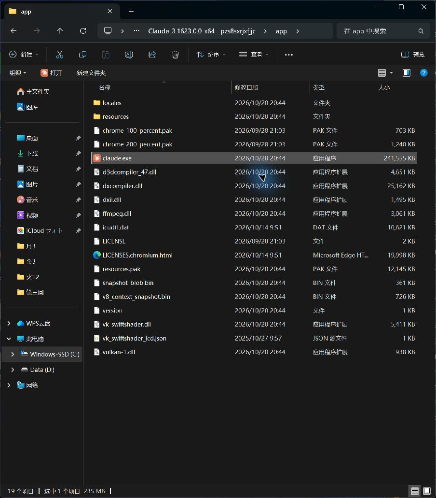
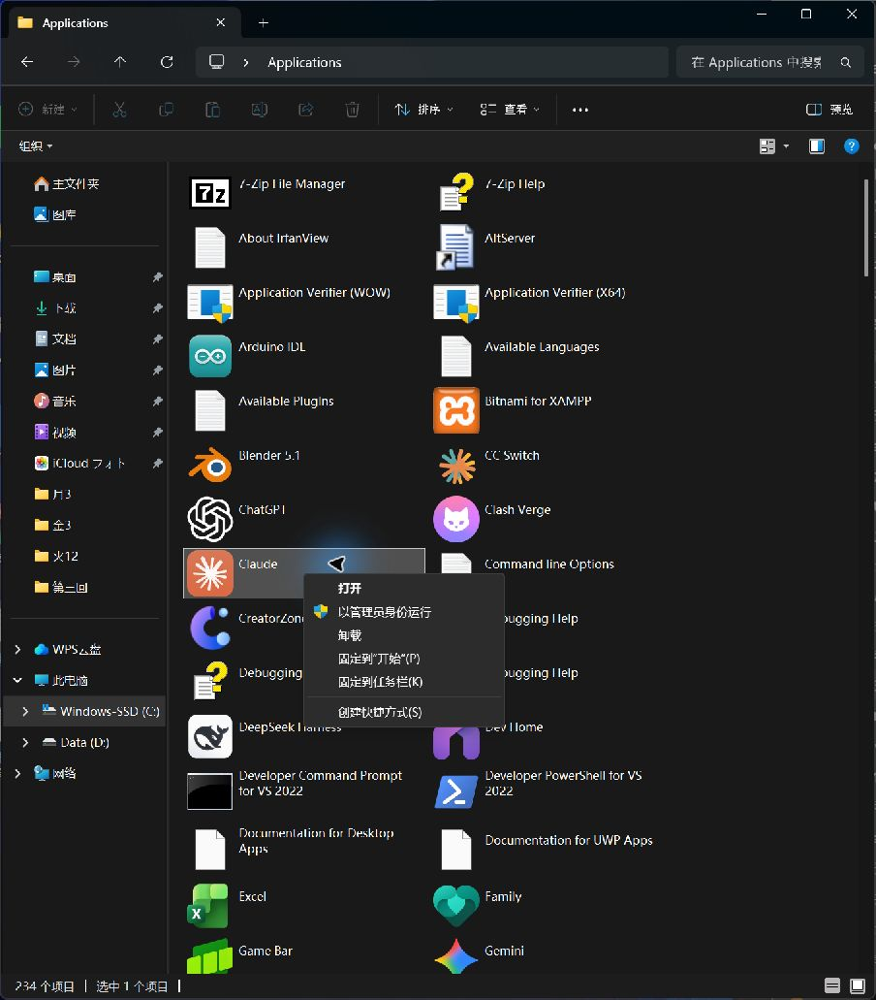

装完 Claude 桌面客户端，开始菜单能搜到，桌面却没有图标。想看它到底装在哪里，进了 Program Files，又只看见一个空的 ModifiableWindowsApps。等找到真正的 WindowsApps，Windows 还不让进。

我当时就是这样一路找过去的。这篇按实际顺序说：**软件为什么在这里、怎样打开目录权限、进去以后哪个才是主程序。**

> 以 Windows 11 和 Claude 桌面客户端为例。配图来自本机实际操作，版本路径会随更新变化。修改权限这部分需要管理员授权；如果只想创建桌面图标，可以直接看第 05 节。

## 01｜软件为什么装到了 WindowsApps

先分清两个文件：下载目录里的 **Claude Setup.exe 是安装程序**，安装完成后，客户端的主程序和配套文件放在另一个位置。桌面图标则是启动入口，没图标不等于没安装。

有些应用采用 **MSIX / AppX 应用包**安装，由 Windows 统一登记和管理，默认位置通常在：

```text
C:\Program Files\WindowsApps
```

这取决于安装方式，和你从官网还是商店下载并不是一回事。官网提供的安装程序，也可以把应用部署成这种包。[微软：应用包的安装位置](https://learn.microsoft.com/en-us/windows/msix/desktop/desktop-to-uwp-behind-the-scenes)

WindowsApps 是受保护的目录。**系统允许你通过登记好的入口启动应用，不代表允许你浏览或修改它的全部安装文件。** 开始菜单按应用入口查找，资源管理器按文件夹权限浏览，因此“搜得到、能运行，但打不开安装目录”可以同时发生。

## 02｜先找到正确的文件夹

打开文件资源管理器，按 **Ctrl + L**，在上方地址栏输入 `C:\Program Files`，回车。再点击 **查看 → 显示 → 隐藏的项目**，找到 **WindowsApps**。

这两个名字别认错：

| 文件夹 | 作用 |
| --- | --- |
| `WindowsApps` | 本文要找的应用包安装目录 |
| `ModifiableWindowsApps` | 给特定应用提供可修改内容的另一处目录，例如某些模组场景；为空不能说明 Claude 没装 |

后者有独立用途，[微软文档在这里](https://learn.microsoft.com/en-us/uwp/schemas/appxpackage/uapmanifestschema/element-desktop6-mutablepackagedirectory)。

如果窗口空白，先确认地址栏没进错位置、右上角搜索框没有残留关键词。**“隐藏”是列表里看不见，“拒绝访问”是权限不够，“空白”则要先核对位置和筛选条件。显示隐藏项目不会自动解除访问限制。**

如果要直接查 Claude 当前装在哪里，开始菜单搜索并打开 **Windows PowerShell**，输入：

```powershell
Get-AppxPackage -Name '*Claude*' |
    Select-Object Name, Version, InstallLocation |
    Format-List
```

看输出里的 **InstallLocation**，就是当前安装目录。这条命令只读取当前用户的应用包记录。没有结果时，可能是包名不同、当前用户没有登记，或应用采用了别的安装方式。[微软：查询安装目录](https://devblogs.microsoft.com/oldnewthing/20171120-00/?p=97425)

## 03｜提示“拒绝访问”，怎样取得读取权限

**这里按我当时的方式操作：临时取得目标文件夹所有权，给自己的账号添加读取权限，再恢复原所有者。范围只选“只有该文件夹”，不递归接管里面所有应用。** 修改前先截下原所有者和权限列表，保留原来的权限条目。

### 第一步：打开高级安全设置

1. 右键 `WindowsApps`，选择 **属性 → 安全 → 高级**。
2. 如果显示“你必须具有读取权限才能查看此对象属性”，仍点击 **“高级”**；出现管理员授权提示时，由你确认或输入管理员凭据。
3. 看顶部的 **“所有者”**，记下原来的名称，通常是 `TrustedInstaller`。如果已经能添加权限，可直接跳到第三步，不必再次更改所有者。

这里有两个不同概念：**所有者主要决定谁能管理权限；读取权限决定你能否列出、查看内容。** 所以只改所有者，还没完成让自己进去浏览的设置。[微软：所有权与访问控制](https://learn.microsoft.com/en-us/windows/security/identity-protection/access-control/access-control)

### 第二步：临时把所有者改为自己的账号

1. 点击顶部所有者旁边的 **“更改”**。
2. 在 **“输入要选择的对象名称”** 中填写当前 Windows 账号，点击 **“检查名称”**。
3. 识别成功后，名称会变成类似 `电脑名\用户名`，再点 **“确定”**。
4. **不要勾选“替换子容器和对象的所有者”**，点击 **“应用”**。

不知道自己的账号名称，可以在普通 PowerShell 输入 `whoami`，把输出的 `电脑名\用户名` 填进去。我当时的是 `G\guo`，你的电脑不一定一样，不要照抄 `guo`。如果“检查名称”找不到，点 **高级 → 立即查找**，从结果中选当前使用的账号。

这时可能弹出：

> 如果你刚获得此对象的所有权，在查看或更改权限之前，你需要关闭并重新打开此对象的属性。

**这是提示，不是失败。** 点击“确定”，关闭这组属性窗口，然后重新右键 `WindowsApps` → **属性 → 安全 → 高级**。

### 第三步：给自己的账号添加读取权限

1. 点击 **“添加” → “选择主体”**。
2. 输入刚才确认的账号 → **检查名称 → 确定**。
3. 在权限窗口里按下面设置：

| 项目 | 选择什么 |
| --- | --- |
| 主体 | 你当前使用的 Windows 账号 |
| 类型 | **允许** |
| 应用于 | 下拉菜单第一项 **“只有该文件夹”**，有些界面写“仅此文件夹” |
| 基本权限 | **读取和执行、列出文件夹内容、读取** |
| 写入、修改、完全控制 | **不勾选** |

**特别看清“应用于”：默认值可能是“此文件夹、子文件夹和文件”，要改成“只有该文件夹”。** 这决定修改是只作用于眼前这一层，还是会向下继承。

4. 点击权限窗口的 **“确定”**，回到“高级安全设置”。
5. 检查列表：自己的账号应显示 **“读取和执行”**，应用于 **“只有该文件夹”**。
6. 底部 **“使用可以从此对象继承的权限项目替换所有子对象的权限项目”保持不勾选**，点击 **应用 → 确定**。
7. 关闭属性窗口，重新打开 `WindowsApps`。能列出应用文件夹，就说明这一层的读取权限已经生效。

**到这里开放的是 WindowsApps 顶层的浏览权限，不是所有应用文件的统一通行证。** 如果某个具体应用子目录仍被拒绝访问，需要另外检查那个目录；确有查看需要时，只对那一个目录按同样方式处理，仍限定“只有该文件夹”，不要回到根目录给所有应用批量授权。

### 第四步：恢复原所有者

添加读取权限后，重新进入 **属性 → 安全 → 高级**，点击顶部所有者的 **“更改”**。

如果最初记录的所有者是 TrustedInstaller，输入：

```text
NT SERVICE\TrustedInstaller
```

点击 **检查名称 → 确定 → 应用**。**“替换子容器和对象的所有者”仍然不勾选。** 如果最初是其他所有者，就恢复为当时记录的对象，不要一律改成 TrustedInstaller。

这只是把管理身份交回原对象。你刚添加的读取权限是另一条规则，会保留，所以仍能浏览。以后不需要这项访问时，只删除自己本次添加的那条读取权限，原有条目保留。

### 操作中出现这两种弹窗，怎么处理

| 提示 | 处理方法 |
| --- | --- |
| “需要关闭并重新打开此对象的属性” | 点“确定”，关闭属性窗口，再重新打开，继续添加读取权限 |
| “无法枚举容器中的对象，访问被拒绝” | 停止反复点“继续”，先取消正在进行的权限操作；若提示停止传播可能导致不一致，点“确定”确认停止。回头检查修改对象、应用范围和递归替换选项 |

第二种报错表示操作在处理某些对象时没有权限，**单凭弹窗不能断定是哪一项设置引起的**。取消也不会撤销已经完成的修改。要按实际改动检查；如果之前选过递归替换，只恢复顶层所有者并不能还原所有子目录。

## 04｜进去了，哪个文件才是 Claude 本体

在 `WindowsApps` 里找到以 **`Claude_`** 开头、与当前安装记录一致的文件夹，打开其中的 **`app`**。本机写这篇时的路径是：

```text
C:\Program Files\WindowsApps\Claude_3.1623.0.0_x64__pzs8sxrjxfjjc\app
```

`3.1623.0.0` 是包版本，更新后会变，完整路径要以自己的查询结果为准。



*已选中的 `claude.exe` 就是客户端主程序。*

旁边的 `resources`、`locales` 和各种 `.dll`、`.pak`、`.bin` 是应用代码、语言、功能库及资源。**整个文件夹共同组成客户端，exe 只是启动入口**，不能单独剪切到桌面当成搬家。

WindowsApps 根目录里其他陌生名字，可能是系统应用或公共运行依赖。要卸载软件，从 **设置 → 应用 → 安装的应用** 操作，不根据文件夹名字直接删除。

## 05｜想放到桌面，创建快捷方式就行

1. 打开资源管理器，按 **Ctrl + L**，在上方地址栏输入下面这一行，回车。不要填进右上角搜索框。

```text
shell:AppsFolder
```

2. 在打开的 **Applications / 应用程序** 列表中找到 Claude，右键 → **创建快捷方式**。
3. 如果提示是否将快捷方式放到桌面，选 **“是”**，再去桌面双击验证。



*菜单最下面是“创建快捷方式”。这个列表显示应用入口，不是程序实际存储的目录。[微软社区操作参考](https://learn.microsoft.com/en-us/answers/a/12996435)*

这样既知道软件实际存在哪里，也有方便使用的桌面入口。查位置、浏览文件、日常启动，各自对应上面的一步就够了。